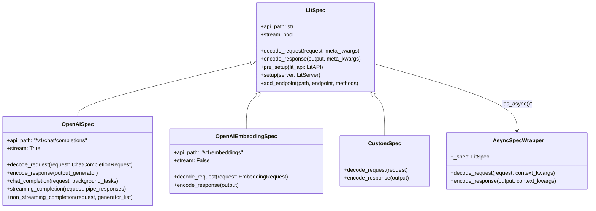
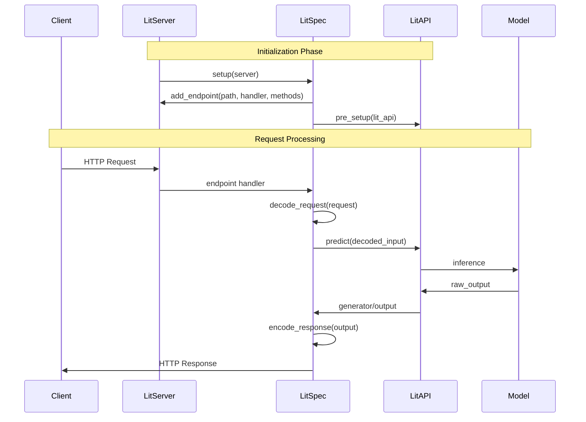
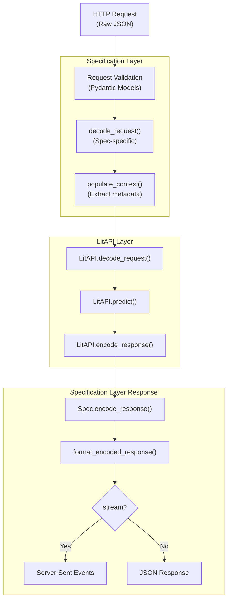
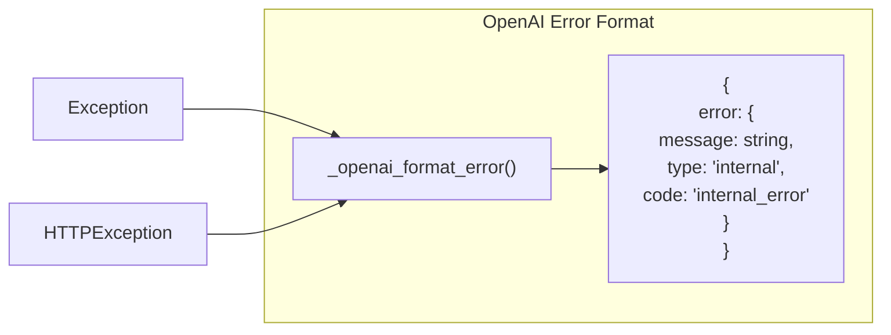

<!-- source: DeepWiki mcp.deepwiki.com · repo Lightning-AI/LitServe · page 3 API Specifications · fetched 2026-10-21 -->

# API Specifications

<details>
<summary>Relevant source files</summary>

The following files were used as context for generating this wiki page:

- [src/litserve/api.py](src/litserve/api.py)
- [src/litserve/specs/base.py](src/litserve/specs/base.py)
- [src/litserve/specs/openai.py](src/litserve/specs/openai.py)

</details>


API Specifications in LitServe provide standardized interfaces for common AI model serving protocols. They define request/response formats, validation rules, and endpoint behavior to ensure compatibility with existing AI frameworks and tools. Specifications handle the transformation between HTTP requests and model inputs/outputs, enabling seamless integration with clients like the OpenAI SDK.

For implementation details of specific APIs, see [OpenAI Chat Completions API](#3.1) and [OpenAI Embeddings API](#3.2). For creating your own specifications, see [Custom Specifications](#3.3). For the core LitAPI abstraction that uses these specifications, see [LitAPI](#2.1).

## Specification Architecture

API Specifications extend the base `LitSpec` class and integrate with `LitAPI` to provide protocol-specific behavior. The specification system operates as a layer between HTTP endpoints and model inference, handling request decoding, response encoding, and endpoint registration.

### Class Hierarchy



Sources: [src/litserve/specs/base.py:21-85](), [src/litserve/specs/openai.py:352-616]()

### Integration with LitAPI



Sources: [src/litserve/specs/base.py:40-44](), [src/litserve/specs/openai.py:363-377](), [src/litserve/api.py:329-340]()

## Base Specification Class

The `LitSpec` class defines the core interface that all specifications must implement. It provides abstract methods for request/response transformation and concrete methods for endpoint management and server integration.

### Core Methods

| Method | Purpose | Required |
|--------|---------|----------|
| `decode_request()` | Convert HTTP request to model input format | Yes |
| `encode_response()` | Convert model output to HTTP response format | Yes |
| `pre_setup()` | Validate and configure LitAPI before server startup | No |
| `setup()` | Connect specification to server resources | No |
| `add_endpoint()` | Register HTTP endpoints with the server | No |

### Async Support

Specifications support async operations through the `_AsyncSpecWrapper` class, which automatically wraps synchronous specifications for use with async LitAPI implementations.

```mermaid
graph TB
    subgraph "Sync Specification"
        LitSpec_sync["LitSpec"]
        decode_sync["decode_request()"]
        encode_sync["encode_response()"]
    end
    
    subgraph "Async Wrapper"
        AsyncWrapper["_AsyncSpecWrapper"]
        decode_async["async decode_request()"]
        encode_async["async encode_response()"]
    end
    
    subgraph "LitAPI Integration"
        LitAPI_class["LitAPI"]
        enable_async["enable_async: bool"]
    end
    
    LitSpec_sync --> AsyncWrapper : "as_async()"
    decode_sync --> decode_async : "delegates to"
    encode_sync --> encode_async : "delegates to"
    AsyncWrapper --> LitAPI_class
    enable_async --> AsyncWrapper : "when True"
```

Sources: [src/litserve/specs/base.py:68-85](), [src/litserve/specs/openai.py:422-423](), [src/litserve/specs/openai.py:612-616]()

## Built-in Specifications

LitServe includes several built-in specifications that provide compatibility with popular AI service APIs.

### OpenAI Chat Completions

The `OpenAISpec` class implements the OpenAI Chat Completions API format, supporting both streaming and non-streaming responses, tool calls, and multi-choice generation.

**Key Features:**
- Endpoint: `/v1/chat/completions`
- Request format: `ChatCompletionRequest`
- Response format: `ChatCompletionResponse` or `ChatCompletionChunk`
- Streaming support with Server-Sent Events
- Tool calling and function execution
- Multiple response choices (`n` parameter)

**Request/Response Models:**

| Model | Purpose | Key Fields |
|-------|---------|------------|
| `ChatCompletionRequest` | Incoming chat request | `messages`, `model`, `stream`, `tools` |
| `ChatMessage` | Individual message | `role`, `content`, `tool_calls` |
| `ChatCompletionResponse` | Non-streaming response | `choices`, `usage`, `model` |
| `ChatCompletionChunk` | Streaming response chunk | `choices`, `delta`, `finish_reason` |

### OpenAI Embeddings

The `OpenAIEmbeddingSpec` class provides vector embedding generation compatible with OpenAI's embeddings API format.

**Key Features:**
- Endpoint: `/v1/embeddings`
- Batch processing support
- Multiple encoding formats
- Usage tracking

Sources: [src/litserve/specs/openai.py:40-616]()

## Request Processing Pipeline

The specification system processes requests through a multi-stage pipeline that transforms HTTP requests into model inputs and converts model outputs back to HTTP responses.

### Data Flow



Sources: [src/litserve/specs/openai.py:425-433](), [src/litserve/specs/openai.py:477-482](), [src/litserve/api.py:248-304]()

### Error Handling

Specifications implement protocol-specific error formatting to maintain compatibility with client SDKs. The OpenAI specification formats errors according to OpenAI's error response structure.



Sources: [src/litserve/specs/openai.py:332-349](), [src/litserve/specs/openai.py:567-570]()

## Validation and Compatibility

Specifications enforce compatibility requirements on LitAPI implementations through validation during the `pre_setup()` phase.

### OpenAI Specification Validation

The `OpenAISpec` validates that LitAPI methods use generators for streaming compatibility:

**Sync Mode Requirements:**
- `predict()` must be a generator function
- `encode_response()` must be a generator function (if overridden)
- No async methods allowed unless `enable_async=True`

**Async Mode Requirements:**
- `predict()` must be an async generator function
- `encode_response()` can be regular function or async generator
- `decode_request()` can be regular function or async function

Sources: [src/litserve/specs/openai.py:380-416](), [src/litserve/specs/openai.py:217-329]()

---

