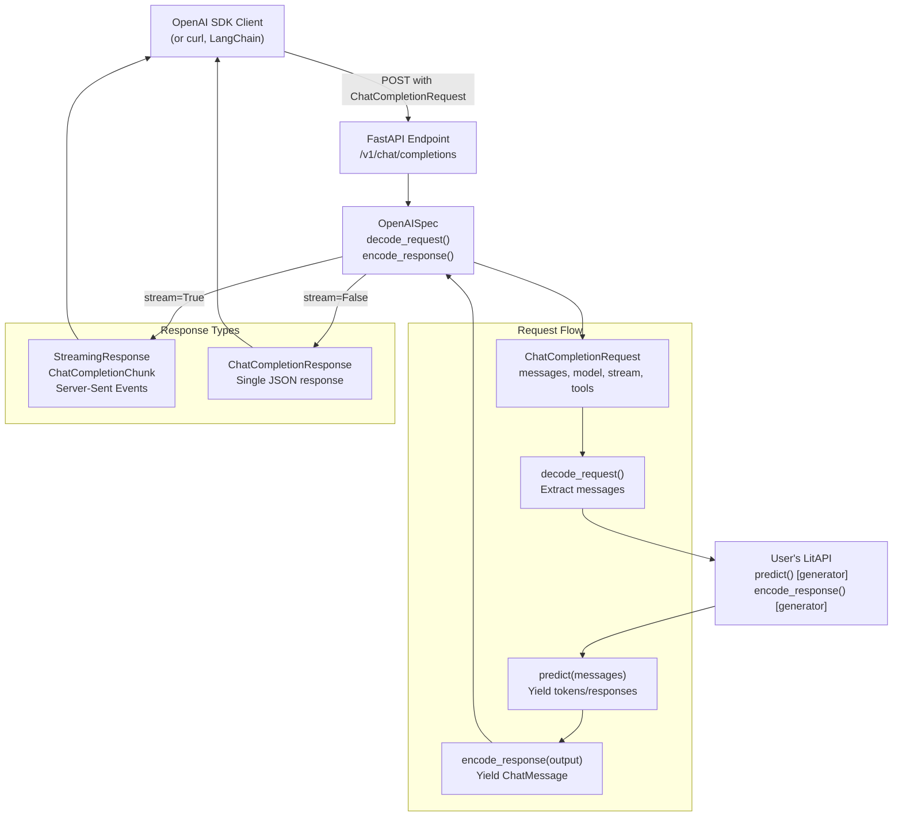
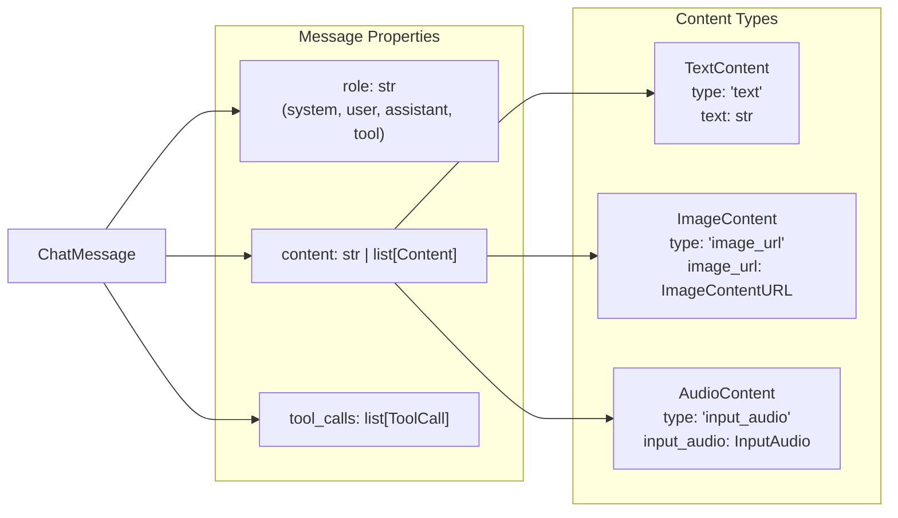
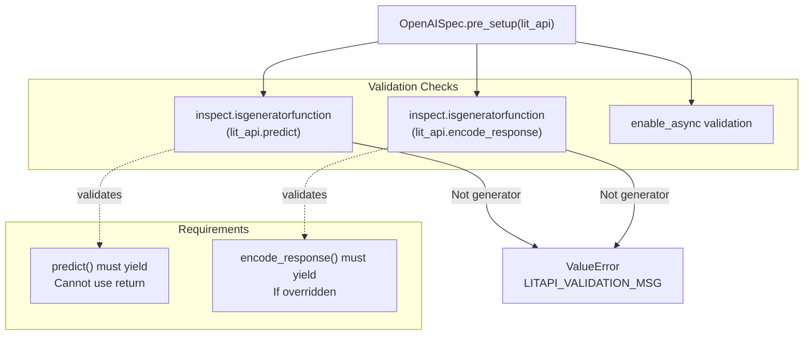
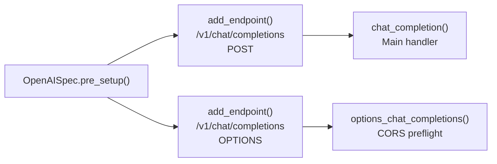
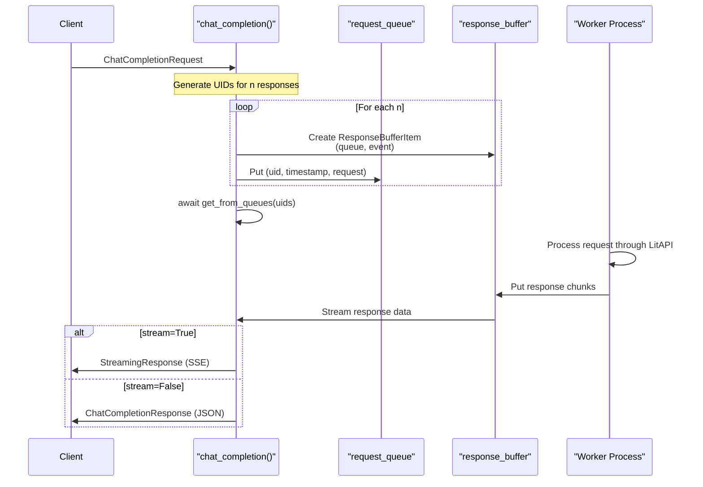
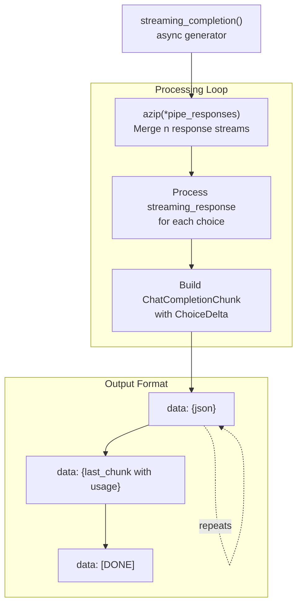
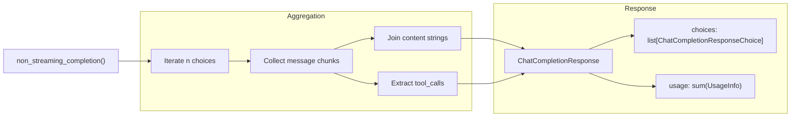
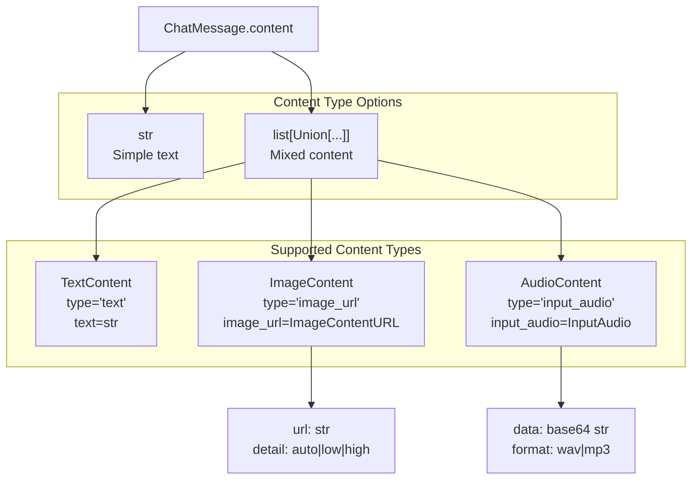
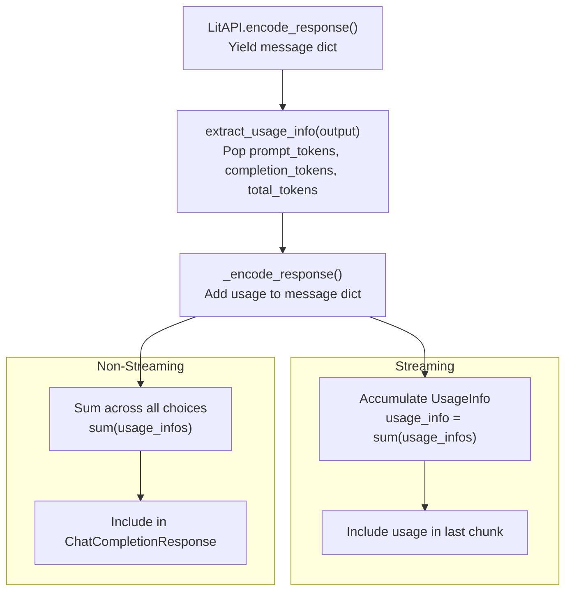
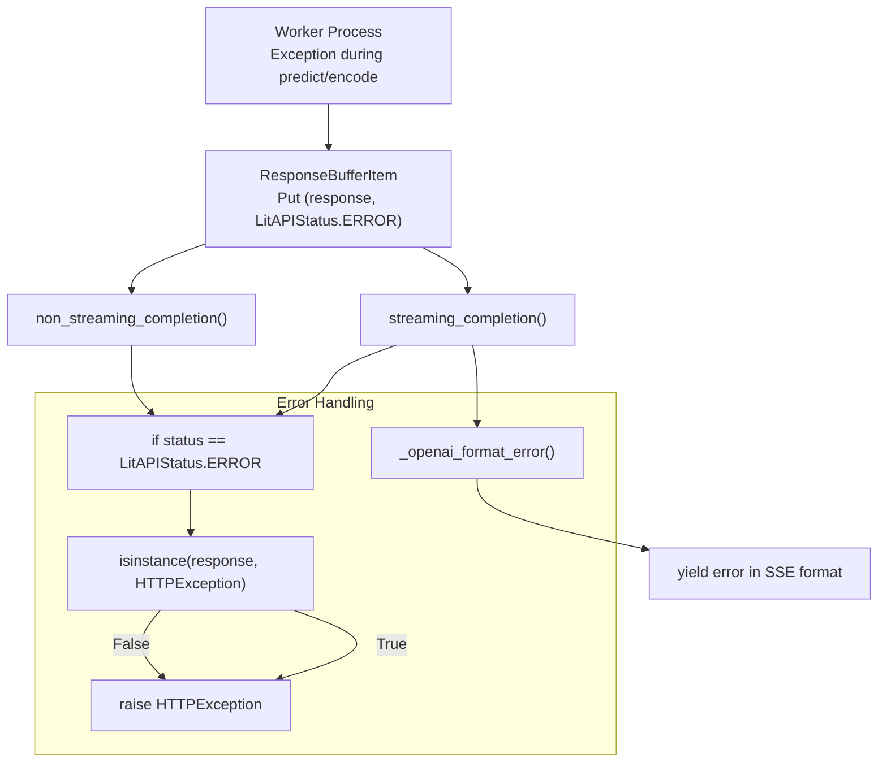

<!-- source: DeepWiki mcp.deepwiki.com · repo Lightning-AI/LitServe · page 3.1 OpenAI Chat Completions API · fetched 2026-10-21 -->

# OpenAI Chat Completions API

<details>
<summary>Relevant source files</summary>

The following files were used as context for generating this wiki page:

- [src/litserve/api.py](src/litserve/api.py)
- [src/litserve/specs/base.py](src/litserve/specs/base.py)
- [src/litserve/specs/openai.py](src/litserve/specs/openai.py)

</details>


This document describes the `OpenAISpec` implementation, which provides OpenAI-compatible chat completion endpoints for LitServe. It enables LitServe models to be accessed using the OpenAI Python SDK, LangChain, LlamaIndex, and other tools that support the OpenAI API format.

For information about the OpenAI embeddings endpoint, see [OpenAI Embeddings API](#3.2). For creating custom specifications, see [Custom Specifications](#3.3). For the base LitSpec abstraction, see [API Specifications](#3).

## Overview

The `OpenAISpec` class extends `LitSpec` to implement the `/v1/chat/completions` endpoint following OpenAI's API specification. It handles request decoding, response encoding, streaming, tool calls, multimodal inputs, and usage tracking automatically.

**Key Features:**
- OpenAI-compatible `/v1/chat/completions` endpoint
- Streaming and non-streaming responses
- Function/tool calling support
- JSON mode with schema validation
- Multimodal inputs (text, images, audio)
- Automatic usage token tracking
- Async and sync mode support

**Initialization:**

```python
from litserve.specs.openai import OpenAISpec

spec = OpenAISpec()
api = MyLitAPI(spec=spec)
```

Sources: [src/litserve/specs/openai.py:358-368]()

## Architecture



Sources: [src/litserve/specs/openai.py:358-630]()

## Request and Response Models

The OpenAI specification uses Pydantic models to define the structure of requests and responses. These models ensure type safety and automatic validation.

### Core Request Model

The `ChatCompletionRequest` model defines the input format:

| Field | Type | Description | Default |
|-------|------|-------------|---------|
| `model` | `str` | Model identifier | `""` |
| `messages` | `list[ChatMessage]` | Conversation history | Required |
| `temperature` | `float` | Sampling temperature | `0.7` |
| `max_completion_tokens` | `int` | Maximum tokens to generate | `None` |
| `stream` | `bool` | Enable streaming | `False` |
| `tools` | `list[Tool]` | Available functions | `None` |
| `tool_choice` | `ToolChoice` | Tool selection mode | `auto` |
| `response_format` | `ResponseFormat` | Output format constraints | `None` |

Sources: [src/litserve/specs/openai.py:167-184]()

### Message Structure



Sources: [src/litserve/specs/openai.py:148-154](), [src/litserve/specs/openai.py:63-92]()

### Response Models

**Non-Streaming Response:**
- `ChatCompletionResponse`: Single response with full message
  - `id`: Unique completion ID
  - `choices`: List of `ChatCompletionResponseChoice`
  - `usage`: Token usage information

**Streaming Response:**
- `ChatCompletionChunk`: Incremental response chunks
  - `choices`: List of `ChatCompletionStreamingChoice` with `delta` field
  - Server-sent events format with `data: {json}\n\n`

Sources: [src/litserve/specs/openai.py:193-217]()

## LitAPI Integration Requirements

### Method Requirements

The `OpenAISpec` enforces strict requirements on LitAPI method implementations. All methods must use generators (yield statements) to support streaming.



**Synchronous Mode Example:**

```python
class ExampleAPI(ls.LitAPI):
    def setup(self, device):
        self.model = load_model()
    
    def predict(self, x):
        # Must use yield, not return
        yield "Generated response"
    
    def encode_response(self, output):
        # Must yield ChatMessage
        yield ChatMessage(role="assistant", content=output)
```

Sources: [src/litserve/specs/openai.py:369-423](), [src/litserve/specs/openai.py:219-269]()

### Async Mode Requirements

When `enable_async=True`, different validation rules apply:

| Method | Requirement | Validation |
|--------|-------------|------------|
| `decode_request` | Can be sync or async | Warning if not async |
| `predict` | Must be async generator | Error if not |
| `encode_response` | Can be sync generator or async generator | Warning if not async |

The spec will automatically wrap non-async methods using the `_AsyncOpenAISpecWrapper`:

Sources: [src/litserve/specs/openai.py:389-422](), [src/litserve/specs/openai.py:626-630]()

## Chat Completion Endpoint

### Endpoint Registration

The spec registers two endpoints during `pre_setup`:



Sources: [src/litserve/specs/openai.py:383-384]()

### Request Processing Flow



Sources: [src/litserve/specs/openai.py:500-534]()

### Context Population

The spec populates the request context with all request parameters except `messages`:

```python
def populate_context(self, context, request):
    data = request.dict()
    data.pop("messages")  # Passed as main input
    context.update(data)   # temperature, tools, etc.
```

This allows LitAPI methods to access request metadata via `**kwargs`.

Sources: [src/litserve/specs/openai.py:431-434]()

## Streaming Support

### Streaming Response Generation



**Streaming Response Structure:**

Each chunk follows the Server-Sent Events (SSE) format:

```
data: {"id":"chatcmpl-abc123","object":"chat.completion.chunk",...}\n\n
data: {"id":"chatcmpl-abc123","choices":[{"delta":{"content":"Hello"},...}],...}\n\n
data: {"id":"chatcmpl-abc123","choices":[{"delta":{"content":" world"},...}],...}\n\n
data: {"id":"chatcmpl-abc123","choices":[{"delta":{},"finish_reason":"stop"}],"usage":{...}}\n\n
data: [DONE]\n\n
```

Sources: [src/litserve/specs/openai.py:536-584]()

### Non-Streaming Response Aggregation

For non-streaming requests (`stream=False`), the spec aggregates all chunks into a single response:



Sources: [src/litserve/specs/openai.py:586-623]()

## Advanced Features

### Tool and Function Calls

The spec supports OpenAI's function calling via the `tools` parameter:

**Request with Tools:**

```json
{
  "model": "gpt-4",
  "messages": [...],
  "tools": [
    {
      "type": "function",
      "function": {
        "name": "get_weather",
        "description": "Get weather for a location",
        "parameters": {...}
      }
    }
  ],
  "tool_choice": "auto"
}
```

**Response with Tool Calls:**

The LitAPI's `encode_response` should yield messages with `tool_calls`:

```python
def encode_response(self, output):
    yield ChatMessage(
        role="assistant",
        content=None,
        tool_calls=[
            ToolCall(
                id="call_abc123",
                type="function",
                function=FunctionCall(
                    name="get_weather",
                    arguments='{"location": "San Francisco"}'
                )
            )
        ]
    )
```

Sources: [src/litserve/specs/openai.py:94-121](), [src/litserve/specs/openai.py:610-611]()

### Response Format and JSON Mode

Three response format options are supported:

| Format | Class | Description |
|--------|-------|-------------|
| Text | `ResponseFormatText` | Standard text output (default) |
| JSON Object | `ResponseFormatJSONObject` | Ensures valid JSON |
| JSON Schema | `ResponseFormatJSONSchema` | Validates against schema |

**Example:**

```json
{
  "messages": [...],
  "response_format": {
    "type": "json_schema",
    "json_schema": {
      "name": "math_response",
      "schema": {
        "type": "object",
        "properties": {
          "answer": {"type": "number"}
        }
      }
    }
  }
}
```

Sources: [src/litserve/specs/openai.py:123-145]()

### Multimodal Content Support

The spec supports multiple content types within messages:



**Example with Image:**

```json
{
  "messages": [
    {
      "role": "user",
      "content": [
        {"type": "text", "text": "What's in this image?"},
        {
          "type": "image_url",
          "image_url": {
            "url": "data:image/jpeg;base64,...",
            "detail": "high"
          }
        }
      ]
    }
  ]
}
```

Sources: [src/litserve/specs/openai.py:63-92](), [src/litserve/specs/openai.py:148-154]()

## Usage Tracking

The spec automatically tracks and aggregates token usage information.

### Usage Information Model

```python
class UsageInfo(BaseModel):
    prompt_tokens: int = 0
    total_tokens: int = 0
    completion_tokens: Optional[int] = 0
```

The `UsageInfo` class implements `__add__` for aggregation across multiple responses.

Sources: [src/litserve/specs/openai.py:46-60]()

### Usage Extraction and Aggregation



**In LitAPI Implementation:**

```python
def encode_response(self, output):
    yield {
        "role": "assistant",
        "content": output,
        "prompt_tokens": 10,
        "completion_tokens": 20,
        "total_tokens": 30
    }
```

Sources: [src/litserve/specs/openai.py:447-481](), [src/litserve/specs/openai.py:560-562](), [src/litserve/specs/openai.py:608-618]()

## Error Handling

### Error Formatting

The spec formats errors in OpenAI's error structure:

```python
def _openai_format_error(error: Exception):
    return "data: " + json.dumps({
        "error": {
            "message": error.detail if HTTPException else "Internal server error",
            "type": "internal",
            "param": None,
            "code": "internal_error"
        }
    })
```

### Error Propagation



Sources: [src/litserve/specs/openai.py:334-356](), [src/litserve/specs/openai.py:545-550](), [src/litserve/specs/openai.py:597-601]()

## Complete Usage Example

### Basic Chat API

```python
import litserve as ls
from litserve.specs.openai import OpenAISpec, ChatMessage

class SimpleChatAPI(ls.LitAPI):
    def setup(self, device):
        self.model = load_model(device)
    
    def decode_request(self, request):
        # request is ChatCompletionRequest
        return request.messages
    
    def predict(self, messages):
        # Must yield for OpenAISpec
        response = self.model.generate(messages)
        yield response
    
    def encode_response(self, output):
        # Must yield ChatMessage
        for chunk in output:
            yield ChatMessage(
                role="assistant",
                content=chunk,
                prompt_tokens=10,
                completion_tokens=5,
                total_tokens=15
            )

server = ls.LitServer(
    SimpleChatAPI(spec=OpenAISpec()),
    accelerator="cuda",
    devices=1
)
```

### Client Usage

```python
from openai import OpenAI

client = OpenAI(
    base_url="http://localhost:8000/v1",
    api_key="dummy"  # Not validated by default
)

# Non-streaming
response = client.chat.completions.create(
    model="gpt-3.5-turbo",
    messages=[
        {"role": "user", "content": "Hello!"}
    ]
)

# Streaming
stream = client.chat.completions.create(
    model="gpt-3.5-turbo",
    messages=[
        {"role": "user", "content": "Hello!"}
    ],
    stream=True
)

for chunk in stream:
    print(chunk.choices[0].delta.content, end="")
```

Sources: [src/litserve/specs/openai.py:358-630](), [src/litserve/api.py:106-117]()

---

