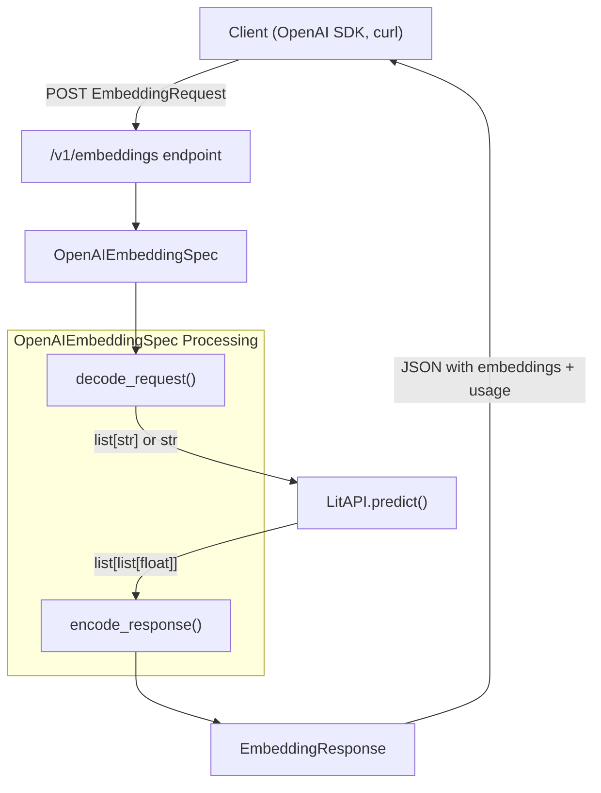
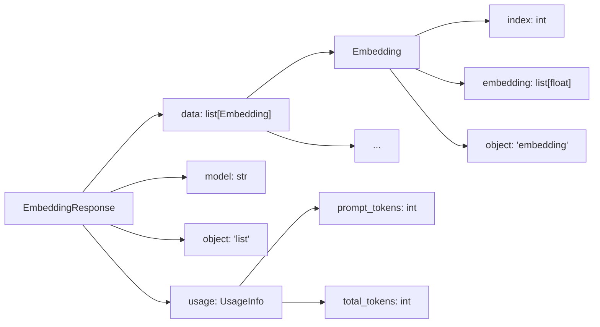
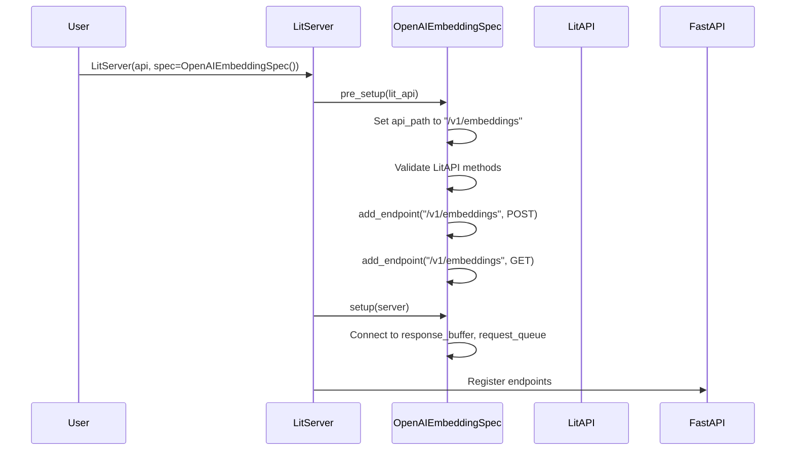
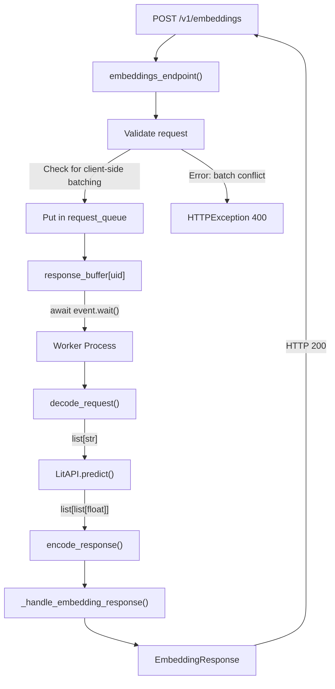
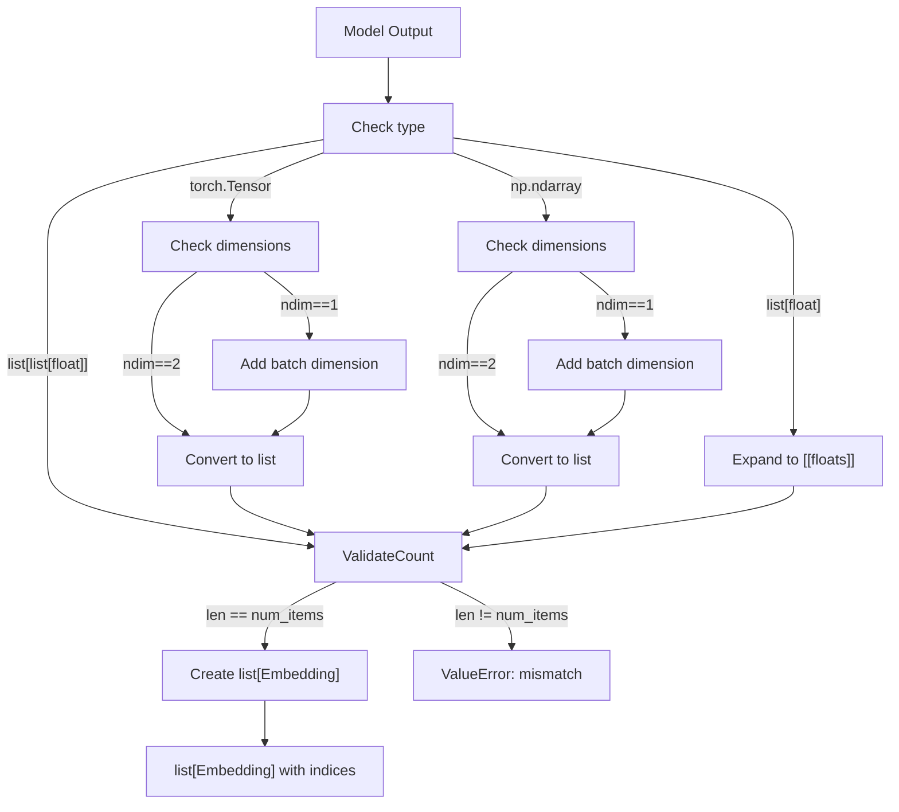
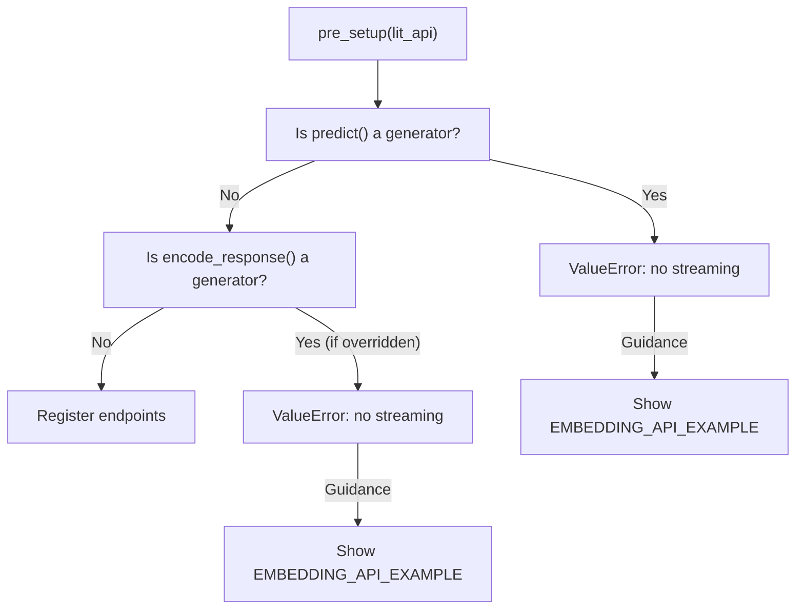
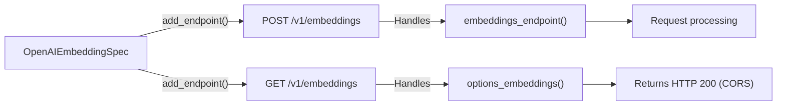
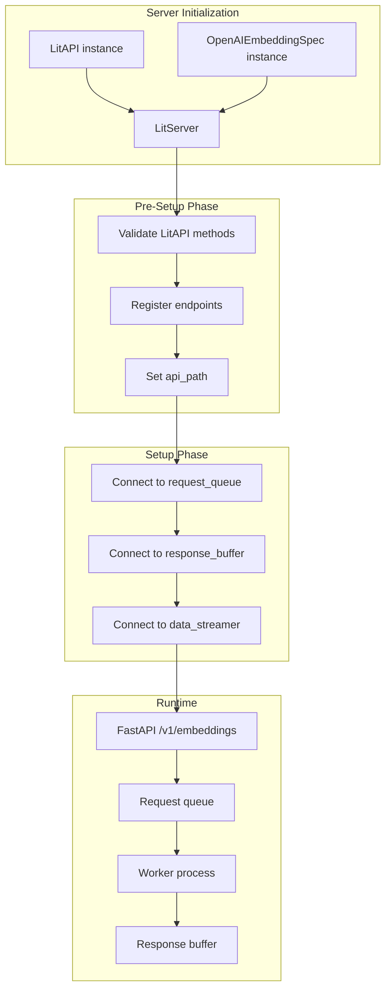

<!-- source: DeepWiki mcp.deepwiki.com · repo Lightning-AI/LitServe · page 3.2 OpenAI Embeddings API · fetched 2026-10-21 -->

# OpenAI Embeddings API

<details>
<summary>Relevant source files</summary>

The following files were used as context for generating this wiki page:

- [src/litserve/api.py](src/litserve/api.py)
- [src/litserve/specs/base.py](src/litserve/specs/base.py)
- [src/litserve/specs/openai_embedding.py](src/litserve/specs/openai_embedding.py)
- [tests/unit/test_litapi.py](tests/unit/test_litapi.py)
- [tests/unit/test_openai_embedding.py](tests/unit/test_openai_embedding.py)
- [tests/unit/test_specs.py](tests/unit/test_specs.py)

</details>


This page documents the `OpenAIEmbeddingSpec` class, which implements an OpenAI-compatible embeddings API endpoint at `/v1/embeddings`. This specification allows LitServe to serve embedding models using the OpenAI API format, enabling drop-in compatibility with OpenAI SDKs and clients.

For information about OpenAI chat completions, see [OpenAI Chat Completions API](#3.1). For creating custom specifications, see [Custom Specifications](#3.3).

## Overview

The `OpenAIEmbeddingSpec` class extends `LitSpec` to provide a standardized interface for serving text embedding models. It handles request parsing, response formatting, validation, and endpoint registration automatically.

**Key Features:**
- OpenAI-compatible `/v1/embeddings` endpoint
- Support for single and multiple input texts
- Automatic dimension validation
- Usage tracking (prompt tokens, total tokens)
- Server-side batching support
- Validation to prevent incompatible streaming operations



**Sources:** [src/litserve/specs/openai_embedding.py:127-297]()

## Request and Response Models

### EmbeddingRequest

The `EmbeddingRequest` model defines the structure of incoming embedding requests:

| Field | Type | Required | Description |
|-------|------|----------|-------------|
| `input` | `Union[str, list[str], list[int], list[list[int]]]` | Yes | Text(s) to embed. Can be a single string or array of strings/tokens |
| `model` | `str` | Yes | Model identifier |
| `dimensions` | `int` | No | Desired embedding dimensions (if model supports it) |
| `encoding_format` | `Literal["float", "base64"]` | No | Format for embeddings. Default: `"float"` |
| `user` | `str` | No | User identifier for tracking |

The `EmbeddingRequest` class provides utility methods:
- `get_num_items()`: Returns the number of input items to process
- `ensure_list()`: Normalizes input to a list format

**Sources:** [src/litserve/specs/openai_embedding.py:41-58]()

### EmbeddingResponse

The response structure follows the OpenAI format:



**Sources:** [src/litserve/specs/openai_embedding.py:60-76]()

### Embedding

Each embedding in the response contains:

| Field | Type | Description |
|-------|------|-------------|
| `index` | `int` | Position in the input array |
| `embedding` | `list[float]` | The embedding vector |
| `object` | `Literal["embedding"]` | Always set to `"embedding"` |

**Sources:** [src/litserve/specs/openai_embedding.py:60-64]()

### UsageInfo

Tracks token usage for billing/monitoring:

| Field | Type | Description |
|-------|------|-------------|
| `prompt_tokens` | `int` | Number of tokens in the input |
| `total_tokens` | `int` | Total tokens processed |

**Sources:** [src/litserve/specs/openai_embedding.py:66-69]()

## Implementation Architecture

### Initialization and Setup

The `OpenAIEmbeddingSpec` class initializes with a default API path:



**Sources:** [src/litserve/specs/openai_embedding.py:128-172]()

### Request Flow



**Sources:** [src/litserve/specs/openai_embedding.py:248-293]()

### decode_request Method

The `decode_request` method extracts the input field from the request:

```python
def decode_request(self, request: EmbeddingRequest, context_kwargs: Optional[dict] = None) -> list[str]:
    return request.input
```

This returns the raw input, which can be:
- A single string
- A list of strings
- Token IDs (list of integers)
- Multiple token sequences (list of lists)

**Sources:** [src/litserve/specs/openai_embedding.py:173-174]()

### encode_response Method

The `encode_response` method packages the model output with usage information:

```python
def encode_response(
    self, output: list[list[float]], context_kwargs: Optional[dict] = None
) -> Union[dict, EmbeddingResponse]:
    usage = {
        "prompt_tokens": context_kwargs.get("prompt_tokens", 0) if context_kwargs else 0,
        "total_tokens": context_kwargs.get("total_tokens", 0) if context_kwargs else 0,
    }
    return {"embeddings": output} | usage
```

The method expects:
- **Input**: `list[list[float]]` - embeddings from model
- **Output**: Dictionary with `"embeddings"` key and optional usage fields

**Sources:** [src/litserve/specs/openai_embedding.py:176-183]()

### Response Handling

The `_handle_embedding_response` method normalizes embeddings to the expected format:



**Key transformations:**
1. Expands single vectors (1D) to batched format (2D)
2. Converts PyTorch tensors and NumPy arrays to lists
3. Validates count matches requested items
4. Wraps each vector in an `Embedding` object with index

**Sources:** [src/litserve/specs/openai_embedding.py:206-246]()

## Validation

### Method Validation

The `pre_setup` method validates that the `LitAPI` implementation is compatible:



**Validation Rules:**
1. `predict()` must NOT be a generator (no `yield`)
2. Custom `encode_response()` must NOT be a generator
3. Embeddings are not sequential operations, so streaming is prohibited

**Sources:** [src/litserve/specs/openai_embedding.py:132-167]()

### Response Validation

The `_validate_response` method ensures the encoded response has the correct structure:

```python
def _validate_response(self, response: Union[dict, list[Embedding], Any]) -> None:
    if isinstance(response, list) and all(isinstance(item, Embedding) for item in response):
        return
    if not isinstance(response, (dict, EmbeddingResponse)):
        raise ValueError(f"Expected response to be a dictionary, but got type {type(response)}.")
    if "embeddings" not in response:
        raise ValueError("The response does not contain the key 'embeddings'.")
```

**Requirements:**
- Response must be a dictionary or list of `Embedding` objects
- Dictionary must contain `"embeddings"` key
- Optional `"prompt_tokens"` and `"total_tokens"` keys for usage tracking

**Sources:** [src/litserve/specs/openai_embedding.py:185-204]()

### Batching Constraints

Client-side batching (multiple inputs in one request) is incompatible with server-side batching:

```python
if num_items > 1 and self._max_batch_size > 1:
    raise HTTPException(
        status_code=400,
        detail=(
            "The OpenAIEmbedding spec does not support dynamic batching when client-side batching is used. "
            "To resolve this, either set `max_batch_size=1` or send a single input from the client."
        ),
    )
```

**Reason:** LitServe's batching expects one output per request, but client-side batching produces multiple outputs per request, creating a conflict.

**Sources:** [src/litserve/specs/openai_embedding.py:251-258]()

## Usage Patterns

### Basic Single Input

```python
import numpy as np
from litserve.specs import OpenAIEmbeddingSpec
import litserve as ls

class EmbedAPI(ls.LitAPI):
    def setup(self, device):
        self.model = load_embedding_model()
    
    def predict(self, inputs):
        # inputs is a single string
        embedding = self.model.embed(inputs)
        return np.array(embedding).tolist()

server = ls.LitServer(EmbedAPI(spec=OpenAIEmbeddingSpec()))
server.run()
```

**Request:**
```json
{
  "input": "Hello world",
  "model": "text-embedding-ada-002"
}
```

**Response:**
```json
{
  "object": "list",
  "data": [
    {
      "object": "embedding",
      "index": 0,
      "embedding": [0.1, 0.2, ..., 0.768]
    }
  ],
  "model": "text-embedding-ada-002",
  "usage": {
    "prompt_tokens": 0,
    "total_tokens": 0
  }
}
```

**Sources:** [src/litserve/specs/openai_embedding.py:78-100](), [tests/unit/test_openai_embedding.py:38-53]()

### Client-Side Batching (Multiple Inputs)

```python
class EmbedAPI(ls.LitAPI):
    def setup(self, device):
        self.model = load_embedding_model()
    
    def predict(self, inputs):
        # inputs is a list of strings
        embeddings = self.model.embed_batch(inputs)
        return embeddings  # list[list[float]]
```

**Request:**
```json
{
  "input": ["Text 1", "Text 2", "Text 3", "Text 4"],
  "model": "text-embedding-ada-002"
}
```

**Response:**
```json
{
  "object": "list",
  "data": [
    {"object": "embedding", "index": 0, "embedding": [...]},
    {"object": "embedding", "index": 1, "embedding": [...]},
    {"object": "embedding", "index": 2, "embedding": [...]},
    {"object": "embedding", "index": 3, "embedding": [...]}
  ],
  "model": "text-embedding-ada-002",
  "usage": {"prompt_tokens": 0, "total_tokens": 0}
}
```

**Sources:** [tests/unit/test_openai_embedding.py:83-99]()

### Server-Side Batching

```python
class BatchedEmbedAPI(ls.LitAPI):
    def setup(self, device):
        self.model = load_embedding_model().to(device)
    
    def predict(self, batch):
        # batch is a list of strings from multiple requests
        embeddings = self.model.embed_batch(batch)
        return embeddings.tolist()  # Returns list[list[float]]

# Enable server-side batching
api = BatchedEmbedAPI(max_batch_size=10, batch_timeout=0.1)
server = ls.LitServer(api, spec=OpenAIEmbeddingSpec())
```

**Important:** Each request must contain a single input when using server-side batching. LitServe will batch multiple requests together.

**Sources:** [src/litserve/specs/openai_embedding.py:102-124](), [tests/unit/test_openai_embedding.py:157-192]()

### With Usage Tracking

```python
class EmbedAPIWithUsage(ls.LitAPI):
    def setup(self, device):
        self.model = load_embedding_model()
        self.tokenizer = load_tokenizer()
    
    def encode_response(self, output, context_kwargs=None):
        # Count tokens from the original input
        if context_kwargs and "input_text" in context_kwargs:
            tokens = len(self.tokenizer.encode(context_kwargs["input_text"]))
        else:
            tokens = 0
        
        return {
            "embeddings": output,
            "prompt_tokens": tokens,
            "total_tokens": tokens
        }
```

The `encode_response` method can return usage information which will be included in the response.

**Sources:** [tests/unit/test_openai_embedding.py:102-119]()

### Custom API Path

```python
api = EmbedAPI(
    spec=OpenAIEmbeddingSpec(),
    api_path="/v2/embeddings"  # Custom path
)
server = ls.LitServer(api)
```

**Warning:** Custom API paths are supported but incompatible with the OpenAI SDK, which expects `/v1/embeddings`. A warning will be issued.

**Sources:** [src/litserve/specs/openai_embedding.py:136-143](), [tests/unit/test_openai_embedding.py:57-74]()

## Endpoint Registration

The spec registers two endpoints during `pre_setup`:



**Endpoints:**
1. `POST /v1/embeddings` - Main embedding endpoint via `embeddings_endpoint()`
2. `GET /v1/embeddings` - OPTIONS handler via `options_embeddings()` for CORS support

**Sources:** [src/litserve/specs/openai_embedding.py:146-147](), [src/litserve/specs/openai_embedding.py:295-296]()

## Error Handling

### Common Errors

| Error | Status Code | Cause | Solution |
|-------|-------------|-------|----------|
| Client-side + server-side batching conflict | 400 | `max_batch_size > 1` with multiple inputs | Set `max_batch_size=1` or send single inputs |
| Missing `embeddings` key | 500 | `encode_response()` returns dict without `"embeddings"` | Include `"embeddings"` key in response dict |
| Non-dict output | 500 | `encode_response()` returns non-dict value | Return a dictionary with `"embeddings"` key |
| Dimension mismatch | 500 | Number of embeddings ≠ number of inputs | Ensure model returns one embedding per input |
| Streaming in predict | ValueError | `predict()` uses `yield` | Use `return` instead of `yield` |
| Streaming in encode | ValueError | Custom `encode_response()` uses `yield` | Use `return` instead of `yield` |

**Sources:** [src/litserve/specs/openai_embedding.py:185-240](), [tests/unit/test_openai_embedding.py:122-155]()

## Testing

The test suite demonstrates various usage scenarios:

```mermaid
graph TB
    TestSuite["Test Suite"]
    
    TestSuite --> SingleInput["test_openai_embedding_spec_with_single_input"]
    TestSuite --> MultiInput["test_openai_embedding_spec_with_multiple_inputs"]
    TestSuite --> Usage["test_openai_embedding_spec_with_usage"]
    TestSuite --> Validation["test_openai_embedding_spec_validation"]
    TestSuite --> Batching["test_openai_embedding_spec_with_batching"]
    TestSuite --> CustomPath["test_openai_embedding_spec_with_custom_api_path"]
    TestSuite --> Errors["test_openai_embedding_spec_with_non_dict_output"]
    TestSuite --> BatchConflict["test_batching_with_client_side_batching"]
    
    SingleInput --> Verify1["Verifies single embedding response"]
    MultiInput --> Verify2["Verifies multiple embeddings in response"]
    Usage --> Verify3["Verifies usage tracking"]
    Validation --> Verify4["Verifies generator validation"]
    Batching --> Verify5["Verifies server-side batching performance"]
    CustomPath --> Verify6["Verifies custom path + warning"]
    Errors --> Verify7["Verifies error messages"]
    BatchConflict --> Verify8["Verifies 400 error on conflict"]
```



**Key Test Fixtures:**
- `openai_embedding_request_data`: Single input request
- `openai_embedding_request_data_array`: Multiple input request
- `TestEmbedAPI`: Basic embedding API returning random embeddings
- `TestEmbedAPIWithUsage`: API with token usage tracking
- `TestOpenAIWithBatching`: API demonstrating server-side batching

**Sources:** [tests/unit/test_openai_embedding.py:1-212]()

## Integration with LitServer



**Initialization Flow:**
1. User creates `LitAPI` instance with `spec=OpenAIEmbeddingSpec()`
2. `LitServer` calls `spec.pre_setup(lit_api)` to validate and register endpoints
3. `LitServer` calls `spec.setup(server)` to connect spec to server infrastructure
4. Spec's `embeddings_endpoint` receives requests and coordinates with workers
5. Workers process requests using the spec's `decode_request` and `encode_response`

**Sources:** [src/litserve/specs/base.py:22-76](), [src/litserve/specs/openai_embedding.py:132-172]()

## Comparison with OpenAISpec

| Feature | OpenAIEmbeddingSpec | OpenAISpec |
|---------|---------------------|------------|
| Endpoint | `/v1/embeddings` | `/v1/chat/completions` |
| Streaming | Not supported (embeddings are non-sequential) | Supported (token-by-token) |
| Primary use case | Text embeddings | Chat completions |
| Input format | String or list of strings | Chat messages |
| Output format | Embedding vectors | Text responses |
| Batching | Server-side only (conflicts with client-side) | Both client and server-side |
| Tool calls | Not applicable | Supported |
| Usage tracking | `prompt_tokens`, `total_tokens` | `prompt_tokens`, `completion_tokens`, `total_tokens` |

**Sources:** [src/litserve/specs/openai_embedding.py:127-297](), [src/litserve/specs/openai.py:1-500]()

---

