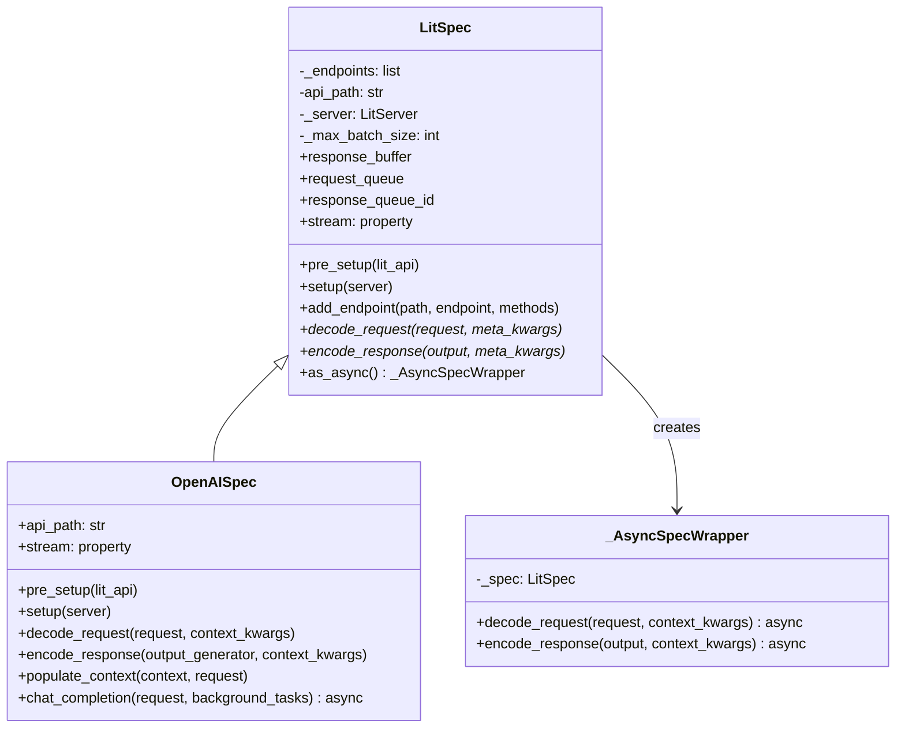
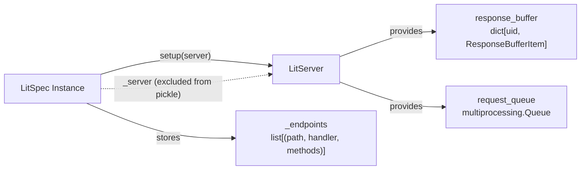
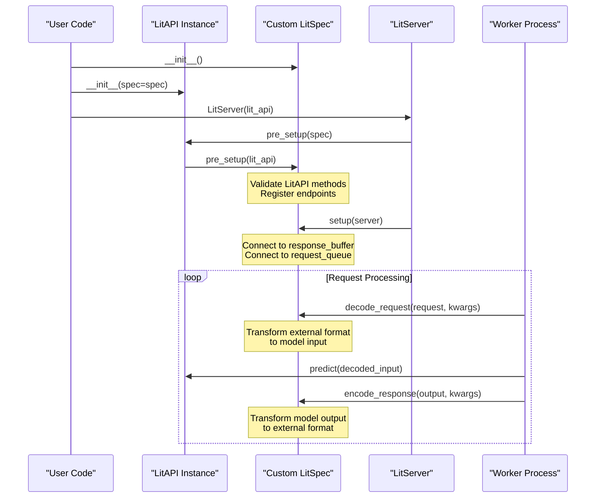
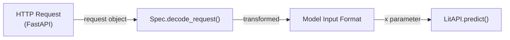
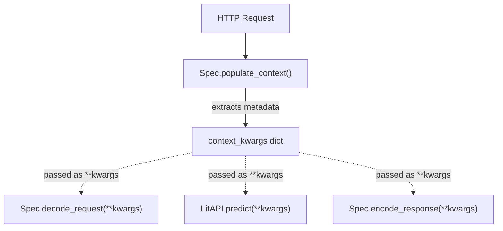
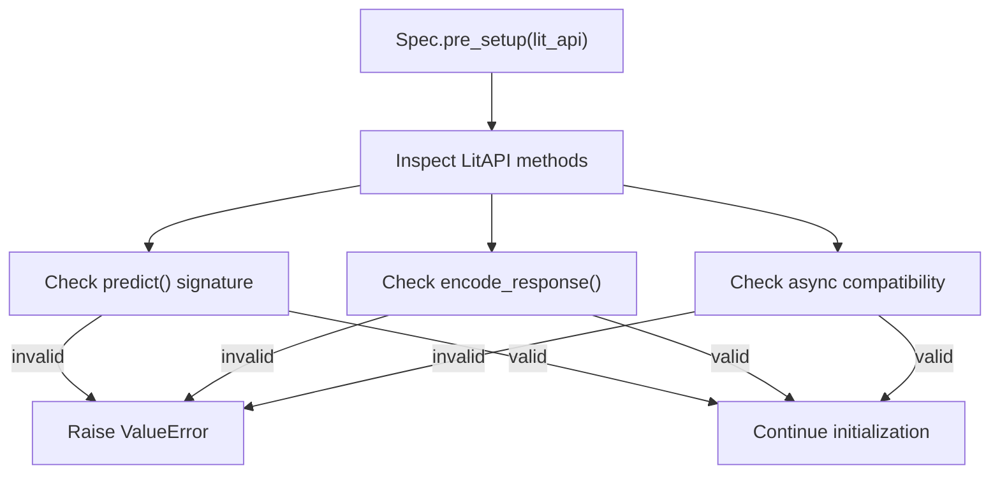
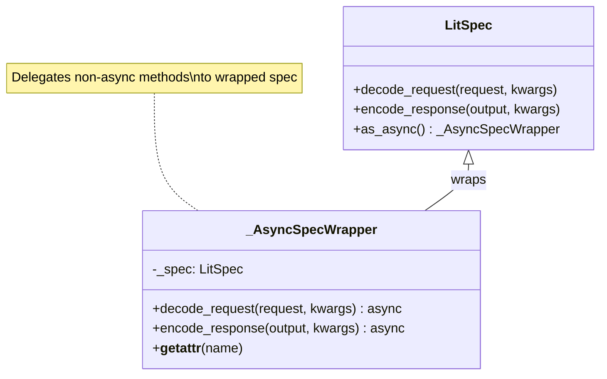
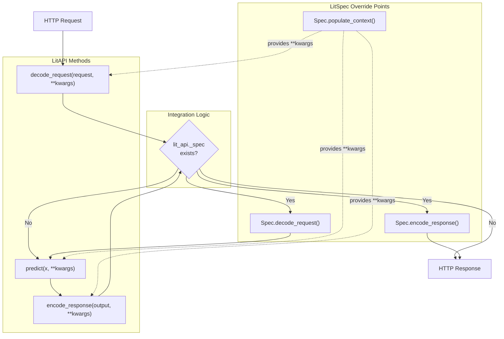

<!-- source: DeepWiki mcp.deepwiki.com · repo Lightning-AI/LitServe · page 3.3 Custom Specifications · fetched 2026-10-21 -->

# Custom Specifications

<details>
<summary>Relevant source files</summary>

The following files were used as context for generating this wiki page:

- [src/litserve/api.py](src/litserve/api.py)
- [src/litserve/specs/base.py](src/litserve/specs/base.py)
- [src/litserve/specs/openai.py](src/litserve/specs/openai.py)

</details>


This page explains how to create custom API specifications by extending the `LitSpec` base class. Custom specs allow you to define non-standard API formats, implement proprietary protocols, or create domain-specific request/response transformations beyond the built-in OpenAI-compatible specifications.

For implementing OpenAI-compatible chat completions, see [OpenAI Chat Completions API](#3.1). For embeddings, see [OpenAI Embeddings API](#3.2). For general information about the specification system, see [API Specifications](#3).

---

## Overview

The `LitSpec` abstraction enables you to:

- Transform between external API formats and model-specific formats
- Register custom HTTP endpoints beyond `/predict`
- Validate `LitAPI` method implementations
- Populate request context with metadata
- Support both synchronous and asynchronous processing

**Sources:** [src/litserve/specs/base.py:22-77]()

---

## LitSpec Base Class

### Class Structure

The `LitSpec` base class defines the interface for all API specifications:



**Sources:** [src/litserve/specs/base.py:22-77](), [src/litserve/specs/openai.py:358-429]()

### Required Abstract Methods

| Method | Purpose | Return Type |
|--------|---------|-------------|
| `decode_request(request, meta_kwargs)` | Transform HTTP request to model input | Any |
| `encode_response(output, meta_kwargs)` | Transform model output to HTTP response | Any (or Generator for streaming) |

**Sources:** [src/litserve/specs/base.py:61-73]()

### Initialization and State

The spec maintains internal state that connects it to the server infrastructure:



**Sources:** [src/litserve/specs/base.py:25-38](), [src/litserve/specs/base.py:47-51]()

---

## Lifecycle and Methods

### Lifecycle Flow



**Sources:** [src/litserve/specs/base.py:44-51](), [src/litserve/api.py:370-380]()

### Method Details

#### `pre_setup(lit_api: LitAPI)`

Called during server initialization, before worker processes spawn. Used for:

- Validating that `LitAPI` methods conform to spec requirements
- Registering custom endpoints via `add_endpoint`
- Setting the `api_path` attribute
- Performing compatibility checks

Example from `OpenAISpec`:

**Sources:** [src/litserve/specs/openai.py:369-422]()

#### `setup(server: LitServer)`

Called after `pre_setup` to connect the spec to server infrastructure:

- Receives `response_buffer` reference
- Receives `request_queue` reference
- Receives `data_streamer` function for async coordination

**Sources:** [src/litserve/specs/base.py:47-51]()

#### `add_endpoint(path: str, endpoint: Callable, methods: list[str])`

Registers a custom HTTP endpoint that will be added to the FastAPI application:

```python
self.add_endpoint("/v1/models", self.list_models, ["GET"])
self.add_endpoint("/v1/chat/completions", self.chat_completion, ["POST"])
self.add_endpoint("/v1/chat/completions", self.options_handler, ["OPTIONS"])
```

**Sources:** [src/litserve/specs/base.py:53-59](), [src/litserve/specs/openai.py:383-384]()

---

## Implementing decode_request

The `decode_request` method transforms the incoming HTTP request into the format expected by `LitAPI.predict`.

### Signature

```python
def decode_request(self, request, meta_kwargs: Optional[dict] = None):
    """Convert the request payload to model input.
    
    Args:
        request: The parsed request object (FastAPI/Pydantic model)
        meta_kwargs: Optional context dictionary for request metadata
        
    Returns:
        Input in the format expected by LitAPI.predict
    """
```

### Example: Custom JSON API

```python
from pydantic import BaseModel
from litserve.specs.base import LitSpec

class CustomRequest(BaseModel):
    text: str
    language: str
    max_length: int

class CustomSpec(LitSpec):
    def pre_setup(self, lit_api):
        self.api_path = "/v1/translate"
        self.add_endpoint(self.api_path, self.translate_endpoint, ["POST"])
    
    def decode_request(self, request: CustomRequest, meta_kwargs=None):
        # Extract relevant fields for model
        return {
            "input_text": request.text,
            "target_lang": request.language,
            "max_len": request.max_length
        }
```

### Integration with LitAPI

The decoded request flows into `LitAPI`:



**Sources:** [src/litserve/specs/base.py:62-64](), [src/litserve/api.py:249-253]()

---

## Implementing encode_response

The `encode_response` method transforms model output into the HTTP response format.

### Signature

```python
def encode_response(self, output, meta_kwargs: Optional[dict] = None):
    """Convert model output to response payload.
    
    Args:
        output: The output from LitAPI.predict (or generator for streaming)
        meta_kwargs: Optional context dictionary
        
    Returns:
        Response object or Generator for streaming responses
    """
```

### Non-Streaming Example

```python
class CustomSpec(LitSpec):
    def encode_response(self, output, meta_kwargs=None):
        # output comes from LitAPI.predict
        return {
            "translated_text": output["text"],
            "confidence": output["score"],
            "model_version": "v2.1"
        }
```

### Streaming Example

For streaming responses, `encode_response` should be a generator:

```python
class StreamingCustomSpec(LitSpec):
    @property
    def stream(self):
        return True
    
    def encode_response(self, output_generator, meta_kwargs=None):
        for chunk in output_generator:
            yield {
                "chunk": chunk,
                "timestamp": time.time()
            }
```

**Sources:** [src/litserve/specs/base.py:66-73](), [src/litserve/specs/openai.py:483-488]()

---

## Context Population and Metadata

Specs can populate a context dictionary that gets passed to `LitAPI` methods as `**kwargs`. This enables passing request metadata through the processing pipeline.

### Context Flow



### Implementation Example

From `OpenAISpec`:

```python
def populate_context(self, context, request):
    data = request.dict()
    data.pop("messages")  # Remove main content, keep metadata
    context.update(data)  # temperature, top_p, model, etc.
```

This allows `LitAPI.predict` to access request parameters:

```python
class MyAPI(LitAPI):
    def predict(self, x, temperature=None, top_p=None, **kwargs):
        # Use temperature from request context
        return self.model.generate(x, temperature=temperature)
```

**Sources:** [src/litserve/specs/openai.py:431-434]()

---

## Validation Patterns

The `pre_setup` method is the appropriate place to validate that `LitAPI` methods conform to spec requirements.

### Validation Flow



### Example: Validating Generator Methods

From `OpenAISpec`, which requires `predict` to be a generator:

```python
import inspect

class OpenAISpec(LitSpec):
    def pre_setup(self, lit_api):
        # Validate predict is a generator
        if not inspect.isgeneratorfunction(lit_api.predict):
            raise ValueError(
                "LitAPI.predict must be a generator (use yield) "
                "when using OpenAISpec"
            )
        
        # Validate encode_response if overridden
        is_original = (
            lit_api.encode_response.__code__ 
            is LitAPI.encode_response.__code__
        )
        if not is_original and not inspect.isgeneratorfunction(lit_api.encode_response):
            raise ValueError(
                "LitAPI.encode_response must be a generator "
                "when overridden with OpenAISpec"
            )
```

**Sources:** [src/litserve/specs/openai.py:418-422]()

### Example: Async Validation

```python
import asyncio

class OpenAISpec(LitSpec):
    def pre_setup(self, lit_api):
        if lit_api.enable_async:
            # Validate predict is async generator
            if not inspect.isasyncgenfunction(lit_api.predict):
                raise ValueError(
                    "predict must be an async generator when enable_async=True"
                )
            
            # Warn about non-async decode_request
            if not asyncio.iscoroutinefunction(lit_api.decode_request):
                logger.info(
                    "decode_request is not async. LitServe will asyncify it."
                )
```

**Sources:** [src/litserve/specs/openai.py:389-406]()

---

## Async Support

### _AsyncSpecWrapper

For async-enabled LitAPIs, specs are automatically wrapped in `_AsyncSpecWrapper`, which provides async versions of `decode_request` and `encode_response`:



**Sources:** [src/litserve/specs/base.py:75-92]()

### Implementation Pattern

The wrapper delegates to the original spec's synchronous methods:

```python
class _AsyncSpecWrapper:
    def __init__(self, spec: LitSpec):
        self._spec = spec
    
    async def decode_request(self, request, context_kwargs=None):
        # Calls synchronous spec.decode_request
        return self._spec.decode_request(request, context_kwargs)
    
    async def encode_response(self, output, context_kwargs=None):
        # Returns synchronous generator/result
        return self._spec.encode_response(output, context_kwargs)
    
    def __getattr__(self, name):
        # Delegate all other attributes to wrapped spec
        return getattr(self._spec, name)
```

**Sources:** [src/litserve/specs/base.py:79-92]()

### Custom Async Specs

For specs requiring true async operations (e.g., async database queries in `decode_request`), override `as_async()`:

```python
class AsyncCustomSpec(LitSpec):
    def as_async(self):
        return _AsyncCustomSpecWrapper(self)

class _AsyncCustomSpecWrapper(_AsyncSpecWrapper):
    async def decode_request(self, request, context_kwargs=None):
        # Perform actual async operations
        data = await fetch_from_database(request.id)
        return self._spec.decode_request(data, context_kwargs)
```

**Sources:** [src/litserve/specs/openai.py:626-629]()

---

## Complete Example: Translation API Spec

Here's a complete custom spec implementation:

### Request/Response Models

```python
from pydantic import BaseModel
from litserve.specs.base import LitSpec

class TranslationRequest(BaseModel):
    text: str
    source_lang: str
    target_lang: str
    formality: str = "default"

class TranslationResponse(BaseModel):
    translated_text: str
    confidence: float
    detected_language: str | None
```

### Custom Spec Implementation

```python
class TranslationSpec(LitSpec):
    def __init__(self):
        super().__init__()
        self.api_path = "/v1/translate"
    
    def pre_setup(self, lit_api):
        """Validate and register endpoints."""
        # Register main endpoint
        self.add_endpoint(
            self.api_path, 
            self.translate_endpoint, 
            ["POST"]
        )
        
        # Register supported languages endpoint
        self.add_endpoint(
            "/v1/languages",
            self.list_languages,
            ["GET"]
        )
        
        # Validate predict returns dict with required keys
        # (validation logic here)
    
    def decode_request(self, request: TranslationRequest, meta_kwargs=None):
        """Transform request to model input."""
        return {
            "text": request.text,
            "src": request.source_lang,
            "tgt": request.target_lang
        }
    
    def encode_response(self, output, meta_kwargs=None):
        """Transform model output to API response."""
        return TranslationResponse(
            translated_text=output["translation"],
            confidence=output.get("confidence", 1.0),
            detected_language=output.get("detected_lang")
        )
    
    async def translate_endpoint(self, request: TranslationRequest):
        """Main translation endpoint handler."""
        # Implementation delegated to standard LitServer flow
        pass
    
    async def list_languages(self):
        """Return supported language pairs."""
        return {
            "languages": ["en", "es", "fr", "de", "ja"],
            "pairs": [
                {"source": "en", "target": "es"},
                # ...
            ]
        }
```

### Usage with LitAPI

```python
import litserve as ls

class TranslationAPI(ls.LitAPI):
    def setup(self, device):
        self.model = load_translation_model(device)
    
    def predict(self, x):
        return {
            "translation": self.model.translate(
                x["text"], 
                src=x["src"], 
                tgt=x["tgt"]
            ),
            "confidence": 0.95
        }

# Initialize server with custom spec
api = TranslationAPI()
spec = TranslationSpec()
server = ls.LitServer(api, spec=spec)
server.run()
```

---

## Integration Points

### How Specs Connect to LitAPI



The integration logic in `LitAPI`:

```python
class LitAPI:
    def decode_request(self, request, **kwargs):
        if self._spec:
            return self._spec.decode_request(request, **kwargs)
        return request
    
    def encode_response(self, output, **kwargs):
        if self._spec:
            return self._spec.encode_response(output, **kwargs)
        return output
```

**Sources:** [src/litserve/api.py:249-253](), [src/litserve/api.py:337-345]()

---

## Advanced Patterns

### Batching Support

Specs can implement custom batching logic:

```python
class BatchableSpec(LitSpec):
    def batch(self, inputs):
        """Combine multiple decoded requests into batch."""
        return {
            "texts": [inp["text"] for inp in inputs],
            "langs": [inp["lang"] for inp in inputs]
        }
    
    def unbatch(self, output):
        """Split batched output back to individual responses."""
        for text, score in zip(output["texts"], output["scores"]):
            yield {"text": text, "score": score}
```

**Sources:** [src/litserve/specs/openai.py:441-445]()

### Streaming with Aggregation

For streaming responses that need aggregation (e.g., tracking token usage):

```python
class StreamingSpec(LitSpec):
    @property
    def stream(self):
        return True
    
    def encode_response(self, output_generator, meta_kwargs=None):
        total_tokens = 0
        
        # Stream chunks
        for chunk in output_generator:
            total_tokens += chunk.get("tokens", 0)
            yield {
                "text": chunk["text"],
                "chunk_id": chunk["id"]
            }
        
        # Final message with metadata
        yield {
            "text": None,
            "done": True,
            "total_tokens": total_tokens
        }
```

**Sources:** [src/litserve/specs/openai.py:536-584]()

### Error Handling

Specs can format errors according to the API specification:

```python
def _custom_format_error(error: Exception):
    if isinstance(error, HTTPException):
        return {
            "error": {
                "code": error.status_code,
                "message": error.detail,
                "type": "api_error"
            }
        }
    return {
        "error": {
            "code": 500,
            "message": "Internal server error",
            "type": "server_error"
        }
    }

class CustomSpec(LitSpec):
    async def my_endpoint(self, request):
        try:
            # Process request
            pass
        except Exception as e:
            return _custom_format_error(e)
```

**Sources:** [src/litserve/specs/openai.py:334-356]()

---

## Best Practices

### Validation Checklist

| Validation | When | Example |
|------------|------|---------|
| Method signatures | `pre_setup` | Check `predict` is generator for streaming |
| Async compatibility | `pre_setup` | Validate async methods when `enable_async=True` |
| Required attributes | `pre_setup` | Check model has required methods |
| Response format | `encode_response` | Validate output conforms to spec schema |

### State Management

- Use `__getstate__` to exclude unpickleable objects (like `_server`) from serialization
- Store stateless configuration in `__init__`
- Store server references in `setup`, called after pickling

**Sources:** [src/litserve/specs/base.py:34-38]()

### Endpoint Registration

- Register all custom endpoints in `pre_setup`
- Use descriptive paths following REST conventions
- Support OPTIONS method for CORS when needed

**Sources:** [src/litserve/specs/openai.py:383-384](), [src/litserve/specs/openai.py:497-498]()

---

## Summary

Creating custom specifications enables:

1. **Protocol Translation**: Convert between external API formats and model inputs
2. **Endpoint Management**: Register custom HTTP routes beyond `/predict`
3. **Validation**: Enforce LitAPI implementation requirements
4. **Context Passing**: Inject request metadata into the processing pipeline
5. **Async Support**: Handle both sync and async processing patterns

Key implementation points:

- Extend `LitSpec` and implement `decode_request` and `encode_response`
- Use `pre_setup` for validation and endpoint registration
- Use `setup` to connect to server infrastructure
- Override `as_async()` for custom async behavior
- Use `populate_context` to pass metadata to LitAPI methods

**Sources:** [src/litserve/specs/base.py:22-92](), [src/litserve/specs/openai.py:358-624]()

---

