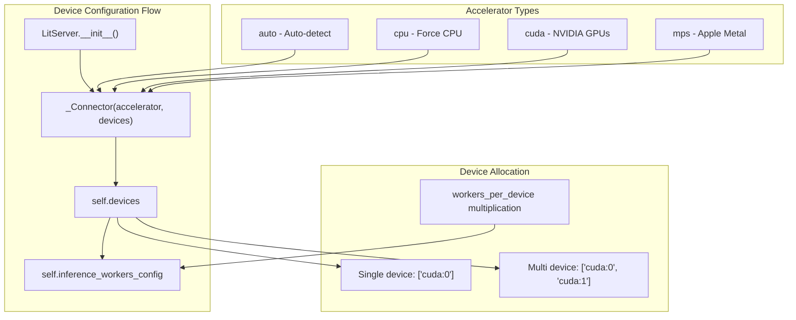
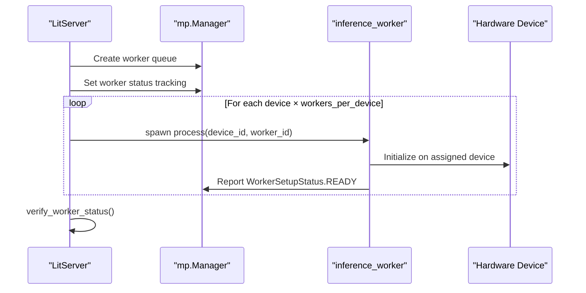
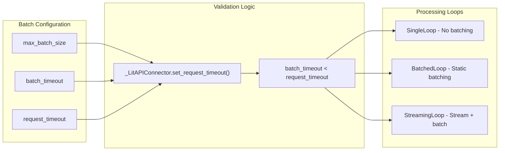
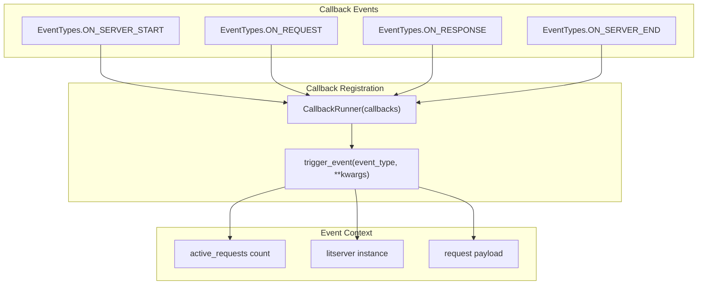
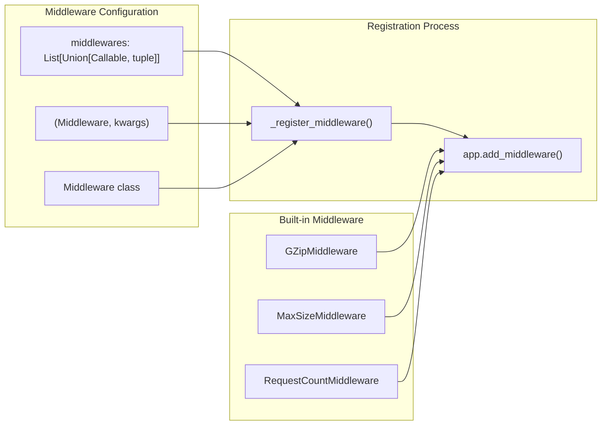
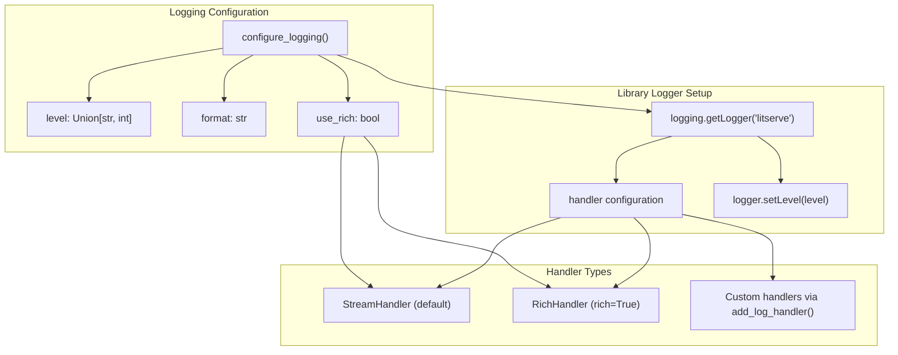
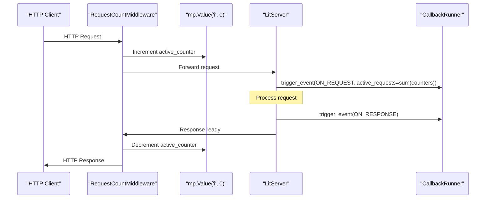
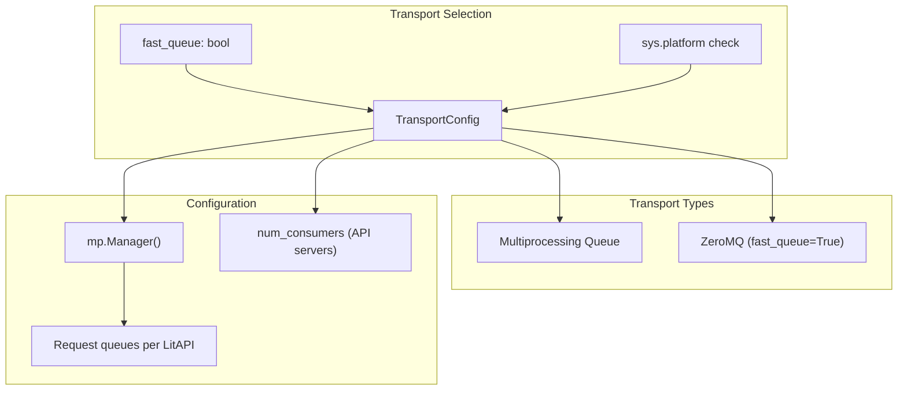
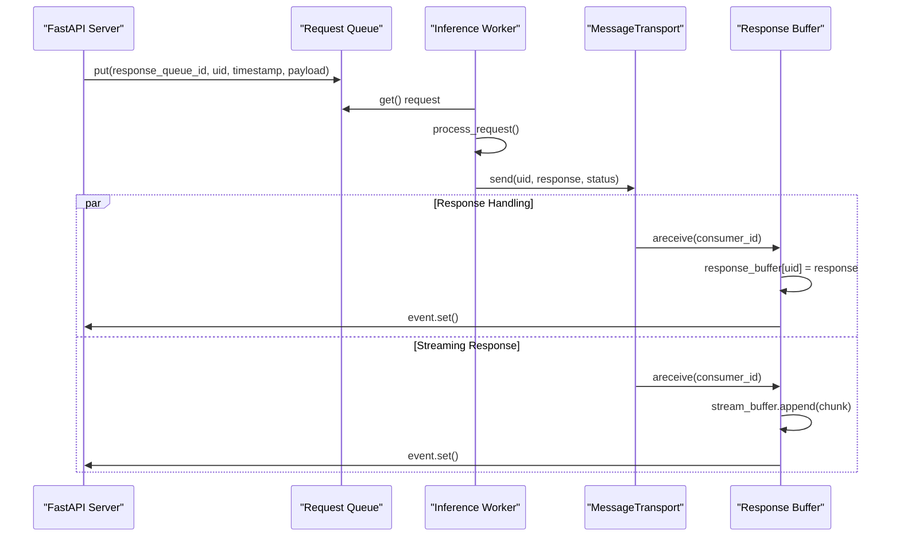
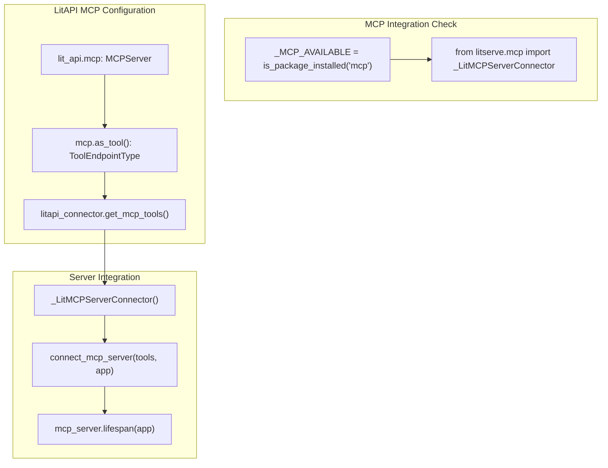

<!-- source: DeepWiki mcp.deepwiki.com · repo Lightning-AI/LitServe · page 4 Advanced Features · fetched 2026-10-21 -->

# Advanced Features

<details>
<summary>Relevant source files</summary>

The following files were used as context for generating this wiki page:

- [README.md](README.md)
- [src/litserve/server.py](src/litserve/server.py)
- [tests/conftest.py](tests/conftest.py)
- [tests/e2e/test_e2e.py](tests/e2e/test_e2e.py)

</details>


This document covers advanced capabilities in LitServe for production deployments and specialized use cases. These features extend beyond basic model serving to provide enterprise-grade functionality including dynamic batching, hardware optimization, monitoring, and protocol integrations.

For basic server setup and configuration, see [Core Concepts](#2). For API specifications and OpenAI compatibility, see [API Specifications](#3).

## Hardware Acceleration & Device Management

LitServe provides comprehensive hardware acceleration support with automatic device detection and manual configuration options. The system supports CPU, CUDA (NVIDIA GPUs), and MPS (Apple Metal Performance Shaders) accelerators.

### Device Detection and Configuration

The `_Connector` class handles accelerator and device management through the LitServer initialization:



**Hardware Configuration Options:**

| Parameter | Type | Default | Description |
|-----------|------|---------|-------------|
| `accelerator` | `Literal["cpu", "cuda", "mps", "auto"]` | `"auto"` | Hardware type for inference |
| `devices` | `Union[int, Literal["auto"]]` | `"auto"` | Number of devices to use |
| `workers_per_device` | `int` | `1` | Worker processes per device |

The device identification logic creates device strings using the `device_identifiers` method [src/litserve/server.py:867-870]():

```python
def device_identifiers(self, accelerator, device):
    if isinstance(device, Sequence):
        return [f"{accelerator}:{el}" for el in device]
    return [f"{accelerator}:{device}"]
```

### Worker Process Architecture

Each device spawns multiple worker processes based on the `workers_per_device` configuration. The worker allocation is calculated in the constructor [src/litserve/server.py:790]():

```python
self.inference_workers_config = self.devices * self.workers_per_device
```

Workers are launched using multiprocessing with proper device assignment [src/litserve/server.py:804-827]():



Sources: [src/litserve/server.py:794-827](), [src/litserve/server.py:1026-1031]()

## Batching Strategies

LitServe implements sophisticated batching strategies through the `LitAPI` configuration and processing loops. Batching improves throughput by processing multiple requests simultaneously.

### Batch Configuration

Batching behavior is controlled through `LitAPI` parameters that are validated by the `_LitAPIConnector`:



The timeout validation ensures batch timeouts don't exceed request timeouts [src/litserve/server.py:244-246]():

```python
if lit_api.batch_timeout > timeout and timeout not in (False, -1):
    raise ValueError("batch_timeout must be less than request_timeout")
```

### Dynamic Batching Implementation

Dynamic batching allows the system to accumulate requests up to `max_batch_size` or until `batch_timeout` expires, whichever comes first. This optimizes both latency and throughput based on request patterns.

**Batching Parameters:**

| Parameter | Type | Default | Description |
|-----------|------|---------|-------------|
| `max_batch_size` | `int` | `1` | Maximum requests per batch |
| `batch_timeout` | `float` | `0.0` | Max wait time to fill batch (seconds) |
| `request_timeout` | `float` | `30.0` | Overall request timeout |

Sources: [src/litserve/server.py:240-246](), [src/litserve/server.py:215-257]()

## Callbacks and Middleware

LitServe provides a comprehensive callback and middleware system for cross-cutting concerns like logging, monitoring, authentication, and request preprocessing.

### Callback System Architecture

The `CallbackRunner` manages lifecycle events throughout request processing:



Callbacks are triggered at key points in the request lifecycle [src/litserve/server.py:287-291]():

```python
self.server._callback_runner.trigger_event(
    EventTypes.ON_REQUEST.value,
    active_requests=self.server.active_requests,
    litserver=self.server,
)
```

### Middleware Integration

LitServe integrates with FastAPI's middleware system, supporting both built-in and custom middleware:

**Built-in Middleware:**
- `GZipMiddleware` - Response compression (disabled for streaming)
- `MaxSizeMiddleware` - Request size limiting  
- `RequestCountMiddleware` - Active request tracking

**Middleware Registration:**



The middleware registration logic handles both formats [src/litserve/server.py:1002-1008]():

```python
def _register_middleware(self):
    for middleware in self.middlewares:
        if isinstance(middleware, tuple):
            middleware, kwargs = middleware
            self.app.add_middleware(middleware, **kwargs)
        elif callable(middleware):
            self.app.add_middleware(middleware)
```

Sources: [src/litserve/server.py:1002-1008](), [src/litserve/server.py:756-760](), [src/litserve/callbacks/base.py]()

## Logging and Monitoring

LitServe provides comprehensive logging and monitoring capabilities through structured logging, configurable log levels, and request tracking.

### Logging Configuration

The logging system supports multiple output formats and handlers through the `configure_logging` function:



**Logging Levels and Configuration:**

| Level | Usage | Description |
|-------|-------|-------------|
| `"critical"` | Production errors | Only severe errors |
| `"error"` | Error conditions | Error conditions |
| `"warning"` | Production default | Warning messages |
| `"info"` | Development default | General information |
| `"debug"` | Development/troubleshooting | Detailed debugging |
| `"trace"` | Verbose troubleshooting | Very verbose output |

The rich logging integration provides enhanced formatting [src/litserve/utils.py:167-178]():

```python
if use_rich:
    try:
        from rich.logging import RichHandler
        from rich.traceback import install
        
        install(show_locals=True)
        handler = RichHandler(rich_tracebacks=True, show_time=True, show_path=True)
    except ImportError:
        logger.warning("Rich is not installed, using default logging")
        handler = _get_default_handler(stream, format)
```

### Request Tracking and Monitoring

LitServe provides built-in request tracking through the `track_requests` configuration:



The active request counting is implemented using multiprocessing-safe counters [src/litserve/server.py:896-899]():

```python
@property
def active_requests(self):
    if self.track_requests and self.active_counters:
        return sum(counter.value for counter in self.active_counters)
    return None
```

Sources: [src/litserve/utils.py:143-183](), [src/litserve/server.py:896-899](), [src/litserve/server.py:1353-1355]()

## Transport Layer

LitServe implements a sophisticated transport layer for inter-process communication between HTTP servers and inference workers, supporting both multiprocessing queues and ZeroMQ for high-throughput scenarios.

### Transport Configuration

The transport system is configured through `TransportConfig` and supports two backends:



The transport selection logic considers platform compatibility [src/litserve/server.py:743-745]():

```python
if sys.platform == "win32" and fast_queue:
    warnings.warn("ZMQ is not supported on Windows with LitServe. Disabling ZMQ.")
    fast_queue = False
```

### Message Flow Architecture

The transport layer handles bidirectional communication between API servers and workers:



The response buffer handling supports both regular and streaming responses [src/litserve/server.py:127-139]():

```python
async def response_queue_to_buffer(
    transport: MessageTransport,
    response_buffer: Dict[str, Union[Tuple[deque, asyncio.Event], asyncio.Event]],
    consumer_id: int,
    litapi_connector: "_LitAPIConnector",
):
    mixed_streaming = (
        len(litapi_connector.lit_apis) > 1
        and litapi_connector.any_stream()
        and not all(api.stream for api in litapi_connector)
    )
```

Sources: [src/litserve/server.py:790-791](), [src/litserve/server.py:127-176](), [src/litserve/transport/factory.py]()

## MCP Integration

Model Context Protocol (MCP) integration enables LitServe to work seamlessly with AI agent frameworks and tool ecosystems. MCP provides a standardized way for language models to interact with external tools and data sources.

### MCP Server Architecture

The MCP integration is implemented through the `_LitMCPServerConnector` when the MCP package is available:



### MCP Tool Registration

Each `LitAPI` instance can expose MCP tools through the `mcp` attribute. The tools are collected and registered with the MCP server [src/litserve/server.py:258-263]():

```python
def get_mcp_tools(self) -> List["ToolEndpointType"]:
    mcp_tools = []
    for lit_api in self.lit_apis:
        if lit_api.mcp:
            mcp_tools.append(lit_api.mcp.as_tool())
    return mcp_tools
```

### MCP Lifecycle Management

The MCP server is integrated into the FastAPI application lifecycle [src/litserve/server.py:853-856]():

```python
if _MCP_AVAILABLE:
    async with self.mcp_server.lifespan(app):
        yield
else:
    yield
```

This integration allows AI agents and clients that support MCP to discover and interact with LitServe-hosted models as tools within their workflows.

Sources: [src/litserve/server.py:63](), [src/litserve/server.py:258-263](), [src/litserve/server.py:853-856](), [src/litserve/server.py:1365-1369]()

---

