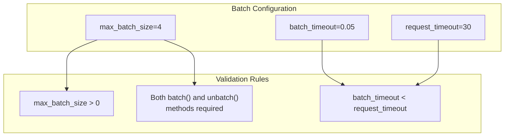
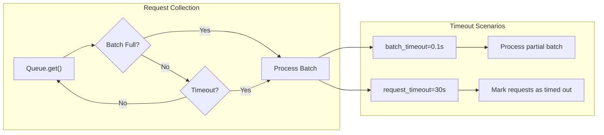
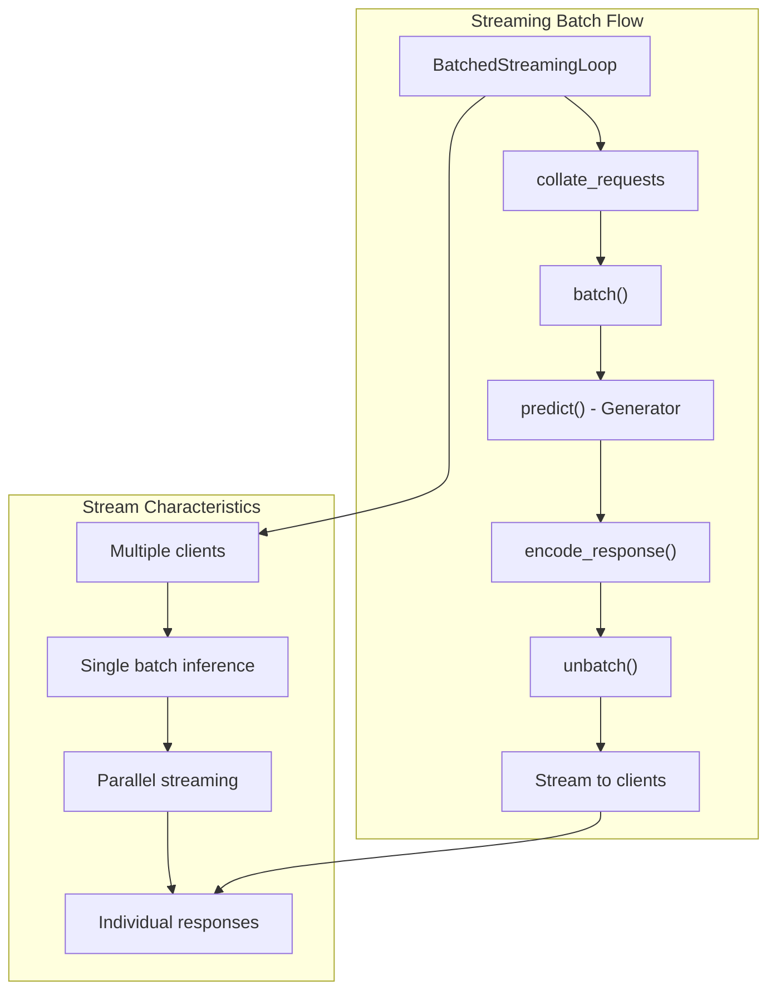
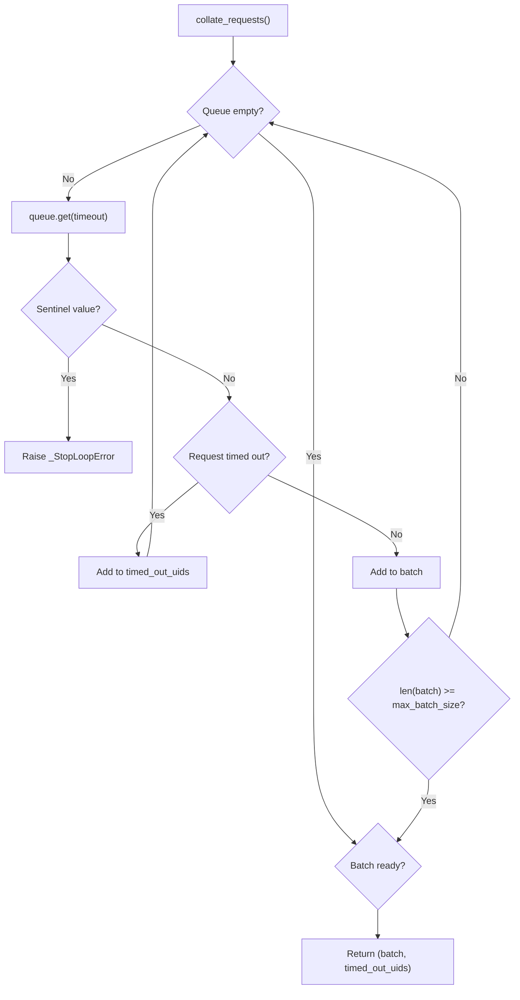
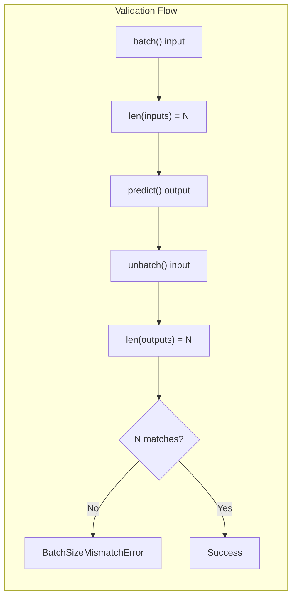
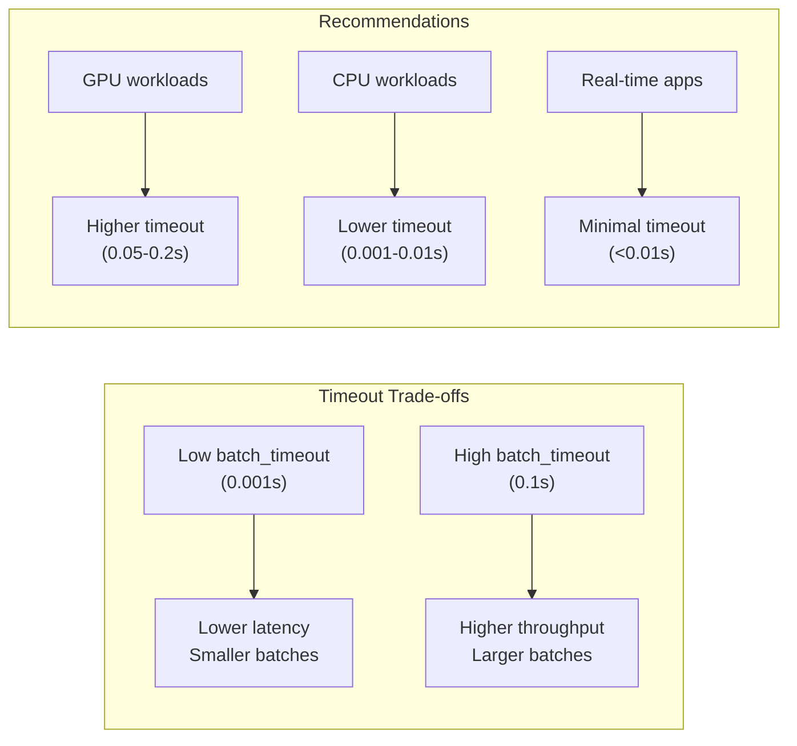
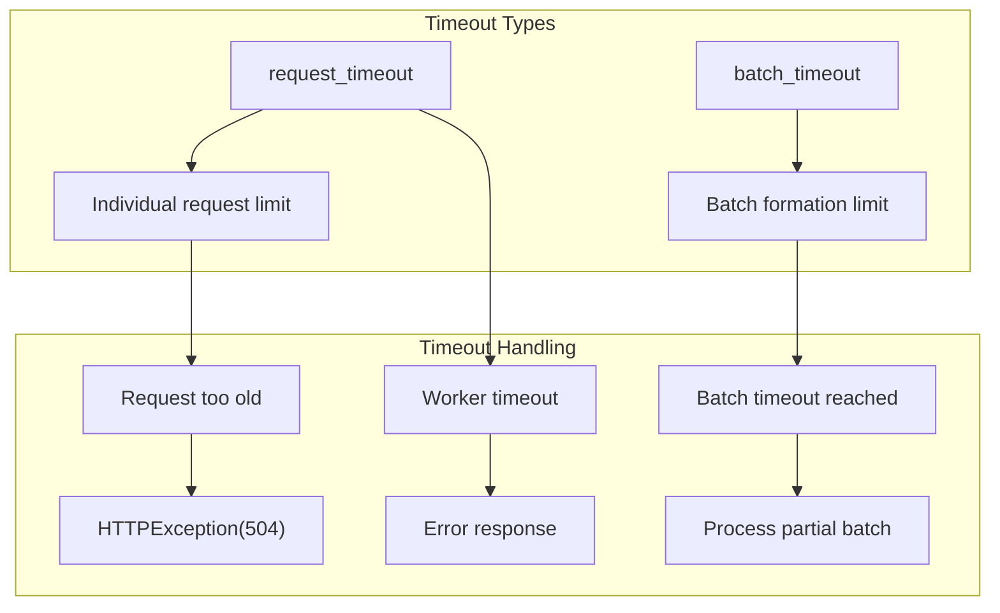

<!-- source: DeepWiki mcp.deepwiki.com · repo Lightning-AI/LitServe · page 4.1 Batching Strategies · fetched 2026-10-21 -->

# Batching Strategies

<details>
<summary>Relevant source files</summary>

The following files were used as context for generating this wiki page:

- [src/litserve/api.py](src/litserve/api.py)
- [src/litserve/loops/continuous_batching_loop.py](src/litserve/loops/continuous_batching_loop.py)
- [src/litserve/loops/loops.py](src/litserve/loops/loops.py)
- [src/litserve/loops/simple_loops.py](src/litserve/loops/simple_loops.py)
- [src/litserve/loops/streaming_loops.py](src/litserve/loops/streaming_loops.py)
- [src/litserve/specs/base.py](src/litserve/specs/base.py)
- [tests/unit/test_batch.py](tests/unit/test_batch.py)
- [tests/unit/test_lit_server.py](tests/unit/test_lit_server.py)
- [tests/unit/test_loops.py](tests/unit/test_loops.py)
- [tests/unit/test_simple.py](tests/unit/test_simple.py)

</details>


This document covers LitServe's batching capabilities for optimizing throughput by processing multiple requests simultaneously. Batching strategies determine how incoming requests are grouped together for efficient inference, including dynamic batching, timeout-based processing, and streaming batching scenarios.

For information about processing loops that implement these strategies, see [Processing Loops](#2.3). For hardware acceleration considerations with batching, see [Hardware Acceleration & Device Management](#4.2).

## Overview

LitServe provides several batching strategies to optimize inference throughput by processing multiple requests together. The batching system automatically collects incoming requests and processes them as groups, reducing per-request overhead and improving GPU utilization.

The core batching mechanism is implemented through the `LitAPI.batch()` and `LitAPI.unbatch()` methods, controlled by the `max_batch_size` and `batch_timeout` parameters.

Sources: [tests/unit/test_batch.py:48-71](), [tests/e2e/default_batching.py:16-19]()

## Core Batching Parameters

### Batch Size Configuration

| Parameter | Description | Default | Validation |
|-----------|-------------|---------|------------|
| `max_batch_size` | Maximum number of requests per batch | 1 | Must be > 0 |
| `batch_timeout` | Maximum wait time for batch formation (seconds) | 0.001 | Must be < `request_timeout` |
| `request_timeout` | Individual request timeout (seconds) | 30 | Must be > `batch_timeout` |



Sources: [tests/unit/test_batch.py:131-141](), [tests/unit/test_batch.py:143-164]()

## Batching Strategies

### Static Batching

Static batching processes requests in fixed-size batches, waiting for either the batch to fill completely or the timeout to expire.

```mermaid
sequenceDiagram
    participant Client1 as "Client 1"
    participant Client2 as "Client 2"
    participant Queue as "RequestQueue"
    participant Collator as "collate_requests"
    participant API as "LitAPI"
    participant Loop as "BatchedLoop"
    
    Client1->>Queue: Request 1
    Client2->>Queue: Request 2
    
    Loop->>Collator: get_batch(max_size=2, timeout=0.05)
    Collator->>Queue: Collect requests
    Collator->>Loop: [req1, req2]
    
    Loop->>API: batch([decoded1, decoded2])
    API->>Loop: batched_input
    Loop->>API: predict(batched_input)
    API->>Loop: batched_output
    Loop->>API: unbatch(batched_output)
    API->>Loop: [output1, output2]
```

Sources: [tests/unit/test_batch.py:199-232](), [litserve/loops/base.py:collate_requests]()

### Dynamic Batching with Timeouts

Dynamic batching adapts to request arrival patterns, processing partial batches when timeouts occur.



The `collate_requests` function implements this strategy by checking both batch size and timing conditions:

Sources: [tests/unit/test_batch.py:244-252](), [litserve/loops/base.py:collate_requests]()

### Streaming Batching

Streaming batching combines batch processing with real-time response streaming, enabling efficient processing of generative models.



Sources: [tests/e2e/default_batched_streaming.py:19-38](), [tests/unit/test_loops.py:316-356]()

## Implementation Details

### Request Collation Process

The `collate_requests` function is the core batching mechanism that manages request collection and timeout handling:



Sources: [litserve/loops/base.py:collate_requests](), [tests/unit/test_batch.py:255-261]()

### Batch Size Validation

LitServe enforces strict batch size consistency between the `batch()` and `unbatch()` methods:



Sources: [tests/unit/test_batch.py:264-291](), [tests/unit/test_batch.py:166-180]()

### Loop Selection Strategy

LitServe automatically selects the appropriate processing loop based on batching and streaming configuration:

| Conditions | Selected Loop | Purpose |
|------------|---------------|---------|
| `max_batch_size=1, stream=False` | `SingleLoop` | Individual request processing |
| `max_batch_size>1, stream=False` | `BatchedLoop` | Static batching |
| `max_batch_size=1, stream=True` | `StreamingLoop` | Individual streaming |
| `max_batch_size>1, stream=True` | `BatchedStreamingLoop` | Streaming with batching |

Sources: [tests/unit/test_loops.py:726-751]()

## Performance Optimization

### Timeout Configuration

Optimal batch timeout values balance latency and throughput:



### Batch Size Guidelines

| Workload Type | Recommended Batch Size | Considerations |
|---------------|----------------------|----------------|
| NLP Models | 4-32 | Memory constraints |
| Computer Vision | 1-8 | Image size dependent |
| Embedding Models | 16-128 | High throughput focus |
| Streaming Generation | 2-8 | Balance latency/throughput |

Sources: [tests/e2e/default_batching.py:17](), [tests/e2e/default_batched_streaming.py:36]()

## Error Handling and Monitoring

### Timeout Management

The batching system handles multiple timeout scenarios:



### Batch Size Mismatch Detection

The system validates that `unbatch()` returns the correct number of outputs:

Sources: [tests/unit/test_batch.py:273-291](), [tests/unit/test_loops.py:495-535]()

### Warning System

LitServe provides warnings for common batching configuration issues:

- Missing `max_batch_size` when both `batch()` and `unbatch()` are implemented
- String return values from `predict()` when batching is enabled
- `batch_timeout` greater than `request_timeout`

Sources: [tests/unit/test_batch.py:143-164](), [tests/unit/test_batch.py:166-180]()

---

