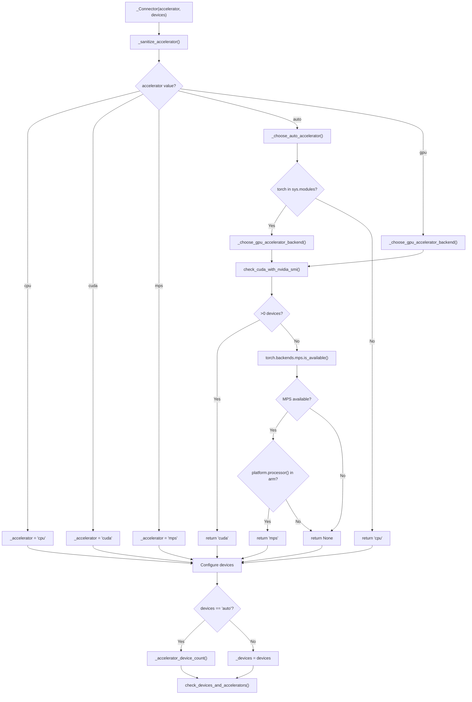
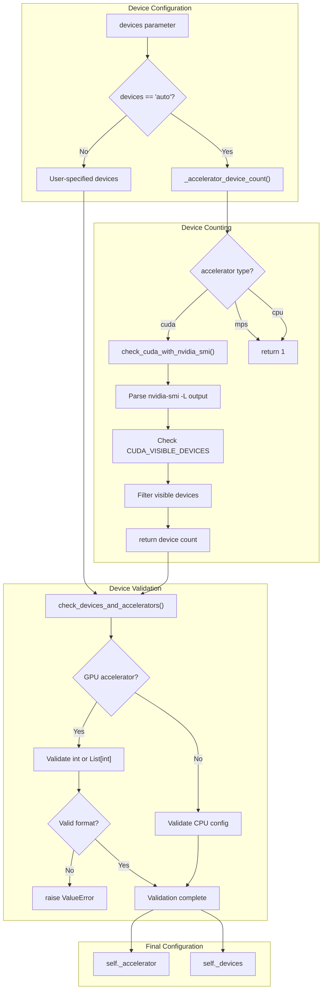
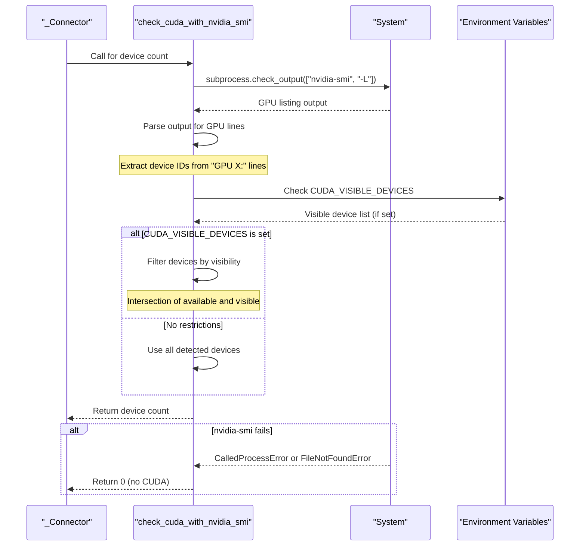

<!-- source: DeepWiki mcp.deepwiki.com · repo Lightning-AI/LitServe · page 4.2 Hardware Acceleration & Device Management · fetched 2026-10-21 -->

# Hardware Acceleration & Device Management

Relevant source files

The following files were used as context for generating this wiki page:

- [README.md](README.md)
- [src/litserve/api.py](src/litserve/api.py)
- [src/litserve/server.py](src/litserve/server.py)
- [src/litserve/specs/base.py](src/litserve/specs/base.py)
- [tests/conftest.py](tests/conftest.py)
- [tests/e2e/test_e2e.py](tests/e2e/test_e2e.py)

This document covers LitServe's hardware acceleration and device management system, which automatically detects available hardware resources and configures optimal device allocation for AI model inference. The system handles CPU, CUDA GPU, and Apple Silicon (MPS) acceleration through the `_Connector` class.

For information about processing loops that utilize these hardware resources, see [Processing Loops](#2.3). For deployment considerations with hardware acceleration, see [Docker Deployment](#4.6).

## Hardware Detection and Accelerator Selection

LitServe automatically detects and configures hardware acceleration through the `_Connector` class, which serves as the central component for device management. The system supports multiple accelerator types and provides automatic selection based on available hardware.

### Accelerator Selection Flow

Sources: [src/litserve/connector.py:22-97]()

### Supported Accelerator Types

The system supports four main accelerator configurations:

| Accelerator | Description | Device Requirements | Use Case |
|-------------|-------------|-------------------|----------|
| `cpu` | CPU-only processing | Any CPU | Development, testing, CPU-optimized models |
| `cuda` | NVIDIA GPU acceleration | CUDA-compatible GPU + drivers | High-performance GPU inference |
| `mps` | Apple Silicon GPU | Apple M1/M2/M3 with macOS | Apple Silicon optimization |
| `auto` | Automatic detection | Any available | Production deployments |
| `gpu` | Generic GPU detection | CUDA or MPS compatible | Flexible GPU usage |

Sources: [src/litserve/connector.py:25-31](), [src/litserve/connector.py:61-70]()

## Device Configuration and Validation

The `_Connector` class handles device specification and validation to ensure proper hardware utilization and prevent configuration errors.

### Device Management Architecture

Sources: [src/litserve/connector.py:32-51](), [src/litserve/connector.py:78-82](), [src/litserve/connector.py:99-118]()

### Device Specification Formats

The `devices` parameter accepts multiple formats depending on the accelerator type:

**For CUDA and MPS accelerators:**
- `devices="auto"` - Automatically detect and use all available devices
- `devices=1` - Use 1 device (single GPU)
- `devices=4` - Use 4 devices (multi-GPU)
- `devices=[0, 2, 3]` - Use specific GPU indices

**For CPU accelerator:**
- `devices="auto"` - Use CPU (devices parameter ignored)
- Any other value - CPU processing (devices parameter ignored)

Sources: [src/litserve/connector.py:42-48]()

## CUDA Detection and Management

The system uses `nvidia-smi` command-line tool for robust CUDA detection, providing accurate device counting even with `CUDA_VISIBLE_DEVICES` restrictions.

### CUDA Detection Process

The `check_cuda_with_nvidia_smi` function implements sophisticated CUDA detection:

1. **Device Discovery**: Executes `nvidia-smi -L` to list all GPUs
2. **Parsing**: Extracts GPU indices from command output
3. **Visibility Filtering**: Respects `CUDA_VISIBLE_DEVICES` environment variable
4. **Error Handling**: Returns 0 if CUDA is unavailable or command fails
5. **Caching**: Uses `@lru_cache(maxsize=1)` for performance optimization

Sources: [src/litserve/connector.py:99-118]()

## Integration with LitServer

The `_Connector` class integrates with LitServer's multiprocessing architecture to distribute inference workloads across available hardware resources. Each worker process receives device assignments based on the connector's configuration.

### Hardware Resource Allocation

When LitServer starts multiple worker processes, the `_Connector` configuration determines:

- **Accelerator Type**: Which hardware backend each worker uses
- **Device Assignment**: Specific GPU indices or CPU allocation
- **Process Distribution**: How workers map to available devices
- **Resource Isolation**: Ensuring workers don't conflict over hardware

For detailed information about how workers utilize these hardware resources, see [LitServer](#2.2) and [Processing Loops](#2.3).

Sources: [src/litserve/connector.py:22-38]()

---

