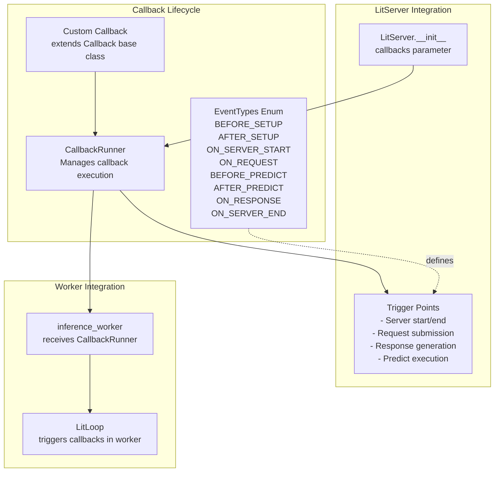
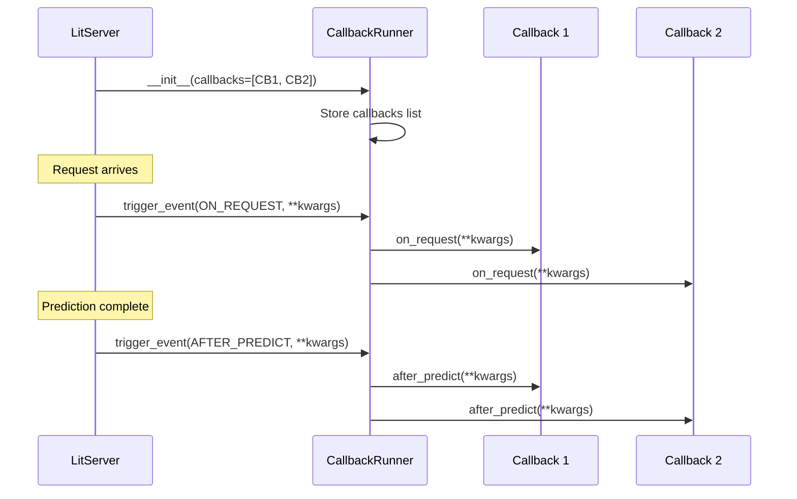
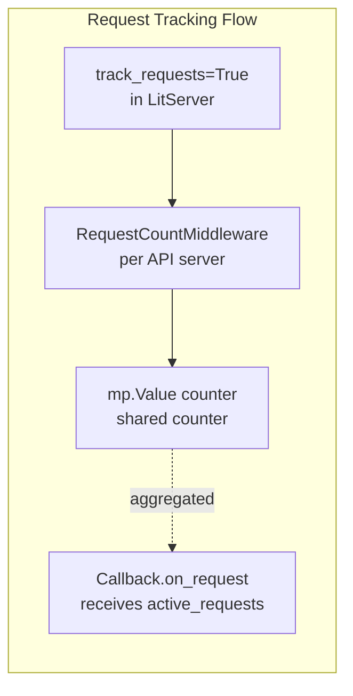
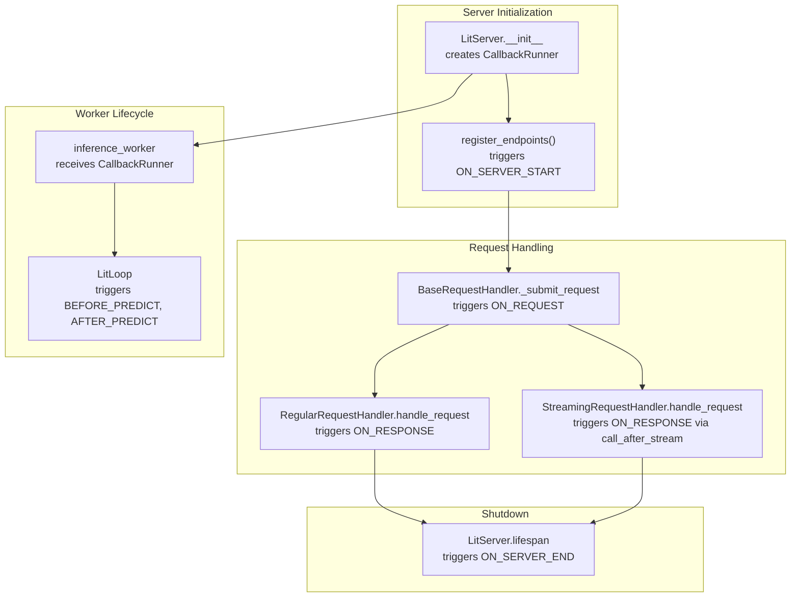
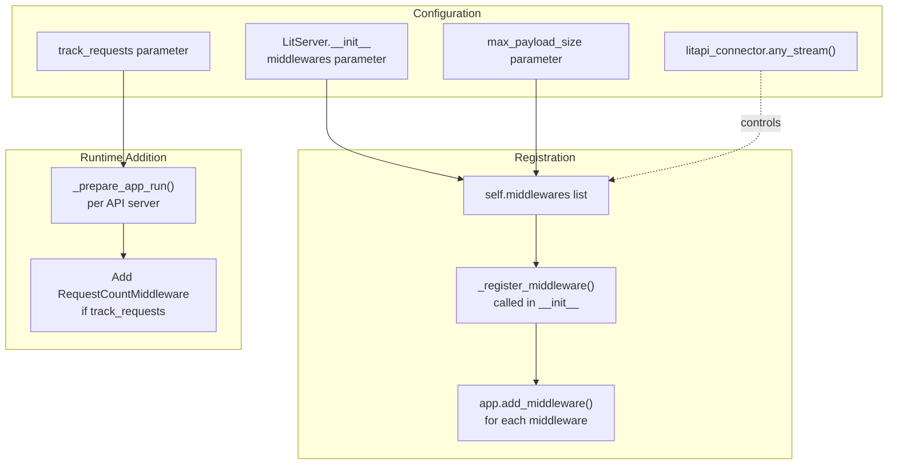
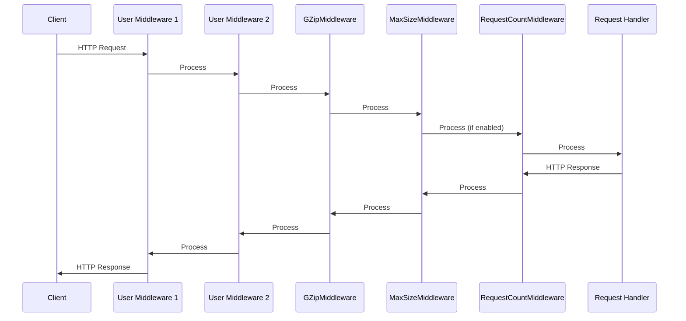
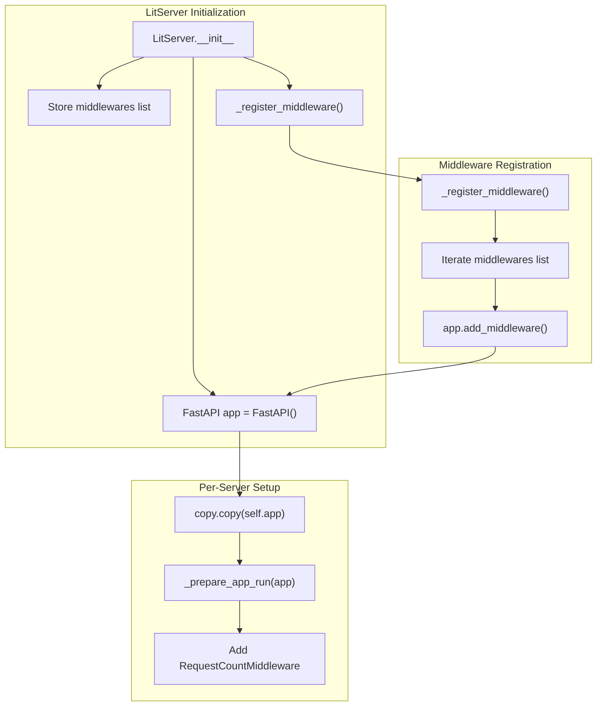

<!-- source: DeepWiki mcp.deepwiki.com · repo Lightning-AI/LitServe · page 4.3 Callbacks and Middleware · fetched 2026-10-21 -->

# Callbacks and Middleware

<details>
<summary>Relevant source files</summary>

The following files were used as context for generating this wiki page:

- [src/litserve/server.py](src/litserve/server.py)
- [src/litserve/utils.py](src/litserve/utils.py)

</details>


## Purpose and Scope

This document explains LitServe's callback and middleware systems for extending server behavior. Callbacks provide lifecycle event hooks for monitoring and custom logic during request processing, while middleware enables HTTP-level request/response manipulation using FastAPI/Starlette patterns.

For performance monitoring and metrics collection, see [Logging and Monitoring](#4.4). For API specification customizations, see [Custom Specifications](#3.3).

---

## Overview

LitServe provides two distinct extension mechanisms:

| Extension Type | Purpose | Execution Context | Configuration Location |
|---------------|---------|-------------------|----------------------|
| **Callbacks** | Lifecycle events, monitoring, custom logic | Worker processes and main server | `LitServer(callbacks=...)` |
| **Middleware** | HTTP request/response processing | FastAPI application layer | `LitServer(middlewares=...)` |

**Sources:** [src/litserve/server.py:674-675]()

---

## Callback System Architecture



**Sources:** [src/litserve/server.py:46](), [src/litserve/server.py:803](), [src/litserve/server.py:858]()

---

## Event Types

The `EventTypes` enum defines all available lifecycle hooks:

| Event | Trigger Location | Context | Use Case |
|-------|-----------------|---------|----------|
| `BEFORE_SETUP` | Worker initialization, before model loading | Worker process | Pre-setup validation, resource allocation |
| `AFTER_SETUP` | Worker initialization, after model loading | Worker process | Setup verification, warmup |
| `ON_SERVER_START` | Server endpoint registration | Main process | Initialization logging, service registration |
| `ON_REQUEST` | Request submission to queue | FastAPI handler | Request counting, load monitoring |
| `BEFORE_PREDICT` | Before `LitAPI.predict()` call | Worker process | Input validation, timing |
| `AFTER_PREDICT` | After `LitAPI.predict()` call | Worker process | Output validation, metrics |
| `ON_RESPONSE` | Before HTTP response sent | FastAPI handler | Response logging, metrics |
| `ON_SERVER_END` | Server shutdown | Main process | Cleanup, final metrics |

**Sources:** [src/litserve/callbacks/base.py](), [src/litserve/server.py:301-305](), [src/litserve/server.py:340](), [src/litserve/server.py:932](), [src/litserve/server.py:1049]()

---

## Creating Custom Callbacks

### Callback Base Class

Custom callbacks extend the `Callback` base class and implement event handler methods:

```python
from litserve.callbacks import Callback, EventTypes

class MetricsCallback(Callback):
    def on_request(self, **kwargs):
        # Access active_requests from kwargs
        active = kwargs.get('active_requests')
        print(f"Active requests: {active}")
    
    def after_predict(self, **kwargs):
        # Access prediction output
        output = kwargs.get('output')
        # Log or process output
```

**Sources:** [src/litserve/callbacks/base.py]()

### CallbackRunner Integration

The `CallbackRunner` class orchestrates callback execution:



**Sources:** [src/litserve/server.py:803](), [src/litserve/callbacks/base.py]()

### Configuration Example

```python
import litserve as ls

class CustomCallback(ls.Callback):
    def on_server_start(self, **kwargs):
        print("Server starting...")
    
    def on_request(self, **kwargs):
        active = kwargs.get('active_requests')
        if active and active > 100:
            print(f"Warning: High load - {active} active requests")

server = ls.LitServer(
    api,
    callbacks=[CustomCallback()],
    track_requests=True  # Required for active_requests in callbacks
)
```

**Sources:** [src/litserve/server.py:674](), [src/litserve/server.py:478-486]()

---

## Request Tracking with Callbacks

The `track_requests` feature enables monitoring active concurrent requests:



**Implementation:**
- Each API server process has a `RequestCountMiddleware` with a shared counter [src/litserve/server.py:1440-1442]()
- Counters are aggregated in `active_requests` property [src/litserve/server.py:969-972]()
- Value passed to callbacks via `ON_REQUEST` event [src/litserve/server.py:301-305]()

**Sources:** [src/litserve/server.py:478-486](), [src/litserve/server.py:793](), [src/litserve/server.py:1440-1442]()

---

## Callback Trigger Points in Code



**Sources:** [src/litserve/server.py:803](), [src/litserve/server.py:1049](), [src/litserve/server.py:301-305](), [src/litserve/server.py:340](), [src/litserve/server.py:385-390](), [src/litserve/server.py:932](), [src/litserve/server.py:858]()

---

## Middleware System

### Built-in Middleware

LitServe includes three built-in middleware components:

| Middleware | Purpose | Configuration | Auto-enabled |
|-----------|---------|---------------|--------------|
| `GZipMiddleware` | Response compression | `minimum_size=1000` | Yes (non-streaming) |
| `MaxSizeMiddleware` | Request size limiting | `max_size` parameter | If `max_payload_size` set |
| `RequestCountMiddleware` | Active request tracking | Per API server counter | If `track_requests=True` |

**Sources:** [src/litserve/server.py:789-792](), [src/litserve/server.py:1440-1442](), [src/litserve/middlewares]()

### Middleware Registration Flow



**Sources:** [src/litserve/server.py:789-792](), [src/litserve/server.py:829](), [src/litserve/server.py:1082-1088](), [src/litserve/server.py:1434-1442]()

### Adding Custom Middleware

Middleware configuration accepts tuples of `(middleware_class, kwargs)`:

```python
from starlette.middleware.cors import CORSMiddleware
from starlette.middleware.gzip import GZipMiddleware

server = ls.LitServer(
    api,
    middlewares=[
        (CORSMiddleware, {
            "allow_origins": ["*"],
            "allow_methods": ["*"],
            "allow_headers": ["*"]
        }),
        (CustomAuthMiddleware, {
            "secret_key": "your-key"
        })
    ]
)
```

**Validation:**
- Must be a list [src/litserve/server.py:705-712]()
- Each item is either a callable or tuple of (callable, dict)
- Applied in order via `app.add_middleware()` [src/litserve/server.py:1082-1088]()

**Sources:** [src/litserve/server.py:532-546](), [src/litserve/server.py:703-712](), [src/litserve/server.py:1082-1088]()

---

## Middleware Execution Order



**Note:** Middleware is added in LIFO order to FastAPI app. User middleware is registered first [src/litserve/server.py:1082-1088](), then built-in middleware [src/litserve/server.py:789-792](), then per-server middleware [src/litserve/server.py:1440-1442]().

**Sources:** [src/litserve/server.py:789-792](), [src/litserve/server.py:829](), [src/litserve/server.py:1082-1088](), [src/litserve/server.py:1434-1442]()

---

## Integration with FastAPI Application



**Key Implementation Details:**
- FastAPI app created in `__init__` [src/litserve/server.py:783]()
- User middleware registered during `__init__` [src/litserve/server.py:829]()
- App is copied for each API server process [src/litserve/server.py:1457]()
- Per-server middleware added in `_prepare_app_run` [src/litserve/server.py:1434-1442]()

**Sources:** [src/litserve/server.py:783](), [src/litserve/server.py:829](), [src/litserve/server.py:1082-1088](), [src/litserve/server.py:1434-1442](), [src/litserve/server.py:1457]()

---

## Callbacks vs Middleware Decision Matrix

| Requirement | Use Callback | Use Middleware |
|-------------|-------------|----------------|
| Monitor request lifecycle events | ✓ | |
| Access worker-level data (predictions, setup status) | ✓ | |
| Log metrics per request | ✓ | |
| Modify HTTP headers | | ✓ |
| Validate request size | | ✓ |
| Enable CORS | | ✓ |
| Track active requests | ✓ (with middleware support) | ✓ (provides data) |
| Access LitServer instance | ✓ | |
| Compress responses | | ✓ |
| Custom authentication | | ✓ |

**Sources:** [src/litserve/callbacks/base.py](), [src/litserve/middlewares]()

---

## Common Patterns

### Pattern 1: Request Monitoring Callback

```python
class RequestMonitor(ls.Callback):
    def __init__(self):
        self.request_count = 0
        
    def on_request(self, active_requests, litserver, **kwargs):
        self.request_count += 1
        if active_requests and active_requests > 50:
            logging.warning(f"High load: {active_requests} concurrent requests")

server = ls.LitServer(
    api, 
    callbacks=[RequestMonitor()],
    track_requests=True
)
```

### Pattern 2: Custom Size Limit Middleware

```python
from starlette.middleware.base import BaseHTTPMiddleware

class CustomSizeLimitMiddleware(BaseHTTPMiddleware):
    def __init__(self, app, max_size_mb):
        super().__init__(app)
        self.max_size = max_size_mb * 1024 * 1024
    
    async def dispatch(self, request, call_next):
        if "content-length" in request.headers:
            if int(request.headers["content-length"]) > self.max_size:
                return JSONResponse(
                    {"error": "Request too large"}, 
                    status_code=413
                )
        return await call_next(request)

server = ls.LitServer(
    api,
    middlewares=[
        (CustomSizeLimitMiddleware, {"max_size_mb": 50})
    ]
)
```

### Pattern 3: Combined Callback and Middleware

```python
# Middleware for request modification
class HeaderMiddleware(BaseHTTPMiddleware):
    async def dispatch(self, request, call_next):
        request.state.request_id = str(uuid.uuid4())
        response = await call_next(request)
        response.headers["X-Request-ID"] = request.state.request_id
        return response

# Callback for logging with request context
class LoggingCallback(ls.Callback):
    def on_request(self, **kwargs):
        logging.info("Request received")
    
    def on_response(self, **kwargs):
        logging.info("Response sent")

server = ls.LitServer(
    api,
    middlewares=[(HeaderMiddleware, {})],
    callbacks=[LoggingCallback()]
)
```

**Sources:** [src/litserve/server.py:301-305](), [src/litserve/server.py:340](), [src/litserve/middlewares]()

---

## Streaming Response Considerations

When `stream=True`, certain middleware behavior changes:

- `GZipMiddleware` is **not** added automatically [src/litserve/server.py:789-790]()
- Callbacks use `call_after_stream()` wrapper to trigger `ON_RESPONSE` after streaming completes [src/litserve/server.py:385-390]()
- Custom middleware must handle `StreamingResponse` objects appropriately

**Sources:** [src/litserve/server.py:789-790](), [src/litserve/server.py:385-390](), [src/litserve/utils.py:127-134]()

---

## Summary

The callback and middleware systems provide complementary extension points:

- **Callbacks** integrate deeply with LitServe's lifecycle, triggering at specific events in both the main process and worker processes
- **Middleware** operates at the HTTP layer, processing requests and responses through the FastAPI application
- Both systems are configured during `LitServer` initialization and remain active throughout the server's lifetime

Use callbacks for monitoring, metrics, and custom logic tied to inference lifecycle. Use middleware for HTTP-level concerns like authentication, compression, and request validation.

**Sources:** [src/litserve/server.py:674-675](), [src/litserve/server.py:803](), [src/litserve/server.py:829](), [src/litserve/callbacks/base.py](), [src/litserve/middlewares]()

---

