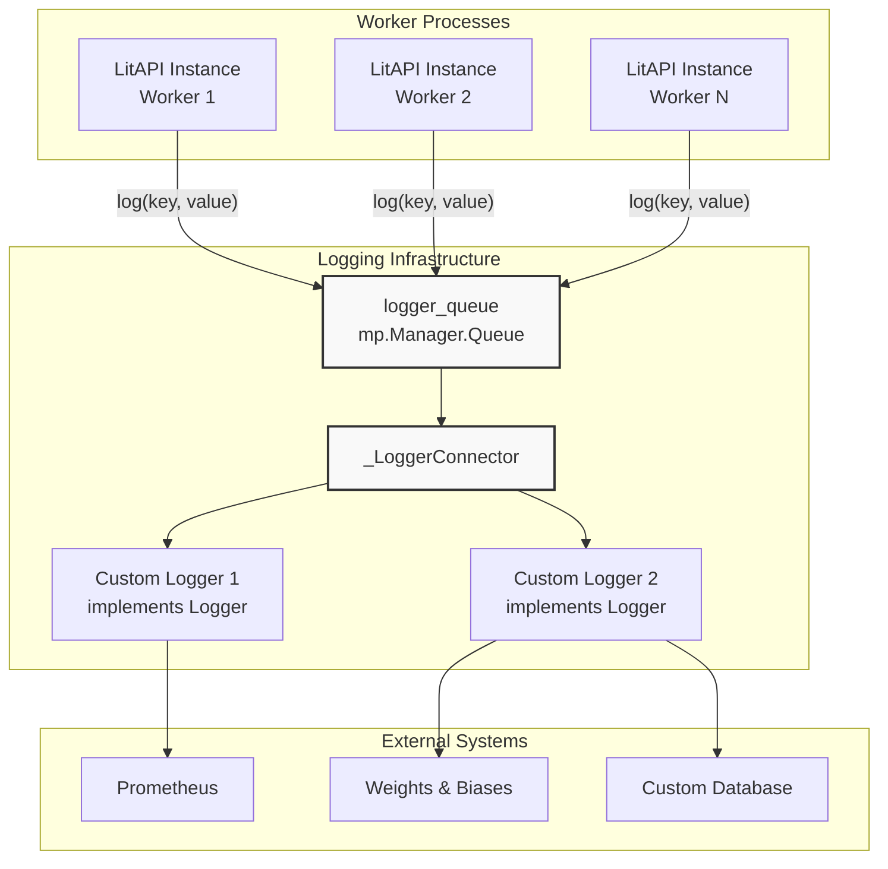
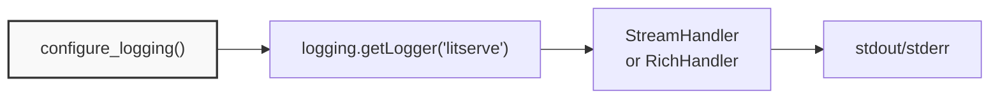
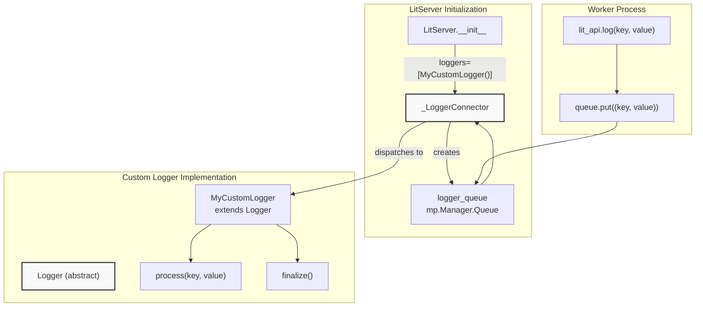
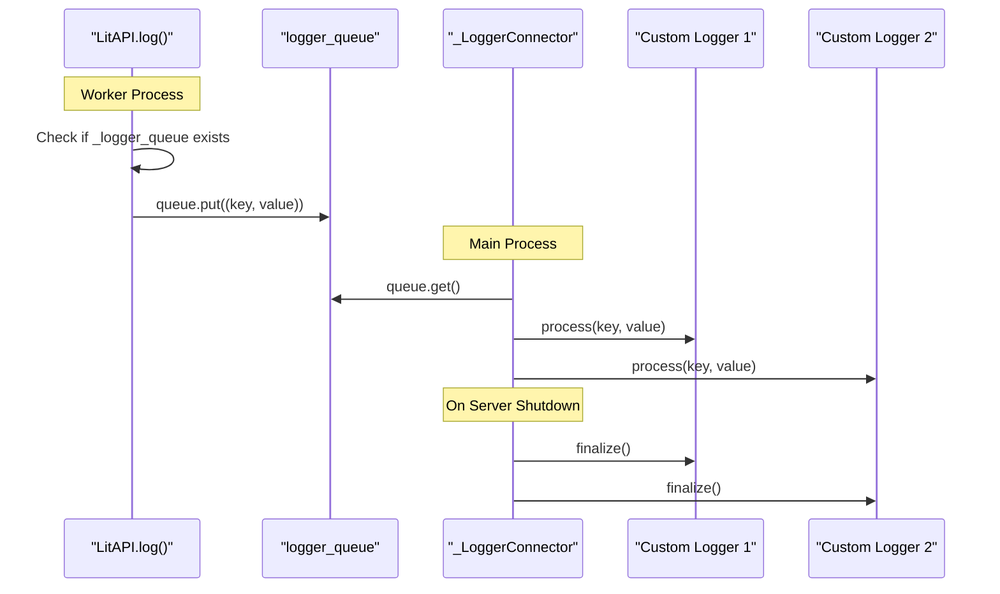
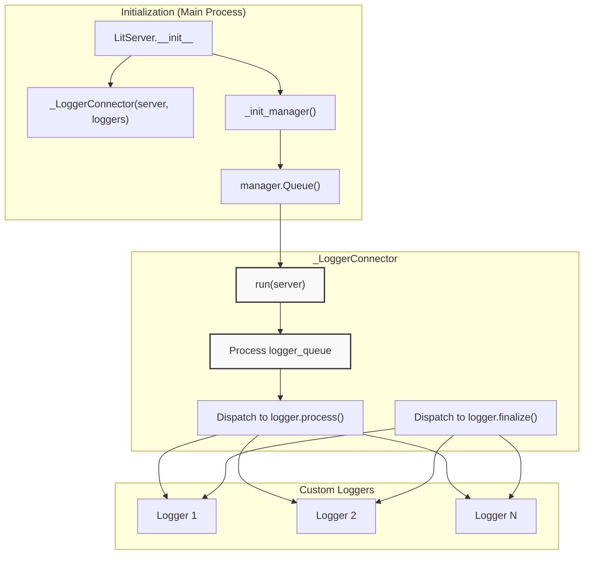

<!-- source: DeepWiki mcp.deepwiki.com · repo Lightning-AI/LitServe · page 4.4 Logging and Monitoring · fetched 2026-10-21 -->

# Logging and Monitoring

<details>
<summary>Relevant source files</summary>

The following files were used as context for generating this wiki page:

- [src/litserve/api.py](src/litserve/api.py)
- [src/litserve/server.py](src/litserve/server.py)
- [src/litserve/specs/base.py](src/litserve/specs/base.py)
- [src/litserve/utils.py](src/litserve/utils.py)

</details>


This page documents LitServe's logging and monitoring capabilities, covering built-in logging configuration, custom logger implementations, metrics tracking through the `LitAPI.log()` method, and integration with monitoring systems.

**Purpose**: Enable developers to configure logging levels, implement custom loggers for metrics collection, and integrate LitServe with external monitoring systems like Prometheus, Weights & Biases, or custom dashboards.

**Scope**: This page covers the logging infrastructure and custom logger interface. For lifecycle event handling (like request/response hooks), see [Callbacks and Middleware](#4.3). For performance testing and benchmarking, see [Performance Testing](#5.2).

---

## Overview

LitServe provides a multi-layered logging and monitoring system:

1. **Built-in logging**: Standard Python logging for operational messages
2. **Custom loggers**: Extensible interface for metrics and event tracking
3. **LitAPI logging**: Worker-level metrics via `lit_api.log(key, value)`
4. **Logger queue**: Multi-process communication for metrics aggregation



**Architecture**: Workers call `lit_api.log(key, value)` which puts metrics into a shared queue. The `_LoggerConnector` processes this queue and dispatches metrics to all registered custom loggers, which can forward to monitoring systems.

**Sources**: [src/litserve/server.py:48](), [src/litserve/server.py:795-797](), [src/litserve/api.py:136](), [src/litserve/api.py:382-396]()

---

## Built-in Logging Configuration

LitServe uses Python's standard `logging` module with sensible defaults for operational logging (errors, warnings, debug messages). The `configure_logging` utility provides centralized configuration.

### Basic Configuration



**Function Signature**: The `configure_logging` function at [src/litserve/utils.py:152-193]() accepts:

| Parameter | Type | Default | Description |
|-----------|------|---------|-------------|
| `level` | `str` or `int` | `logging.INFO` | Logging level (DEBUG, INFO, WARNING, ERROR) |
| `format` | `str` | Default format | Log message format string |
| `stream` | `TextIO` | `sys.stdout` | Output stream for logs |
| `use_rich` | `bool` | `False` | Enable rich formatting with tracebacks |

**Default Format**: Defined at [src/litserve/utils.py:42-44]():
```
%(asctime)s - %(processName)s[%(process)d] - %(name)s - %(levelname)s - %(filename)s:%(lineno)d - %(message)s
```

### Configuration Examples

**Basic usage** - Set log level to DEBUG:
```python
from litserve.utils import configure_logging
import logging

configure_logging(level=logging.DEBUG)
```

**Rich formatting** - Enable enhanced tracebacks for debugging:
```python
configure_logging(level="DEBUG", use_rich=True)
```

**Custom format** - Simplified log format:
```python
configure_logging(
    level="INFO",
    format="%(asctime)s - %(levelname)s - %(message)s"
)
```

**File output** - Write logs to file:
```python
import sys

with open("server.log", "w") as f:
    configure_logging(level="INFO", stream=f)
```

### Runtime Log Control

After initial configuration, use helper functions for runtime control:

**Set log level** at [src/litserve/utils.py:195-197]():
```python
from litserve.utils import set_log_level
import logging

set_log_level(logging.DEBUG)
```

**Add custom handlers** at [src/litserve/utils.py:200-208]():
```python
from litserve.utils import add_log_handler
import logging

file_handler = logging.FileHandler('litserve.log')
add_log_handler(file_handler)
```

**Sources**: [src/litserve/utils.py:42-44](), [src/litserve/utils.py:152-193](), [src/litserve/utils.py:195-208]()

---

## Custom Logger Interface

LitServe provides an abstract `Logger` interface for implementing custom metrics collection and monitoring integrations. Custom loggers receive metrics from worker processes via the logger queue.

### Logger Architecture



**Logger Lifecycle**:
1. Custom loggers passed to `LitServer(loggers=[...])`
2. `_LoggerConnector` creates manager queue if loggers present
3. Workers call `lit_api.log()` → puts to queue
4. `_LoggerConnector` reads queue, calls `process()` on each logger
5. On shutdown, calls `finalize()` on each logger

### Implementing a Custom Logger

The `Logger` abstract class requires two methods:

**Method: `process(key: str, value: Any)`**
- Called for each metric logged by workers
- Receives key-value pairs from `lit_api.log(key, value)`
- Should be non-blocking to avoid slowing down metrics collection

**Method: `finalize()`**
- Called during server shutdown
- Use for cleanup: flushing buffers, closing connections, saving state

### Example: Prometheus Logger

```python
import litserve as ls
from litserve.loggers import Logger
from prometheus_client import Counter, Histogram, push_to_gateway

class PrometheusLogger(Logger):
    def __init__(self, gateway_url: str, job_name: str):
        self.gateway_url = gateway_url
        self.job_name = job_name
        
        # Define metrics
        self.request_counter = Counter(
            'litserve_requests_total', 
            'Total requests processed'
        )
        self.latency_histogram = Histogram(
            'litserve_latency_seconds',
            'Request latency in seconds'
        )
    
    def process(self, key: str, value: Any):
        """Process incoming metrics from workers."""
        if key == "request_count":
            self.request_counter.inc(value)
        elif key == "request_latency":
            self.latency_histogram.observe(value)
    
    def finalize(self):
        """Push metrics to Prometheus gateway on shutdown."""
        push_to_gateway(
            self.gateway_url, 
            job=self.job_name, 
            registry=self.request_counter._registry
        )

# Use the logger
class MyAPI(ls.LitAPI):
    def setup(self, device):
        self.model = load_model()
    
    def predict(self, x):
        import time
        start = time.time()
        result = self.model(x)
        
        # Log metrics
        self.log("request_count", 1)
        self.log("request_latency", time.time() - start)
        return result

prometheus_logger = PrometheusLogger(
    gateway_url="localhost:9091",
    job_name="litserve_inference"
)

server = ls.LitServer(
    MyAPI(),
    loggers=[prometheus_logger]
)
```

### Example: Weights & Biases Logger

```python
import litserve as ls
from litserve.loggers import Logger
import wandb

class WandBLogger(Logger):
    def __init__(self, project: str, name: str):
        wandb.init(project=project, name=name)
        self.step = 0
    
    def process(self, key: str, value: Any):
        """Log metrics to W&B."""
        wandb.log({key: value}, step=self.step)
        self.step += 1
    
    def finalize(self):
        """Finish W&B run."""
        wandb.finish()

# Usage
class MyAPI(ls.LitAPI):
    def predict(self, x):
        result = self.model(x)
        
        # Log custom metrics
        self.log("prediction_value", float(result))
        self.log("input_size", len(x))
        return result

server = ls.LitServer(
    MyAPI(),
    loggers=[WandBLogger(project="litserve", name="production")]
)
```

### Multiple Loggers

LitServe supports multiple loggers simultaneously, allowing metrics to be sent to different destinations:

```python
# Log to both Prometheus and W&B
server = ls.LitServer(
    MyAPI(),
    loggers=[
        PrometheusLogger("localhost:9091", "litserve"),
        WandBLogger("litserve", "production"),
        CustomDatabaseLogger("postgresql://...")
    ]
)
```

**Sources**: [src/litserve/server.py:48](), [src/litserve/server.py:676](), [src/litserve/server.py:795]()

---

## LitAPI Logging Methods

Workers log metrics and events using the `lit_api.log()` method, which safely communicates metrics from worker processes to the main process via the logger queue.

### Logging Flow



### The log() Method

Defined at [src/litserve/api.py:387-396]():

```python
def log(self, key: str, value: Any):
    """Log a key-value pair to the server."""
    if self._logger_queue is None:
        warnings.warn(
            f"Logging event ('{key}', '{value}') attempted without a configured logger. "
            "To track and visualize metrics, please initialize and attach a logger. "
            "If this is intentional, you can safely ignore this message."
        )
        return
    self._logger_queue.put((key, value))
```

**Behavior**:
- If no loggers configured, emits warning (not an error)
- Non-blocking: puts to queue and returns immediately
- Thread-safe: safe to call from any worker thread
- Type-agnostic: accepts any pickleable value

### Usage Patterns

**Basic metrics**:
```python
class MyAPI(ls.LitAPI):
    def predict(self, x):
        result = self.model(x)
        
        # Log scalar metrics
        self.log("prediction_score", float(result.score))
        self.log("confidence", result.confidence)
        
        return result
```

**Performance tracking**:
```python
import time

class MyAPI(ls.LitAPI):
    def predict(self, x):
        start = time.time()
        result = self.model(x)
        
        # Log timing information
        self.log("inference_time_ms", (time.time() - start) * 1000)
        self.log("batch_size", len(x))
        
        return result
```

**Custom metrics with context**:
```python
class MyAPI(ls.LitAPI):
    def __init__(self):
        super().__init__()
        self.request_count = 0
    
    def predict(self, x):
        self.request_count += 1
        result = self.model(x)
        
        # Log with additional context
        self.log("requests_processed", self.request_count)
        self.log("model_version", "v2.1")
        self.log("input_type", type(x).__name__)
        
        return result
```

**Error tracking**:
```python
class MyAPI(ls.LitAPI):
    def predict(self, x):
        try:
            result = self.model(x)
            self.log("prediction_success", 1)
            return result
        except Exception as e:
            self.log("prediction_error", 1)
            self.log("error_type", type(e).__name__)
            raise
```

### Logger Queue Initialization

The logger queue is created by `_LoggerConnector` when loggers are provided:

**Initialization sequence** at [src/litserve/server.py:1124-1126]():
```python
if self._logger_connector._loggers:
    self.logger_queue = manager.Queue()
self._logger_connector.run(self)
```

**Queue distribution to LitAPIs** via [src/litserve/server.py:268-270]():
```python
def set_logger_queue(self, queue: Queue):
    for lit_api in self.lit_apis:
        lit_api.set_logger_queue(queue)
```

**LitAPI receives queue** at [src/litserve/api.py:382-385]():
```python
def set_logger_queue(self, queue: Queue):
    """Set the queue for logging events."""
    self._logger_queue = queue
```

**Sources**: [src/litserve/api.py:387-396](), [src/litserve/server.py:1124-1126](), [src/litserve/server.py:268-270](), [src/litserve/api.py:382-385]()

---

## Logger Connector Implementation

The `_LoggerConnector` class manages the lifecycle of custom loggers and processes the logger queue. It runs in the main process and distributes metrics to all registered loggers.

### Connector Architecture



### Key Responsibilities

The `_LoggerConnector` class (referenced at [src/litserve/server.py:48]() and [src/litserve/server.py:795]()):

1. **Logger management**: Stores and manages custom logger instances
2. **Queue processing**: Continuously reads from `logger_queue`
3. **Metric distribution**: Calls `process()` on each logger for every metric
4. **Lifecycle management**: Calls `finalize()` on shutdown
5. **Error handling**: Isolates logger errors from worker processes

### Usage Pattern

```python
class MyAPI(ls.LitAPI):
    def predict(self, x):
        # This call goes through the queue to _LoggerConnector
        self.log("prediction_count", 1)
        return self.model(x)

# Logger receives metrics via _LoggerConnector
class MyLogger(Logger):
    def process(self, key, value):
        # Called by _LoggerConnector for each metric
        print(f"Metric: {key} = {value}")

server = ls.LitServer(
    MyAPI(),
    loggers=[MyLogger()]  # Registered with _LoggerConnector
)
```

**Sources**: [src/litserve/server.py:48](), [src/litserve/server.py:795](), [src/litserve/server.py:1124-1126]()

---

## Integration with Callbacks

Logging and monitoring complement the callback system. While loggers track metrics, callbacks handle lifecycle events like request start/end.

### Callbacks vs Loggers Comparison

| Feature | Callbacks | Loggers |
|---------|-----------|---------|
| **Purpose** | React to lifecycle events | Collect and forward metrics |
| **Scope** | Request/response lifecycle | Worker-level metrics |
| **Execution** | Synchronous event handlers | Asynchronous queue processing |
| **Use cases** | Authentication, rate limiting | Performance metrics, dashboards |
| **Interface** | `on_request()`, `after_predict()`, etc. | `process()`, `finalize()` |
| **Communication** | Direct method calls | Multi-process queue |

### Combined Usage Pattern

```python
from litserve.callbacks import Callback, EventTypes
from litserve.loggers import Logger
import time

class PerformanceLogger(Logger):
    """Logger for collecting performance metrics."""
    
    def __init__(self):
        self.metrics = []
    
    def process(self, key, value):
        self.metrics.append((key, value, time.time()))
    
    def finalize(self):
        # Save metrics to file
        with open("metrics.json", "w") as f:
            json.dump(self.metrics, f)

class RequestTimingCallback(Callback):
    """Callback for timing individual requests."""
    
    def on_request(self, litserver, **kwargs):
        # Record request start time
        litserver.request_start_time = time.time()
    
    def on_response(self, litserver, **kwargs):
        # Calculate and log request duration
        duration = time.time() - litserver.request_start_time
        # Note: callbacks can't directly log, but can trigger other actions
        print(f"Request completed in {duration:.3f}s")

class MyAPI(ls.LitAPI):
    def predict(self, x):
        start = time.time()
        result = self.model(x)
        
        # Log to logger system
        self.log("prediction_time", time.time() - start)
        self.log("input_tokens", len(x))
        
        return result

server = ls.LitServer(
    MyAPI(),
    callbacks=[RequestTimingCallback()],  # Lifecycle events
    loggers=[PerformanceLogger()]          # Metrics collection
)
```

### Event Triggering Locations

Callbacks are triggered at [src/litserve/server.py:301-305]() (ON_REQUEST) and [src/litserve/server.py:340]() (ON_RESPONSE):

```python
# Trigger callback in request handler
self.server._callback_runner.trigger_event(
    EventTypes.ON_REQUEST.value,
    active_requests=self.server.active_requests,
    litserver=self.server,
)
```

**Sources**: [src/litserve/server.py:301-305](), [src/litserve/server.py:340](), [src/litserve/callbacks/base.py]()

---

## Monitoring Best Practices

### 1. Metric Naming Conventions

Use consistent, hierarchical naming:

```python
# Good: namespaced and descriptive
self.log("model.inference_time_ms", 45.2)
self.log("model.batch_size", 8)
self.log("request.input_tokens", 150)
self.log("request.output_tokens", 75)

# Avoid: ambiguous names
self.log("time", 45.2)
self.log("size", 8)
```

### 2. Metric Types

Track different metric types appropriately:

```python
class MyAPI(ls.LitAPI):
    def predict(self, x):
        # Counters: incrementing values
        self.log("requests_total", 1)
        self.log("errors_total", 0)
        
        # Gauges: current state
        self.log("queue_depth", len(self.queue))
        self.log("gpu_memory_mb", torch.cuda.memory_allocated() / 1e6)
        
        # Histograms: distributions
        self.log("request_latency_ms", latency)
        self.log("batch_size", len(x))
        
        # Labels: categorical data
        self.log("model_version", "v2.1")
        self.log("input_type", "image")
```

### 3. Performance Considerations

Logging should not impact inference performance:

```python
class EfficientLogger(Logger):
    def __init__(self):
        self.buffer = []
        self.buffer_size = 1000
    
    def process(self, key, value):
        # Buffer metrics to reduce I/O
        self.buffer.append((key, value))
        
        if len(self.buffer) >= self.buffer_size:
            self._flush()
    
    def _flush(self):
        # Batch write to external system
        write_to_monitoring_system(self.buffer)
        self.buffer.clear()
    
    def finalize(self):
        # Flush remaining metrics
        if self.buffer:
            self._flush()
```

### 4. Error Handling in Loggers

Loggers should not crash the server:

```python
class ResilientLogger(Logger):
    def process(self, key, value):
        try:
            # Attempt to send metric
            self.client.send_metric(key, value)
        except Exception as e:
            # Log error but don't crash
            print(f"Failed to log metric {key}: {e}")
    
    def finalize(self):
        try:
            self.client.close()
        except Exception:
            pass  # Best-effort cleanup
```

### 5. Development vs Production Logging

Adjust logging verbosity based on environment:

```python
import os

if os.getenv("ENV") == "production":
    configure_logging(level="WARNING")
else:
    configure_logging(level="DEBUG", use_rich=True)
```

### 6. Health Check Logging

The health endpoint at [src/litserve/server.py:981-998]() can be monitored:

```python
class MyAPI(ls.LitAPI):
    def health(self):
        # Custom health check
        is_healthy = self.model.is_loaded and self.check_dependencies()
        
        # Log health status
        self.log("health_check", 1 if is_healthy else 0)
        
        return is_healthy
```

**Sources**: [src/litserve/server.py:981-998]()

---

## Complete Example: Production Monitoring

This example demonstrates a complete monitoring setup with custom logger, metrics tracking, and integration with external systems:

```python
import litserve as ls
from litserve.loggers import Logger
from litserve.callbacks import Callback, EventTypes
import time
from collections import defaultdict
import json

# Custom Logger for aggregating metrics
class AggregatingMetricsLogger(Logger):
    """Aggregates metrics and exports to monitoring system."""
    
    def __init__(self, export_interval: int = 60):
        self.metrics = defaultdict(list)
        self.export_interval = export_interval
        self.last_export = time.time()
    
    def process(self, key: str, value: Any):
        """Collect metrics in memory."""
        self.metrics[key].append(value)
        
        # Periodic export
        if time.time() - self.last_export > self.export_interval:
            self._export_metrics()
    
    def _export_metrics(self):
        """Export aggregated metrics to monitoring system."""
        aggregated = {}
        for key, values in self.metrics.items():
            if isinstance(values[0], (int, float)):
                aggregated[f"{key}_mean"] = sum(values) / len(values)
                aggregated[f"{key}_min"] = min(values)
                aggregated[f"{key}_max"] = max(values)
                aggregated[f"{key}_count"] = len(values)
            else:
                aggregated[f"{key}_count"] = len(values)
        
        # Send to monitoring system (e.g., Prometheus, CloudWatch)
        print(f"Exporting metrics: {json.dumps(aggregated, indent=2)}")
        
        # Clear buffer
        self.metrics.clear()
        self.last_export = time.time()
    
    def finalize(self):
        """Export remaining metrics on shutdown."""
        if self.metrics:
            self._export_metrics()

# Callback for request tracking
class RequestMetricsCallback(Callback):
    """Track request-level metrics."""
    
    def on_request(self, litserver, **kwargs):
        # Access active requests if tracking is enabled
        if litserver.track_requests:
            active = litserver.active_requests
            print(f"Active requests: {active}")

# LitAPI with comprehensive logging
class ProductionAPI(ls.LitAPI):
    def setup(self, device):
        import torch
        self.model = torch.nn.Linear(10, 1).to(device)
        self.device = device
        self.request_count = 0
        
        # Log setup completion
        self.log("setup_complete", 1)
        self.log("device", str(device))
    
    def predict(self, x):
        self.request_count += 1
        
        # Timing
        start = time.time()
        
        # Inference
        result = self.model(x)
        
        # Performance metrics
        inference_time = time.time() - start
        self.log("inference_time_ms", inference_time * 1000)
        self.log("requests_total", self.request_count)
        
        # Resource metrics
        if str(self.device).startswith("cuda"):
            gpu_mem = torch.cuda.memory_allocated() / 1e6
            self.log("gpu_memory_mb", gpu_mem)
        
        # Input/output metrics
        self.log("input_size", x.shape[0])
        self.log("output_value", float(result.mean()))
        
        return result
    
    def health(self):
        """Custom health check with logging."""
        is_healthy = hasattr(self, 'model') and self.model is not None
        self.log("health_status", 1 if is_healthy else 0)
        return is_healthy

# Create server with monitoring
server = ls.LitServer(
    ProductionAPI(max_batch_size=8, batch_timeout=0.1),
    accelerator="cuda",
    devices=1,
    workers_per_device=2,
    track_requests=True,  # Enable request tracking
    loggers=[
        AggregatingMetricsLogger(export_interval=30)
    ],
    callbacks=[
        RequestMetricsCallback()
    ]
)

# Configure logging
from litserve.utils import configure_logging
configure_logging(level="INFO")

# Run server
server.run(port=8000)
```

This production example demonstrates:
- Custom logger with metric aggregation
- Request tracking via callbacks
- Comprehensive metric collection (timing, resources, I/O)
- Health check integration
- Periodic metric export
- GPU memory monitoring

**Sources**: [src/litserve/api.py:387-396](), [src/litserve/server.py:674-676](), [src/litserve/server.py:478-486]()

---

