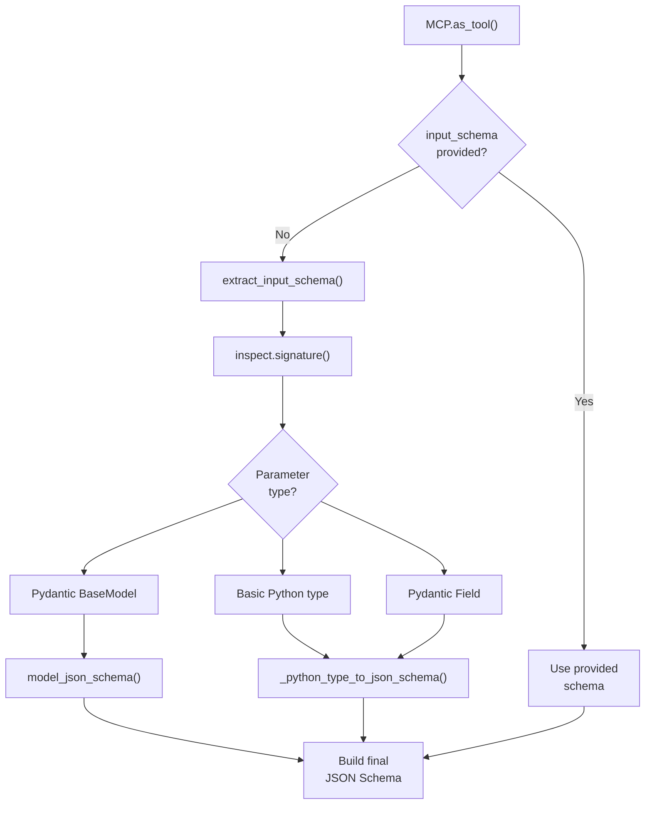
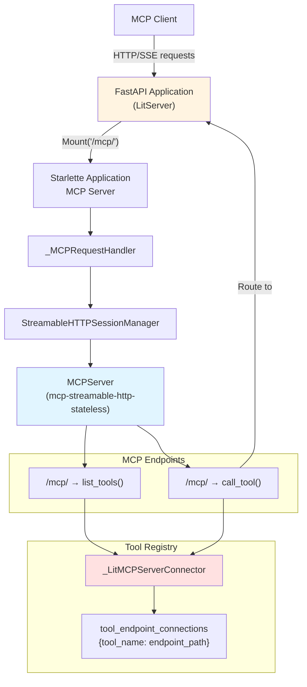

<!-- source: DeepWiki mcp.deepwiki.com · repo Lightning-AI/LitServe · page 4.5 MCP Integration · fetched 2026-10-21 -->

# MCP Integration

<details>
<summary>Relevant source files</summary>

The following files were used as context for generating this wiki page:

- [pyproject.toml](pyproject.toml)
- [src/litserve/__init__.py](src/litserve/__init__.py)
- [src/litserve/mcp.py](src/litserve/mcp.py)
- [tests/e2e/default_mcp.py](tests/e2e/default_mcp.py)
- [tests/unit/test_cli.py](tests/unit/test_cli.py)
- [tests/unit/test_mcp.py](tests/unit/test_mcp.py)

</details>


This document covers the Model Context Protocol (MCP) integration in LitServe, which enables LitAPI implementations to be exposed as tools for AI agent orchestration systems. MCP integration allows models served by LitServe to be discovered and invoked by MCP-compatible clients such as Claude Desktop and other AI agent frameworks.

For information about general API specifications and OpenAI compatibility, see [API Specifications](#3). For deployment options, see [Deployment Options](#4.7).

## Purpose and Scope

The MCP integration provides:
- Automatic tool registration for LitAPI endpoints
- Schema extraction from Pydantic models and type annotations
- SSE (Server-Sent Events) protocol support via `/mcp/` endpoint
- Compatibility with MCP clients and AI agent orchestrators

---

## Quick Start

Basic MCP integration requires defining a Pydantic model for requests and passing an `MCP` instance to `LitAPI`:

```python
from pydantic import BaseModel
from litserve.mcp import MCP
import litserve as ls

class PowerRequest(BaseModel):
    input: float

class MyLitAPI(ls.LitAPI):
    def decode_request(self, request: PowerRequest) -> float:
        return request.input
    
    def predict(self, x: float) -> float:
        return x ** 2
    
    def encode_response(self, output: float) -> dict:
        return {"result": output}

api = MyLitAPI(mcp=MCP(description="Returns the power of a number."))
server = ls.LitServer(api)
server.run()
```

Once running, the API is exposed at `/predict` and also registered as an MCP tool accessible via `/mcp/`.

**Sources:** [tests/e2e/default_mcp.py:1-20]()

---

## The MCP Class

The `MCP` class is the primary interface for enabling MCP integration. It configures how a LitAPI endpoint is exposed as an MCP tool.

### Constructor Parameters

| Parameter | Type | Default | Description |
|-----------|------|---------|-------------|
| `name` | `Optional[str]` | `None` | Tool name for MCP registration. If not provided, uses `api_path`. Forward slashes are converted to underscores. |
| `description` | `Optional[str]` | `None` | Human-readable description used by AI systems to understand when to use the tool. If not provided, uses class docstring. |
| `input_schema` | `Optional[dict]` | `None` | JSON Schema defining expected input format. If not provided, auto-extracted from `decode_request` method. |

### Name Sanitization

Tool names are automatically sanitized to comply with MCP naming requirements:

```python
# Leading "/" is removed
MCP(name="/predict")  # becomes "predict"

# "/" in names converted to "_"
MCP(name="api/v1/predict")  # becomes "api_v1_predict"
```

This sanitization is handled by the `name` property setter at [src/litserve/mcp.py:375-379]().

### Connection to LitAPI

The `MCP` instance connects to a `LitAPI` when passed via the `mcp` parameter:

```python
api = MyLitAPI(mcp=MCP(description="Tool description"))
```

Internally, `LitAPI` calls `mcp._connect(self)` to establish a weak reference, preventing circular dependencies [src/litserve/mcp.py:381-384]().

**Sources:** [src/litserve/mcp.py:265-415](), [src/litserve/mcp.py:348-369]()

---

## Schema Extraction

LitServe automatically extracts JSON Schema from type annotations in the `decode_request` method when no explicit `input_schema` is provided.

### Schema Extraction Flow



**Diagram: Schema Extraction Process**

### Supported Type Annotations

The `extract_input_schema()` function at [src/litserve/mcp.py:54-193]() supports:

| Python Type | JSON Schema Type | Example |
|------------|------------------|---------|
| `str` | `"string"` | `name: str` |
| `int` | `"integer"` | `age: int` |
| `float` | `"number"` | `price: float` |
| `bool` | `"boolean"` | `active: bool` |
| `list` | `"array"` | `items: list` |
| `dict` | `"object"` | `metadata: dict` |
| `Optional[T]` | `{"type": "...", "nullable": true}` | `nickname: Optional[str]` |
| Pydantic `BaseModel` | Full schema with `$ref` | `request: MyModel` |

### Pydantic Field Constraints

Pydantic `Field` constraints are automatically extracted:

```python
from pydantic import BaseModel, Field

class Request(BaseModel):
    name: str = Field(min_length=3, max_length=50, description="User name")
    age: int = Field(gt=0, lt=150, description="User age")
```

Generated schema includes:
- `minLength`, `maxLength` for string constraints
- `minimum`, `maximum` for inclusive numeric bounds
- `exclusiveMinimum`, `exclusiveMaximum` for exclusive bounds
- `description` for documentation
- `default` for default values

The constraint extraction logic is at [src/litserve/mcp.py:166-178]().

### Schema for Pydantic Models

When a parameter is a Pydantic `BaseModel`, the entire model schema is extracted with `$defs` for nested models:

```python
class Address(BaseModel):
    street: str
    city: str

class UserRequest(BaseModel):
    name: str
    address: Address

def decode_request(self, request: UserRequest):
    ...
```

Generates schema:

```json
{
  "properties": {
    "request": {"$ref": "#/$defs/UserRequest"}
  },
  "$defs": {
    "UserRequest": {
      "properties": {
        "name": {"type": "string", "title": "Name"},
        "address": {"$ref": "#/$defs/Address"}
      },
      "required": ["name", "address"],
      "type": "object"
    },
    "Address": {
      "properties": {
        "street": {"type": "string", "title": "Street"},
        "city": {"type": "string", "title": "City"}
      },
      "required": ["street", "city"],
      "type": "object"
    }
  }
}
```

This logic is handled at [src/litserve/mcp.py:106-126]().

**Sources:** [src/litserve/mcp.py:54-193](), [src/litserve/mcp.py:196-246](), [tests/unit/test_mcp.py:29-208]()

---

## Tool Registration and Endpoint

### Tool Creation

When `LitServer` initializes, it collects MCP tools from all registered APIs and passes them to `_LitMCPServerConnector.connect_mcp_server()`. Each `MCP` instance is converted to a `ToolEndpointType` via the `as_tool()` method:

```python
def as_tool(self) -> ToolEndpointType:
    name = self.name or self.lit_api.api_path
    description = self.description or self.lit_api.__doc__
    
    if self.input_schema:
        input_schema = self.input_schema
    else:
        input_schema = extract_input_schema(self.lit_api.decode_request)
    
    return ToolEndpointType(
        name=name,
        description=description,
        inputSchema=input_schema,
        endpoint=self.lit_api.api_path
    )
```

This method is at [src/litserve/mcp.py:386-414]().

### MCP Server Architecture



**Diagram: MCP Server Architecture and Request Flow**

### Endpoint Mounting

The `_LitMCPServerConnector` mounts the MCP server to the FastAPI application:

1. Creates an internal `MCPServer` instance with mode `"mcp-streamable-http-stateless"` [src/litserve/mcp.py:492]()
2. Registers `list_tools()` handler to return available tools [src/litserve/mcp.py:526-530]()
3. Registers `call_tool()` handler to route tool calls to FastAPI endpoints [src/litserve/mcp.py:532-551]()
4. Creates Starlette app with routes at `/mcp/` [src/litserve/mcp.py:478-481]()
5. Mounts Starlette app to FastAPI with `app.mount("/", starlette_app, name="mcp")` [src/litserve/mcp.py:554]()

### Tool Invocation Flow

When an MCP client calls a tool:

1. Request arrives at `/mcp/` endpoint
2. `_MCPRequestHandler.handle_streamable_http()` processes the request [src/litserve/mcp.py:428-461]()
3. `StreamableHTTPSessionManager` handles SSE protocol
4. `call_tool()` handler receives tool name and arguments [src/litserve/mcp.py:533-551]()
5. Tool name is mapped to endpoint path via `tool_endpoint_connections` [src/litserve/mcp.py:535-538]()
6. Corresponding FastAPI route handler is invoked directly [src/litserve/mcp.py:541-546]()
7. `_call_handler()` binds arguments to handler signature, converting dict arguments to Pydantic models [src/litserve/mcp.py:248-258]()
8. Response is converted to MCP content format via `_convert_to_content()` [src/litserve/mcp.py:258]()

**Sources:** [src/litserve/mcp.py:417-593](), [tests/unit/test_mcp.py:260-274]()

---

## Integration with LitAPI

### LitAPI Configuration

To enable MCP for a `LitAPI` implementation:

```python
class MyAPI(ls.LitAPI):
    def __init__(self):
        super().__init__()
        self.mcp = MCP(
            description="API description for AI agents",
            input_schema=None  # Auto-extracted from decode_request
        )
    
    def decode_request(self, request: MyRequestModel) -> Any:
        # Type hints used for schema extraction
        return request.data
```

Alternatively, pass `mcp` during instantiation:

```python
api = MyAPI(mcp=MCP(description="..."))
```

### Schema Extraction from decode_request

The `decode_request` method's signature is analyzed to extract the input schema. Best practices:

1. **Use Pydantic Models:** Provides complete schema with validation rules
   ```python
   def decode_request(self, request: MyRequestModel) -> Any:
       return request.field
   ```

2. **Use Type Hints:** For simple types, use standard Python type annotations
   ```python
   def decode_request(self, name: str, age: int) -> tuple:
       return name, age
   ```

3. **Use Pydantic Fields:** Add constraints and descriptions
   ```python
   from pydantic import Field
   
   def decode_request(
       self,
       name: str = Field(description="User name"),
       age: int = Field(ge=0, le=150)
   ) -> tuple:
       return name, age
   ```

The extraction happens at [src/litserve/mcp.py:403-404]() when `as_tool()` is called.

### Multiple APIs with MCP

Each `LitAPI` instance can have its own `MCP` configuration, allowing multiple tools to be registered on a single `LitServer`:

```python
api1 = API1(mcp=MCP(name="tool1", description="..."))
api2 = API2(mcp=MCP(name="tool2", description="..."))

server = ls.LitServer([api1, api2])
```

All tools are collected and registered with the `_LitMCPServerConnector` [src/litserve/mcp.py:556-575]().

**Sources:** [src/litserve/mcp.py:381-414](), [tests/e2e/default_mcp.py:1-20](), [tests/unit/test_mcp.py:210-258]()

---

## MCP Server Connector

### _LitMCPServerConnector Class

The `_LitMCPServerConnector` class at [src/litserve/mcp.py:484-593]() manages the lifecycle of the MCP server:

| Component | Type | Purpose |
|-----------|------|---------|
| `mcp_server` | `MCPServer` | Core MCP server instance from `mcp` package |
| `tools` | `list[ToolEndpointType]` | Registry of registered tools |
| `request_handler` | `_MCPRequestHandler` | Handles HTTP/SSE requests |
| `tool_endpoint_connections` | `dict[str, str]` | Maps tool names to FastAPI endpoint paths |

### Tool Management Methods

```python
def add_tool(self, tool: ToolEndpointType):
    # Maps tool name to endpoint path
    self.tool_endpoint_connections[tool.name] = tool.endpoint
    self.tools.append(tool)

def list_tools(self) -> list[ToolEndpointType]:
    # Returns all registered tools
    return self.tools
```

These methods are at [src/litserve/mcp.py:497-502]().

### Lifespan Management

The connector uses an async context manager for lifespan management:

```python
@asynccontextmanager
async def lifespan(self, app: Starlette):
    # Initialize session manager
    if self.request_handler._session_manager is None:
        self.request_handler._session_manager = StreamableHTTPSessionManager(...)
    
    # Start MCP server
    async with self.request_handler._session_manager.run():
        yield
```

This ensures proper startup and shutdown of the MCP server's SSE session manager [src/litserve/mcp.py:504-516]().

### Connection Initialization

When `connect_mcp_server()` is called by `LitServer`:

1. Validates that tools are provided [src/litserve/mcp.py:565-566]()
2. Logs beta warning [src/litserve/mcp.py:571-573]()
3. Mounts Starlette app to FastAPI [src/litserve/mcp.py:575]()
4. Logs setup instructions for Claude Desktop [src/litserve/mcp.py:577-592]()

**Sources:** [src/litserve/mcp.py:484-593]()

---

## Configuration and Client Setup

### Server-Side Configuration

The MCP server runs on the same port as the LitServer. No additional configuration is required beyond passing `MCP` instances to `LitAPI`.

### Claude Desktop Integration

After starting the server, configure Claude Desktop by adding to `claude_desktop_config.json`:

```json
{
  "mcpServers": {
    "litserve": {
      "command": "npx",
      "args": ["mcp-remote", "http://localhost:8000/mcp/"]
    }
  }
}
```

Replace `http://localhost:8000` with your actual server URL. The `/mcp/` suffix is required for the MCP endpoint.

Installation instructions are logged when MCP is enabled [src/litserve/mcp.py:577-592]().

### MCP Client Requirements

MCP clients must support:
- HTTP/SSE (Server-Sent Events) protocol
- Stateless operation mode
- JSON request/response format

The server uses `StreamableHTTPSessionManager` with `stateless=True` [src/litserve/mcp.py:471]().

**Sources:** [src/litserve/mcp.py:577-592]()

---

## Advanced Topics

### Custom Input Schemas

Override automatic schema extraction by providing explicit `input_schema`:

```python
custom_schema = {
    "properties": {
        "query": {
            "type": "string",
            "description": "Search query"
        },
        "limit": {
            "type": "integer",
            "minimum": 1,
            "maximum": 100,
            "default": 10
        }
    },
    "required": ["query"],
    "type": "object"
}

mcp = MCP(description="...", input_schema=custom_schema)
```

This bypasses the `extract_input_schema()` call [src/litserve/mcp.py:400-404]().

### Error Handling

Errors during tool calls are caught and returned as JSON responses:

```python
try:
    return await _call_handler(handler, **arguments)
except Exception as e:
    logger.error(f"Error calling tool {name}: {e}")
    raise e
```

The error handling is at [src/litserve/mcp.py:549-551]() for tool calls and [src/litserve/mcp.py:445-461]() for HTTP requests.

### Package Dependencies

MCP integration requires the `fastmcp` package:

```bash
pip install fastmcp
```

The system validates package availability at initialization [src/litserve/mcp.py:366-369](). If not installed, a clear error message is raised.

This dependency is specified in `pyproject.toml` under `[dependency-groups]` [pyproject.toml:166]().

### MCP Protocol Version

LitServe uses the streamable HTTP stateless mode of MCP, compatible with:
- MCP SDK for Python
- `mcp-remote` client for remote connections
- Claude Desktop app with remote MCP support

The server identifier is `"mcp-streamable-http-stateless"` [src/litserve/mcp.py:492]().

**Sources:** [src/litserve/mcp.py:366-369](), [src/litserve/mcp.py:445-461](), [src/litserve/mcp.py:549-551](), [pyproject.toml:166]()

---

## Summary

MCP integration in LitServe enables AI agent orchestration by:

1. **Tool Registration:** `MCP` class registers LitAPI endpoints as tools
2. **Schema Extraction:** Automatic JSON Schema generation from Pydantic models and type hints
3. **Endpoint Exposure:** Tools accessible via `/mcp/` SSE endpoint
4. **Client Integration:** Compatible with Claude Desktop and other MCP clients
5. **Architecture:** `_LitMCPServerConnector` bridges LitServer's FastAPI with MCP server infrastructure

The integration is optional and doesn't affect standard HTTP API functionality. All existing LitServe features (batching, streaming, async) remain fully functional with MCP-enabled endpoints.

**Sources:** [src/litserve/mcp.py:1-593](), [tests/unit/test_mcp.py:1-274](), [tests/e2e/default_mcp.py:1-20]()

---

