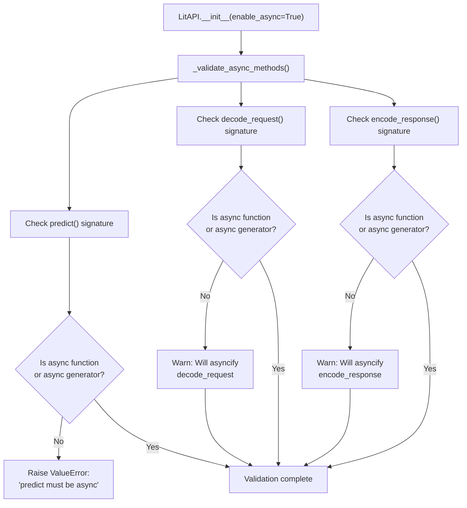
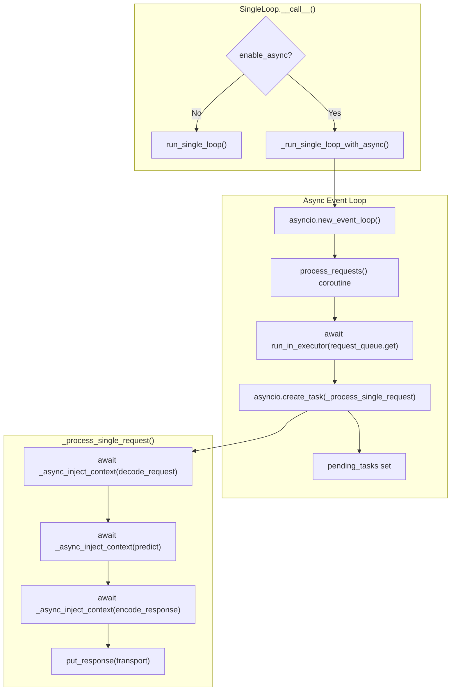
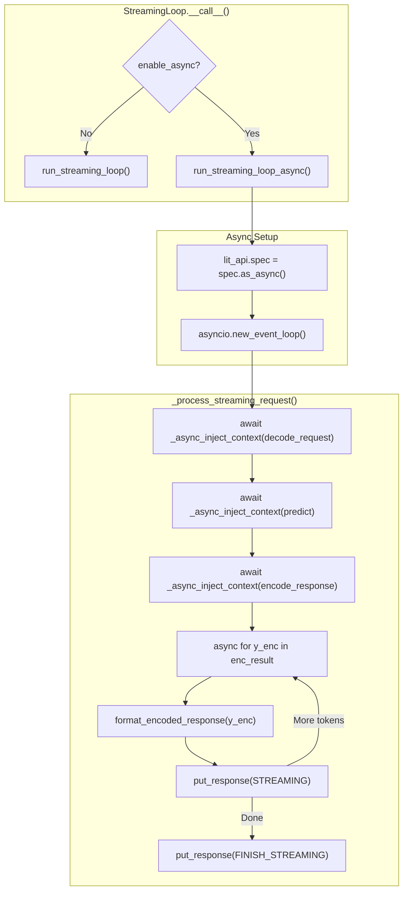
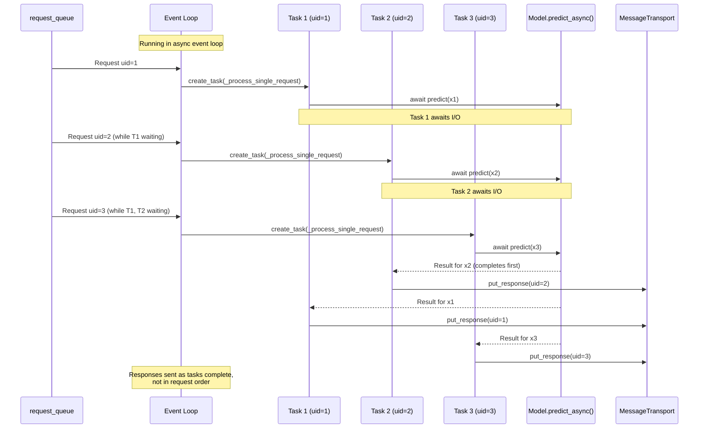
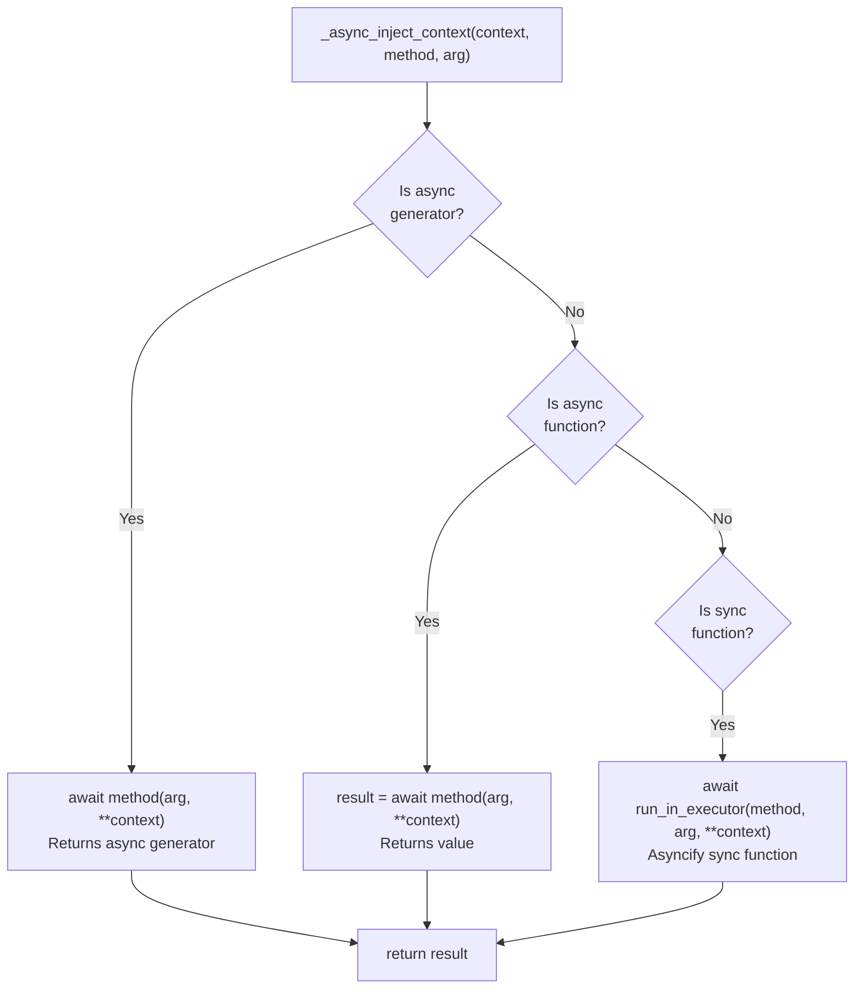
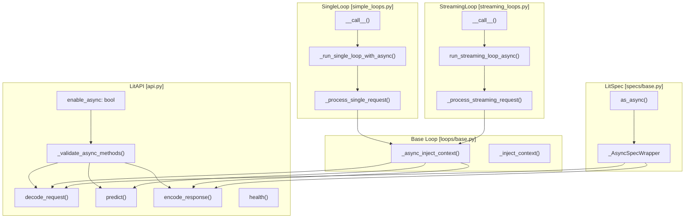

<!-- source: DeepWiki mcp.deepwiki.com · repo Lightning-AI/LitServe · page 4.6 Async Support · fetched 2026-10-21 -->

# Async Support

<details>
<summary>Relevant source files</summary>

The following files were used as context for generating this wiki page:

- [src/litserve/api.py](src/litserve/api.py)
- [src/litserve/loops/simple_loops.py](src/litserve/loops/simple_loops.py)
- [src/litserve/loops/streaming_loops.py](src/litserve/loops/streaming_loops.py)
- [src/litserve/specs/base.py](src/litserve/specs/base.py)

</details>


This page documents LitServe's async/await support, which enables concurrent request processing within a single worker process. Async support is particularly useful for I/O-bound operations (database queries, external API calls) and can improve throughput when the model inference time varies significantly between requests.

For information about processing loops in general, see [Processing Loops](#2.3). For streaming-specific features, see [Streaming Loops](#2.3.2).

## Overview

LitServe supports async/await patterns through the `enable_async` flag on `LitAPI`. When enabled, LitAPI methods can be declared as async functions or async generators, allowing the event loop to process multiple requests concurrently without blocking on I/O operations.

**Key capabilities:**
- Concurrent request processing within a single worker
- Async versions of `decode_request`, `predict`, and `encode_response` methods
- Async generators for streaming responses
- Automatic validation of async method implementations
- Support for async health checks

**When to use async:**
- I/O-bound operations (databases, external APIs, file systems)
- Variable inference times where some requests complete faster than others
- Streaming responses with async generators
- Services that need to handle multiple concurrent connections per worker

**When NOT to use async:**
- Pure CPU-bound inference (GPU models with consistent latency)
- When batching is sufficient for throughput
- Simple request-response patterns with fast inference

Sources: [src/litserve/api.py:33-189]()

## Enabling Async Support

Set `enable_async=True` when initializing your `LitAPI` to enable async processing:

```python
class AsyncAPI(ls.LitAPI):
    def setup(self, device):
        self.model = load_model()
    
    async def decode_request(self, request):
        # Can use async I/O here
        return await preprocess_async(request)
    
    async def predict(self, x):
        return await self.model.infer_async(x)
    
    async def encode_response(self, output):
        return await postprocess_async(output)

api = AsyncAPI(enable_async=True)
server = ls.LitServer(api)
```

The `enable_async` parameter is defined in the `LitAPI.__init__` method and triggers validation of async method implementations.

Sources: [src/litserve/api.py:139-194]()

## Async Method Requirements

### Method Validation

When `enable_async=True`, LitServe validates that methods are properly implemented as async. The validation rules are defined in `LitAPI._validate_async_methods()`:

| Method | Requirement | Validation Type |
|--------|-------------|-----------------|
| `predict` | **Must** be async function or async generator | Error (blocks startup) |
| `decode_request` | **Should** be async function or async generator | Warning (will asyncify) |
| `encode_response` | **Should** be async function or async generator | Warning (will asyncify) |

**Validation flow:**



Sources: [src/litserve/api.py:195-243]()

### Async Function Example

For non-streaming APIs, implement methods as async functions:

```python
class AsyncNonStreamingAPI(ls.LitAPI):
    async def decode_request(self, request):
        # Async I/O operations
        data = await fetch_from_db(request["id"])
        return preprocess(data)
    
    async def predict(self, x):
        # Async inference
        result = await self.model.predict_async(x)
        return result
    
    async def encode_response(self, output):
        # Async post-processing
        await log_to_db(output)
        return {"result": output}
```

Sources: [src/litserve/loops/simple_loops.py:146-215]()

### Async Generator Example

For streaming APIs, implement methods as async generators:

```python
class AsyncStreamingAPI(ls.LitAPI):
    async def predict(self, prompt):
        # Async generator for streaming tokens
        async for token in self.model.stream_async(prompt):
            yield token
    
    async def encode_response(self, token_stream):
        # Transform async generator
        async for token in token_stream:
            yield {"token": token, "timestamp": time.time()}

api = AsyncStreamingAPI(stream=True, enable_async=True)
```

Sources: [src/litserve/loops/streaming_loops.py:137-204]()

## Async Processing in Loops

### SingleLoop Async Implementation

The `SingleLoop` class has a separate code path for async processing via `_run_single_loop_with_async()`:



**Key implementation details:**

1. **Event loop creation**: `asyncio.new_event_loop()` at [src/litserve/loops/simple_loops.py:285]()
2. **Non-blocking queue access**: Uses `run_in_executor` to avoid blocking the event loop at [src/litserve/loops/simple_loops.py:229]()
3. **Task creation**: Each request creates an `asyncio.create_task()` at [src/litserve/loops/simple_loops.py:270-278]()
4. **Task tracking**: `pending_tasks` set prevents garbage collection at [src/litserve/loops/simple_loops.py:226]()
5. **Request processing**: `_process_single_request()` coroutine at [src/litserve/loops/simple_loops.py:146-215]()

Sources: [src/litserve/loops/simple_loops.py:217-308]()

### StreamingLoop Async Implementation

The `StreamingLoop` provides async streaming through `run_streaming_loop_async()`:



**Async generator handling:**

The `_async_inject_context` helper (from `loops/base.py`) handles both async functions and async generators. For streaming:

1. `predict()` returns an async generator
2. `encode_response()` receives and transforms the async generator
3. The loop iterates with `async for` at [src/litserve/loops/streaming_loops.py:180-182]()

**Spec wrapping:**

When a spec is provided with async streaming, it's wrapped using `spec.as_async()` at [src/litserve/loops/streaming_loops.py:214-215](), which creates an `_AsyncSpecWrapper` that provides async versions of decode/encode methods.

Sources: [src/litserve/loops/streaming_loops.py:206-294](), [src/litserve/specs/base.py:75-91]()

## Concurrent Request Processing

### How Concurrency Works



**Task management:**

Tasks are tracked in a `pending_tasks` set to prevent premature garbage collection:

```python
# From single_loops.py
pending_tasks = set()

task = asyncio.create_task(
    self._process_single_request(...),
    name=f"process_request_{uid}"
)

# Keep reference to prevent GC
pending_tasks.add(task)
task.add_done_callback(pending_tasks.discard)
```

This pattern is used in both `SingleLoop` at [src/litserve/loops/simple_loops.py:279-282]() and `StreamingLoop` at [src/litserve/loops/streaming_loops.py:271-272]().

Sources: [src/litserve/loops/simple_loops.py:224-282](), [src/litserve/loops/streaming_loops.py:217-272]()

## Async Context Injection

### _async_inject_context Helper

The `_async_inject_context` function in `loops/base.py` handles calling async methods with context kwargs:



**Implementation:**
- Checks if method is async generator using `inspect.isasyncgenfunction()`
- Checks if method is async function using `asyncio.iscoroutinefunction()`
- Falls back to `run_in_executor` for sync functions (asyncifies them)
- Passes context dictionary as kwargs to methods that accept them

This enables the same method signature to work in both sync and async contexts, with automatic detection and handling.

Sources: [src/litserve/loops/base.py]() (referenced in multiple loop files)

## Async Health Checks

The `health()` method on `LitAPI` can optionally be async:

```python
class AsyncAPIWithHealth(ls.LitAPI):
    async def health(self) -> bool:
        # Check database connection
        db_ok = await check_database()
        
        # Check external service
        service_ok = await ping_external_api()
        
        return db_ok and service_ok
```

The server automatically detects whether `health()` is async and awaits it accordingly. This is documented at [src/litserve/api.py:404-417]().

Sources: [src/litserve/api.py:404-417]()

## Code Entity Reference

### Key Classes and Methods



**File locations:**
- `LitAPI`: [src/litserve/api.py:33-448]()
- `SingleLoop`: [src/litserve/loops/simple_loops.py:32-309]()
- `StreamingLoop`: [src/litserve/loops/streaming_loops.py:32-295]()
- `BatchedLoop`: [src/litserve/loops/simple_loops.py:311-438]() (does not support async)
- `_async_inject_context`: [src/litserve/loops/base.py]()
- `LitSpec.as_async()`: [src/litserve/specs/base.py:75-76]()
- `_AsyncSpecWrapper`: [src/litserve/specs/base.py:79-91]()

Sources: [src/litserve/api.py:33-448](), [src/litserve/loops/simple_loops.py:32-438](), [src/litserve/loops/streaming_loops.py:32-413](), [src/litserve/specs/base.py:22-91]()

## Best Practices

### When to Use Async

| Scenario | Use Async? | Reason |
|----------|------------|--------|
| Database queries in decode/encode | ✅ Yes | I/O-bound operations benefit from concurrency |
| External API calls | ✅ Yes | Network latency can be hidden with concurrent requests |
| File I/O | ✅ Yes | Disk operations can run concurrently |
| Pure GPU inference | ❌ No | GPU operations don't benefit from async |
| Consistent low latency (<10ms) | ❌ No | Overhead may exceed benefits |
| High batch size (>8) | ❌ No | Batching is more efficient |
| Variable inference times | ✅ Yes | Fast requests don't wait for slow ones |

### Performance Considerations

1. **Async overhead**: Each async call adds ~1-2ms overhead. Only use when I/O wait time exceeds this.

2. **Concurrent task limit**: The event loop can handle hundreds of concurrent tasks, but each task consumes memory. Monitor worker memory usage.

3. **Thread pool for blocking I/O**: If you have sync blocking operations that can't be asyncified, `run_in_executor` will automatically use a thread pool, but this has overhead.

4. **Batching vs Async**: For GPU models, batching (see [Batching Strategies](#4.1)) typically provides better throughput than async. Use batching for compute-bound workloads, async for I/O-bound workloads.

### Common Pitfalls

**Mixing sync and async incorrectly:**
```python
# ❌ Wrong: async method calling blocking sync function
async def predict(self, x):
    return self.model.predict(x)  # Blocks event loop!

# ✅ Correct: Use run_in_executor for blocking calls
async def predict(self, x):
    loop = asyncio.get_event_loop()
    return await loop.run_in_executor(None, self.model.predict, x)
```

**Not handling async generators:**
```python
# ❌ Wrong: Treating async generator as regular generator
async def encode_response(self, output_gen):
    for token in output_gen:  # Won't work with async generator!
        yield format(token)

# ✅ Correct: Use async for
async def encode_response(self, output_gen):
    async for token in output_gen:
        yield format(token)
```

**Forgetting to await:**
```python
# ❌ Wrong: Not awaiting async call
async def predict(self, x):
    result = self.model.predict_async(x)  # Returns coroutine, not result!
    return result

# ✅ Correct: Await the coroutine
async def predict(self, x):
    result = await self.model.predict_async(x)
    return result
```

Sources: [src/litserve/api.py:195-243](), [src/litserve/loops/simple_loops.py:217-308]()

## Limitations

1. **BatchedLoop does not support async**: The `BatchedLoop` class does not have an async implementation. If you need batching with async, you must use synchronous batching or implement a custom loop.

2. **ContinuousBatchingLoop does not support async**: Advanced continuous batching is not compatible with async processing.

3. **Async validation is strict**: The `predict` method **must** be async when `enable_async=True`, while `decode_request` and `encode_response` will only emit warnings if not async (they will be asyncified).

4. **No async support in batch/unbatch methods**: The `batch()` and `unbatch()` methods are always called synchronously, even with `enable_async=True`.

Sources: [src/litserve/api.py:195-243](), [src/litserve/loops/simple_loops.py:311-438]()

---

