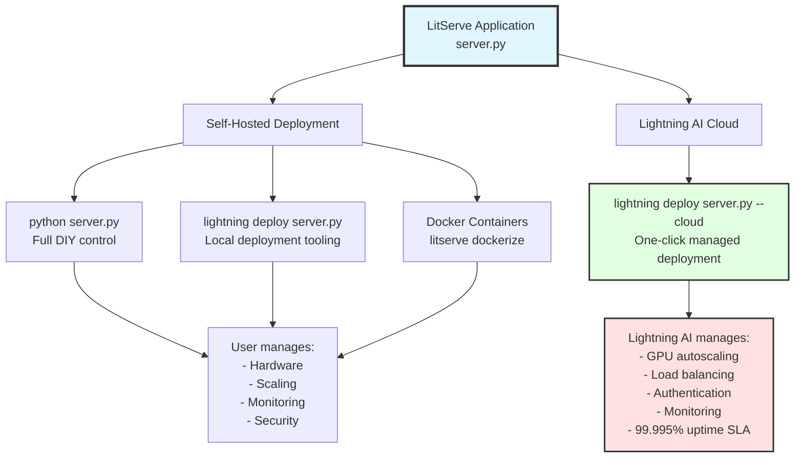
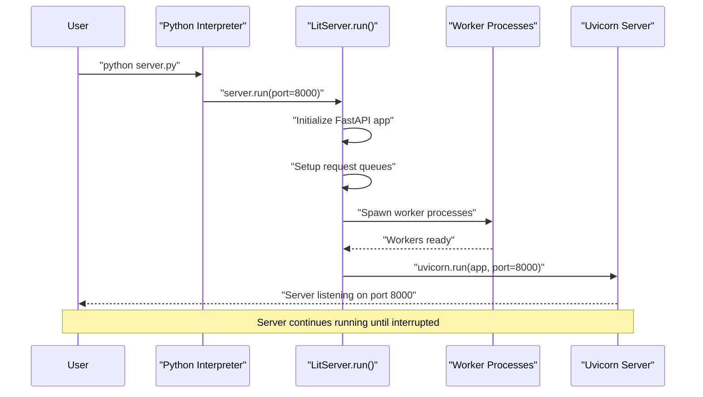
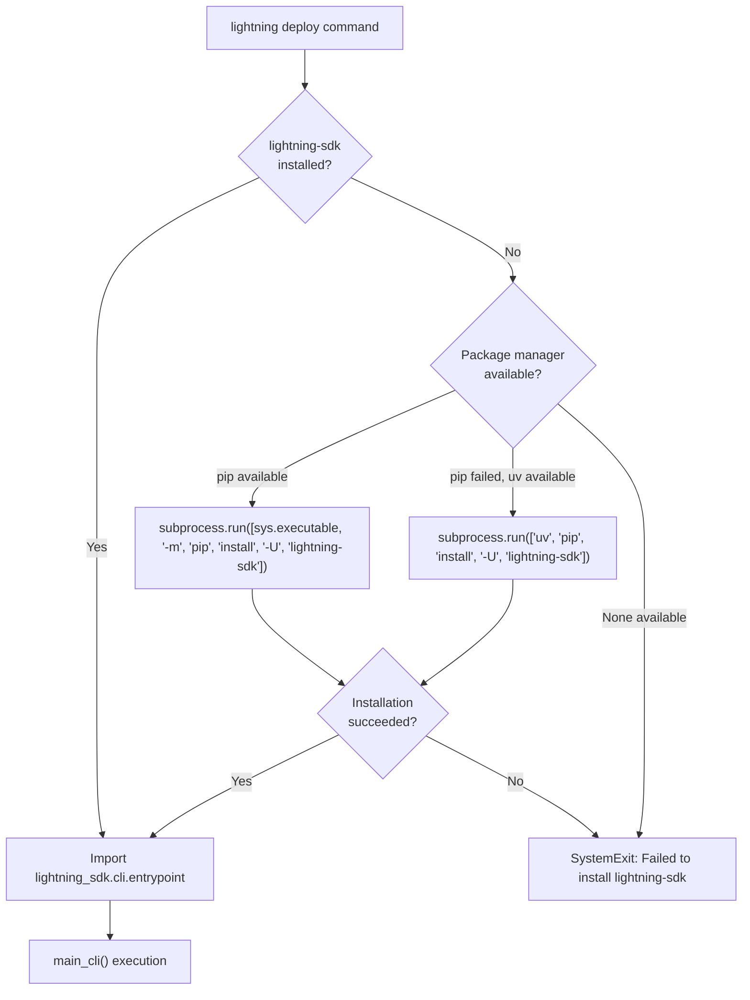
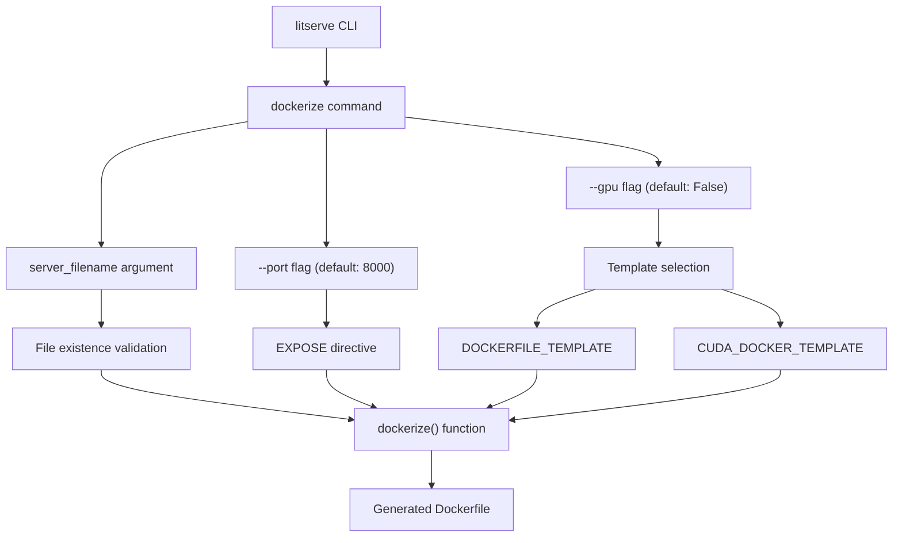
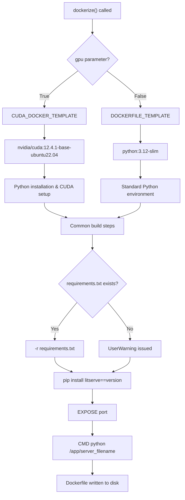
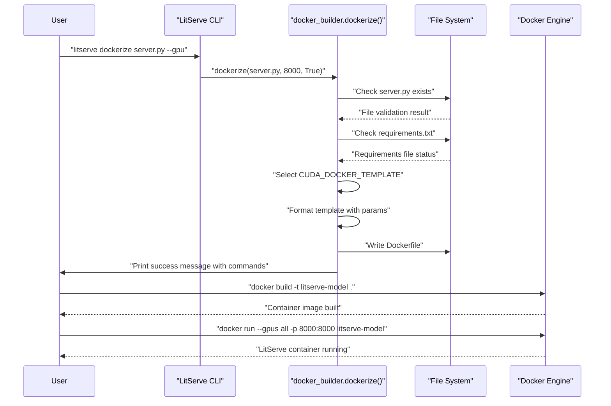
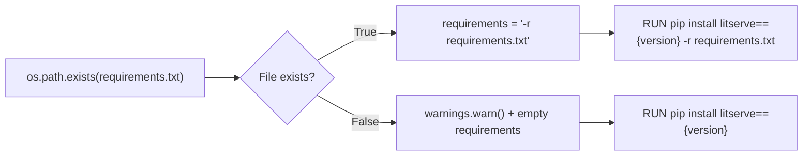

<!-- source: DeepWiki mcp.deepwiki.com · repo Lightning-AI/LitServe · page 4.7 Deployment Options · fetched 2026-10-21 -->

# Deployment Options

<details>
<summary>Relevant source files</summary>

The following files were used as context for generating this wiki page:

- [.github/workflows/ci-minimal-dependency-check.yml](.github/workflows/ci-minimal-dependency-check.yml)
- [.github/workflows/ci-parity.yml](.github/workflows/ci-parity.yml)
- [.github/workflows/ci-testing.yml](.github/workflows/ci-testing.yml)
- [.github/workflows/release-pypi.yml](.github/workflows/release-pypi.yml)
- [README.md](README.md)
- [pyproject.toml](pyproject.toml)
- [tests/conftest.py](tests/conftest.py)
- [tests/e2e/test_e2e.py](tests/e2e/test_e2e.py)
- [tests/perf_test/stream/run_test.sh](tests/perf_test/stream/run_test.sh)
- [tests/unit/test_cli.py](tests/unit/test_cli.py)
- [tests/unit/test_mcp.py](tests/unit/test_mcp.py)

</details>


This document compares the two primary deployment strategies for LitServe applications: self-hosted deployment and Lightning AI Cloud deployment. Self-hosted deployment provides full control and can be run anywhere using `python server.py` or Docker containers. Lightning AI Cloud deployment offers managed infrastructure with GPU autoscaling, monitoring, authentication, and enterprise features.

For advanced deployment configurations, see [Hardware Acceleration & Device Management](#4.2). For monitoring and logging setup, see [Logging and Monitoring](#4.4).

## Overview

LitServe applications can be deployed using two primary strategies:



**Deployment Path Selection**

| Strategy | Best For | Control Level | Infrastructure Management |
|----------|----------|---------------|---------------------------|
| Self-Hosted (Direct) | Development, full customization | Complete | User responsible |
| Self-Hosted (Docker) | Reproducible deployments, container orchestration | Complete | User responsible |
| Lightning AI Cloud | Production, autoscaling, enterprise requirements | Configurable | Managed service |

Sources: [README.md:197-208](), [README.md:110-119]()

## Self-Hosted Deployment

Self-hosted deployment provides full control over infrastructure, allowing deployment on any hardware or cloud provider. Users are responsible for infrastructure management, scaling, and monitoring.

### Direct Python Execution

The simplest deployment method runs the server directly using Python:

```bash
python server.py
```

This executes the `LitServer.run()` method, which:
1. Initializes the FastAPI application
2. Spawns worker processes based on configuration
3. Sets up request queues and message transport
4. Starts the Uvicorn server

**Direct Execution Flow**



Sources: [README.md:116-119](), [src/litserve/server.py]() (inferred from system architecture)

### Lightning Deploy (Local)

The `lightning deploy` command provides local deployment with additional tooling:

```bash
lightning deploy server.py
```

This command uses the Lightning SDK to deploy locally with enhanced features compared to direct Python execution. The CLI automatically installs `lightning-sdk` if not present.

**CLI Installation Process**



Sources: [src/litserve/cli.py:1-80](), [tests/unit/test_cli.py:37-119]()

### Docker Deployment

LitServe provides automated Docker containerization through the `dockerize` command, which generates optimized Dockerfiles based on server configuration and hardware requirements. The system supports both standard CPU deployments and GPU-accelerated deployments with CUDA support.

## CLI Usage

### Basic Dockerization

The `dockerize` command generates a Dockerfile for your LitServe application:

```bash
litserve dockerize server.py
litserve dockerize server.py --port 8080
litserve dockerize server.py --port 8000 --gpu
```

### Command Structure



Sources: [src/litserve/__main__.py:29-54](), [src/litserve/docker_builder.py:122-133]()

## Dockerfile Generation Process

### Template Selection Logic

The system automatically selects the appropriate Docker template based on the `--gpu` flag:



Sources: [src/litserve/docker_builder.py:149-162](), [src/litserve/docker_builder.py:134-142]()

## Container Templates

### Standard CPU Template

The `DOCKERFILE_TEMPLATE` provides a lightweight Python-based container:

| Component | Configuration |
|-----------|---------------|
| Base Image | `python:3.12-slim` |
| Working Directory | `/app` |
| Dependencies | `litserve` + `requirements.txt` |
| Exposed Port | Configurable (default: 8000) |
| Entry Point | `python /app/{server_filename}` |

### GPU-Enabled Template

The `CUDA_DOCKER_TEMPLATE` provides CUDA support for GPU acceleration:

| Component | Configuration |
|-----------|---------------|
| Base Image | `nvidia/cuda:12.4.1-base-ubuntu22.04` |
| Python Version | Configurable (default: 3.12) |
| CUDA Setup | Pre-configured CUDA runtime |
| Package Manager | pip installation with deadsnakes PPA |
| GPU Runtime | `--gpus all` flag required |

Sources: [src/litserve/docker_builder.py:52-67](), [src/litserve/docker_builder.py:69-105]()

## Build and Deployment Workflow

### Container Build Process



### Generated Commands

The system provides ready-to-use Docker commands based on configuration:

| Deployment Type | Build Command | Run Command |
|----------------|---------------|-------------|
| CPU | `docker build -t litserve-model .` | `docker run -p {port}:{port} litserve-model:latest` |
| GPU | `docker build -t litserve-model .` | `docker run --gpus all -p {port}:{port} litserve-model:latest` |

Sources: [src/litserve/docker_builder.py:150-154](), [src/litserve/docker_builder.py:108-119]()

## Requirements Management

### Automatic Detection

The `dockerize` function automatically detects and includes `requirements.txt`:



### Version Management

The system automatically pins the LitServe version using `ls.__version__` to ensure consistency between development and production environments.

Sources: [src/litserve/docker_builder.py:134-142](), [src/litserve/docker_builder.py:148]()

## Deployment Strategies

### Local Development

For local testing and development:

```bash
# Generate Dockerfile
litserve dockerize server.py

# Build and run locally
docker build -t my-litserve-app .
docker run -p 8000:8000 my-litserve-app
```

### Production Deployment

For production environments with GPU support:

```bash
# Generate GPU-enabled Dockerfile
litserve dockerize server.py --port 8080 --gpu

# Build with specific tag
docker build -t my-company/litserve-model:v1.0 .

# Deploy to registry
docker push my-company/litserve-model:v1.0

# Run in production
docker run --gpus all -p 8080:8080 my-company/litserve-model:v1.0
```

### Container Customization

The generated Dockerfile includes placeholder sections for custom installation commands:

```dockerfile
####### Add your own installation commands here #######
# RUN pip install some-package
# RUN wget https://path/to/some/data/or/weights
# RUN apt-get update && apt-get install -y <package-name>
```

Sources: [src/litserve/docker_builder.py:55-58](), [src/litserve/docker_builder.py:93-96]()

## Error Handling and Validation

### File Validation

The system validates that the server file exists in the current directory:

```python
if not (current_dir / server_filename).is_file():
    raise FileNotFoundError(f"Server file `{server_filename}` must be in the current directory: {os.getcwd()}")
```

### Requirements Warning

When `requirements.txt` is missing, the system issues a warning but continues with Dockerfile generation:

```python
warnings.warn(
    f"requirements.txt not found at {os.getcwd()}. "
    f"Make sure to install the required packages in the Dockerfile.",
    UserWarning,
)
```

Sources: [src/litserve/docker_builder.py:145-146](), [src/litserve/docker_builder.py:138-142]()

---

