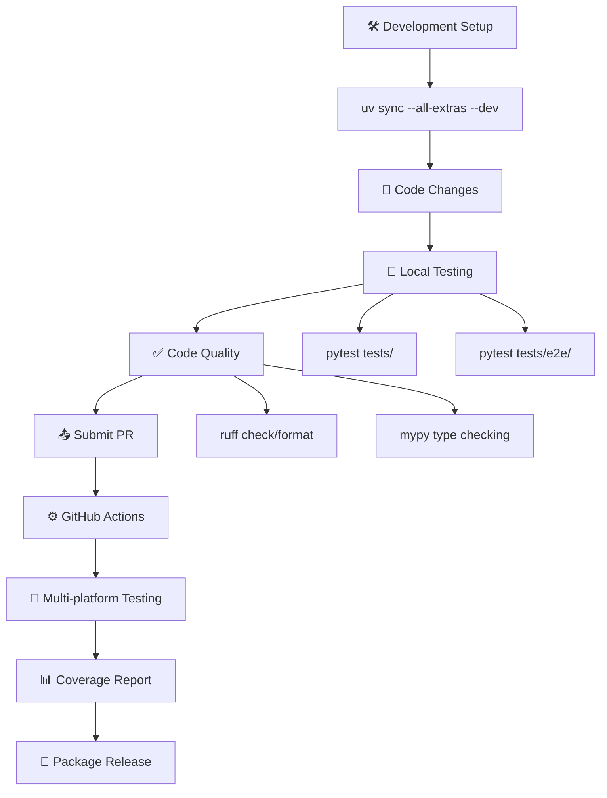
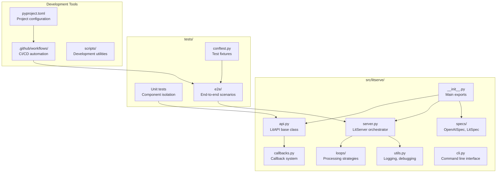
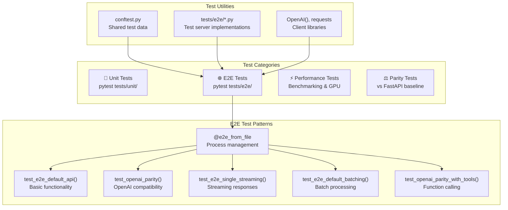
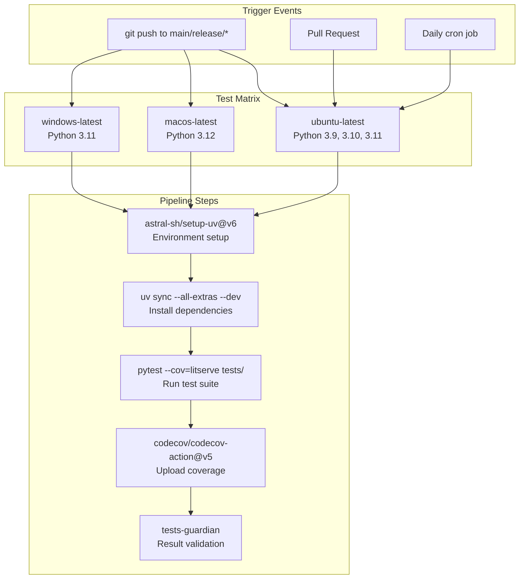
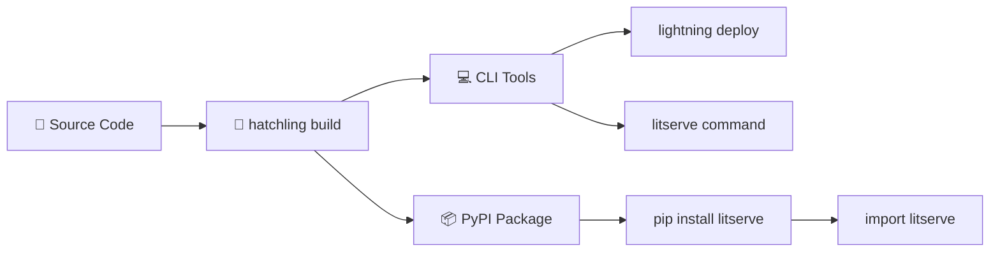

<!-- source: DeepWiki mcp.deepwiki.com · repo Lightning-AI/LitServe · page 5 Development Guide · fetched 2026-10-21 -->

# Development Guide

<details>
<summary>Relevant source files</summary>

The following files were used as context for generating this wiki page:

- [.github/workflows/ci-minimal-dependency-check.yml](.github/workflows/ci-minimal-dependency-check.yml)
- [.github/workflows/ci-parity.yml](.github/workflows/ci-parity.yml)
- [.github/workflows/ci-testing.yml](.github/workflows/ci-testing.yml)
- [.github/workflows/release-pypi.yml](.github/workflows/release-pypi.yml)
- [.pre-commit-config.yaml](.pre-commit-config.yaml)
- [src/litserve/test_examples/openai_spec_example.py](src/litserve/test_examples/openai_spec_example.py)
- [tests/perf_test/stream/run_test.sh](tests/perf_test/stream/run_test.sh)

</details>


This guide provides an overview of the LitServe development ecosystem, including codebase organization, testing strategies, and development workflows. It serves as an entry point for developers looking to understand, modify, or contribute to the LitServe framework.

For detailed testing procedures, see [Testing Framework](#5.1). For performance benchmarking, see [Performance Testing](#5.2). For CI/CD specifics, see [CI/CD Pipeline](#5.3). For contribution workflows, see [Contributing Guidelines](#5.4).

## Development Environment Setup

LitServe uses modern Python tooling with `uv` for dependency management and `hatchling` for building. The development environment supports Python 3.9+ across multiple platforms.

### Core Development Dependencies

| Category | Tools | Purpose |
|----------|-------|---------|
| Package Management | `uv` | Fast dependency resolution and virtual environment management |
| Build System | `hatchling` | Modern Python packaging and distribution |
| Testing | `pytest`, `pytest-asyncio`, `pytest-cov` | Unit and integration testing framework |
| Code Quality | `ruff`, `mypy` | Linting, formatting, and type checking |
| HTTP Testing | `httpx`, `requests` | API testing and client interactions |
| Process Management | `psutil` | System resource monitoring in tests |

### Development Workflow



Sources: [pyproject.toml:162-187](), [.github/workflows/ci-testing.yml:15-27]()

## Codebase Architecture for Developers

### Package Structure



Sources: [src/litserve/__init__.py:14-37](), [tests/e2e/test_e2e.py:1-438]()

### Key Development Classes and Interfaces

| Class/Module | Location | Developer Role |
|--------------|----------|----------------|
| `LitAPI` | `src/litserve/api.py` | Base abstraction for ML model APIs |
| `LitServer` | `src/litserve/server.py` | Core server orchestration and HTTP handling |
| `OpenAISpec` | `src/litserve/specs/openai.py` | OpenAI API compatibility layer |
| `Callback` | `src/litserve/callbacks.py` | Extensible event system |
| `Logger` | `src/litserve/loggers.py` | Structured logging interface |

## Testing Strategy Overview

### Test Architecture



Sources: [tests/e2e/test_e2e.py:30-54](), [tests/e2e/test_e2e.py:57-83]()

### E2E Testing Pattern

The framework uses a decorator-based approach for end-to-end testing that manages server processes:

```python
@e2e_from_file("tests/simple_server.py")
def test_run():
    # Test logic here - server is automatically managed
```

This pattern in `e2e_from_file` decorator handles:
- Server process spawning via `subprocess.Popen`
- Automatic cleanup with `psutil.Process` management
- 5-second startup delay for server initialization

Sources: [tests/e2e/test_e2e.py:30-54]()

## CI/CD Pipeline Overview

### Multi-Platform Testing Matrix



Sources: [.github/workflows/ci-testing.yml:3-9](), [.github/workflows/ci-testing.yml:16-27](), [.github/workflows/ci-testing.yml:54-62]()

### Quality Gates

| Stage | Tool | Timeout | Purpose |
|-------|------|---------|---------|
| Testing | `pytest --cov=litserve tests/` | 15 min | Unit and E2E test execution |
| Coverage | `codecov-action@v5` | - | Test coverage reporting |
| Matrix Validation | `tests-guardian` | - | Ensure all platform tests pass |

## Build System and Packaging

### Project Configuration

The build system uses `hatchling` with dynamic versioning from `src/litserve/__about__.py`:

```toml
[build-system]
requires = ["hatchling"]
build-backend = "hatchling.build"

[tool.hatch.version]
path = "src/litserve/__about__.py"
pattern = "__version__ = \"(?P<version>.+)\""
```

### Distribution Channels



Sources: [pyproject.toml:51-58](), [pyproject.toml:46-48]()

## Key Development Tools

### Code Quality Configuration

| Tool | Configuration | Purpose |
|------|---------------|---------|
| `ruff` | Line length 120, Python 3.8+ target | Linting and formatting |
| `coverage` | Excludes pragma and pass statements | Test coverage measurement |
| `codespell` | Quiet level 3 | Spell checking |
| `docformatter` | 120-char wrapping, recursive | Documentation formatting |

### Development Scripts and Entry Points

The package provides multiple entry points for different development and deployment scenarios:

- `litserve` command: Main CLI interface
- `lightning` command: Lightning AI platform integration
- Module execution: `python -m litserve`

Sources: [pyproject.toml:46-48](), [pyproject.toml:111-161]()

### Dependency Management Strategy

LitServe uses minimal core dependencies with extensive optional development dependencies:

**Core Runtime Dependencies:**
- `fastapi>=0.100` - HTTP server framework
- `pyzmq>=22.0.0` - Message transport
- `uvicorn[standard]>=0.29.0` - ASGI server

**Development Dependencies:**
- Testing: `pytest`, `httpx`, `openai` client
- ML Libraries: `torch`, `transformers`, `numpy`
- System Tools: `psutil`, `lightning`

Sources: [pyproject.toml:33-37](), [pyproject.toml:162-187]()

---

