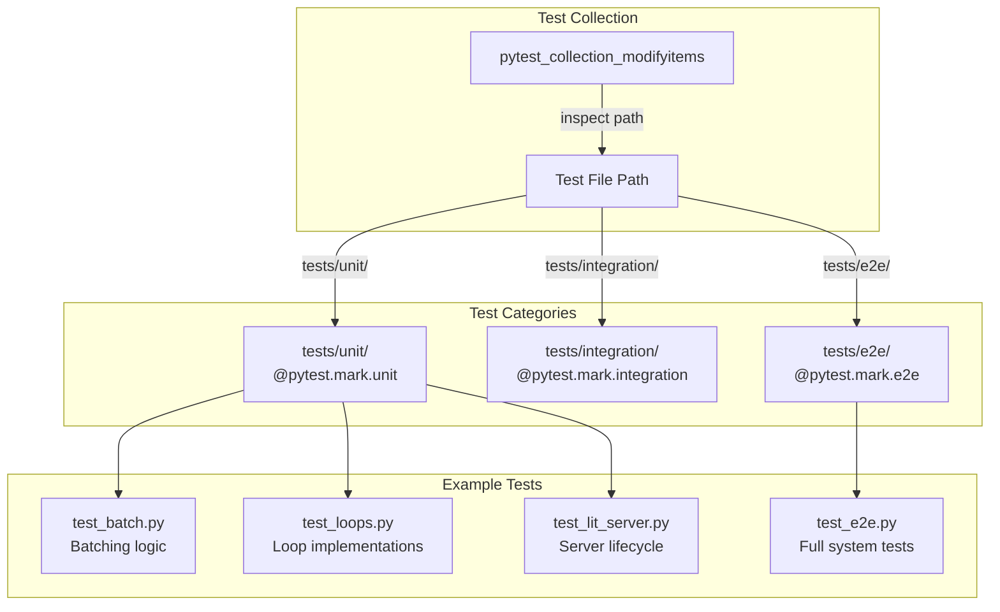
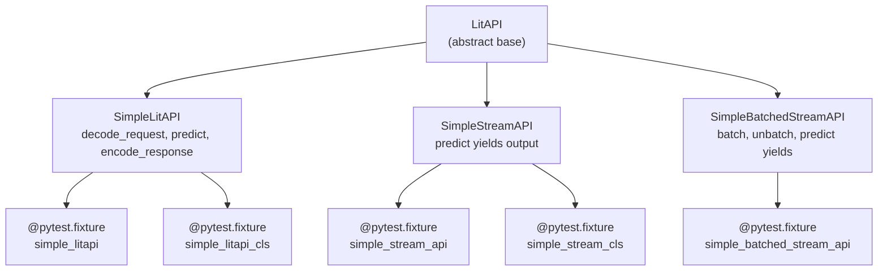
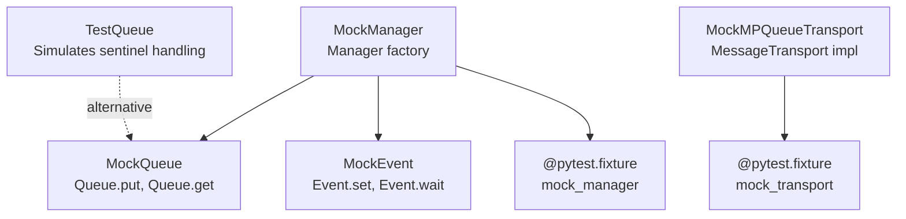
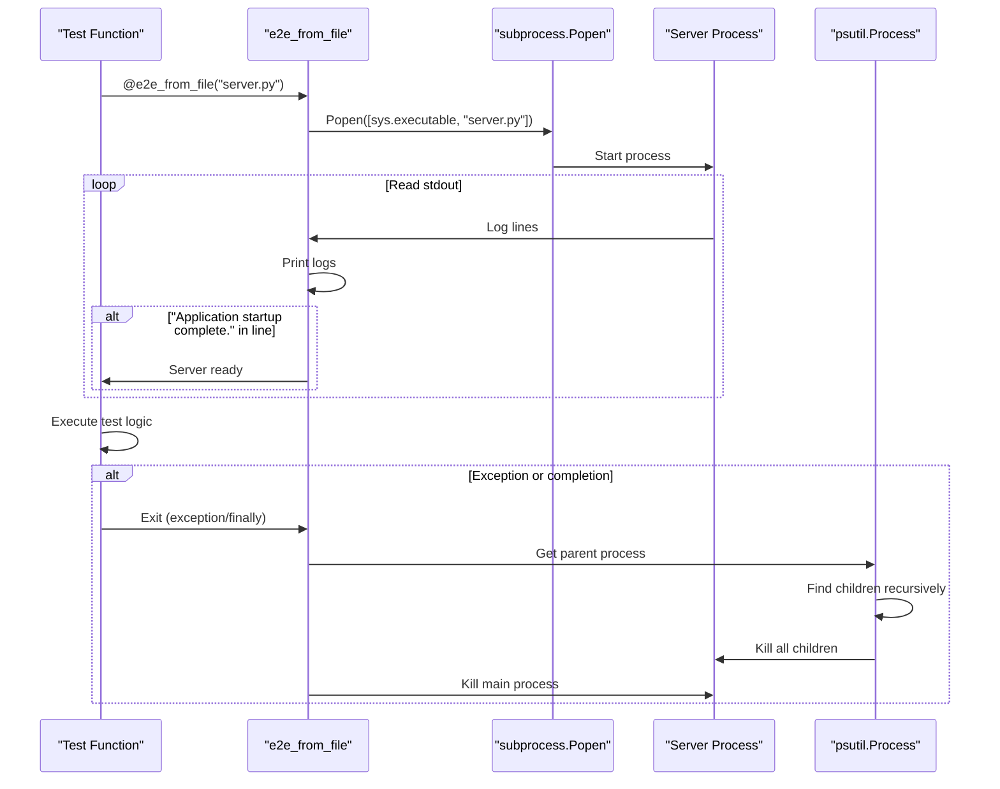
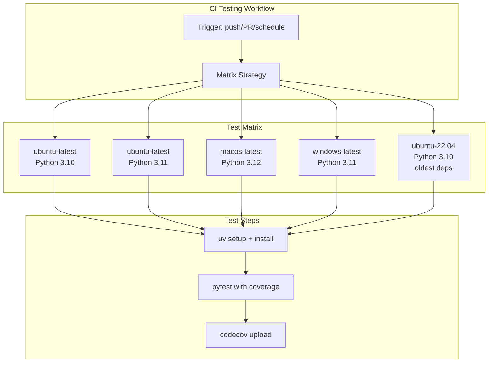

<!-- source: DeepWiki mcp.deepwiki.com · repo Lightning-AI/LitServe · page 5.1 Testing Framework · fetched 2026-10-21 -->

# Testing Framework

<details>
<summary>Relevant source files</summary>

The following files were used as context for generating this wiki page:

- [.github/workflows/ci-minimal-dependency-check.yml](.github/workflows/ci-minimal-dependency-check.yml)
- [.github/workflows/ci-parity.yml](.github/workflows/ci-parity.yml)
- [.github/workflows/ci-testing.yml](.github/workflows/ci-testing.yml)
- [.github/workflows/release-pypi.yml](.github/workflows/release-pypi.yml)
- [README.md](README.md)
- [tests/conftest.py](tests/conftest.py)
- [tests/e2e/test_e2e.py](tests/e2e/test_e2e.py)
- [tests/perf_test/stream/run_test.sh](tests/perf_test/stream/run_test.sh)
- [tests/unit/test_batch.py](tests/unit/test_batch.py)
- [tests/unit/test_lit_server.py](tests/unit/test_lit_server.py)
- [tests/unit/test_loops.py](tests/unit/test_loops.py)
- [tests/unit/test_simple.py](tests/unit/test_simple.py)

</details>


This document describes the testing framework for LitServe, including test organization, fixtures, utilities, and execution patterns. For performance testing and benchmarking methodology, see [5.2 Performance Testing](#5.2). For CI/CD pipeline configuration, see [5.3 CI/CD Pipeline](#5.3).

## Overview

LitServe uses pytest as its testing framework with a three-tier test organization: unit tests, integration tests, and end-to-end (E2E) tests. The framework provides reusable fixtures for common `LitAPI` implementations, server lifecycle management utilities, and automatic test categorization based on file location.

**Sources:** [tests/conftest.py:1-401](), [.github/workflows/ci-testing.yml:1-93]()

## Test Organization

### Directory Structure and Automatic Markers

Tests are organized into three directories with automatic pytest markers applied based on file path:

```
tests/
├── unit/          # Unit tests (marked @pytest.mark.unit)
├── integration/   # Integration tests (marked @pytest.mark.integration)
└── e2e/          # End-to-end tests (marked @pytest.mark.e2e)
```

The automatic marking is implemented via pytest's `pytest_collection_modifyitems` hook:

**Diagram: Test Organization and Marker System**



**Sources:** [tests/conftest.py:29-41]()

### Test Execution Commands

```bash
# Run all tests
pytest tests/

# Run specific category
pytest -m unit
pytest -m integration
pytest -m e2e

# Run with coverage
pytest --cov=litserve tests/ -v -s --durations=100
```

**Sources:** [.github/workflows/ci-testing.yml:58-60](), [README.md:60]()

## Test Fixtures

### LitAPI Test Implementations

The framework provides three standard `LitAPI` implementations for testing different server modes:

**Diagram: Test Fixture Class Hierarchy**



| Fixture Class | Purpose | Key Methods | Example Usage |
|--------------|---------|-------------|---------------|
| `SimpleLitAPI` | Basic request-response | `setup()`, `predict()`, `encode_response()` | Single request testing |
| `SimpleStreamAPI` | Streaming output | `predict()` yields strings | Token streaming tests |
| `SimpleBatchedStreamAPI` | Batched streaming | `batch()`, `unbatch()`, `predict()` yields | Batched streaming tests |

**Sources:** [tests/conftest.py:43-101]()

#### SimpleLitAPI Implementation

```python
class SimpleLitAPI(LitAPI):
    def setup(self, device):
        self.model = lambda x: x**2

    def decode_request(self, request: Request):
        return request["input"]

    def predict(self, x):
        return self.model(x)

    def encode_response(self, output) -> Response:
        return {"output": output}
```

**Sources:** [tests/conftest.py:43-55]()

#### SimpleStreamAPI Implementation

```python
class SimpleStreamAPI(LitAPI):
    def setup(self, device) -> None:
        self.sentence = "LitServe is streaming output"

    def decode_request(self, request: Request) -> str:
        return request["prompt"]

    def predict(self, x) -> Generator:
        output = f"prompt={x} generated_output={self.sentence}".split()
        yield from output

    def encode_response(self, output: Generator) -> Generator:
        delay = 0.01  # delay for testing timeouts
        for out in output:
            time.sleep(delay)
            yield out.lower()
```

**Sources:** [tests/conftest.py:57-73]()

### Server Lifecycle Fixtures

| Fixture | Type | Purpose | Dependencies |
|---------|------|---------|--------------|
| `lit_server` | `LitServer` | Configured server ready for testing | `simple_litapi` |
| `sync_testclient` | `TestClient` | FastAPI test client | `lit_server` |

The `lit_server` fixture uses `wrap_litserve_start` to manage server lifecycle:

```python
@pytest.fixture
def lit_server(simple_litapi):
    server = LitServer(simple_litapi, accelerator="cpu", devices=1, timeout=10)
    with wrap_litserve_start(server) as s:
        yield s
```

**Sources:** [tests/conftest.py:129-139]()

### Request and Response Fixtures

For testing OpenAI-compatible endpoints, the framework provides fixtures with request and response data:

| Fixture | Purpose | Structure |
|---------|---------|-----------|
| `openai_request_data` | Basic chat completion request | `model`, `messages`, `temperature`, `stream`, etc. |
| `openai_response_data` | Chat completion response | `id`, `choices`, `usage`, `created` |
| `openai_request_data_with_image` | Multimodal request | Messages with `image_url` content |
| `openai_request_data_with_audio_wav` | Audio input request | Messages with base64 encoded audio |
| `openai_request_data_with_tools` | Function calling request | `tools` with function definitions |
| `openai_request_data_with_response_format` | Structured output request | `response_format` with JSON schema |
| `openai_embedding_request_data` | Embedding request | `input`, `model`, `encoding_format` |

**Sources:** [tests/conftest.py:152-366]()

### Mock Utilities

For testing inter-process communication and queue behavior:

**Diagram: Mock Utility Dependencies**



```python
class MockQueue:
    def put(self, item):
        pass
    
    def get(self, block=True, timeout=None):
        pass

class MockEvent:
    def set(self):
        pass
    
    def wait(self):
        pass

class MockManager:
    def __init__(self):
        self.Queue = MockQueue
        self.Event = MockEvent
        self.dict = dict
    
    def shutdown(self):
        pass
```

**Sources:** [tests/conftest.py:368-396](), [tests/unit/test_loops.py:58-63]()

## Test Utilities

### e2e_from_file Decorator

The `e2e_from_file` decorator manages the lifecycle of a LitServe server process for end-to-end testing:

**Diagram: e2e_from_file Workflow**



```python
def e2e_from_file(filename):
    def decorator(test_fn):
        @wraps(test_fn)
        def wrapper(*args, **kwargs):
            process = subprocess.Popen(
                [sys.executable, filename],
                stdout=subprocess.PIPE,
                stderr=subprocess.STDOUT,
                stdin=subprocess.DEVNULL,
                text=True,
                bufsize=1,
            )

            try:
                # Print logs in real-time
                for line in process.stdout:
                    print(line, end="")
                    if "Application startup complete." in line:
                        break

                # Run test function
                test_fn(*args, **kwargs)
            except Exception:
                raise
            finally:
                parent = psutil.Process(process.pid)
                for child in parent.children(recursive=True):
                    child.kill()
                process.kill()

        return wrapper
    return decorator
```

**Usage Example:**

```python
@e2e_from_file("tests/simple_server.py")
def test_run():
    assert os.path.exists("client.py")
    output = subprocess.run("python client.py", shell=True, capture_output=True, text=True).stdout
    assert '{"output":16.0}' in output
    os.remove("client.py")
```

**Sources:** [tests/e2e/test_e2e.py:29-62](), [tests/e2e/test_e2e.py:64-69]()

### wrap_litserve_start Context Manager

The `wrap_litserve_start` utility manages LitServer lifecycle for testing without starting the full uvicorn server:

```python
# Basic usage
def test_example():
    api = SimpleLitAPI()
    server = LitServer(api, accelerator="cpu")
    
    with wrap_litserve_start(server) as s:
        # Server workers are running
        with TestClient(s.app) as client:
            response = client.post("/predict", json={"input": 4.0})
            assert response.status_code == 200
    # Workers are cleaned up

# With worker monitoring enabled
with wrap_litserve_start(server, worker_monitor=True) as s:
    # Automatic worker restart enabled
    ...
```

The context manager:
1. Initializes the manager and transport layer
2. Spawns worker processes
3. Yields the server for testing
4. Cleans up workers and transport on exit

**Sources:** [tests/conftest.py:26](), [tests/unit/test_lit_server.py:409-417]()

## Writing Tests

### Unit Tests

Unit tests focus on isolated components. Key patterns include:

**Testing Loop Implementations:**

```python
def test_single_loop(loop_args):
    lit_api_mock, requests_queue = loop_args
    transport = DummyMessageTransport()

    lit_loop = SingleLoop()
    with pytest.raises(StopIteration, match="exit loop"):
        lit_loop.run_single_loop(lit_api_mock, requests_queue, transport, callback_runner=NOOP_CB_RUNNER)
```

**Testing Batching Logic:**

```python
@pytest.mark.asyncio
async def test_batched():
    api = SimpleBatchLitAPI(max_batch_size=2, batch_timeout=4)
    server = LitServer(api, accelerator="cpu", devices=1, timeout=10)

    with wrap_litserve_start(server) as server:
        async with (
            LifespanManager(server.app) as manager,
            AsyncClient(transport=ASGITransport(app=manager.app), base_url="http://test") as ac,
        ):
            response1 = ac.post("/predict", json={"input": 4.0})
            response2 = ac.post("/predict", json={"input": 5.0})
            response1, response2 = await asyncio.gather(response1, response2)

    assert response1.json() == {"output": 9.0}
    assert response2.json() == {"output": 11.0}
```

**Sources:** [tests/unit/test_loops.py:131-139](), [tests/unit/test_batch.py:91-107]()

### E2E Tests

E2E tests verify full system behavior with actual server processes:

**Testing OpenAI Compatibility:**

```python
@e2e_from_file("tests/e2e/default_openaispec.py")
def test_openai_parity():
    client = OpenAI(
        base_url="http://127.0.0.1:8000/v1",
        api_key="lit",
    )
    response = client.chat.completions.create(
        model="lit",
        messages=[
            {"role": "system", "content": "You are a helpful assistant."},
            {"role": "user", "content": "How are you?"},
        ],
    )
    assert response.choices[0].message.content == "This is a generated output"
```

**Testing Streaming with OpenAI SDK:**

```python
@e2e_from_file("tests/e2e/default_openaispec.py")
def test_openai_parity():
    client = OpenAI(base_url="http://127.0.0.1:8000/v1", api_key="lit")
    response = client.chat.completions.create(
        model="lit",
        messages=[...],
        stream=True,
    )

    expected_outputs = ["This is a generated output", None]
    for r, expected_out in zip(response, expected_outputs):
        assert r.choices[0].delta.content == expected_out
```

**Sources:** [tests/e2e/test_e2e.py:122-153]()

### Async Test Patterns

For testing async `LitAPI` implementations:

```python
@pytest.mark.asyncio
async def test_async_litapi():
    api = TestAsyncLitAPI(enable_async=True)
    server = LitServer(api)
    
    with wrap_litserve_start(server) as server:
        async with (
            LifespanManager(server.app) as manager,
            AsyncClient(transport=ASGITransport(app=manager.app), base_url="http://test") as ac,
        ):
            resp = await ac.post("/predict", json={"input": 5.0}, timeout=10)
            assert resp.status_code == 200
            assert resp.json()["output"] == 25.0
```

**Testing Concurrent Async Processing:**

```python
@pytest.mark.asyncio
async def test_concurrent_async_inference(num_requests):
    api = TestSleepAsyncLitAPI(enable_async=True)
    server = LitServer(api)
    
    with wrap_litserve_start(server) as server:
        async with (
            LifespanManager(server.app) as manager,
            AsyncClient(transport=ASGITransport(app=manager.app), base_url="http://test") as ac,
        ):
            tasks = [ac.post("/predict", json={"input": 5.0}, timeout=10) for _ in range(num_requests)]
            start = time.perf_counter()
            responses = await asyncio.gather(*tasks)
            elapsed = time.perf_counter() - start

            for resp in responses:
                assert resp.status_code == 200
                assert resp.json()["output"] == 25.0

            # Verify concurrency (should not be sequential)
            assert elapsed < 4 + 4  # Much faster than sequential
```

**Sources:** [tests/unit/test_lit_server.py:597-642]()

## Running Tests

### Local Execution

```bash
# Install test dependencies
uv sync --all-extras --dev

# Run all tests with coverage
pytest --cov=litserve tests/ -v -s --durations=100

# Run specific test file
pytest tests/unit/test_batch.py -v

# Run specific test function
pytest tests/unit/test_batch.py::test_batched -v

# Run with specific markers
pytest -m "unit and not slow"

# Show 100 slowest tests
pytest tests/ --durations=100
```

**Sources:** [.github/workflows/ci-testing.yml:58-66]()

### CI Pipeline Integration

The CI pipeline runs tests across multiple configurations:

**Diagram: Test Matrix Execution**



| Configuration | OS | Python | Special |
|--------------|-----|--------|---------|
| Main 1 | ubuntu-latest | 3.10 | - |
| Main 2 | ubuntu-latest | 3.11 | - |
| macOS | macos-latest | 3.12 | - |
| Windows | windows-latest | 3.11 | - |
| Oldest deps | ubuntu-22.04 | 3.10 | Minimum dependency versions |

The oldest dependency test ensures backward compatibility by running:

```bash
uv pip install 'lightning-utilities[cli]>=0.15.1'
uv run python -m lightning_utilities.cli requirements set-oldest --req_files=pyproject.toml
```

**Sources:** [.github/workflows/ci-testing.yml:15-79]()

### Test Coverage

Coverage reports are generated and uploaded to Codecov:

```bash
# Generate coverage report
pytest --cov=litserve tests/ -v

# View coverage report
coverage report
coverage xml

# Upload to Codecov (CI only)
# Automated via GitHub Actions
```

The CI workflow uploads coverage with environment variables for OS and Python version tracking.

**Sources:** [.github/workflows/ci-testing.yml:62-75]()

---

