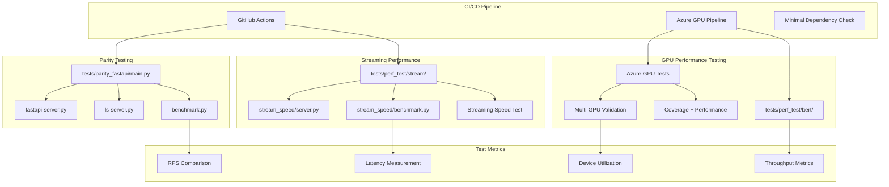
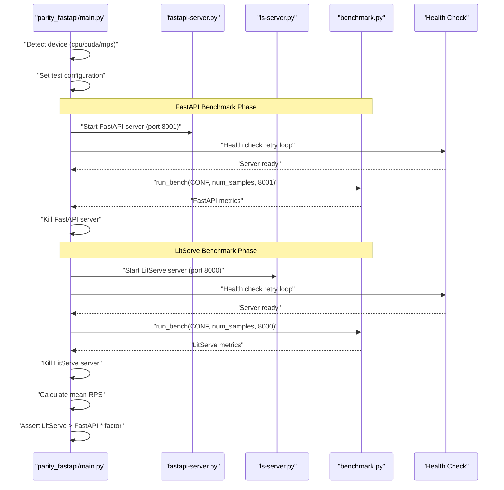
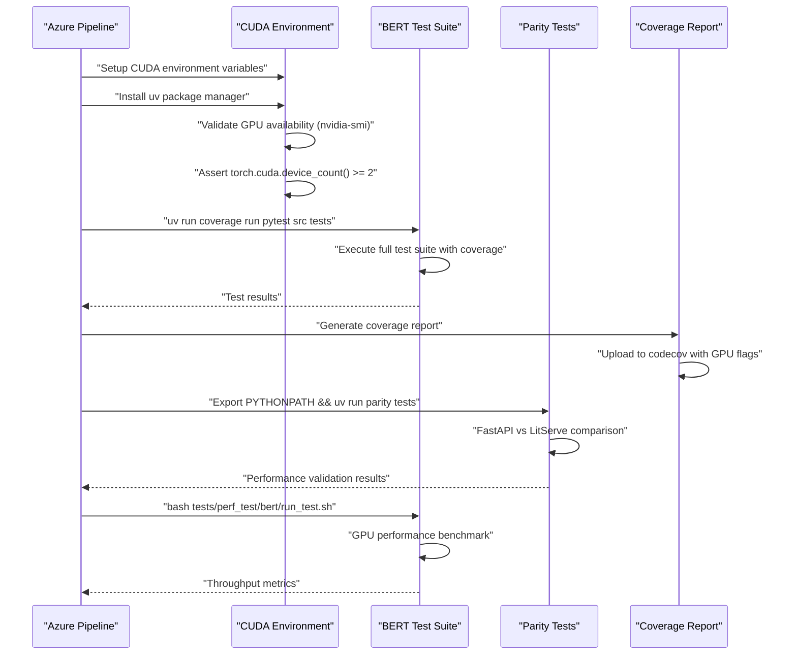
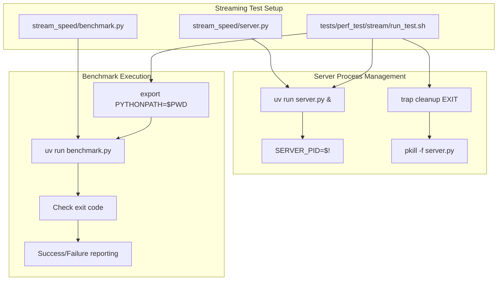
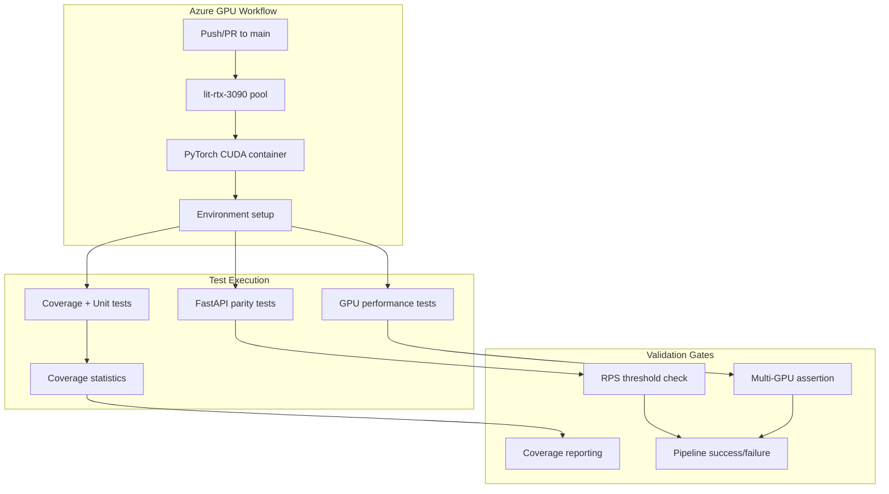

<!-- source: DeepWiki mcp.deepwiki.com · repo Lightning-AI/LitServe · page 5.2 Performance Testing · fetched 2026-10-21 -->

# Performance Testing

<details>
<summary>Relevant source files</summary>

The following files were used as context for generating this wiki page:

- [.github/workflows/ci-minimal-dependency-check.yml](.github/workflows/ci-minimal-dependency-check.yml)
- [.github/workflows/ci-parity.yml](.github/workflows/ci-parity.yml)
- [.github/workflows/ci-testing.yml](.github/workflows/ci-testing.yml)
- [.github/workflows/release-pypi.yml](.github/workflows/release-pypi.yml)
- [tests/perf_test/stream/run_test.sh](tests/perf_test/stream/run_test.sh)
- [tests/unit/test_batch.py](tests/unit/test_batch.py)
- [tests/unit/test_lit_server.py](tests/unit/test_lit_server.py)
- [tests/unit/test_loops.py](tests/unit/test_loops.py)
- [tests/unit/test_simple.py](tests/unit/test_simple.py)

</details>


This document covers LitServe's comprehensive performance testing framework, which validates throughput, latency, and compatibility across different hardware configurations. The framework includes parity testing against FastAPI, GPU acceleration validation, and streaming performance benchmarks.

For information about the general testing framework and unit tests, see [Testing Framework](#5.1). For deployment optimization strategies, see [Docker Deployment](#4.6).

## Purpose and Scope

The performance testing framework enables developers to:
- **Parity Testing**: Validate LitServe performance against FastAPI baselines
- **GPU Performance Validation**: Test acceleration on CUDA and MPS devices  
- **Streaming Benchmarks**: Measure real-time response generation speed
- **CI/CD Integration**: Automated performance regression detection
- **Hardware Scaling**: Test multi-GPU and multi-worker configurations
- **Load Testing**: Validate behavior under sustained high-throughput conditions

## Performance Testing Architecture

LitServe's performance testing framework consists of three main testing categories integrated into CI/CD pipelines: parity testing, GPU acceleration testing, and streaming performance validation.

### Performance Testing Framework Architecture



Sources: [.github/workflows/ci-parity.yml:1-40](), [.azure/gpu-tests.yml:16-100](), [tests/parity_fastapi/main.py:1-99]()

## Parity Testing Framework

The parity testing system validates that LitServe maintains performance advantages over FastAPI across different hardware configurations. The `tests/parity_fastapi/main.py` orchestrates comparative benchmarks.

### Parity Test Configuration

| Device Type | Request Count | Performance Factor | Purpose |
|-------------|---------------|-------------------|---------|
| `cpu` | 50 | 1.0x | Baseline CPU performance |
| `cuda` | 100 | 1.2x | GPU acceleration validation |
| `mps` | 50 | 1.0x | Apple Silicon optimization |

### Parity Testing Flow



The `run_python_script` decorator in [tests/parity_fastapi/main.py:27-50]() manages server lifecycle, starting processes and ensuring cleanup with `psutil.Process.kill()`.

### Performance Validation Logic

```python
# Device-specific performance factors
DIFF_FACTOR = {
    "cpu": 1,
    "cuda": 1.2,  # LitServe should be 20% faster on GPU
    "mps": 1,
}

# Validation assertion
assert ls_throughput > fastapi_throughput * factor, msg
```

Sources: [tests/parity_fastapi/main.py:11-25](), [tests/parity_fastapi/main.py:81-95]()

## GPU Performance Testing

GPU performance testing runs on Azure pipelines using RTX 3090 hardware to validate acceleration and multi-device scaling. The test suite includes BERT model benchmarks and comprehensive coverage analysis.

### Azure GPU Pipeline Configuration

The Azure pipeline `lit-rtx-3090` pool executes performance tests with specific hardware optimizations:

| Configuration | Value | Purpose |
|---------------|-------|---------|
| **Container** | `pytorch/pytorch:2.3.1-cuda12.1-cudnn8-runtime` | CUDA environment |
| **GPU Options** | `--gpus=all --shm-size=8g` | Multi-GPU access |
| **Timeout** | 20 minutes | Performance test duration |
| **Cache Directories** | `/var/tmp/torch`, `/var/tmp/pip` | Persistent caching |

### GPU Test Execution Flow



The pipeline installs additional packages for GPU monitoring: `gpustat wget` for resource utilization tracking in [.azure/gpu-tests.yml:97-99]().

### BERT Performance Test Implementation

The BERT performance test demonstrates production-ready optimizations for transformer models:

**Server Configuration:**
- `HuggingFaceLitAPI` with `bert-large-uncased` model
- Hardware-specific dtype selection (`float16` for CUDA)
- Batch processing with configurable timeouts
- Multi-worker and multi-device scaling

**Performance Validation:**
- Target RPS: 390 for RTX 3090 hardware
- Automated assertion: `assert rps >= MAX_SPEED`
- Session pool optimization for concurrent requests
- Statistical sampling across multiple test runs

Sources: [.azure/gpu-tests.yml:17-100](), [tests/perf_test/bert/run_test.sh:1-29]()

## Streaming Performance Testing

Streaming performance tests validate real-time response generation capabilities and measure end-to-end latency for streaming APIs.

### Streaming Test Architecture



### Process Lifecycle Management

The streaming test script implements robust process management:

```bash
# Process cleanup function
cleanup() {
    pkill -f "uv run tests/perf_test/stream/stream_speed/server.py"
}

# Trap script exit to run cleanup
trap cleanup EXIT

# Background server execution with PID tracking
uv run tests/perf_test/stream/stream_speed/server.py &
SERVER_PID=$!
```

The script validates benchmark execution with exit code checking and provides clear success/failure reporting in [tests/perf_test/stream/run_test.sh:24-29]().

Sources: [tests/perf_test/stream/run_test.sh:1-30](), [.github/workflows/ci-parity.yml:38-39]()

## CI/CD Integration

Performance tests are integrated into GitHub Actions and Azure Pipelines to catch performance regressions and validate optimizations across different environments.

### GitHub Actions Workflow

The CI pipeline executes performance tests on every push and pull request:

```yaml
# Parity test execution
- name: Parity test
  run: export PYTHONPATH=$PWD && python tests/parity_fastapi/main.py

# Streaming speed test  
- name: Streaming speed test
  run: bash tests/perf_test/stream/run_test.sh
```

**Minimal Dependency Testing:**
- Validates core functionality with minimal dependencies
- Uses `uv` package manager for fast environment setup
- Tests basic server startup and health endpoints
- Executes `tests/minimal_run.py` for smoke testing

### Performance Test Matrix

| Test Type | Trigger | Environment | Hardware | Purpose |
|-----------|---------|-------------|----------|---------|
| **Parity Tests** | Every PR/push | Ubuntu Latest | CPU | FastAPI comparison |
| **Streaming Tests** | Every PR/push | Ubuntu Latest | CPU | Real-time validation |
| **GPU Tests** | PR/push to main | Azure RTX 3090 | Multi-GPU | Acceleration validation |
| **Minimal Tests** | Every PR/push | Ubuntu Latest | CPU | Dependency validation |

### Azure GPU Pipeline Integration



The Azure pipeline validates multi-GPU availability with `torch.cuda.device_count() >= 2` and uploads coverage data to Codecov with GPU-specific flags in [.azure/gpu-tests.yml:71-89]().

Sources: [.github/workflows/ci-parity.yml:35-39](), [.github/workflows/ci-minimal-dependency-check.yml:28-35](), [.azure/gpu-tests.yml:79-94]()

## Performance Metrics and Benchmarking

The performance testing framework collects comprehensive metrics across different test scenarios to validate LitServe's performance characteristics and competitive advantages.

### Core Performance Metrics

| Metric | Description | Units | Test Source |
|--------|-------------|-------|-------------|
| **Requests Per Second (RPS)** | Throughput comparison | requests/second | Parity tests |
| **Mean Response Time** | Average latency | milliseconds | Benchmark sampling |
| **Streaming Speed** | Real-time generation rate | tokens/second | Stream tests |
| **GPU Utilization** | Hardware acceleration efficiency | percentage | Azure GPU tests |
| **Coverage Performance** | Test suite execution speed | seconds | CI/CD metrics |

### Parity Test Validation Logic

The `tests/parity_fastapi/main.py` implements device-specific performance validation:

```python
# Configuration for different devices
CONF = {
    "cpu": {"num_requests": 50},
    "mps": {"num_requests": 50}, 
    "cuda": {"num_requests": 100},
}

# Performance factor expectations
DIFF_FACTOR = {
    "cpu": 1,
    "cuda": 1.2,  # 20% performance advantage on GPU
    "mps": 1,
}

# Validation assertion
fastapi_throughput = mean([e["Requests Per Second (RPS)"] for e in fastapi_metrics])
ls_throughput = mean([e["Requests Per Second (RPS)"] for e in ls_metrics])
assert ls_throughput > fastapi_throughput * factor
```

### Benchmark Sampling Methodology

The parity testing framework uses statistical sampling for reliable performance measurements:

- **Sample Size:** 12 benchmark iterations per test
- **Warmup:** Server initialization before measurement
- **Health Checks:** Retry loops with 10-second timeouts
- **Process Isolation:** Clean server startup/shutdown per test
- **Mean Calculation:** Average RPS across all samples

### Performance Validation Thresholds

**GPU Performance Targets:**
- RTX 3090: 390+ RPS for BERT-large model
- Multi-GPU scaling validation
- Coverage test completion under time limits

**Streaming Performance:**
- Real-time response generation validation
- End-to-end latency measurement
- Concurrent streaming capability testing

Sources: [tests/parity_fastapi/main.py:11-94](), [.azure/gpu-tests.yml:97-99]()

## Optimization Techniques

The performance testing framework demonstrates several optimization techniques that can be applied to production deployments.

### Server-Side Optimizations

**Batching Configuration:**
- `max_batch_size`: Groups requests for efficient GPU utilization
- `batch_timeout`: Balances latency vs. throughput
- Custom `batch()` and `unbatch()` methods for efficient processing

**Multiprocessing Setup:**
- Multiple workers per device for parallel processing
- Multiple API server processes for request handling
- Fast queue implementation for reduced latency

**Hardware Acceleration:**
- Automatic device detection and utilization
- Optimized tensor operations and memory management
- Device-specific optimizations based on capabilities

Sources: [tests/perf_test/bert/server.py:46-66](), [tests/perf_test/bert/server.py:29-40]()

### Client-Side Optimizations

**Connection Management:**
- HTTP session pooling for connection reuse
- Optimized pool size and connection limits
- Retry strategies for handling transient failures

**Load Generation:**
- Concurrent request execution
- Proper warmup procedures
- Statistical sampling for accurate measurements

Sources: [tests/perf_test/bert/benchmark.py:18-33](), [tests/perf_test/bert/benchmark.py:42-44]()

### Performance Testing Best Practices

1. **Baseline Establishment:** Run tests on known hardware configurations
2. **Environment Isolation:** Use dedicated test environments
3. **Statistical Significance:** Collect multiple samples for reliable results
4. **Resource Monitoring:** Track CPU, GPU, and memory utilization
5. **Configuration Testing:** Compare different server configurations
6. **Regression Testing:** Validate performance across code changes

The performance testing framework provides a comprehensive foundation for validating and optimizing LitServe deployments across different hardware configurations and workload patterns.

Sources: [tests/perf_test/bert/benchmark.py:35-74](), [tests/perf_test/bert/server.py:46-66]()

---

