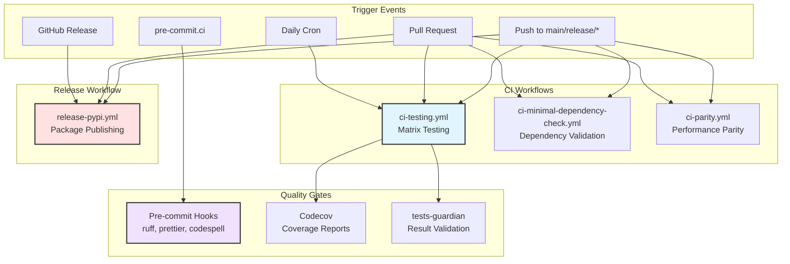
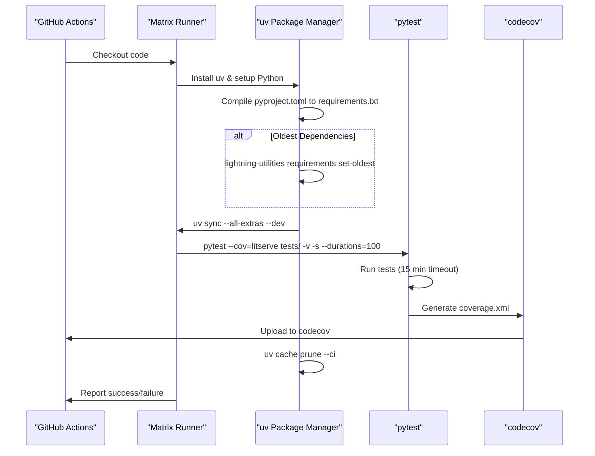
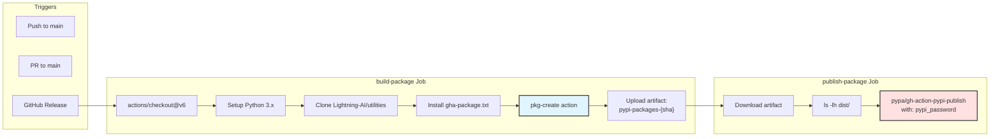
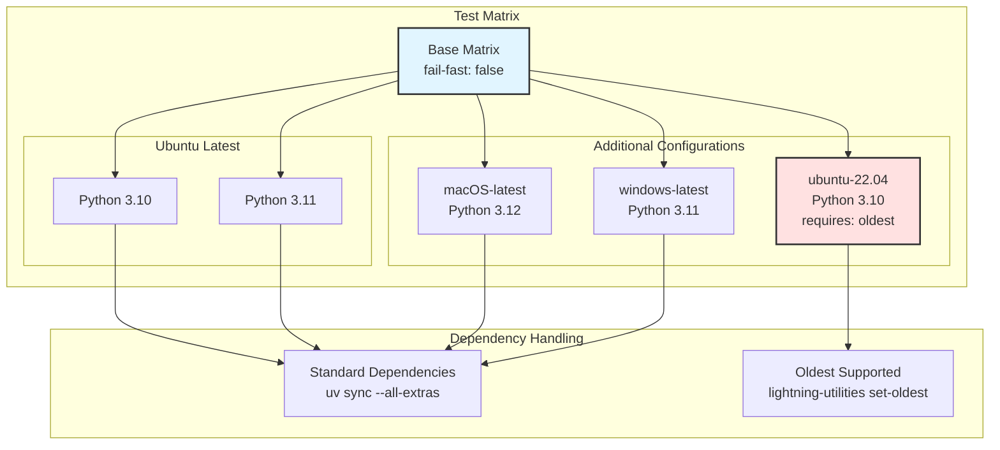

<!-- source: DeepWiki mcp.deepwiki.com · repo Lightning-AI/LitServe · page 5.3 CI/CD Pipeline · fetched 2026-10-21 -->

# CI/CD Pipeline

<details>
<summary>Relevant source files</summary>

The following files were used as context for generating this wiki page:

- [.github/workflows/ci-minimal-dependency-check.yml](.github/workflows/ci-minimal-dependency-check.yml)
- [.github/workflows/ci-parity.yml](.github/workflows/ci-parity.yml)
- [.github/workflows/ci-testing.yml](.github/workflows/ci-testing.yml)
- [.github/workflows/release-pypi.yml](.github/workflows/release-pypi.yml)
- [tests/perf_test/stream/run_test.sh](tests/perf_test/stream/run_test.sh)

</details>


This page documents LitServe's continuous integration and deployment infrastructure, including GitHub Actions workflows, automated testing strategies, release automation, and pre-commit hooks. This system ensures code quality, compatibility across platforms, and automated package publishing.

For information about the testing framework itself (fixtures, test utilities), see [Testing Framework](#5.1). For performance benchmarking methodology, see [Performance Testing](#5.2). For contribution guidelines and development setup, see [Contributing Guidelines](#5.4).

---

## Overview

LitServe's CI/CD pipeline is implemented through GitHub Actions workflows that run automatically on push, pull request, and release events. The pipeline validates code quality, runs comprehensive tests across multiple platforms and Python versions, checks dependency compatibility, and automates PyPI releases.

**Workflow Diagram**



Sources: [.github/workflows/ci-testing.yml:1-93](), [.github/workflows/release-pypi.yml:1-58](), [.github/workflows/ci-minimal-dependency-check.yml:1-36](), [.github/workflows/ci-parity.yml:1-40]()

---

## Core Testing Workflow: ci-testing.yml

The `ci-testing` workflow is the primary quality gate, running the full test suite across a matrix of operating systems and Python versions with code coverage reporting.

### Workflow Configuration

**Trigger Events:**
- Push to `main` or `release/*` branches
- Pull requests to `main` or `release/*` branches  
- Daily scheduled run at midnight UTC (cron: `0 0 * * *`)

**Test Matrix:**

| OS | Python Versions | Special Configuration |
|---|---|---|
| `ubuntu-latest` | 3.10, 3.11 | Standard configuration |
| `macos-latest` | 3.12 | macOS compatibility |
| `windows-latest` | 3.11 | Windows compatibility |
| `ubuntu-22.04` | 3.10 | Oldest supported dependencies |

Sources: [.github/workflows/ci-testing.yml:3-26]()

### Job Execution Flow

**ci-testing Job Flow Diagram**



Sources: [.github/workflows/ci-testing.yml:32-78]()

### Key Steps

**1. Environment Setup** [.github/workflows/ci-testing.yml:34-40]()
- Uses `astral-sh/setup-uv@v7` for fast dependency management
- Enables Python environment activation and cache
- Sets `TORCH_URL` for CPU-only PyTorch installation

**2. Dependency Resolution** [.github/workflows/ci-testing.yml:42-56]()
```yaml
# Compile dependencies from pyproject.toml
uv pip compile pyproject.toml -o requirements.txt

# For oldest dependency check
uv pip install 'lightning-utilities[cli]>=0.15.1'
uv run python -m lightning_utilities.cli requirements set-oldest --req_files=pyproject.toml

# Install package with all extras
uv sync --all-extras --dev
```

**3. Test Execution** [.github/workflows/ci-testing.yml:58-60]()
```bash
pytest --cov=litserve tests/ -v -s --durations=100
```
- 15-minute timeout for test suite
- Coverage collection enabled for `litserve` package
- Verbose output (`-v`) with stdout/stderr capture disabled (`-s`)
- Reports slowest 100 test durations

**4. Coverage Reporting** [.github/workflows/ci-testing.yml:67-75]()
- Uploads coverage data to Codecov with `CODECOV_TOKEN`
- Tags with `unittests` flag and OS/Python environment variables
- Non-blocking: `fail_ci_if_error: false`

**5. Guardian Job** [.github/workflows/ci-testing.yml:80-92]()
```yaml
tests-guardian:
  needs: pytester
  if: always()
```
- Ensures matrix job completion is properly validated
- Fails CI if any matrix job failed
- Introduces 90-second delay if jobs were cancelled/skipped to prevent race conditions

Sources: [.github/workflows/ci-testing.yml:32-92]()

---

## PyPI Release Workflow: release-pypi.yml

Automates building and publishing LitServe packages to PyPI on releases and tags.

**Release Pipeline Diagram**



Sources: [.github/workflows/release-pypi.yml:1-58]()

### Job Definitions

**build-package Job** [.github/workflows/release-pypi.yml:17-39]()
1. Checks out repository code
2. Sets up Python 3.x environment
3. Clones Lightning-AI reusable actions from `utilities` repository
4. Installs build dependencies: `pip install -r ./.cicd/requirements/gha-package.txt`
5. Creates package distribution using `.cicd/.github/actions/pkg-create`
6. Uploads build artifacts as `pypi-packages-${{ github.sha }}`

**publish-package Job** [.github/workflows/release-pypi.yml:41-58]()
- Depends on: `build-package` completion
- Downloads artifact: `pypi-packages-${{ github.sha }}`
- Lists package contents: `ls -lh dist/`
- **Publishes to PyPI** (conditional):
  - Only runs if: `startsWith(github.event.ref, 'refs/tags')` OR `github.event_name == 'release'`
  - Uses `pypa/gh-action-pypi-publish@v1.13.0`
  - Authenticates with `secrets.pypi_password`

**Publishing Conditions:**
```yaml
if: startsWith(github.event.ref, 'refs/tags') || github.event_name == 'release'
```
This ensures packages are only published on official tags or release events, not on regular pushes or PRs.

Sources: [.github/workflows/release-pypi.yml:52-57]()

---

## Minimal Dependency Check: ci-minimal-dependency-check.yml

Validates that LitServe functions correctly with minimal dependencies (no extras).

**Workflow Purpose:**
Ensures the core package installs and runs without optional dependencies like embeddings, OpenAI specs, or MCP integration extras.

**Execution:** [.github/workflows/ci-minimal-dependency-check.yml:19-35]()
```bash
# Install only core dependencies (no extras)
uv sync --no-dev
uv pip install . psutil -U -q

# Run minimal test script
python tests/minimal_run.py
```

**Test Environment:**
- Single platform: `ubuntu-latest`
- Single Python version: `3.12`
- 30-minute timeout
- Runs on every push and PR to `main` or `release/*` branches

This workflow catches regressions where optional dependencies accidentally become required imports.

Sources: [.github/workflows/ci-minimal-dependency-check.yml:1-36]()

---

## Parity Testing: ci-parity.yml

Verifies LitServe performance parity with FastAPI and validates streaming speed.

**Test Components:**

| Test Type | Command | Purpose |
|---|---|---|
| FastAPI Parity | `python tests/parity_fastapi/main.py` | Compare throughput against raw FastAPI |
| Streaming Speed | `bash tests/perf_test/stream/run_test.sh` | Validate streaming response speed |

Sources: [.github/workflows/ci-parity.yml:35-39]()

### Parity Test Execution

**Installation:** [.github/workflows/ci-parity.yml:28-33]()
```bash
uv sync --all-extras --dev
uv pip compile pyproject.toml -o requirements.txt
uv pip install torchvision jsonargparse uvloop tenacity -U -q
```
Includes additional dependencies like `uvloop` for async performance and `tenacity` for retry logic.

**Streaming Performance Test:** [tests/perf_test/stream/run_test.sh:1-30]()
```bash
# Start streaming server in background
uv run tests/perf_test/stream/stream_speed/server.py &
SERVER_PID=$!

# Run benchmark client
export PYTHONPATH=$PWD && uv run tests/perf_test/stream/stream_speed/benchmark.py

# Exit code validation
if [ $? -ne 0 ]; then
    echo "benchmark.py failed to run successfully."
    exit 1
fi
```

**Cleanup Mechanism:** [tests/perf_test/stream/run_test.sh:4-10]()
```bash
cleanup() {
    pkill -f "uv run tests/perf_test/stream/stream_speed/server.py"
}
trap cleanup EXIT
```
Ensures server process is terminated even if benchmark fails.

Sources: [.github/workflows/ci-parity.yml:1-40](), [tests/perf_test/stream/run_test.sh:1-30]()

---

## Pre-commit Integration

LitServe uses pre-commit hooks for automatic code quality enforcement via `pre-commit.ci`, a hosted service that runs checks on every commit.

**Pre-commit Hooks:**
- **ruff**: Python linting and formatting
- **prettier**: YAML/Markdown formatting
- **codespell**: Spell checking in code and documentation

These hooks run automatically on commits and can auto-fix issues by pushing commits to PRs. Configuration is defined in `.pre-commit-config.yaml` (referenced in contribution guidelines).

For details on using pre-commit during local development, see [Contributing Guidelines](#5.4).

Sources: Based on standard pre-commit.ci integration pattern

---

## Workflow Configuration Reference

### Environment Variables

**ci-testing.yml:**
```yaml
env:
  TORCH_URL: "https://download.pytorch.org/whl/cpu/torch_stable.html"
```
Forces CPU-only PyTorch installation to reduce dependency download time.

### Timeout Configurations

| Workflow | Job | Timeout |
|---|---|---|
| `ci-testing.yml` | `pytester` | 35 minutes |
| `ci-testing.yml` | Test execution | 15 minutes |
| `ci-minimal-dependency-check.yml` | `minimal-test` | 30 minutes |
| `ci-parity.yml` | `pytester` | 30 minutes |
| `release-pypi.yml` | `build-package` | 10 minutes |
| `release-pypi.yml` | `publish-package` | 5 minutes |

These timeouts prevent stuck workflows from consuming runner resources.

Sources: [.github/workflows/ci-testing.yml:28,59](), [.github/workflows/ci-minimal-dependency-check.yml:17](), [.github/workflows/ci-parity.yml:17](), [.github/workflows/release-pypi.yml:19,44]()

---

## Matrix Strategy Details

The test matrix in `ci-testing.yml` provides comprehensive coverage across platforms and dependency versions.

**Matrix Configuration Diagram**



**Matrix Rationale:**
- **`fail-fast: false`**: All matrix jobs run to completion even if one fails, providing complete test coverage visibility
- **Ubuntu + Multiple Python Versions**: Validates compatibility with actively supported Python releases
- **macOS**: Tests MPS (Metal Performance Shaders) accelerator on Apple Silicon
- **Windows**: Ensures cross-platform compatibility
- **Oldest Dependencies**: Validates minimum version requirements specified in `pyproject.toml`

Sources: [.github/workflows/ci-testing.yml:18-26]()

---

## Workflow Dependencies and Secrets

### Required Secrets

| Secret | Used In | Purpose |
|---|---|---|
| `CODECOV_TOKEN` | `ci-testing.yml` | Authenticate coverage uploads |
| `pypi_password` | `release-pypi.yml` | Publish packages to PyPI (API token) |

Secrets are configured in GitHub repository settings under **Settings → Secrets and variables → Actions**.

### Action Dependencies

**External Actions Used:**

| Action | Version | Purpose |
|---|---|---|
| `actions/checkout` | v6 | Clone repository code |
| `astral-sh/setup-uv` | v7 | Install uv package manager |
| `actions/setup-python` | v6 | Install Python runtime |
| `actions/upload-artifact` | v5 | Store build artifacts |
| `actions/download-artifact` | v6 | Retrieve build artifacts |
| `codecov/codecov-action` | v5 | Upload coverage reports |
| `pypa/gh-action-pypi-publish` | v1.13.0 | Publish to PyPI |

Sources: [.github/workflows/ci-testing.yml:33-68](), [.github/workflows/release-pypi.yml:21-54]()

---

## Summary

LitServe's CI/CD pipeline provides:
- **Comprehensive Testing**: Matrix strategy covering 5 OS/Python combinations
- **Quality Gates**: Coverage reporting, pre-commit hooks, guardian jobs
- **Dependency Validation**: Minimal install testing and oldest dependency verification
- **Performance Validation**: FastAPI parity tests and streaming benchmarks
- **Automated Releases**: Tag-triggered PyPI publishing with artifact management

All workflows use modern tooling (`uv` for fast dependency management, `astral-sh/setup-uv` for consistent environments) and include appropriate timeouts and failure handling to maintain CI reliability.

Sources: All workflow files [.github/workflows/]()

---

