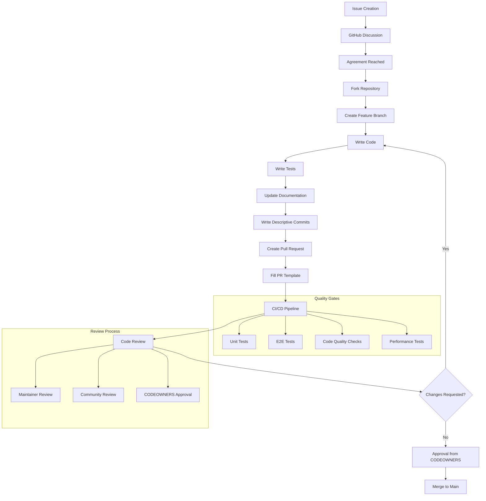
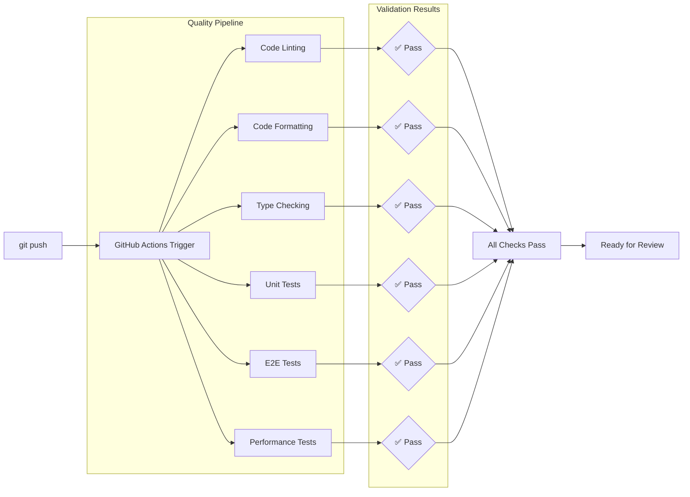

<!-- source: DeepWiki mcp.deepwiki.com · repo Lightning-AI/LitServe · page 5.4 Contributing Guidelines · fetched 2026-10-21 -->

# Contributing Guidelines

Relevant source files

The following files were used as context for generating this wiki page:

- [.github/workflows/ci-minimal-dependency-check.yml](.github/workflows/ci-minimal-dependency-check.yml)
- [.github/workflows/ci-parity.yml](.github/workflows/ci-parity.yml)
- [.github/workflows/ci-testing.yml](.github/workflows/ci-testing.yml)
- [.github/workflows/release-pypi.yml](.github/workflows/release-pypi.yml)
- [.pre-commit-config.yaml](.pre-commit-config.yaml)
- [src/litserve/test_examples/openai_spec_example.py](src/litserve/test_examples/openai_spec_example.py)
- [tests/perf_test/stream/run_test.sh](tests/perf_test/stream/run_test.sh)

This document outlines the standards, processes, and governance for contributing to the LitServe codebase. It covers the complete contribution workflow from issue creation through code review and merge, including code quality requirements and repository ownership structure.

For information about testing your contributions, see [Testing Framework](#5.1) and [Performance Testing](#5.2). For details about the CI/CD pipeline that validates contributions, see [CI/CD Pipeline](#5.3).

## Contribution Workflow

The following diagram illustrates the complete contribution process from initial idea to merged code:

Sources: [.github/PULL_REQUEST_TEMPLATE.md:1-40]()

## Repository Ownership Structure

The LitServe repository uses a distributed ownership model with specific maintainers responsible for different components:

```mermaid
graph TD
    GlobalOwners["Global Owners"] --> AllFiles["* (All Files)"]
    
    subgraph "Core Maintainers"
        GlobalOwners --> lantiga["@lantiga"]
        GlobalOwners --> aniketmaurya["@aniketmaurya"] 
        GlobalOwners --> ethanwharris["@ethanwharris"]
        GlobalOwners --> borda["@borda"]
        GlobalOwners --> justusschock["@justusschock"]
        GlobalOwners --> tchaton["@tchaton"]
        GlobalOwners --> andyland["@andyland"]
        GlobalOwners --> k223kim["@k223kim"]
        GlobalOwners --> KaelanDt["@KaelanDt"]
    end
    
    subgraph "Specialized Ownership"
        CIOwner["@borda"] --> GithubDir["/.github/"]
        CIOwner --> YAMLFiles["*.yaml, *.yml"]
        
        ReqOwners["@borda @lantiga"] --> Requirements["/_requirements/"]
        
        DocOwners["@williamfalcon @lantiga"] --> README["/README.md"]
        ProjectOwner["@williamfalcon"] --> ReqTxt["/requirements.txt"]
    end
    
    AllFiles -.-> DefaultReview["Default Review Required"]
    GithubDir -.-> CIReview["CI/CD Review Required"]
    Requirements -.-> DepsReview["Dependencies Review Required"]
```

Sources: [.github/CODEOWNERS:1-17]()

## Pull Request Requirements

### Mandatory Checklist

All pull requests must satisfy the following requirements before review:

| Requirement | Description | Validation |
|-------------|-------------|------------|
| **Issue Discussion** | Feature/change discussed via GitHub issue | Manual review |
| **User Impact Description** | Clear explanation of user benefit in plain English | Template enforcement |
| **Documentation Updates** | Relevant docs updated | CI checks |
| **Test Coverage** | New tests written for new functionality | CI checks |
| **Contributor Guidelines** | Read and followed | Self-certification |

### PR Template Requirements

Every pull request must include:

1. **Clear Problem Statement**: Link to the GitHub issue being addressed
2. **User Impact Description**: Written in plain English, not technical jargon
3. **Solution Overview**: How the changes solve the user problem
4. **Testing Strategy**: What tests were added or modified

**Good Example**: 
> "As a user, I need to serve models faster. This PR focuses on enabling speed gains by using GPUs"

**Bad Example**: 
> "This PR enables GPUs"

Sources: [.github/PULL_REQUEST_TEMPLATE.md:1-40]()

## Issue Submission Guidelines

### Issue Types and Templates

The repository supports three primary issue types with specific templates:

| Issue Type | Template | Purpose | Labels |
|------------|----------|---------|---------|
| **Bug Report** | `bug_report.md` | Report functionality issues | `bug`, `help wanted` |
| **Feature Request** | `feature_request.md` | Propose new features | `enhancement` |
| **Documentation** | `documentation.md` | Typos and doc improvements | `documentation` |

### Bug Report Requirements

Bug reports must include:

1. **Lightning Studio Reproduction**: Fully reproducible environment
2. **Minimal Code Sample**: Shortest code that preserves the bug
3. **Environment Details**: Python, CUDA, OS versions
4. **Expected vs Actual Behavior**: Clear behavioral description

### Feature Request Guidelines

**What We Accept:**
- Features that solve real user problems
- Improvements to existing functionality
- Better error messages and debugging tools

**What We Don't Accept:**
- Decorators without clear benefit
- Multiple ways to do the same thing
- Additional abstraction layers (max tree-depth: 1)
- Over-engineered solutions
- Linters and complexity-adding tools

Sources: [.github/ISSUE_TEMPLATE/bug_report.md:1-48](), [.github/ISSUE_TEMPLATE/feature_request.md:1-48](), [.github/ISSUE_TEMPLATE/documentation.md:1-17]()

## Code Quality Standards

### Automated Quality Gates

All contributions pass through automated quality checks:

### Code Style Requirements

- **Linting**: Code must pass all linting checks
- **Formatting**: Consistent code formatting enforced
- **Type Hints**: Type annotations required for public APIs
- **Documentation**: Docstrings required for public methods
- **Test Coverage**: New functionality must include tests

Sources: [.github/PULL_REQUEST_TEMPLATE.md:9-13]()

## Review Process

### Community Review

1. **Open Review**: Any community member can review after CI passes
2. **Constructive Feedback**: Focus on code quality and user impact
3. **Knowledge Sharing**: Reviews should be educational

### Maintainer Review

1. **CODEOWNERS Approval**: Required from relevant code owners
2. **Architecture Review**: Ensure changes align with project goals
3. **Performance Impact**: Assess impact on system performance

### Merge Criteria

- All CI checks pass
- At least one CODEOWNERS approval
- Community feedback addressed
- Documentation updated
- User impact clearly articulated

Sources: [.github/PULL_REQUEST_TEMPLATE.md:32-36](), [.github/CODEOWNERS:1-17]()

## Community Support Channels

For questions and discussions outside of code contributions:

| Channel | Purpose | URL |
|---------|---------|-----|
| **Discord** | Live chat with experts and users | `discord.gg/VptPCZkGNa` |
| **Reddit** | Q&A and discussions | `reddit.com/r/lightningAI/` |
| **Documentation** | Official guides and references | `lightning.ai/litserve/` |
| **Lightning Studio** | Platform support | `lightning.ai` |

Sources: [.github/ISSUE_TEMPLATE/config.yml:1-15]()

---

