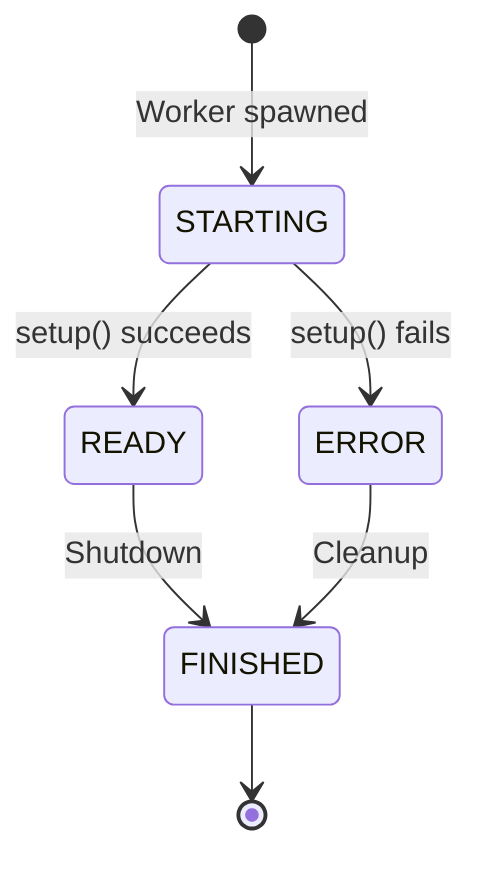
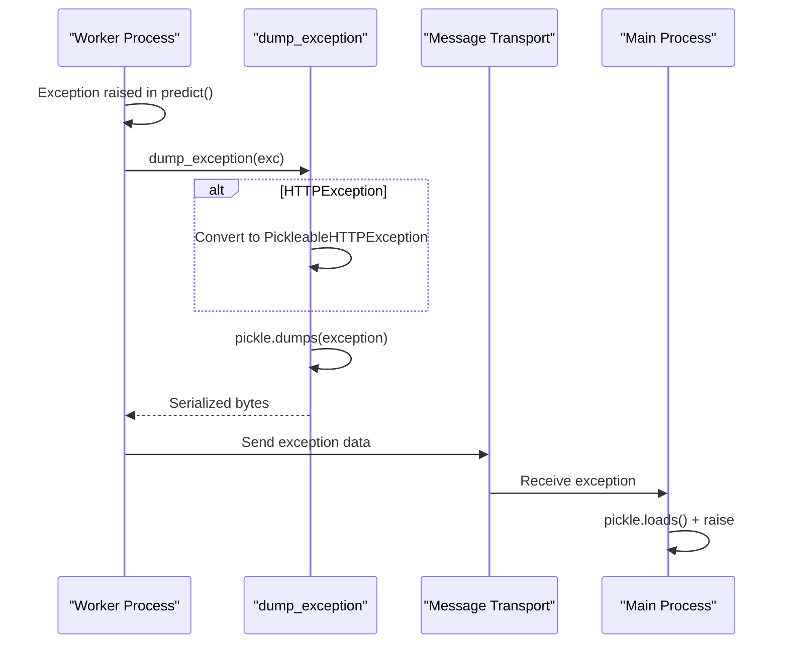
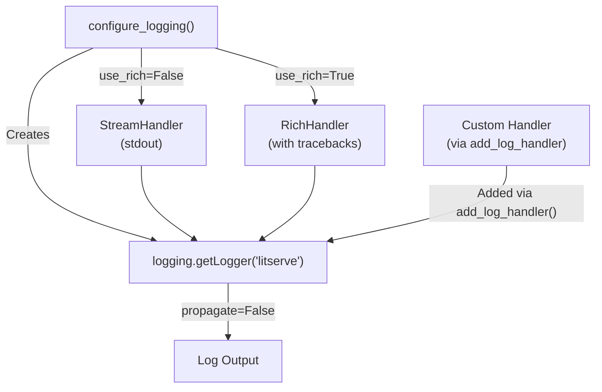
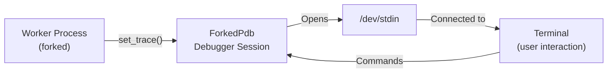
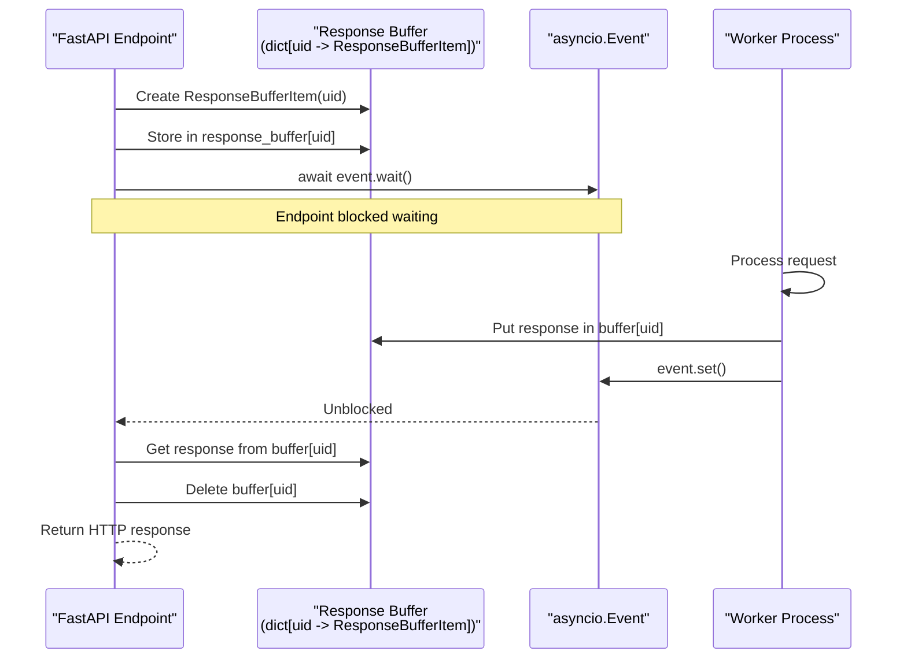
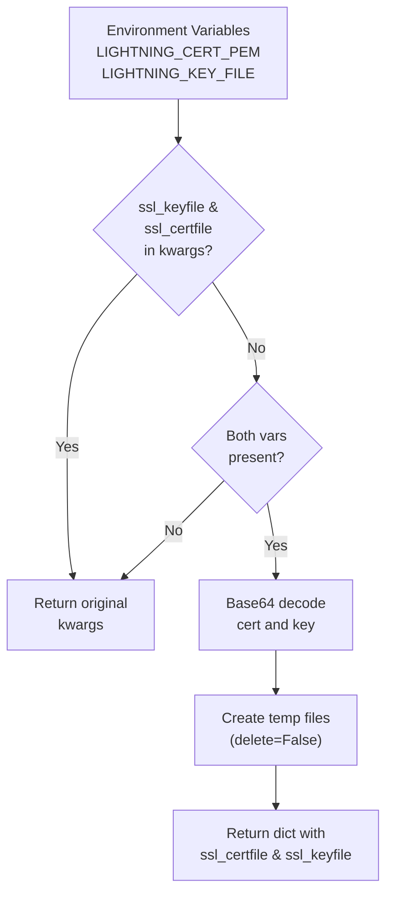
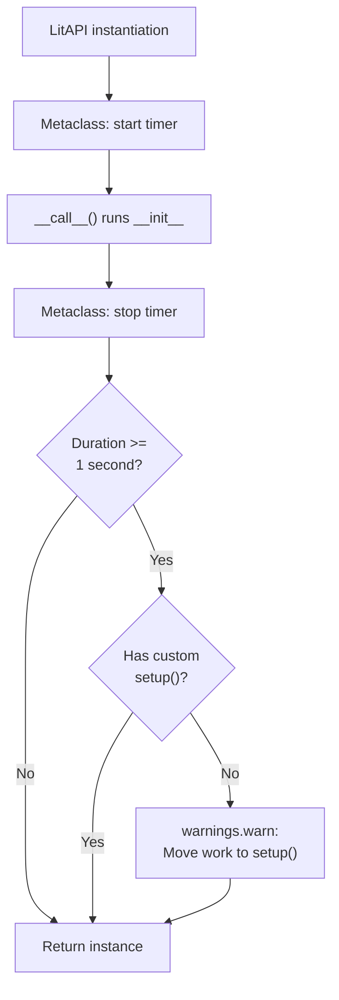

<!-- source: DeepWiki mcp.deepwiki.com · repo Lightning-AI/LitServe · page 6 Utilities & Helpers · fetched 2026-10-21 -->

# Utilities & Helpers

<details>
<summary>Relevant source files</summary>

The following files were used as context for generating this wiki page:

- [src/litserve/utils.py](src/litserve/utils.py)

</details>


This page documents utility functions, classes, and enumerations used throughout LitServe. These utilities support core functionality like status tracking, exception handling, logging configuration, debugging in multi-process environments, async coordination, and SSL setup. For information about core abstractions like LitAPI and LitServer, see [Core Concepts](#2). For deployment and infrastructure details, see [Deployment Options](#4.7).

## Status Enumerations

LitServe uses several enumerations to track internal state and coordinate communication between components.

### LitAPIStatus

The `LitAPIStatus` class defines constants used in the request-response lifecycle to communicate status between workers and the main process.

[src/litserve/utils.py:51-55]()

| Constant | Purpose |
|----------|---------|
| `START` | Indicates the beginning of request processing |
| `OK` | Successful request completion |
| `ERROR` | Request processing failed |
| `FINISH_STREAMING` | Streaming response has completed |

These status codes are used in the transport layer (see [Transport Layer & IPC](#2.4)) to coordinate response handling across process boundaries.

### LoopResponseType

The `LoopResponseType` enum distinguishes between streaming and regular (non-streaming) response patterns.

[src/litserve/utils.py:58-60]()

| Value | Description |
|-------|-------------|
| `STREAMING` | Response is generated incrementally via async iterator |
| `REGULAR` | Response is returned as a single complete object |

This enum is used by processing loops (see [Processing Loops](#2.3)) to determine the appropriate response handling strategy.

### WorkerSetupStatus

The `WorkerSetupStatus` dataclass defines states during worker initialization.

[src/litserve/utils.py:137-142]()

| Status | Meaning |
|--------|---------|
| `STARTING` | Worker process has been spawned but not yet initialized |
| `READY` | Worker has completed `setup()` and is ready to process requests |
| `ERROR` | Worker encountered an error during initialization |
| `FINISHED` | Worker has been shut down |

These statuses are tracked by the worker management system (see [Worker Management](#2.5)) to coordinate startup and monitor worker health.



**Diagram: Worker Lifecycle State Transitions**

**Sources:** [src/litserve/utils.py:137-142]()

## Exception Handling

### PickleableHTTPException

FastAPI's `HTTPException` cannot be serialized with pickle, which is required for inter-process communication. `PickleableHTTPException` provides a serializable wrapper.

[src/litserve/utils.py:63-71]()

**Key Methods:**
- `from_exception(exc: HTTPException)` - Static factory method that converts a standard HTTPException
- `__reduce__()` - Enables pickle serialization by returning constructor arguments

**Usage in IPC:**

When exceptions occur in worker processes, they must be transmitted back to the main process through the transport layer. The `dump_exception` utility handles this conversion:

[src/litserve/utils.py:74-77]()



**Diagram: Exception Serialization Flow**

**Sources:** [src/litserve/utils.py:63-77]()

## Logging Configuration

LitServe provides centralized logging configuration for consistent output across the library.

### configure_logging

The primary logging configuration function allows customization of format, level, output stream, and optional rich formatting.

[src/litserve/utils.py:152-192]()

**Parameters:**

| Parameter | Type | Default | Description |
|-----------|------|---------|-------------|
| `level` | `str` or `int` | `logging.INFO` | Logging level (DEBUG, INFO, WARNING, ERROR, CRITICAL) |
| `format` | `str` | `_DEFAULT_LOG_FORMAT` | Log message format string |
| `stream` | `TextIO` | `sys.stdout` | Output stream for logs |
| `use_rich` | `bool` | `False` | Enable rich formatting with tracebacks |

**Default Format:**

[src/litserve/utils.py:42-44]()

The default format includes timestamp, process name/ID, logger name, level, filename, line number, and message.

**Example Configuration:**

```python
from litserve.utils import configure_logging

# Basic configuration
configure_logging(level="DEBUG")

# With rich formatting for development
configure_logging(level="DEBUG", use_rich=True)
```

### Additional Logging Utilities

**set_log_level**

[src/litserve/utils.py:195-197]()

Dynamically change the logging level without reconfiguring handlers.

**add_log_handler**

[src/litserve/utils.py:200-208]()

Add custom handlers for routing logs to files, external services, or monitoring systems.



**Diagram: Logging Configuration Architecture**

**Sources:** [src/litserve/utils.py:145-208]()

## Debugging Utilities

### ForkedPdb

Debugging multi-process applications requires special handling of stdin. The `ForkedPdb` class enables breakpoints in worker processes.

[src/litserve/utils.py:224-237]()

**Implementation:**

The class overrides `interaction()` to redirect stdin from `/dev/stdin`, allowing the debugger to function correctly in forked processes.

### set_trace Functions

**set_trace**

[src/litserve/utils.py:240-242]()

Unconditionally sets a breakpoint using `ForkedPdb`.

**set_trace_if_debug**

[src/litserve/utils.py:245-248]()

Conditionally sets a breakpoint based on environment variable. By default, checks if `LITSERVE_DEBUG=1`.

**Usage Example:**

```python
from litserve.utils import set_trace_if_debug

class MyLitAPI(LitAPI):
    def predict(self, x):
        set_trace_if_debug()  # Only breaks if LITSERVE_DEBUG=1
        result = self.model(x)
        return result
```



**Diagram: ForkedPdb stdin Redirection**

**Sources:** [src/litserve/utils.py:224-248]()

## Async Utilities

### azip

Asynchronous equivalent of Python's built-in `zip` for async iterables.

[src/litserve/utils.py:80-86]()

**Behavior:**
- Takes multiple async iterables as arguments
- Yields tuples of items from each iterable
- Stops when any iterable is exhausted

### call_after_stream

Utility for executing a callback after an async streaming response completes, ensuring cleanup even if exceptions occur.

[src/litserve/utils.py:127-134]()

**Usage Pattern:**

This is used internally to track when streaming responses complete, enabling proper resource cleanup and status updates.

### ResponseBufferItem

Data structure for coordinating async responses between workers and the FastAPI app.

[src/litserve/utils.py:352-357]()

**Fields:**

| Field | Type | Purpose |
|-------|------|---------|
| `event` | `asyncio.Event` | Signals when response is ready |
| `response_queue` | `Optional[deque]` | Queue of streamed response chunks |
| `worker_id` | `Optional[int]` | ID of worker processing request |
| `response` | `Optional[Any]` | Complete response for non-streaming requests |

This dataclass is central to the async coordination described in [Transport Layer & IPC](#2.4).



**Diagram: ResponseBufferItem Coordination Flow**

**Sources:** [src/litserve/utils.py:352-357]()

## SSL Configuration

### add_ssl_context_from_env

Loads SSL certificates from base64-encoded environment variables for secure HTTPS deployment.

[src/litserve/utils.py:296-349]()

**Environment Variables:**

| Variable | Content |
|----------|---------|
| `LIGHTNING_CERT_PEM` | Base64-encoded SSL certificate (PEM format) |
| `LIGHTNING_KEY_FILE` | Base64-encoded private key (PEM format) |

**Return Value:**

Returns a dictionary with `ssl_certfile` and `ssl_keyfile` keys containing `Path` objects to temporary files. If SSL is already configured via kwargs or environment variables are not set, returns the original kwargs unchanged.

**Important Note:**

The temporary files created are not automatically deleted (`delete=False` in `NamedTemporaryFile`). The calling application is responsible for cleanup.

**Integration:**

This function is used by LitServer during deployment to configure SSL for uvicorn when running in secure environments (see [Deployment Options](#4.7)).



**Diagram: SSL Context Loading Decision Flow**

**Sources:** [src/litserve/utils.py:296-349]()

## Testing Utilities

### wrap_litserve_start

Context manager for testing that starts and cleanly shuts down a LitServer instance without blocking.

[src/litserve/utils.py:89-125]()

**Purpose:**

Enables pytest to start workers, initialize the server, and ensure proper cleanup in test teardown. This is essential for end-to-end testing (see [Testing Framework](#5.1)).

**Behavior:**

1. Initializes manager and response queue IDs
2. Launches inference workers
3. Optionally starts worker monitoring
4. Yields the running server for test execution
5. On exit, sets shutdown event, closes transport, and terminates workers

**Example Usage:**

```python
def test_server_endpoint():
    server = LitServer(MyLitAPI())
    with wrap_litserve_start(server):
        response = requests.post("http://127.0.0.1:8000/predict", json={"input": "test"})
        assert response.status_code == 200
```

**Sources:** [src/litserve/utils.py:89-125]()

## Miscellaneous Utilities

### generate_random_zmq_address

Generates unique IPC addresses for ZeroMQ sockets, ensuring no collisions between server instances.

[src/litserve/utils.py:211-221]()

**Format:** `ipc:///tmp/zmq-{uuid}.ipc`

Used by the transport layer when `fast_queue=True` is enabled (see [Transport Layer & IPC](#2.4)).

### is_package_installed

Checks if an optional package is available without importing it.

[src/litserve/utils.py:251-253]()

**Usage:**

Used throughout LitServe to check for optional dependencies like `mcp`, `rich`, `zmq`, etc., allowing graceful degradation when packages are unavailable.

### _TimedInitMeta

Metaclass that warns developers when heavy initialization occurs in `__init__` rather than `setup()`.

[src/litserve/utils.py:256-293]()

**Threshold:** Warns if `__init__` takes more than 1 second (`_INIT_THRESHOLD`).

**Purpose:**

Encourages best practices by reminding users that model loading and heavy processing should occur in `setup()` to avoid unnecessary work during instantiation. See [LitAPI](#2.1) for lifecycle details.



**Diagram: _TimedInitMeta Warning Logic**

**Sources:** [src/litserve/utils.py:256-293]()

## Summary Table

| Category | Utilities | Primary Use Case |
|----------|-----------|------------------|
| **Status Tracking** | `LitAPIStatus`, `LoopResponseType`, `WorkerSetupStatus` | Internal state coordination between processes |
| **Exception Handling** | `PickleableHTTPException`, `dump_exception` | Serialize exceptions across process boundaries |
| **Logging** | `configure_logging`, `set_log_level`, `add_log_handler` | Library-wide logging configuration |
| **Debugging** | `ForkedPdb`, `set_trace`, `set_trace_if_debug` | Debugging in multi-process environments |
| **Async Coordination** | `azip`, `call_after_stream`, `ResponseBufferItem` | Async response handling and streaming |
| **SSL** | `add_ssl_context_from_env` | Load SSL certificates from environment |
| **Testing** | `wrap_litserve_start` | Server lifecycle management in tests |
| **Miscellaneous** | `generate_random_zmq_address`, `is_package_installed`, `_TimedInitMeta` | IPC addressing, dependency checks, initialization warnings |

**Sources:** [src/litserve/utils.py:1-358]()