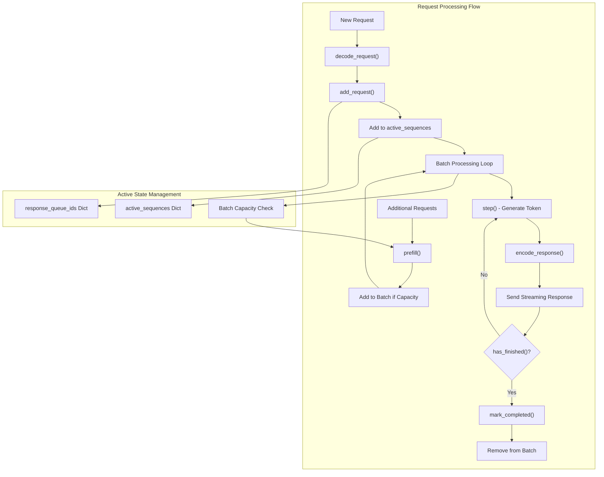
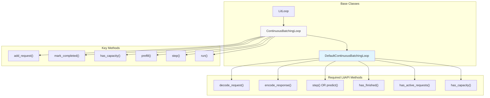
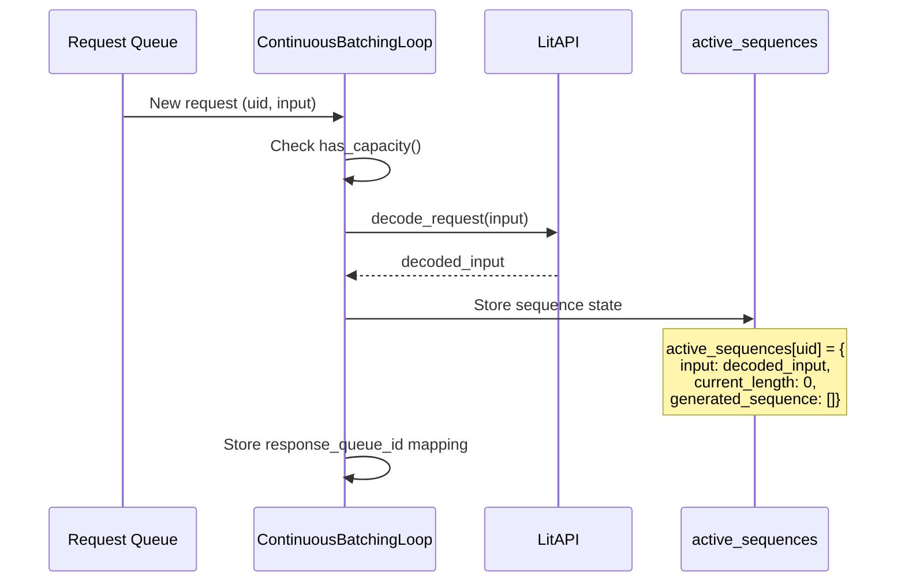
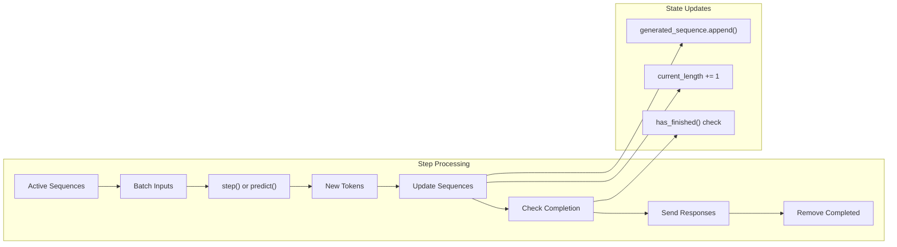
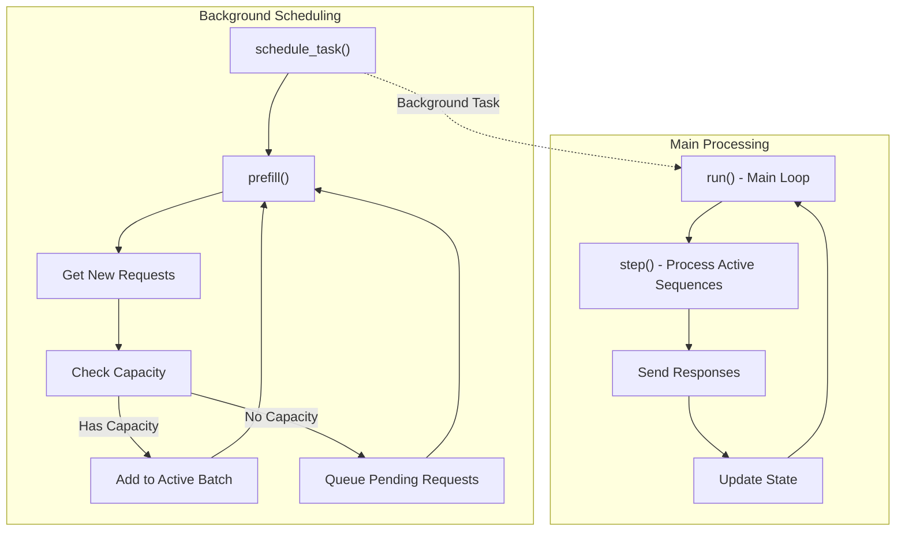

<!-- source: DeepWiki mcp.deepwiki.com · repo Lightning-AI/LitServe · extra page Continuous Batching Loop · fetched 2026-10-21 -->

# Continuous Batching Loop

<details>
<summary>Relevant source files</summary>

The following files were used as context for generating this wiki page:

- [src/litserve/loops/base.py](src/litserve/loops/base.py)
- [src/litserve/loops/continuous_batching_loop.py](src/litserve/loops/continuous_batching_loop.py)
- [src/litserve/loops/loops.py](src/litserve/loops/loops.py)

</details>


This document covers the `ContinuousBatchingLoop` implementation in LitServe, which provides continuous batching capabilities for LLM-style token generation and streaming workloads. This loop is specifically designed for scenarios where multiple sequences need to be processed concurrently with incremental token generation.

For information about standard request processing loops, see [Standard Loops](#2.3.1). For streaming without continuous batching, see [Streaming Loops](#2.3.2). For the broader processing loop architecture, see [Processing Loops](#2.3).

## Overview

The `ContinuousBatchingLoop` is designed for Large Language Model (LLM) inference patterns where:
- Multiple sequences are processed concurrently in batches
- Each sequence generates tokens incrementally over multiple steps
- New requests can be added to the batch while existing sequences are still generating
- Completed sequences are removed from the batch dynamically

Unlike traditional batching where all requests in a batch start and finish together, continuous batching allows for dynamic batch composition with sequences at different stages of completion.

**Continuous Batching Request Lifecycle**



Sources: [src/litserve/loops/continuous_batching_loop.py:53-295]()

## Architecture Components

The continuous batching system consists of two main classes and several key data structures:

**Core Components**

| Component | Type | Purpose |
|-----------|------|---------|
| `ContinuousBatchingLoop` | Base Class | Abstract implementation requiring custom `step()` method |
| `DefaultContinuousBatchingLoop` | Concrete Class | Default implementation using `predict()` and `has_finished()` |
| `Output` | Data Class | Represents output from a single generation step |
| `active_sequences` | Dict[str, Dict] | Tracks state of all active sequences |
| `response_queue_ids` | Dict[str, int] | Maps request UIDs to response queues |

**Class Hierarchy and Key Methods**



Sources: [src/litserve/loops/continuous_batching_loop.py:53-295]()

## Request Lifecycle Management

### Adding New Requests

The `add_request()` method handles incorporating new requests into the active batch:



Sources: [src/litserve/loops/continuous_batching_loop.py:105-109](), [src/litserve/loops/continuous_batching_loop.py:240-244]()

### Batch Processing Step

Each processing step generates tokens for all active sequences:



Sources: [src/litserve/loops/continuous_batching_loop.py:245-286]()

## Implementation Variants

### Base ContinuousBatchingLoop

The base class requires implementing a custom `step()` method and provides maximum flexibility:

**Required LitAPI Methods:**
- `step(prev_outputs) -> List[Output]`: Custom token generation logic
- `add_request(uid, request)`: Add request to internal state
- `has_active_requests() -> bool`: Check if any sequences are active
- `has_capacity() -> bool`: Check if more requests can be added

### DefaultContinuousBatchingLoop

The default implementation uses standard `predict()` and `has_finished()` methods:

**Required LitAPI Methods:**
- `predict(inputs, generated_sequences) -> List[tokens]`: Generate next tokens
- `has_finished(uid, token, max_length) -> bool`: Check sequence completion
- `decode_request()`: Standard request decoding
- `encode_response()`: Standard response encoding

**Sequence State Management:**

| Field | Type | Purpose |
|-------|------|---------|
| `input` | Any | Decoded request input |
| `current_length` | int | Current sequence length |
| `generated_sequence` | List | All generated tokens |

Sources: [src/litserve/loops/continuous_batching_loop.py:239-295]()

## Asynchronous Request Scheduling

The loop uses asynchronous scheduling to handle new requests while processing active sequences:

**Prefill and Scheduling Flow**



Sources: [src/litserve/loops/continuous_batching_loop.py:152-177](), [src/litserve/loops/continuous_batching_loop.py:120-150]()

## Error Handling and Completion

### Request Completion

Sequences are marked as completed when:
- `has_finished()` returns `True`
- Maximum sequence length is reached
- An error occurs during processing

The `mark_completed()` method handles cleanup:
- Removes sequence from `active_sequences`
- Removes mapping from `response_queue_ids`
- Sends final streaming response with `FINISH_STREAMING` status

### Error Propagation

Errors during processing trigger cleanup for all active sequences:
- Error responses sent to all tracked request queues
- All state dictionaries cleared
- Loop continues with fresh state

Sources: [src/litserve/loops/continuous_batching_loop.py:110-115](), [src/litserve/loops/continuous_batching_loop.py:230-237]()

## Configuration Requirements

The continuous batching loop requires specific configuration:

- **Streaming must be enabled**: `LitServe(..., stream=True)`
- **Max batch size**: Controls maximum concurrent sequences
- **Max sequence length**: Prevents runaway generation
- **Request timeout**: Handles stale requests in queue

**Validation and Setup**

The `pre_setup()` method validates required methods and configuration:

```python
# Required validation checks from pre_setup()
if not lit_api.stream:
    raise ValueError("Continuous batching loop requires streaming to be enabled")

if not hasattr(lit_api, "step") and not hasattr(lit_api, "predict"):
    raise ValueError("Missing step() or predict() method")

if not hasattr(lit_api, "has_finished"):
    raise ValueError("Missing has_finished() method")
```

Sources: [src/litserve/loops/continuous_batching_loop.py:74-104]()

---

