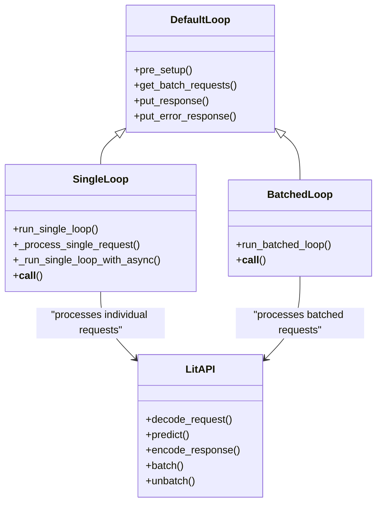
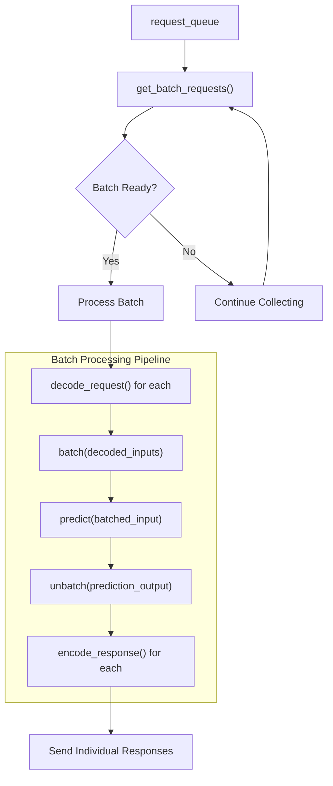
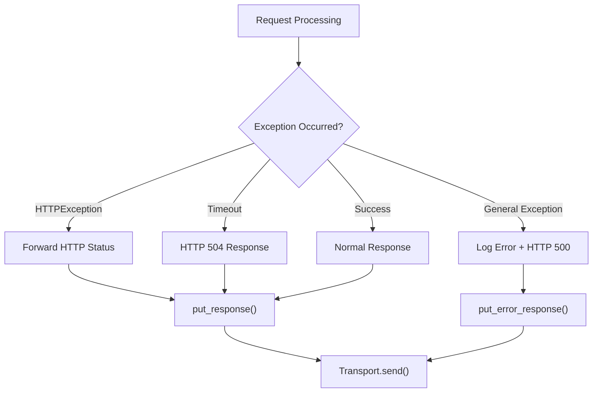

<!-- source: DeepWiki mcp.deepwiki.com · repo Lightning-AI/LitServe · extra page Standard Loops · fetched 2026-10-21 -->

# Standard Loops

<details>
<summary>Relevant source files</summary>

The following files were used as context for generating this wiki page:

- [src/litserve/loops/base.py](src/litserve/loops/base.py)
- [src/litserve/loops/simple_loops.py](src/litserve/loops/simple_loops.py)
- [src/litserve/loops/streaming_loops.py](src/litserve/loops/streaming_loops.py)

</details>


## Purpose and Scope

Standard loops implement the core request processing patterns for non-streaming workloads in LitServe. They handle the fundamental request-response cycle by dequeuing requests, processing them through the LitAPI methods, and sending responses back via the transport layer.

This page covers `SingleLoop` and `BatchedLoop` implementations. For streaming request processing, see [Streaming Loops](#2.3.2). For advanced iterative generation with state management, see [Continuous Batching Loop](#2.3.3).

## Loop Architecture

The standard loops inherit from `DefaultLoop` and implement the core processing patterns used by most LitServe applications:



Sources: [src/litserve/loops/simple_loops.py:32-415](), [src/litserve/loops/base.py:24]()

## SingleLoop

The `SingleLoop` class processes requests individually, making it suitable for workloads where batching provides no performance benefit or where request processing must be isolated.

### Core Processing Flow

```mermaid
sequenceDiagram
    participant Queue as "request_queue"
    participant Loop as "SingleLoop"
    participant API as "LitAPI"
    participant Transport as "MessageTransport"
    participant Callbacks as "CallbackRunner"
    
    Loop->>Queue: get(timeout=1.0)
    Queue->>Loop: (response_queue_id, uid, timestamp, x_enc)
    
    Loop->>Loop: check timeout
    
    Loop->>Callbacks: trigger BEFORE_DECODE_REQUEST
    Loop->>API: decode_request(x_enc)
    API->>Loop: decoded_input
    Loop->>Callbacks: trigger AFTER_DECODE_REQUEST
    
    Loop->>Callbacks: trigger BEFORE_PREDICT
    Loop->>API: predict(decoded_input)
    API->>Loop: prediction_output
    Loop->>Callbacks: trigger AFTER_PREDICT
    
    Loop->>Callbacks: trigger BEFORE_ENCODE_RESPONSE
    Loop->>API: encode_response(prediction_output)
    API->>Loop: encoded_response
    Loop->>Callbacks: trigger AFTER_ENCODE_RESPONSE
    
    Loop->>Transport: send(response)
```

Sources: [src/litserve/loops/simple_loops.py:42-134]()

### Async Support

`SingleLoop` supports both synchronous and asynchronous execution modes based on the `enable_async` flag:

- **Sync mode**: Uses `run_single_loop()` for sequential request processing
- **Async mode**: Uses `_run_single_loop_with_async()` for concurrent request handling with asyncio tasks

The async implementation creates separate tasks for each request via `_process_single_request()`, enabling concurrent processing of multiple requests within a single worker process.

Sources: [src/litserve/loops/simple_loops.py:283-287](), [src/litserve/loops/simple_loops.py:206-270]()

### Timeout Handling

Requests are checked against `lit_api.request_timeout` before processing. Timed-out requests receive an HTTP 504 response:

```python
if (lit_api.request_timeout and lit_api.request_timeout != -1) and (
    time.monotonic() - timestamp > lit_api.request_timeout
):
    # Send timeout response
    self.put_response(transport, response_queue_id, uid, 
                     HTTPException(504, "Request timed out"), 
                     LitAPIStatus.ERROR, LoopResponseType.REGULAR)
```

Sources: [src/litserve/loops/simple_loops.py:57-73]()

## BatchedLoop

The `BatchedLoop` class accumulates requests into batches before processing, improving throughput for workloads that benefit from vectorized operations.

### Batch Collection and Processing



Sources: [src/litserve/loops/simple_loops.py:290-396]()

### Batch Size Validation

The loop validates that `unbatch()` returns the same number of outputs as inputs to prevent response misalignment:

```python
if len(outputs) != num_inputs:
    logger.error(f"LitAPI.predict/unbatch returned {len(outputs)} outputs, "
                f"but expected {num_inputs}")
    raise HTTPException(500, detail="Batch size mismatch")
```

Sources: [src/litserve/loops/simple_loops.py:354-362]()

### Context Injection

Both loops support context injection, allowing LitAPI methods to access request-specific context data:

- **Single requests**: Context passed to individual `decode_request`, `predict`, and `encode_response` calls
- **Batched requests**: Separate context objects maintained for each request in the batch

Sources: [src/litserve/loops/simple_loops.py:75-84](), [src/litserve/loops/simple_loops.py:330-368]()

## Error Handling

Standard loops implement comprehensive error handling for different failure scenarios:

### HTTPException Handling
HTTP exceptions are caught and forwarded as proper HTTP responses with status codes preserved.

### General Exception Handling  
Unexpected exceptions are logged and converted to HTTP 500 responses via `put_error_response()`.

### Timeout Management
Both loops check request timestamps against `request_timeout` and automatically expire stale requests.



Sources: [src/litserve/loops/simple_loops.py:111-133](), [src/litserve/loops/simple_loops.py:376-395]()

## Integration with LitServer

Standard loops are automatically selected by LitServer based on LitAPI configuration:

- `SingleLoop`: Used when `max_batch_size == 1` and `stream == False`
- `BatchedLoop`: Used when `max_batch_size > 1` and `stream == False`

The loops integrate with the broader LitServer architecture through:
- **Transport layer**: For receiving requests and sending responses
- **Callback system**: For lifecycle event notifications  
- **Worker processes**: Each worker runs one loop instance
- **Device management**: Loops operate within device-specific worker contexts

Sources: [src/litserve/loops/simple_loops.py:271-287](), [src/litserve/loops/simple_loops.py:397-415](), [tests/unit/test_loops.py:726-752]()

---

