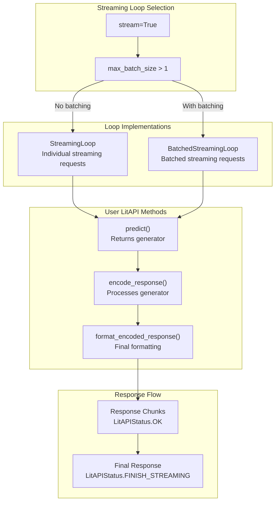
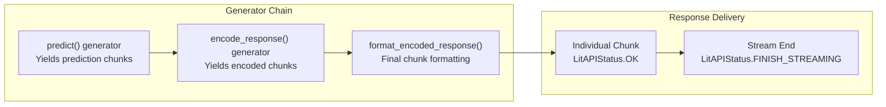
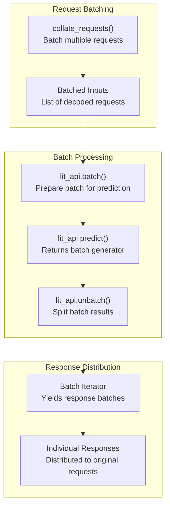
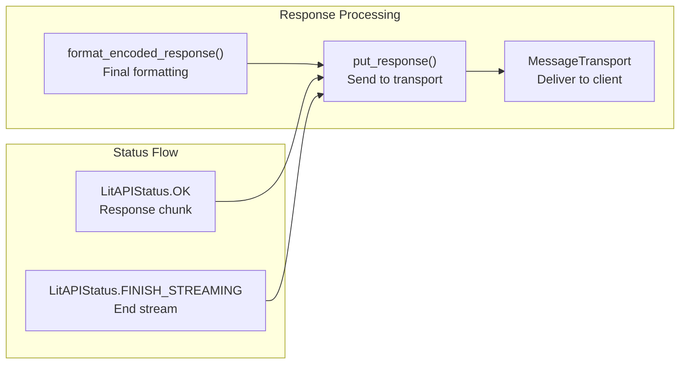

<!-- source: DeepWiki mcp.deepwiki.com · repo Lightning-AI/LitServe · extra page Streaming Loops · fetched 2026-10-21 -->

# Streaming Loops

<details>
<summary>Relevant source files</summary>

The following files were used as context for generating this wiki page:

- [src/litserve/loops/base.py](src/litserve/loops/base.py)
- [src/litserve/loops/simple_loops.py](src/litserve/loops/simple_loops.py)
- [src/litserve/loops/streaming_loops.py](src/litserve/loops/streaming_loops.py)

</details>


This document covers the streaming loop implementations in LitServe that handle real-time response generation, where responses are sent incrementally as they become available rather than waiting for complete processing. For standard non-streaming loops, see [Standard Loops](#2.3.1). For continuous batching with LLM-style generation, see [Continuous Batching Loop](#2.3.3).

## Overview

Streaming loops enable real-time response delivery by processing requests and yielding partial results incrementally. LitServe provides two streaming loop implementations: `StreamingLoop` for individual requests and `BatchedStreamingLoop` for batched streaming requests.



Sources: [src/litserve/loops/streaming_loops.py:32-383]()

## StreamingLoop

The `StreamingLoop` class handles individual streaming requests by processing each request independently and yielding responses incrementally.

### Core Processing Flow

```mermaid
sequenceDiagram
    participant Queue as "request_queue"
    participant Loop as "StreamingLoop"
    participant API as "LitAPI"
    participant Transport as "MessageTransport"
    participant Client as "Client"
    
    Queue->>Loop: "get(timeout=1.0)"
    Note over Queue,Loop: "(response_queue_id, uid, timestamp, x_enc)"
    
    Loop->>API: "decode_request(x_enc)"
    API-->>Loop: "decoded input"
    
    Loop->>API: "predict(input)"
    Note over API: "Returns generator"
    API-->>Loop: "prediction_generator"
    
    Loop->>API: "encode_response(prediction_generator)"
    Note over API: "Returns generator"
    API-->>Loop: "encoded_generator"
    
    loop "For each response chunk"
        Loop->>API: "format_encoded_response(chunk)"
        API-->>Loop: "formatted_chunk"
        Loop->>Transport: "put_response(..., LitAPIStatus.OK, STREAMING)"
        Transport->>Client: "Stream chunk"
    end
    
    Loop->>Transport: "put_response(..., LitAPIStatus.FINISH_STREAMING)"
    Transport->>Client: "End stream"
```

Sources: [src/litserve/loops/streaming_loops.py:33-122]()

### Implementation Details

The `StreamingLoop.run_streaming_loop()` method implements the main processing logic:

| Component | Purpose | Key Methods |
|-----------|---------|-------------|
| Request Retrieval | Get requests from shared queue | `request_queue.get(timeout=1.0)` |
| Context Management | Handle request context | `lit_spec.populate_context()` |
| Decoding | Parse request payload | `lit_api.decode_request()` |
| Prediction | Generate streaming response | `lit_api.predict()` (returns generator) |
| Encoding | Format response stream | `lit_api.encode_response()` (processes generator) |
| Response Delivery | Send chunks to client | `put_response()` with `LoopResponseType.STREAMING` |

The loop processes generators returned by `predict()` and `encode_response()`:



Sources: [src/litserve/loops/streaming_loops.py:67-102]()

### Async Support

`StreamingLoop` supports asynchronous processing through `run_streaming_loop_async()` and `_process_streaming_request()`:

- Uses `asyncio.create_task()` for concurrent request processing
- Handles async generators from `predict()` and `encode_response()`
- Maintains pending tasks to prevent garbage collection
- Wraps specs with `spec.as_async()` for async compatibility

Sources: [src/litserve/loops/streaming_loops.py:192-266]()

## BatchedStreamingLoop

The `BatchedStreamingLoop` combines request batching with streaming responses, processing multiple requests together while still delivering incremental results.

### Batched Streaming Flow



Sources: [src/litserve/loops/streaming_loops.py:269-383]()

### Batch Response Processing

The `run_batched_streaming_loop()` method processes batched streaming responses:

1. **Request Collation**: Uses `collate_requests()` to gather multiple requests into batches
2. **Batch Preparation**: Calls `lit_api.batch()` to prepare batched input
3. **Prediction**: `lit_api.predict()` returns a generator for the entire batch
4. **Unbatching**: `lit_api.unbatch()` splits batch results into per-request streams
5. **Response Distribution**: Iterates through batch responses and sends to individual clients

The key difference from standard batching is that `predict()` returns a generator, and `unbatch()` processes this generator to yield batches of responses:

```python
# Conceptual flow in BatchedStreamingLoop
y_iter = lit_api.predict(batched_input)  # Returns generator
unbatched_iter = lit_api.unbatch(y_iter)  # Processes generator
y_enc_iter = lit_api.encode_response(unbatched_iter)  # Encodes responses

# y_enc_iter yields batches: [[response-1, response-2], [response-1, response-2]]
for y_batch in y_enc_iter:
    for response_queue_id, y_enc, uid in zip(response_queue_ids, y_batch, uids):
        # Send individual response chunk
        self.put_response(transport, response_queue_id, uid, y_enc, ...)
```

Sources: [src/litserve/loops/streaming_loops.py:320-343]()

## Response Handling

Both streaming loops use consistent response handling patterns:

### Response Types and Status

| Status | Purpose | When Used |
|--------|---------|-----------|
| `LitAPIStatus.OK` | Normal response chunk | Each streaming response |
| `LitAPIStatus.FINISH_STREAMING` | End of stream | Final response in sequence |
| `LitAPIStatus.ERROR` | Error occurred | Exception handling |

### Response Transport

All responses use `LoopResponseType.STREAMING` to indicate streaming behavior:



Sources: [src/litserve/loops/streaming_loops.py:91-98](), [src/litserve/loops/streaming_loops.py:334-343]()

## Error Handling and Timeouts

Streaming loops implement comprehensive error handling:

### Timeout Management
- Checks `lit_api.request_timeout` against request timestamp
- Sends `HTTPException(504, "Request timed out")` for expired requests
- Uses `LitAPIStatus.ERROR` with `LoopResponseType.STREAMING`

### Exception Handling
- Catches `HTTPException` and forwards to client
- Logs general exceptions with request context
- Uses `put_error_response()` for consistent error delivery

Sources: [src/litserve/loops/streaming_loops.py:49-65](), [src/litserve/loops/streaming_loops.py:103-122]()

---

