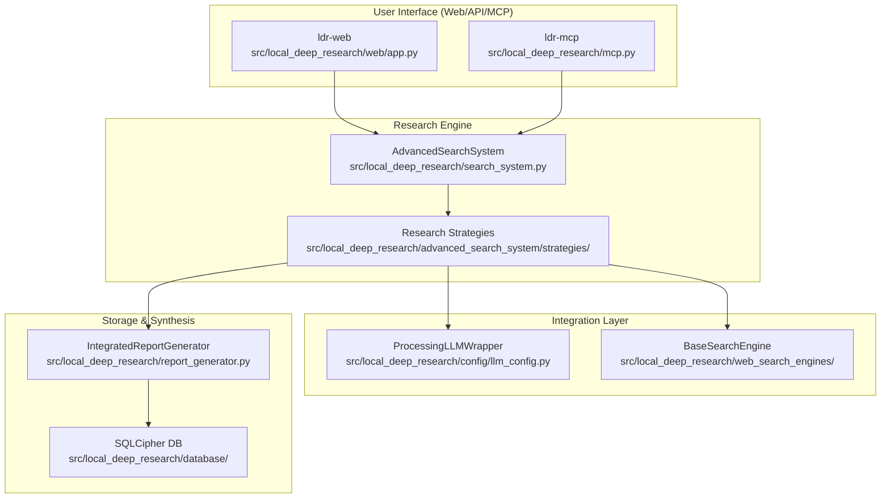
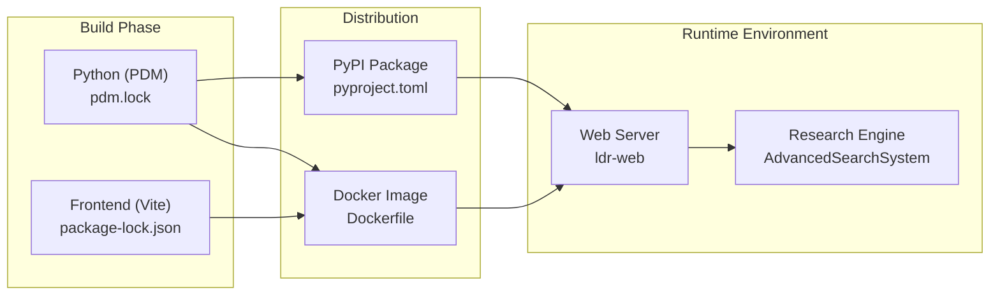

<!-- source: DeepWiki mcp.deepwiki.com · repo LearningCircuit/local-deep-research · page 1 Overview · fetched 2026-10-29 -->

# Overview

Relevant source files

The following files were used as context for generating this wiki page:

- [.file-whitelist.txt](.file-whitelist.txt)
- [.github/CODEOWNERS](.github/CODEOWNERS)
- [.github/scripts/file-whitelist-check.sh](.github/scripts/file-whitelist-check.sh)
- [.gitignore](.gitignore)
- [.gitleaks.toml](.gitleaks.toml)
- [.gitleaksignore](.gitleaksignore)
- [.pre-commit-config.yaml](.pre-commit-config.yaml)
- [.pre-commit-hooks/check-absolute-module-paths.py](.pre-commit-hooks/check-absolute-module-paths.py)
- [.pre-commit-hooks/file-whitelist-check.sh](.pre-commit-hooks/file-whitelist-check.sh)
- [.pre-commit-hooks/recommend-release-notes.py](.pre-commit-hooks/recommend-release-notes.py)
- [CONTRIBUTING.md](CONTRIBUTING.md)
- [README.md](README.md)
- [changelog.d/3670.breaking.1.md](changelog.d/3670.breaking.1.md)
- [changelog.d/3670.breaking.md](changelog.d/3670.breaking.md)
- [changelog.d/3670.feature.md](changelog.d/3670.feature.md)
- [changelog.d/3773.feature.md](changelog.d/3773.feature.md)
- [changelog.d/README.md](changelog.d/README.md)
- [docker-compose.gpu.override.yml](docker-compose.gpu.override.yml)
- [docs/CI_CD_INFRASTRUCTURE.md](docs/CI_CD_INFRASTRUCTURE.md)
- [docs/CONFIGURATION.md](docs/CONFIGURATION.md)
- [docs/RELEASE_GUIDE.md](docs/RELEASE_GUIDE.md)
- [docs/SECURITY_REVIEW_PROCESS.md](docs/SECURITY_REVIEW_PROCESS.md)
- [docs/SQLCIPHER_INSTALL.md](docs/SQLCIPHER_INSTALL.md)
- [docs/decisions/0001-remove-detect-secrets.md](docs/decisions/0001-remove-detect-secrets.md)
- [docs/developing.md](docs/developing.md)
- [docs/docker-compose-guide.md](docs/docker-compose-guide.md)
- [docs/install-pip.md](docs/install-pip.md)
- [docs/installation.md](docs/installation.md)
- [package-lock.json](package-lock.json)
- [package.json](package.json)
- [pdm.lock](pdm.lock)
- [pyproject.toml](pyproject.toml)
- [src/local_deep_research/__version__.py](src/local_deep_research/__version__.py)
- [src/local_deep_research/database/sqlcipher_compat.py](src/local_deep_research/database/sqlcipher_compat.py)
- [src/local_deep_research/web/static/js/mobile-navigation.js](src/local_deep_research/web/static/js/mobile-navigation.js)
- [src/local_deep_research/web/static/js/security/url-validator.js](src/local_deep_research/web/static/js/security/url-validator.js)
- [src/local_deep_research/web/static/js/services/api.js](src/local_deep_research/web/static/js/services/api.js)
- [src/local_deep_research/web/static/js/services/formatting.js](src/local_deep_research/web/static/js/services/formatting.js)
- [tests/infrastructure_tests/test_csrf_api.test.js](tests/infrastructure_tests/test_csrf_api.test.js)
- [tests/infrastructure_tests/test_urls.test.js](tests/infrastructure_tests/test_urls.test.js)
- [tests/security/test_absolute_module_paths_hook.py](tests/security/test_absolute_module_paths_hook.py)
- [vite.config.js](vite.config.js)

## Purpose and Scope

This document provides a high-level introduction to Local Deep Research (LDR), its core capabilities, architectural philosophy, and major system components. It serves as the entry point for understanding the system's design and how the pieces fit together.

**For detailed information about specific subsystems:**
- Core terminology and encrypted databases → [Key Concepts](#1.1)
- Repository organization and dependencies → [Project Structure and Dependencies](#1.2)
- Research execution → [Research Service and Execution Lifecycle](#3.3)
- RAG implementation → [Research Library and RAG System](#3.7)
- Deployment strategies → [Deployment Strategies](#9)

**Sources:** [README.md:1-45](), [src/local_deep_research/__version__.py:1-1]()

---

## What is Local Deep Research?

Local Deep Research is an AI-powered research assistant that performs deep, agentic research using multiple LLMs and search engines with proper citations [README.md:32-34](). It is designed to be "local-first" for privacy, allowing users to build a searchable knowledge base from research findings while maintaining ownership of their data [README.md:42-45]().

The system is accessible through multiple interfaces:
- **Web UI**: Primary interface for research and settings (default port 5000) [docs/CONFIGURATION.md:65-69](), accessible via the `ldr-web` entry point [pyproject.toml:111-111]().
- **REST API**: Authenticated endpoints for programmatic integration using Flask blueprints.
- **Python API**: Programmatic access via the core library for enterprise integration.
- **MCP Server**: Model Context Protocol integration via `ldr-mcp` for tools like Claude Desktop [pyproject.toml:112-112]().

The application version is currently **1.6.9**, tracked in [src/local_deep_research/__version__.py:1]().

**Sources:** [README.md:32-45](), [src/local_deep_research/__version__.py:1-1](), [package.json:3-3](), [pyproject.toml:110-112](), [docs/CONFIGURATION.md:65-69]()

---

## Core Architecture

The system bridges natural language queries to a structured research execution pipeline involving LLMs, search engines, and a RAG-enabled library.

### System Flow: Natural Language to Code Entity Space

**Sources:** [pyproject.toml:110-112](), [README.md:93-115]()

---

## Key Features

### Local-First and Privacy-Focused
LDR prioritizes privacy by supporting fully local stacks. Users can run LLMs via **Ollama** and search via **SearXNG** [README.md:50-65](). Every user's data is isolated in a per-user **SQLCipher** database [README.md:15](). Encryption parameters like `LDR_DB_CONFIG_KDF_ITERATIONS` (default 256,000) and `LDR_DB_CONFIG_HMAC_ALGORITHM` (default HMAC_SHA512) are configurable via bootstrap settings [docs/CONFIGURATION.md:44-47]().

### Multi-Strategy Research
The system coordinates different search strategies via the `AdvancedSearchSystem`.
- **langgraph-agent**: Autonomous research mode where the LLM decides search tools (arXiv, PubMed, etc.) and synthesis timing [README.md:104]().
- **20+ Strategies**: Choose from specialized strategies for quick facts, deep analysis, or academic research [README.md:102]().
- **Citation-Heavy**: Every research session finds valuable sources, extracts text, and indexes them for compound knowledge [README.md:117-118]().

### Research Library and RAG
Research findings become part of a compound knowledge base. LDR can download sources into an encrypted library, index them using **FAISS**, and use them for future RAG-based queries [README.md:106-115](), [pyproject.toml:49-49]().

**Sources:** [README.md:93-115](), [docs/CONFIGURATION.md:42-49](), [pyproject.toml:49-49]()

---

## Architectural Philosophy

### 1. Zero-Knowledge and Isolation
The system uses a per-user database architecture powered by **SQLCipher**. Access is protected by password-derived keys; the system is designed so that data remains encrypted at rest [README.md:15](), [docs/CONFIGURATION.md:39-40]().

### 2. Thread-Safe Settings and Context
Research tasks run in background threads. LDR uses a settings management system that handles thread-local contexts and database session management to ensure safe execution during concurrent research tasks [docs/CONFIGURATION.md:11-13]().

### 3. Resource Lifecycle Management
The system includes automated schedulers for managing background tasks like news subscriptions [docs/CONFIGURATION.md:51-52](). Concurrency is strictly managed via limits like `LDR_SERVER_MAX_CONCURRENT_RESEARCH` [docs/CONFIGURATION.md:57]().

### 4. Pluggable Integration
The architecture uses a strategy pattern for search engines and LLMs. The `AdvancedSearchSystem` allows selecting from various strategies, while abstractions in the `web_search_engines` layer handle provider-specific logic for engines like arXiv, PubMed, and Wikipedia [pyproject.toml:45-47]().

**Sources:** [docs/CONFIGURATION.md:1-60](), [pyproject.toml:45-50]()

---

## Deployment and Build Pipeline

LDR utilizes modern Python and Frontend tooling for reproducible builds and deployment flexibility.

### Deployment Flow: Build to Execution

**Sources:** [package.json:1-50](), [README.md:50-89](), [pyproject.toml:1-112]()

---

## Next Steps

To begin exploring or contributing to the codebase:
- See **[Key Concepts](#1.1)** for a deep dive into the encryption and RAG models.
- Review **[Project Structure and Dependencies](#1.2)** to understand the file layout and package management (PDM and npm).
- Follow the **Getting Started** guide in the README to launch your first research session using Docker or pip [README.md:46-49]().

**Sources:** [README.md:46-49]()

---

