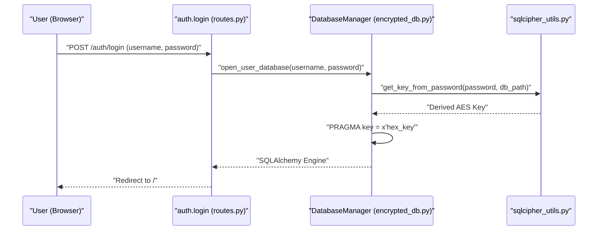
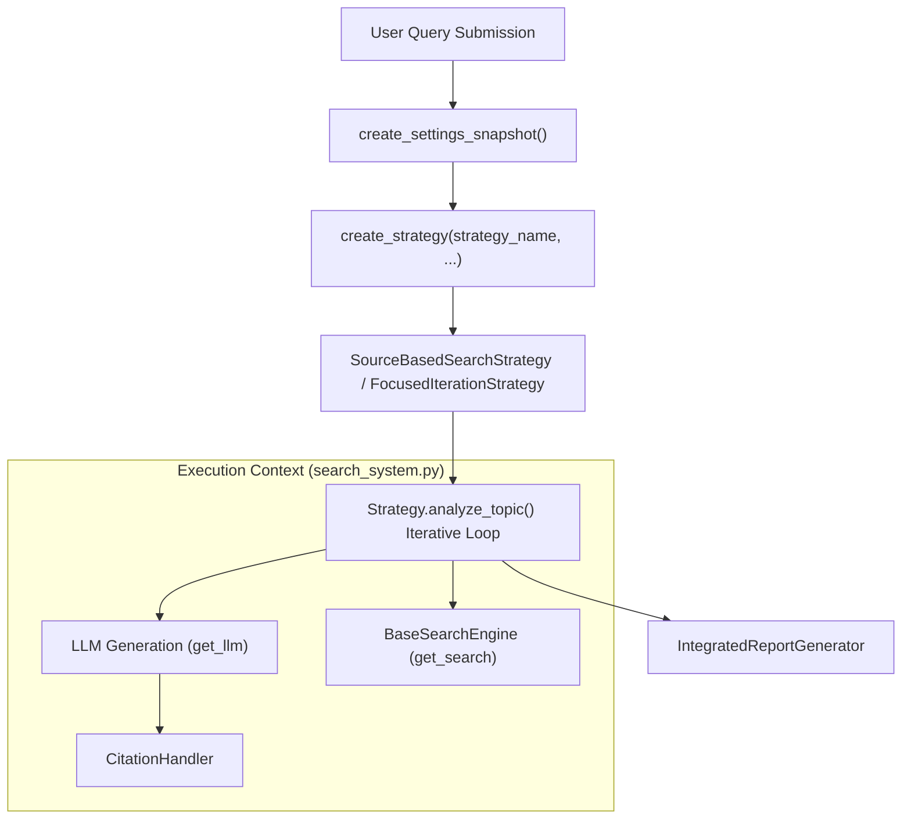

<!-- source: DeepWiki mcp.deepwiki.com · repo LearningCircuit/local-deep-research · page 1.1 Key Concepts · fetched 2026-10-29 -->

# Key Concepts

Relevant source files

The following files were used as context for generating this wiki page:

- [.github/CODEOWNERS](.github/CODEOWNERS)
- [README.md](README.md)
- [docker-compose.gpu.override.yml](docker-compose.gpu.override.yml)
- [docs/BENCHMARKING.md](docs/BENCHMARKING.md)
- [docs/CI_CD_INFRASTRUCTURE.md](docs/CI_CD_INFRASTRUCTURE.md)
- [docs/SECURITY_REVIEW_PROCESS.md](docs/SECURITY_REVIEW_PROCESS.md)
- [docs/SQLCIPHER_INSTALL.md](docs/SQLCIPHER_INSTALL.md)
- [docs/decisions/0001-remove-detect-secrets.md](docs/decisions/0001-remove-detect-secrets.md)
- [docs/developing.md](docs/developing.md)
- [docs/docker-compose-guide.md](docs/docker-compose-guide.md)
- [docs/install-pip.md](docs/install-pip.md)
- [docs/installation.md](docs/installation.md)
- [src/local_deep_research/advanced_search_system/questions/browsecomp_question.py](src/local_deep_research/advanced_search_system/questions/browsecomp_question.py)
- [src/local_deep_research/advanced_search_system/questions/flexible_browsecomp_question.py](src/local_deep_research/advanced_search_system/questions/flexible_browsecomp_question.py)
- [src/local_deep_research/advanced_search_system/strategies/langgraph_agent_strategy.py](src/local_deep_research/advanced_search_system/strategies/langgraph_agent_strategy.py)
- [src/local_deep_research/advanced_search_system/strategies/topic_organization_strategy.py](src/local_deep_research/advanced_search_system/strategies/topic_organization_strategy.py)
- [src/local_deep_research/advanced_search_system/tools/fetch/__init__.py](src/local_deep_research/advanced_search_system/tools/fetch/__init__.py)
- [src/local_deep_research/advanced_search_system/tools/fetch/prompts.py](src/local_deep_research/advanced_search_system/tools/fetch/prompts.py)
- [src/local_deep_research/benchmarks/models/__init__.py](src/local_deep_research/benchmarks/models/__init__.py)
- [src/local_deep_research/database/auth_db.py](src/local_deep_research/database/auth_db.py)
- [src/local_deep_research/database/encrypted_db.py](src/local_deep_research/database/encrypted_db.py)
- [src/local_deep_research/database/migrations/versions/0009_default_fetch_mode_summary.py](src/local_deep_research/database/migrations/versions/0009_default_fetch_mode_summary.py)
- [src/local_deep_research/database/pool_config.py](src/local_deep_research/database/pool_config.py)
- [src/local_deep_research/database/sqlcipher_compat.py](src/local_deep_research/database/sqlcipher_compat.py)
- [src/local_deep_research/database/sqlcipher_utils.py](src/local_deep_research/database/sqlcipher_utils.py)
- [src/local_deep_research/database/thread_local_session.py](src/local_deep_research/database/thread_local_session.py)
- [src/local_deep_research/defaults/default_settings.json](src/local_deep_research/defaults/default_settings.json)
- [src/local_deep_research/search_system_factory.py](src/local_deep_research/search_system_factory.py)
- [src/local_deep_research/settings/env_definitions/bootstrap.py](src/local_deep_research/settings/env_definitions/bootstrap.py)
- [src/local_deep_research/settings/env_definitions/db_config.py](src/local_deep_research/settings/env_definitions/db_config.py)
- [src/local_deep_research/settings/env_settings.py](src/local_deep_research/settings/env_settings.py)
- [src/local_deep_research/web/auth/connection_cleanup.py](src/local_deep_research/web/auth/connection_cleanup.py)
- [tests/advanced_search_system/tools/test_fetch_modes.py](tests/advanced_search_system/tools/test_fetch_modes.py)
- [tests/database/test_database_manager_extended.py](tests/database/test_database_manager_extended.py)
- [tests/database/test_encrypted_db_coverage.py](tests/database/test_encrypted_db_coverage.py)
- [tests/database/test_encrypted_db_manager.py](tests/database/test_encrypted_db_manager.py)
- [tests/database/test_migration_0009_default_fetch_mode.py](tests/database/test_migration_0009_default_fetch_mode.py)
- [tests/database/test_pool_config.py](tests/database/test_pool_config.py)
- [tests/database/test_sqlcipher_connection_factory.py](tests/database/test_sqlcipher_connection_factory.py)
- [tests/database/test_sqlcipher_integration.py](tests/database/test_sqlcipher_integration.py)
- [tests/database/test_sqlcipher_utils.py](tests/database/test_sqlcipher_utils.py)
- [tests/database/test_thread_local_session.py](tests/database/test_thread_local_session.py)
- [tests/database/test_thread_local_session_coverage.py](tests/database/test_thread_local_session_coverage.py)
- [tests/database/test_thread_local_session_deep_coverage.py](tests/database/test_thread_local_session_deep_coverage.py)
- [tests/settings/golden_master_settings.json](tests/settings/golden_master_settings.json)
- [tests/settings/test_settings_defaults_integrity.py](tests/settings/test_settings_defaults_integrity.py)
- [tests/strategies/test_langgraph_agent_strategy.py](tests/strategies/test_langgraph_agent_strategy.py)

## Purpose and Scope

This document defines the core architectural concepts of Local Deep Research (LDR). It outlines the system's "zero-knowledge" security model, the iterative research execution flow, the unified document management system (Library/RAG), and the hierarchical configuration system. This page serves as a technical foundation for understanding how data flows from a user query to an encrypted, searchable knowledge base.

---

## Zero-Knowledge Architecture

LDR is designed with a **zero-knowledge architecture** where user data is isolated into per-user encrypted databases. The system does not store a central password hash; instead, the user's password is used directly as the decryption key for their SQLCipher database [src/local_deep_research/database/sqlcipher_utils.py:172-192]().

### Per-User Encrypted Databases
Each user has a dedicated `.db` file located in the `encrypted_databases` directory within the data root [src/local_deep_research/database/encrypted_db.py:54-55](). If a user forgets their password, the data is mathematically unrecoverable because the encryption key is derived from that password.

| Property | Implementation |
|----------|----------------|
| **Encryption Engine** | SQLCipher (AES-256-CBC) [src/local_deep_research/database/encrypted_db.py:2-4]() |
| **Key Derivation** | PBKDF2-HMAC-SHA512 [src/local_deep_research/database/sqlcipher_utils.py:132-169]() |
| **KDF Iterations** | Configurable (Default: 256,000) [src/local_deep_research/database/sqlcipher_utils.py:191-192]() |
| **Salt Management** | Per-database random `.salt` files [src/local_deep_research/database/sqlcipher_utils.py:76-116]() |
| **Isolation** | One SQLite file per username [src/local_deep_research/database/encrypted_db.py:18-18]() |

### Connection Pooling and FD Management
LDR uses `QueuePool` for production environments to handle concurrent web requests while limiting File Descriptor (FD) usage [src/local_deep_research/database/encrypted_db.py:61-94](). To prevent FD leaks in SQLCipher's WAL mode, the system implements a `pool_size=20` and periodic disposal of pooled connections [src/local_deep_research/database/encrypted_db.py:68-81](). The `ThreadLocalSessionManager` further ensures that each background thread maintains its own session to avoid expensive decryption on every access [src/local_deep_research/database/thread_local_session.py:18-37]().

**Diagram: Authentication and Database Access Flow**

**Sources:** [src/local_deep_research/database/encrypted_db.py:48-113](), [src/local_deep_research/database/sqlcipher_utils.py:172-214](), [src/local_deep_research/database/thread_local_session.py:1-40]()

---

## Research Execution Lifecycle

### Multi-Strategy Research
Research is not a single LLM call but an iterative loop. LDR supports over 30 strategies (e.g., `focused-iteration`, `source-based`, `langgraph-agent`) created via the `create_strategy` factory [src/local_deep_research/search_system_factory.py:32-177]().

### Thread-Safe Settings Snapshots
To prevent race conditions where a user changes settings while a research task is running, the system captures a snapshot. This is an immutable dictionary of all settings at the moment the research thread is spawned [src/local_deep_research/api/research_functions.py:20-20](). The `_get_setting` utility handles the extraction of values from this nested dictionary structure [src/local_deep_research/search_system_factory.py:19-30]().

### Strategy Factory
The `create_strategy` function in `search_system_factory.py` instantiates specific strategy classes based on the user's selected `strategy_name`. It handles mapping settings from the `settings_snapshot` (like `knowledge_summary_limit` or `adaptive_questions`) to the strategy's internal configuration [src/local_deep_research/search_system_factory.py:83-145]().

**Diagram: Research Strategy Creation and Execution**

**Sources:** [src/local_deep_research/search_system_factory.py:32-177](), [src/local_deep_research/api/research_functions.py:34-163](), [src/local_deep_research/search_system.py:20-148]()

---

## The Library and RAG System

### Unified Document Model
The **Library** is a collection of document entities. A document can originate from a research download (e.g., an ArXiv PDF) or a manual user upload. Every research session finds valuable sources which are downloaded and indexed into an encrypted library [README.md:108-118]().

### Strategy-Specific Performance
Certain strategies are optimized for specific benchmarks or data structures. For example, `TopicOrganizationStrategy` organizes search results into topic clusters with lead sources [src/local_deep_research/advanced_search_system/strategies/topic_organization_strategy.py:16-23]().

| Entity | Role |
|--------|-------------|
| **SourceBasedSearchStrategy** | Iterative question generation → parallel search → final synthesis [src/local_deep_research/advanced_search_system/strategies/source_based_strategy.py:22-57](). |
| **FocusedIterationStrategy** | Progressive entity-focused exploration optimized for SimpleQA; uses adaptive questions [src/local_deep_research/advanced_search_system/strategies/focused_iteration_strategy.py:40-51](). |
| **TopicOrganizationStrategy** | Organizes sources into topics using a `TopicGraph` and `FindingsRepository` [src/local_deep_research/advanced_search_system/strategies/topic_organization_strategy.py:148-150](). |
| **LangGraph Agent** | Autonomous agentic research mode where the LLM decides search engine selection [README.md:104-104](). |

**Sources:** [src/local_deep_research/advanced_search_system/strategies/source_based_strategy.py:22-57](), [src/local_deep_research/advanced_search_system/strategies/focused_iteration_strategy.py:2-51](), [src/local_deep_research/advanced_search_system/strategies/topic_organization_strategy.py:16-150](), [README.md:108-118]()

---

## Settings Hierarchy and Priority

LDR employs a multi-layered configuration system. Settings are often read from a frozen `settings_snapshot` to ensure thread safety during long-running research tasks [src/local_deep_research/api/research_functions.py:98-111]().

1.  **Bootstrap Settings**: Environment variables required before the database is opened (e.g., `LDR_BOOTSTRAP_ALLOW_UNENCRYPTED`) [README.md:89-89]().
2.  **Environment Overrides**: Prefixed with `LDR_`, these can override database values (e.g., `LDR_MAX_CONCURRENT`) [src/local_deep_research/defaults/default_settings.json:122-122]().
3.  **Database Settings**: Values stored in the user's encrypted database.
4.  **Settings Snapshot**: A frozen dictionary passed to components like `AdvancedSearchSystem` to ensure consistent behavior throughout a research session [src/local_deep_research/search_system.py:93-94]().

**Sources:** [src/local_deep_research/api/research_functions.py:98-111](), [src/local_deep_research/search_system.py:93-94](), [src/local_deep_research/defaults/default_settings.json:1-132](), [README.md:89-89]()

---

## Terminology Glossary

| Term | Definition | Code Pointer |
|------|------------|--------------|
| **SQLCipher** | Extension providing transparent 256-bit AES encryption for SQLite. | `encrypted_db.py` [src/local_deep_research/database/encrypted_db.py:2-4]() |
| **IterDRAG** | Iterative Dense Retrieval Augmented Generation; an iterative research strategy. | `search_system.py` [src/local_deep_research/search_system.py:49-49]() |
| **QueuePool** | A SQLAlchemy pooling strategy used to manage concurrent connections to encrypted databases. | `encrypted_db.py` [src/local_deep_research/database/encrypted_db.py:63-94]() |
| **SearXNG** | The default privacy-respecting meta-search engine used by the system. | `README.md` [README.md:56-57]() |
| **Thread-Local Session** | A database session management pattern to ensure thread safety in background tasks. | `thread_local_session.py` [src/local_deep_research/database/thread_local_session.py:1-22]() |
| **LangGraph Agent** | An autonomous research mode where the LLM adaptively switches between specialized search engines. | `README.md` [README.md:104-104]() |
| **Settings Snapshot** | An immutable capture of user settings used to maintain consistency during long-running research tasks. | `research_functions.py` [src/local_deep_research/api/research_functions.py:20-20]() |
| **Auth DB** | A central unencrypted SQLite database (`ldr_auth.db`) used for tracking usernames. | `auth_db.py` [src/local_deep_research/database/auth_db.py:1-33]() |

**Sources:** [src/local_deep_research/database/encrypted_db.py:2-94](), [src/local_deep_research/api/research_functions.py:20-20](), [README.md:56-104](), [src/local_deep_research/search_system.py:49-49](), [src/local_deep_research/database/auth_db.py:1-33]()

---

