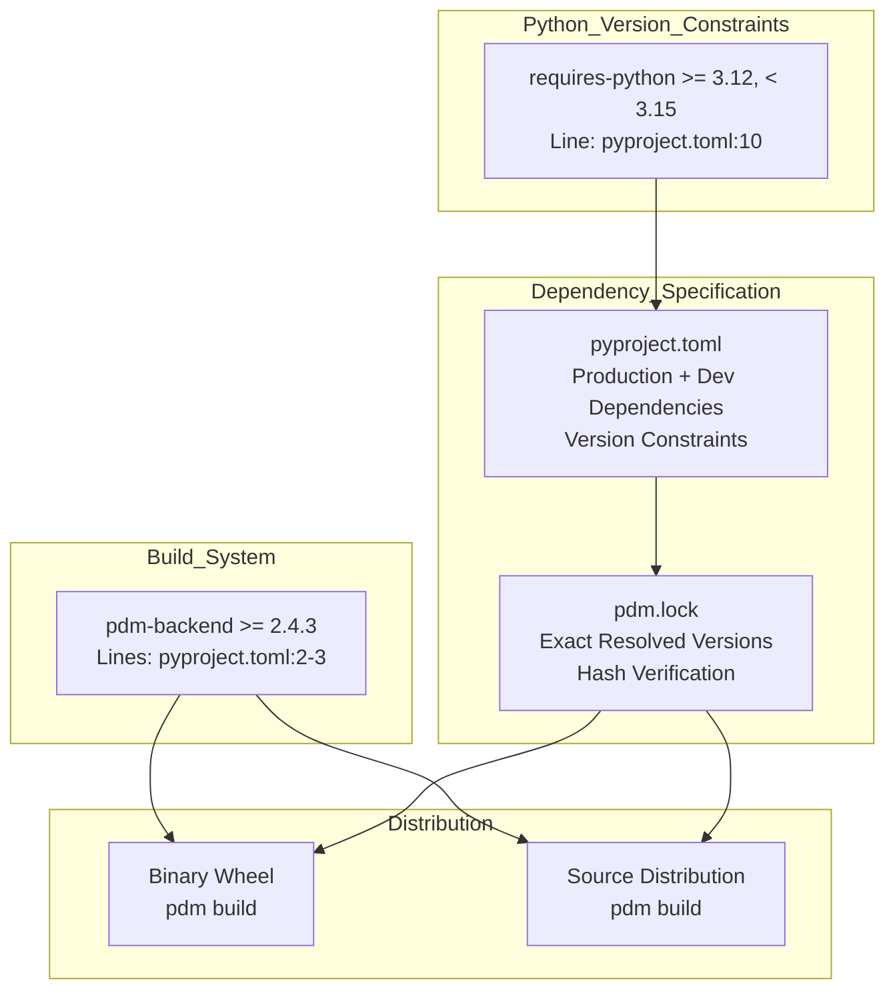
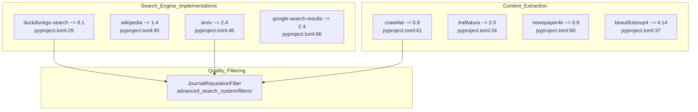
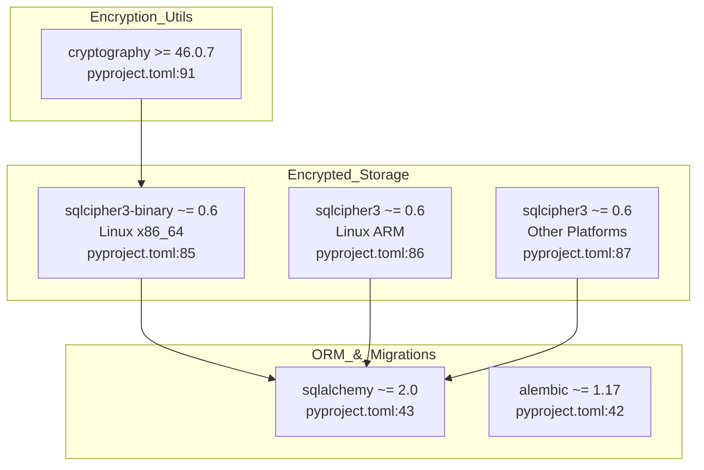

<!-- source: DeepWiki mcp.deepwiki.com · repo LearningCircuit/local-deep-research · page 1.2 Project Structure and Dependencies · fetched 2026-10-29 -->

# Project Structure and Dependencies

<details>
<summary>Relevant source files</summary>

The following files were used as context for generating this wiki page:

- [.file-whitelist.txt](.file-whitelist.txt)
- [.github/CODEOWNERS](.github/CODEOWNERS)
- [.github/scripts/file-whitelist-check.sh](.github/scripts/file-whitelist-check.sh)
- [.gitignore](.gitignore)
- [.gitleaks.toml](.gitleaks.toml)
- [.gitleaksignore](.gitleaksignore)
- [.pre-commit-config.yaml](.pre-commit-config.yaml)
- [.pre-commit-hooks/check-absolute-module-paths.py](.pre-commit-hooks/check-absolute-module-paths.py)
- [.pre-commit-hooks/file-whitelist-check.sh](.pre-commit-hooks/file-whitelist-check.sh)
- [.pre-commit-hooks/recommend-release-notes.py](.pre-commit-hooks/recommend-release-notes.py)
- [CONTRIBUTING.md](CONTRIBUTING.md)
- [README.md](README.md)
- [changelog.d/3670.breaking.1.md](changelog.d/3670.breaking.1.md)
- [changelog.d/3670.breaking.md](changelog.d/3670.breaking.md)
- [changelog.d/3670.feature.md](changelog.d/3670.feature.md)
- [changelog.d/3773.feature.md](changelog.d/3773.feature.md)
- [changelog.d/README.md](changelog.d/README.md)
- [docker-compose.gpu.override.yml](docker-compose.gpu.override.yml)
- [docs/CI_CD_INFRASTRUCTURE.md](docs/CI_CD_INFRASTRUCTURE.md)
- [docs/CONFIGURATION.md](docs/CONFIGURATION.md)
- [docs/RELEASE_GUIDE.md](docs/RELEASE_GUIDE.md)
- [docs/SECURITY_REVIEW_PROCESS.md](docs/SECURITY_REVIEW_PROCESS.md)
- [docs/SQLCIPHER_INSTALL.md](docs/SQLCIPHER_INSTALL.md)
- [docs/decisions/0001-remove-detect-secrets.md](docs/decisions/0001-remove-detect-secrets.md)
- [docs/developing.md](docs/developing.md)
- [docs/docker-compose-guide.md](docs/docker-compose-guide.md)
- [docs/install-pip.md](docs/install-pip.md)
- [docs/installation.md](docs/installation.md)
- [package-lock.json](package-lock.json)
- [package.json](package.json)
- [pdm.lock](pdm.lock)
- [pyproject.toml](pyproject.toml)
- [src/local_deep_research/__version__.py](src/local_deep_research/__version__.py)
- [src/local_deep_research/database/sqlcipher_compat.py](src/local_deep_research/database/sqlcipher_compat.py)
- [src/local_deep_research/web/static/js/mobile-navigation.js](src/local_deep_research/web/static/js/mobile-navigation.js)
- [src/local_deep_research/web/static/js/security/url-validator.js](src/local_deep_research/web/static/js/security/url-validator.js)
- [src/local_deep_research/web/static/js/services/api.js](src/local_deep_research/web/static/js/services/api.js)
- [src/local_deep_research/web/static/js/services/formatting.js](src/local_deep_research/web/static/js/services/formatting.js)
- [tests/infrastructure_tests/test_csrf_api.test.js](tests/infrastructure_tests/test_csrf_api.test.js)
- [tests/infrastructure_tests/test_urls.test.js](tests/infrastructure_tests/test_urls.test.js)
- [tests/security/test_absolute_module_paths_hook.py](tests/security/test_absolute_module_paths_hook.py)
- [vite.config.js](vite.config.js)

</details>


This page documents the repository organization and the complete dependency ecosystem for Local Deep Research, including production dependencies, development tools, and their architectural roles. The project uses [PDM](https://pdm-project.org/) for Python dependency management with explicit version constraints and hash verification to ensure security and reproducibility.

---

## Repository Structure

The repository follows a modern Python project layout with source code contained within a `src/` directory to ensure tests run against the installed package.

```text
.
├── src/local_deep_research/       # Main package source [pyproject.toml:114-123]()
│   ├── advanced_search_system/    # Research logic and quality filters
│   ├── config/                    # Configuration logic (LLM, search, etc.)
│   ├── database/                  # SQLCipher and SQLAlchemy integration
│   ├── defaults/                  # Default TOML/env configurations [pyproject.toml:122]()
│   ├── journal_quality/           # Bibliometric data and scoring [pyproject.toml:126]()
│   ├── library/                   # RAG, FAISS, and document management
│   ├── web/                       # Flask application, blueprints, and static assets [pyproject.toml:121]()
│   │   ├── static/                # Frontend assets (JS/CSS/Images) [pyproject.toml:121]()
│   │   └── templates/             # Jinja2 HTML templates [pyproject.toml:121]()
│   ├── __version__.py             # Single source of truth for versioning [src/local_deep_research/__version__.py:1]()
│   └── main.py                    # CLI entry point [pyproject.toml:110]()
├── tests/                         # Pytest suite (unit, integration, UI) [pyproject.toml:179-185]()
├── scripts/                       # Maintenance and setup scripts
├── examples/                      # API usage and programmatic examples
├── pyproject.toml                 # Project metadata and dependencies [pyproject.toml:1-101]()
└── pdm.lock                       # Content-hashed dependency lockfile [pdm.lock:1-8]()
```

**Sources:** [pyproject.toml:1-127](), [src/local_deep_research/__version__.py:1]()

---

## Dependency Management Architecture

Local Deep Research uses **PDM (Python Development Master)** as its package manager, with a strict versioning strategy enforced through `pyproject.toml` and `pdm.lock`.

### Package Management Flow

Title: PDM Build and Dependency Flow


**Sources:** [pyproject.toml:1-10](), [pyproject.toml:143-145](), [pdm.lock:1-12]()

---

## Production Dependencies by Category

### 1. LLM Integration Layer

The application uses the **LangChain** ecosystem as its LLM abstraction layer.

| Package | Version | Role |
|---------|---------|------|
| `langchain` | ~1.2 | Core framework and chains [pyproject.toml:23]() |
| `langchain-community` | ~0.4 | Community integrations [pyproject.toml:24]() |
| `langchain-core` | ~1.2 | Base abstractions [pyproject.toml:25]() |
| `langchain-ollama` | ~1.0 | Local LLM support via Ollama [pyproject.toml:26]() |
| `langchain-openai` | ~1.1 | OpenAI and compatible endpoints [pyproject.toml:27]() |
| `langchain-anthropic` | ~1.3 | Claude 3 family integration [pyproject.toml:28]() |
| `langchain-experimental`| ~0.4 | Experimental research strategies [pyproject.toml:97]() |
| `tiktoken` | ~0.12 | Token counting for context management [pyproject.toml:57]() |

**Sources:** [pyproject.toml:23-28](), [pyproject.toml:57](), [pyproject.toml:97]()

### 2. Search and Academic Intelligence

Multiple engines and scrapers are integrated to provide comprehensive web and academic research capabilities.

Title: Search System Entity Mapping


**Sources:** [pyproject.toml:29-66]()

### 3. Web Framework Stack

The web application uses **Flask** with security-hardened configurations and fixed versions for critical CVEs.

| Package | Version | Role | Security Note |
|---------|---------|------|---------------|
| `flask` | ~3.1.3 | Core web framework [pyproject.toml:38]() | **CVE-2026-27205 fix** |
| `werkzeug` | ~3.1.6 | WSGI utilities [pyproject.toml:39]() | **CVE-2026-27199 fix** |
| `flask-cors` | ~6.0 | CORS management [pyproject.toml:40]() | - |
| `flask-socketio` | ~5.6.1 | Real-time progress updates [pyproject.toml:41]() | Flask 3.1.3 compatibility |
| `flask-wtf` | ~1.2 | CSRF protection [pyproject.toml:68]() | - |
| `flask-login` | ~0.6 | User session management [pyproject.toml:83]() | - |
| `flask-limiter` | ~4.1 | Rate limiting [pyproject.toml:84]() | - |

**Sources:** [pyproject.toml:38-41](), [pyproject.toml:68](), [pyproject.toml:83-84]()

### 4. Data Persistence & Security Layer

The database layer uses **SQLCipher** for AES-256 encrypted per-user databases. The PDM configuration includes platform-specific selectors for the binary packages.

Title: Database Security Stack


**Sources:** [pyproject.toml:42-43](), [pyproject.toml:85-87](), [pyproject.toml:91]()

---

## Frontend Dependencies (npm/Vite)

The frontend is a Vite-based application built from `package.json`. It adheres to a strict no-CDN policy for privacy [package.json:22-36]().

| Package | Version | Role |
|---------|---------|------|
| `vite` | ^8.0.10 | Build tool and dev server [package.json:44]() |
| `bootstrap` | ^5.3.8 | CSS framework [package.json:24]() |
| `socket.io-client` | ^4.8.3 | WebSocket client for research updates [package.json:35]() |
| `chart.js` | ^4.5.1 | Research metrics visualization [package.json:26]() |
| `dompurify` | ^3.4.1 | Frontend HTML sanitization [package.json:30]() |
| `marked` | ^18.0.2 | Markdown rendering [package.json:34]() |

**Sources:** [package.json:22-48]()

---

## Development and Test Infrastructure

### Testing Framework
- **Pytest**: Core framework with parallel execution (`pytest-xdist`) and async support (`pytest-asyncio`) [pyproject.toml:163-168]().
- **Coverage**: Omission rules exclude CLI entry points, migrations, and experimental strategies [pyproject.toml:190-206]().
- **Static Analysis**: Uses `ruff` for linting/formatting [pyproject.toml:169]() and `mypy` for type checking [pyproject.toml:171]().

**Sources:** [pyproject.toml:158-177](), [pyproject.toml:179-215]()

### CLI and Programmatic Entrypoints

| Command | Module | Purpose |
|---------|--------|---------|
| `ldr` | `local_deep_research.main:main` | CLI research queries [pyproject.toml:110]() |
| `ldr-web` | `local_deep_research.web.app:main` | Start Flask web server [pyproject.toml:111]() |
| `ldr-mcp` | `local_deep_research.mcp:run_server` | MCP Server for Claude [pyproject.toml:112]() |

**Sources:** [pyproject.toml:110-112]()

### Security-Critical Pins

The project enforces minimum versions for libraries with known vulnerabilities:

| Package | Version | Fixed Vulnerability |
|---------|---------|---------------------|
| `pypdf` | ~6.10.1 | CVE-2026-33123, CVE-2026-31826 [pyproject.toml:47]() |
| `urllib3` | ~2.6 | CVE-2026-21441 (Header injection) [pyproject.toml:56]() |
| `Pillow` | >=12.1.1 | CVE-2026-25990 (Out-of-bounds write) [pyproject.toml:90]() |
| `cryptography` | >=46.0.7 | CVE-2026-26007 (Subgroup attack) [pyproject.toml:91]() |
| `lxml-html-clean`| >=0.4.4 | CVE-2026-28350 (Base tag injection) [pyproject.toml:88]() |

**Sources:** [pyproject.toml:47](), [pyproject.toml:56](), [pyproject.toml:88](), [pyproject.toml:90-91]()

---

