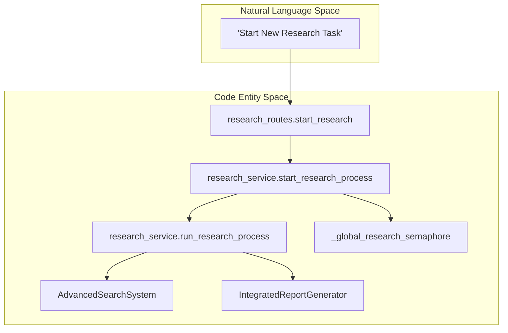
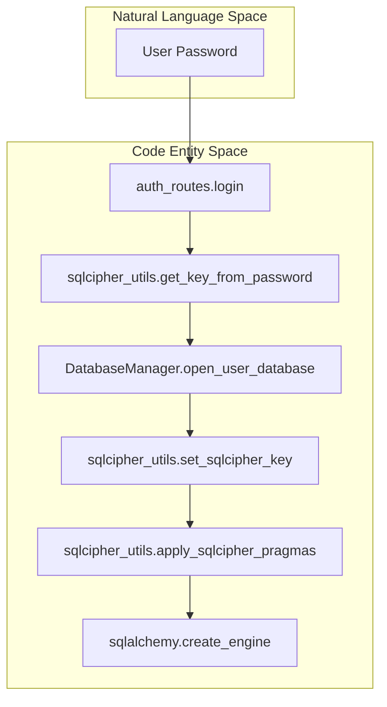

<!-- source: DeepWiki mcp.deepwiki.com · repo LearningCircuit/local-deep-research · page 10 Glossary · fetched 2026-10-29 -->

# Glossary

Relevant source files

The following files were used as context for generating this wiki page:

- [.github/CODEOWNERS](.github/CODEOWNERS)
- [README.md](README.md)
- [docker-compose.gpu.override.yml](docker-compose.gpu.override.yml)
- [docs/BENCHMARKING.md](docs/BENCHMARKING.md)
- [docs/CI_CD_INFRASTRUCTURE.md](docs/CI_CD_INFRASTRUCTURE.md)
- [docs/SECURITY_REVIEW_PROCESS.md](docs/SECURITY_REVIEW_PROCESS.md)
- [docs/SQLCIPHER_INSTALL.md](docs/SQLCIPHER_INSTALL.md)
- [docs/decisions/0001-remove-detect-secrets.md](docs/decisions/0001-remove-detect-secrets.md)
- [docs/developing.md](docs/developing.md)
- [docs/docker-compose-guide.md](docs/docker-compose-guide.md)
- [docs/install-pip.md](docs/install-pip.md)
- [docs/installation.md](docs/installation.md)
- [src/local_deep_research/__init__.py](src/local_deep_research/__init__.py)
- [src/local_deep_research/advanced_search_system/questions/browsecomp_question.py](src/local_deep_research/advanced_search_system/questions/browsecomp_question.py)
- [src/local_deep_research/advanced_search_system/questions/flexible_browsecomp_question.py](src/local_deep_research/advanced_search_system/questions/flexible_browsecomp_question.py)
- [src/local_deep_research/advanced_search_system/strategies/langgraph_agent_strategy.py](src/local_deep_research/advanced_search_system/strategies/langgraph_agent_strategy.py)
- [src/local_deep_research/advanced_search_system/strategies/topic_organization_strategy.py](src/local_deep_research/advanced_search_system/strategies/topic_organization_strategy.py)
- [src/local_deep_research/advanced_search_system/tools/fetch/__init__.py](src/local_deep_research/advanced_search_system/tools/fetch/__init__.py)
- [src/local_deep_research/advanced_search_system/tools/fetch/prompts.py](src/local_deep_research/advanced_search_system/tools/fetch/prompts.py)
- [src/local_deep_research/api/__init__.py](src/local_deep_research/api/__init__.py)
- [src/local_deep_research/benchmarks/models/__init__.py](src/local_deep_research/benchmarks/models/__init__.py)
- [src/local_deep_research/config/llm_config.py](src/local_deep_research/config/llm_config.py)
- [src/local_deep_research/database/auth_db.py](src/local_deep_research/database/auth_db.py)
- [src/local_deep_research/database/encrypted_db.py](src/local_deep_research/database/encrypted_db.py)
- [src/local_deep_research/database/migrations/versions/0009_default_fetch_mode_summary.py](src/local_deep_research/database/migrations/versions/0009_default_fetch_mode_summary.py)
- [src/local_deep_research/database/pool_config.py](src/local_deep_research/database/pool_config.py)
- [src/local_deep_research/database/sqlcipher_compat.py](src/local_deep_research/database/sqlcipher_compat.py)
- [src/local_deep_research/database/sqlcipher_utils.py](src/local_deep_research/database/sqlcipher_utils.py)
- [src/local_deep_research/database/thread_local_session.py](src/local_deep_research/database/thread_local_session.py)
- [src/local_deep_research/defaults/default_settings.json](src/local_deep_research/defaults/default_settings.json)
- [src/local_deep_research/news/__init__.py](src/local_deep_research/news/__init__.py)
- [src/local_deep_research/search_system_factory.py](src/local_deep_research/search_system_factory.py)
- [src/local_deep_research/settings/env_definitions/bootstrap.py](src/local_deep_research/settings/env_definitions/bootstrap.py)
- [src/local_deep_research/settings/env_definitions/db_config.py](src/local_deep_research/settings/env_definitions/db_config.py)
- [src/local_deep_research/settings/env_settings.py](src/local_deep_research/settings/env_settings.py)
- [src/local_deep_research/utilities/log_utils.py](src/local_deep_research/utilities/log_utils.py)
- [src/local_deep_research/web/app.py](src/local_deep_research/web/app.py)
- [src/local_deep_research/web/app_factory.py](src/local_deep_research/web/app_factory.py)
- [src/local_deep_research/web/auth/connection_cleanup.py](src/local_deep_research/web/auth/connection_cleanup.py)
- [src/local_deep_research/web/models/database.py](src/local_deep_research/web/models/database.py)
- [src/local_deep_research/web/routes/api_routes.py](src/local_deep_research/web/routes/api_routes.py)
- [src/local_deep_research/web/routes/history_routes.py](src/local_deep_research/web/routes/history_routes.py)
- [src/local_deep_research/web/routes/research_routes.py](src/local_deep_research/web/routes/research_routes.py)
- [src/local_deep_research/web/routes/settings_routes.py](src/local_deep_research/web/routes/settings_routes.py)
- [src/local_deep_research/web/services/research_service.py](src/local_deep_research/web/services/research_service.py)
- [src/local_deep_research/web/services/socket_service.py](src/local_deep_research/web/services/socket_service.py)
- [src/local_deep_research/web/static/js/components/settings.js](src/local_deep_research/web/static/js/components/settings.js)
- [tests/advanced_search_system/tools/test_fetch_modes.py](tests/advanced_search_system/tools/test_fetch_modes.py)
- [tests/config/test_llm_config_extra_coverage.py](tests/config/test_llm_config_extra_coverage.py)
- [tests/database/test_database_manager_extended.py](tests/database/test_database_manager_extended.py)
- [tests/database/test_encrypted_db_coverage.py](tests/database/test_encrypted_db_coverage.py)
- [tests/database/test_encrypted_db_manager.py](tests/database/test_encrypted_db_manager.py)
- [tests/database/test_migration_0009_default_fetch_mode.py](tests/database/test_migration_0009_default_fetch_mode.py)
- [tests/database/test_pool_config.py](tests/database/test_pool_config.py)
- [tests/database/test_sqlcipher_connection_factory.py](tests/database/test_sqlcipher_connection_factory.py)
- [tests/database/test_sqlcipher_integration.py](tests/database/test_sqlcipher_integration.py)
- [tests/database/test_sqlcipher_utils.py](tests/database/test_sqlcipher_utils.py)
- [tests/database/test_thread_local_session.py](tests/database/test_thread_local_session.py)
- [tests/database/test_thread_local_session_coverage.py](tests/database/test_thread_local_session_coverage.py)
- [tests/database/test_thread_local_session_deep_coverage.py](tests/database/test_thread_local_session_deep_coverage.py)
- [tests/settings/golden_master_settings.json](tests/settings/golden_master_settings.json)
- [tests/settings/test_settings_defaults_integrity.py](tests/settings/test_settings_defaults_integrity.py)
- [tests/strategies/test_langgraph_agent_strategy.py](tests/strategies/test_langgraph_agent_strategy.py)
- [tests/web/services/test_socket_service_coverage.py](tests/web/services/test_socket_service_coverage.py)
- [tests/web/services/test_socket_service_extra_coverage.py](tests/web/services/test_socket_service_extra_coverage.py)
- [tests/web_services/test_socket_service.py](tests/web_services/test_socket_service.py)

This glossary defines core technical terms, architectural patterns, and domain-specific jargon used within the Local Deep Research (LDR) codebase. It is intended to assist onboarding engineers in navigating the relationship between conceptual system components and their implementations.

## Core Architectural Terms

### SQLCipher
The primary security mechanism for data at rest. LDR uses SQLCipher to provide 256-bit AES encryption for all user databases [README.md:15-15](). Unlike standard SQLite, SQLCipher requires a key (derived from the user's password using PBKDF2) to open the database file [src/local_deep_research/database/encrypted_db.py:31-33](). LDR implements a "per-database salt" strategy where a `.salt` file is stored alongside each `.db` file to enhance cryptographic isolation [src/local_deep_research/database/sqlcipher_utils.py:76-85]().
*   **Code Pointer:** `DatabaseManager` [src/local_deep_research/database/encrypted_db.py:48-55](), `set_sqlcipher_key` [src/local_deep_research/database/sqlcipher_utils.py:195-212]()
*   **Sources:** [src/local_deep_research/database/encrypted_db.py:1-58](), [src/local_deep_research/database/sqlcipher_utils.py:22-116]()

### Settings Snapshot
A point-in-time copy of a user's settings captured at the start of a research task. This ensures that if a user changes their LLM provider or search depth while a research task is running, the active task continues with its original configuration to maintain consistency.
*   **Code Pointer:** `SnapshotSettingsContext` [src/local_deep_research/web/services/research_service.py:12-12](), `get_setting_from_snapshot` [src/local_deep_research/config/llm_config.py:25-28]()
*   **Sources:** [src/local_deep_research/web/services/research_service.py:12-12](), [src/local_deep_research/config/llm_config.py:194-199]()

### NullPool vs QueuePool vs StaticPool
SQLAlchemy pooling strategies. LDR typically uses `QueuePool` (pool_size=20, max_overflow=40) for production web operations to handle concurrent requests while limiting file descriptors and managing SQLCipher/WAL mode behavior [src/local_deep_research/database/encrypted_db.py:61-94](). `StaticPool` is used during testing [src/local_deep_research/database/encrypted_db.py:95-96]().
*   **Code Pointer:** `DatabaseManager.__init__` [src/local_deep_research/database/encrypted_db.py:51-97]()
*   **Sources:** [src/local_deep_research/database/encrypted_db.py:51-113]()

### Research Strategy
A modular class that defines the logic for how a research task is executed. Strategies determine whether the research is sequential, parallel, or iterative. The system supports over 30 strategies including `source-based`, `iterdrag`, and `langgraph-agent` [README.md:102-104]().
*   **Code Pointer:** `save_research_strategy` [src/local_deep_research/web/services/research_service.py:131-139]()
*   **Sources:** [README.md:102-104](), [src/local_deep_research/web/services/research_service.py:131-174]()

### IntegratedReportGenerator
The system responsible for synthesizing search results, library documents, and LLM analysis into a final Markdown report. It handles citation formatting and section-based synthesis.
*   **Code Pointer:** `IntegratedReportGenerator` [src/local_deep_research/web/services/research_service.py:23-23]()
*   **Sources:** [README.md:100-100](), [src/local_deep_research/web/services/research_service.py:23-23]()

---

## Research & Search Terms

### Source-Based Strategy
The default comprehensive research strategy. It follows a high-level flow of iterative question generation, parallel searching, and final synthesis.
*   **Code Pointer:** `search.search_strategy` [src/local_deep_research/web/routes/research_routes.py:186-188]()
*   **Sources:** [README.md:102-102](), [src/local_deep_research/web/routes/research_routes.py:184-201]()

### IterDRAG
**Iterative Document Retrieval-Augmented Generation**. A specialized research strategy that performs multiple loops of searching, reading, and refining the research query based on what was previously found.
*   **Sources:** [README.md:102-104]()

### AdvancedSearchSystem
The central orchestrator for the search lifecycle. It coordinates different search strategies, manages citation handling, and interfaces with search engine implementations.
*   **Code Pointer:** `AdvancedSearchSystem` [src/local_deep_research/web/services/research_service.py:24-24]()
*   **Sources:** [README.md:97-100](), [src/local_deep_research/web/services/research_service.py:24-24]()

### LangGraph Agent Strategy
An autonomous agentic research mode where the LLM decides what to search, which specialized engines to use (arXiv, PubMed, etc.), and when to synthesize [README.md:104-104]().
*   **Code Pointer:** `langgraph-agent` [README.md:104-104]()
*   **Sources:** [README.md:104-104]()

---

## Library & RAG Terms

### LibraryRAGService
The service that manages document indexing and retrieval. It handles the pipeline of text extraction, chunking, and vector storage using FAISS.
*   **Sources:** [README.md:112-117]()

### PDF Storage Mode
A configuration setting determining where PDF files are stored. Options include `database` (stored as encrypted BLOBs), `filesystem` (stored in the data directory), or `none` (metadata only).
*   **Sources:** [README.md:117-118]()

### DownloadTracker
A system that tracks the status of resource downloads to prevent redundant attempts and manage retries.
*   **Sources:** [README.md:110-111]()

---

## Technical Infrastructure Diagrams

### Research Execution Lifecycle
This diagram maps the natural language "Start Research" request to the specific code entities and services that manage the research process.

**Sources:** [src/local_deep_research/web/routes/research_routes.py:57-61](), [src/local_deep_research/web/services/research_service.py:40-40](), [src/local_deep_research/web/services/research_service.py:57-61]()

### Database Security and Initialization
This diagram illustrates how a user's password becomes an active, encrypted database connection.

**Sources:** [src/local_deep_research/database/encrypted_db.py:48-58](), [src/local_deep_research/database/sqlcipher_utils.py:172-193](), [src/local_deep_research/database/sqlcipher_utils.py:195-212]()

---

## Security & Infrastructure Terms

### CSRFProtect
The mechanism used to prevent Cross-Site Request Forgery. It is enforced on POST/AJAX requests within the Flask application [src/local_deep_research/web/app_factory.py:16-16]().
*   **Code Pointer:** `CSRFProtect` [src/local_deep_research/web/app_factory.py:16-16]()
*   **Sources:** [src/local_deep_research/web/app_factory.py:16-16]()

### Thread Cleanup
A decorator (`@thread_cleanup`) used to ensure that database sessions and resources are properly released when a background thread finishes execution [src/local_deep_research/web/services/research_service.py:20-20]().
*   **Code Pointer:** `thread_cleanup` [src/local_deep_research/web/services/research_service.py:20-20]()
*   **Sources:** [src/local_deep_research/web/services/research_service.py:20-20]()

### DiskSpoolingRequest
A custom Flask Request class used to spool large file uploads to disk instead of memory to prevent exhaustion attacks [src/local_deep_research/web/app_factory.py:45-57]().
*   **Code Pointer:** `DiskSpoolingRequest` [src/local_deep_research/web/app_factory.py:45-57]()
*   **Sources:** [src/local_deep_research/web/app_factory.py:45-57]()

---

## Miscellaneous Jargon

| Term | Definition | Code Pointer |
| :--- | :--- | :--- |
| **LDR_DATA_DIR** | Environment variable defining the root directory for all persistent data [README.md:63-63](). | `src/local_deep_research/config/paths.py` |
| **Golden Master** | A reference JSON file used to validate that default settings haven't drifted. | `tests/settings/golden_master_settings.json` |
| **Think-Tag Removal** | Logic that strips `<think>` blocks from LLM responses (common in models like DeepSeek) [src/local_deep_research/config/llm_config.py:10-10](). | `src/local_deep_research/utilities/search_utilities.py` |
| **ProxyFix** | Middleware that ensures the application correctly identifies client IPs when behind a reverse proxy [src/local_deep_research/web/app_factory.py:129-136](). | `src/local_deep_research/web/app_factory.py` |

**Sources:** [README.md:1-120](), [src/local_deep_research/database/encrypted_db.py:1-106](), [src/local_deep_research/web/app_factory.py:45-136](), [src/local_deep_research/config/llm_config.py:10-28]()