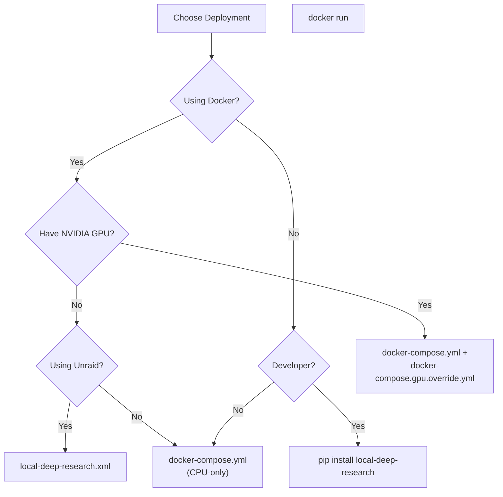
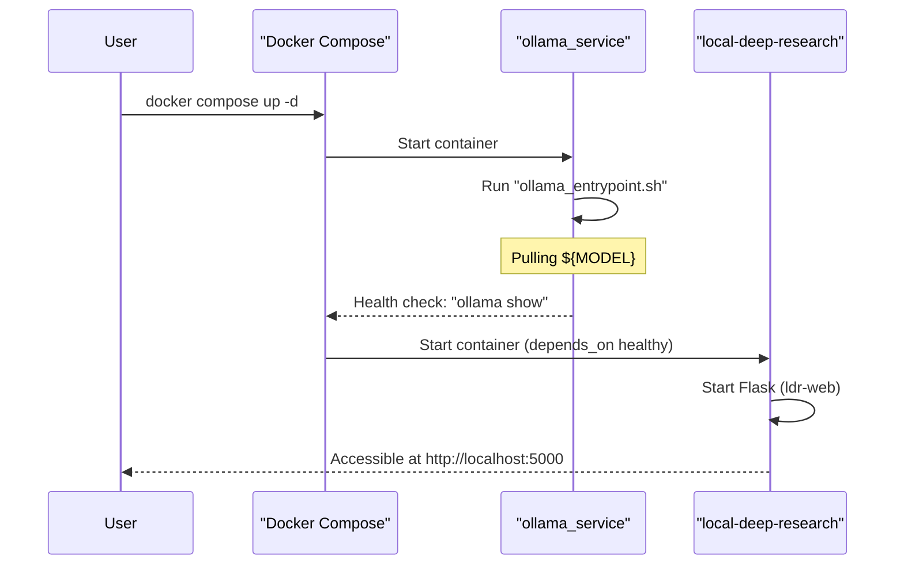
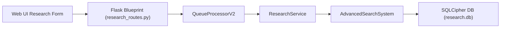

<!-- source: DeepWiki mcp.deepwiki.com · repo LearningCircuit/local-deep-research · page 2 Getting Started · fetched 2026-10-29 -->

# Getting Started

<details>
<summary>Relevant source files</summary>

The following files were used as context for generating this wiki page:

- [.github/CODEOWNERS](.github/CODEOWNERS)
- [Dockerfile](Dockerfile)
- [README.md](README.md)
- [cookiecutter-docker/cookiecutter.json](cookiecutter-docker/cookiecutter.json)
- [cookiecutter-docker/hooks/post_gen_project.py](cookiecutter-docker/hooks/post_gen_project.py)
- [cookiecutter-docker/hooks/pre_prompt.py](cookiecutter-docker/hooks/pre_prompt.py)
- [cookiecutter-docker/{{cookiecutter.config_name}}/docker-compose.{{cookiecutter.config_name}}.yml](cookiecutter-docker/{{cookiecutter.config_name}}/docker-compose.{{cookiecutter.config_name}}.yml)
- [docker-compose.gpu.override.yml](docker-compose.gpu.override.yml)
- [docker-compose.unraid.yml](docker-compose.unraid.yml)
- [docker-compose.yml](docker-compose.yml)
- [docs/CI_CD_INFRASTRUCTURE.md](docs/CI_CD_INFRASTRUCTURE.md)
- [docs/CUSTOM_LLM_INTEGRATION.md](docs/CUSTOM_LLM_INTEGRATION.md)
- [docs/SECURITY_REVIEW_PROCESS.md](docs/SECURITY_REVIEW_PROCESS.md)
- [docs/SQLCIPHER_INSTALL.md](docs/SQLCIPHER_INSTALL.md)
- [docs/analytics-dashboard.md](docs/analytics-dashboard.md)
- [docs/architecture.md](docs/architecture.md)
- [docs/architecture/DATABASE_SCHEMA.md](docs/architecture/DATABASE_SCHEMA.md)
- [docs/architecture/OVERVIEW.md](docs/architecture/OVERVIEW.md)
- [docs/decisions/0001-remove-detect-secrets.md](docs/decisions/0001-remove-detect-secrets.md)
- [docs/decisions/0004-nullpool-for-sqlcipher.md](docs/decisions/0004-nullpool-for-sqlcipher.md)
- [docs/deployment/unraid.md](docs/deployment/unraid.md)
- [docs/developing.md](docs/developing.md)
- [docs/developing/EXTENDING.md](docs/developing/EXTENDING.md)
- [docs/docker-compose-guide.md](docs/docker-compose-guide.md)
- [docs/env_configuration.md](docs/env_configuration.md)
- [docs/faq.md](docs/faq.md)
- [docs/features.md](docs/features.md)
- [docs/install-pip.md](docs/install-pip.md)
- [docs/installation.md](docs/installation.md)
- [docs/library-and-rag.md](docs/library-and-rag.md)
- [docs/mcp-server.md](docs/mcp-server.md)
- [docs/search-engines.md](docs/search-engines.md)
- [docs/troubleshooting.md](docs/troubleshooting.md)
- [scripts/.gitkeep](scripts/.gitkeep)
- [scripts/ollama_entrypoint.sh](scripts/ollama_entrypoint.sh)
- [src/local_deep_research/database/sqlcipher_compat.py](src/local_deep_research/database/sqlcipher_compat.py)
- [src/local_deep_research/web/database/README.md](src/local_deep_research/web/database/README.md)
- [tests/api_tests_with_login/puppeteer_config.js](tests/api_tests_with_login/puppeteer_config.js)
- [tests/database/test_post_login_settings_atomicity.py](tests/database/test_post_login_settings_atomicity.py)
- [tests/mcp/test_mcp_strategy.py](tests/mcp/test_mcp_strategy.py)
- [tests/ui_tests/puppeteer_config.js](tests/ui_tests/puppeteer_config.js)
- [tests/ui_tests/test_login_validation.js](tests/ui_tests/test_login_validation.js)
- [tests/web/routes/test_history_routes_extended.py](tests/web/routes/test_history_routes_extended.py)
- [unraid-templates/local-deep-research.xml](unraid-templates/local-deep-research.xml)

</details>


This page guides you through initial setup and running your first research query. It covers deployment method selection, installation, and basic configuration to get Local Deep Research (LDR) running on your system.

**Scope**: This page provides quick-start instructions for all deployment methods. For detailed deployment configuration, see [Docker Deployment](#2.1). For environment variable reference, see [Environment Configuration](#2.2). For development from source, see [Local Development Setup](#2.3).

---

## Choosing Your Deployment Method

Local Deep Research supports multiple deployment methods. Choose based on your use case:

| Method | Best For | Complexity | Encryption |
|--------|----------|------------|------------|
| **Docker Compose** | Most users, production | Low | ✅ Built-in |
| **Docker Run** | Quick testing | Low | ✅ Built-in |
| **pip install** | Developers, integration | Medium | ✅ Pre-built wheels |
| **Unraid** | Home server users | Low | ✅ Built-in |

### Deployment Selection Logic

"Natural Language Space" to "Code Entity Space" bridge:
- `docker-compose.yml`: Base CPU configuration.
- `docker-compose.gpu.override.yml`: NVIDIA hardware acceleration.
- `sqlcipher3-binary`: Pre-built encrypted database drivers.
- `ldr-web`: The Flask entry point [pyproject.toml:111]().


**Sources**: [README.md:46-91](), [docker-compose.yml:1-17](), [docs/docker-compose-guide.md:7-24](), [pyproject.toml:111](), [unraid-templates/local-deep-research.xml:1-10]()

---

## Prerequisites

### For Docker Deployment
- **Docker Engine**: 20.10+ (Docker Desktop on macOS/Windows) [Dockerfile:4-52]().
- **Docker Compose**: V2 (included with Docker Desktop) [docker-compose.yml:1-17]().
- **System Memory**: 8GB minimum (16GB recommended for larger models) [docs/faq.md:55-61]().
- **Disk Space**: ~10-20GB for images and models [docs/faq.md:62-66]().

### For pip Installation
- **Python**: 3.12+ (supports up to 3.14.4) [pyproject.toml:10](), [Dockerfile:4]().
- **SQLCipher**: System library required for database encryption. [README.md:87](), [docs/SQLCIPHER_INSTALL.md:1-10]().
- **Node.js**: 24.x LTS (required for building the frontend from source) [Dockerfile:23-44]().
- **PDM**: Python package manager [pyproject.toml:1-3](), [Dockerfile:51-52]().

---

## Quick Start: Docker Compose (Recommended)

Docker Compose orchestrates the `local-deep-research` service, `ollama` (LLM), and `searxng` (search).

### Step 1: Download Configuration
**Linux/macOS/Windows**:
```bash
curl -O https://raw.githubusercontent.com/LearningCircuit/local-deep-research/main/docker-compose.yml && docker compose up -d
```
For NVIDIA GPU (Linux):
```bash
curl -O https://raw.githubusercontent.com/LearningCircuit/local-deep-research/main/docker-compose.yml && \
curl -O https://raw.githubusercontent.com/LearningCircuit/local-deep-research/main/docker-compose.gpu.override.yml && \
docker compose -f docker-compose.yml -f docker-compose.gpu.override.yml up -d
```
**Sources**: [README.md:67-81](), [docs/docker-compose-guide.md:7-24]()

### Step 2: Initialization Flow
The first startup pulls the LLM model (default: `gemma3:12b`) [docs/docker-compose-guide.md:66]().


**Sources**: [docker-compose.yml:19-77](), [cookiecutter-docker/{{cookiecutter.config_name}}/docker-compose.{{cookiecutter.config_name}}.yml:61-103](), [scripts/ollama_entrypoint.sh:25-42]()

### Step 3: Access Web Interface
Open `http://localhost:5000` after ~30 seconds [README.md:81]().
1. **Register**: Create your account. This process creates an encrypted database using `SQLCipher` and derives a key from your password [tests/ui_tests/puppeteer_config.js:31-33]().
2. **Login**: Access the dashboard.
⚠️ **Warning**: No password recovery exists due to the zero-knowledge encryption architecture [docs/SQLCIPHER_INSTALL.md:105]().

---

## Quick Start: Docker Run

For minimal setup without a compose file:
```bash
# 1. Run Ollama
docker run -d -p 11434:11434 --name ollama ollama/ollama
docker exec ollama ollama pull gpt-oss:20b

# 2. Run SearXNG
docker run -d -p 8080:8080 --name searxng searxng/searxng

# 3. Run LDR
docker run -d -p 5000:5000 --network host \
  --name local-deep-research \
  --volume "deep-research:/data" \
  -e LDR_DATA_DIR=/data \
  localdeepresearch/local-deep-research
```
**Sources**: [README.md:50-65]()

---

## Quick Start: pip Install

```bash
pip install local-deep-research
```
- **Windows/macOS/Linux**: Includes pre-built SQLCipher wheels (`sqlcipher3-binary` or `sqlcipher3`) for major platforms [pyproject.toml:85-87](), [README.md:87]().
- **Unencrypted Fallback**: If encryption fails or is not desired for development, set `export LDR_BOOTSTRAP_ALLOW_UNENCRYPTED=true` to use standard SQLite [README.md:89](), [docs/developing.md:83-86]().
- **PDF Export**: Windows requires Pango [README.md:88]().

---

## Running Your First Research Query

### Research Execution Lifecycle
When you submit a query, the system follows this internal path:



1. **Submit**: Go to `http://localhost:5000/research`.
2. **Configure**: Select a strategy (e.g., `Standard`, `Academic`, or `langgraph-agent`) [README.md:102-104]().
3. **Execute**: Monitor real-time logs via WebSockets.
4. **Result**: View the generated Markdown report with citations [README.md:100]().

**Sources**: [README.md:93-116](), [docs/architecture.md:1-20]()

---

## Basic Configuration

### Environment Overrides
Environment variables starting with `LDR_` override and **lock** settings in the UI, making them read-only [docs/env_configuration.md:27-29](), [docs/docker-compose-guide.md:53-57]().

| Variable | Description | Default |
|----------|-------------|---------|
| `LDR_WEB_PORT` | Internal server port | `5000` |
| `LDR_DATA_DIR` | Storage location | `/data` (Docker) |
| `LDR_LLM_MODEL` | Default model name | `gemma3:12b` |
| `LDR_LLM_OLLAMA_URL` | Ollama API endpoint | `http://ollama:11434` |

**Sources**: [docker-compose.yml:55-77](), [docs/docker-compose-guide.md:57-65](), [docs/env_configuration.md:122-135]()

### External Providers
To use cloud models like Claude or GPT-4, configure these in the UI or via env:
```bash
export LDR_LLM_PROVIDER=openai_endpoint
export LDR_LLM_OPENAI_ENDPOINT_URL=https://openrouter.ai/api/v1
export LDR_LLM_OPENAI_ENDPOINT_API_KEY=your_key
```
**Sources**: [docker-compose.yml:95-104](), [docs/env_configuration.md:71-77]()

---

## Next Steps
- **[Docker Deployment](#2.1)**: Deep dive into GPU setup, volume management, and `cookiecutter` configuration.
- **[Environment Configuration](#2.2)**: Full list of `LDR_*` variables and the bootstrap system.
- **[Local Development Setup](#2.3)**: How to build from source using `PDM`, manage Node.js assets, and run tests.

---

