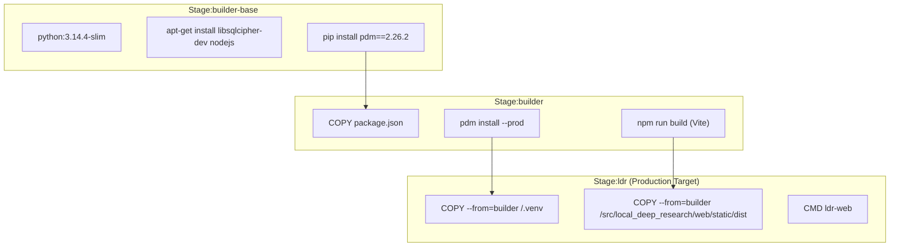
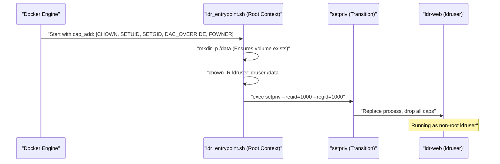

<!-- source: DeepWiki mcp.deepwiki.com · repo LearningCircuit/local-deep-research · page 2.1 Docker Deployment · fetched 2026-10-29 -->

# Docker Deployment

<details>
<summary>Relevant source files</summary>

The following files were used as context for generating this wiki page:

- [.github/CODEOWNERS](.github/CODEOWNERS)
- [Dockerfile](Dockerfile)
- [README.md](README.md)
- [cookiecutter-docker/cookiecutter.json](cookiecutter-docker/cookiecutter.json)
- [cookiecutter-docker/hooks/post_gen_project.py](cookiecutter-docker/hooks/post_gen_project.py)
- [cookiecutter-docker/hooks/pre_prompt.py](cookiecutter-docker/hooks/pre_prompt.py)
- [cookiecutter-docker/{{cookiecutter.config_name}}/docker-compose.{{cookiecutter.config_name}}.yml](cookiecutter-docker/{{cookiecutter.config_name}}/docker-compose.{{cookiecutter.config_name}}.yml)
- [docker-compose.gpu.override.yml](docker-compose.gpu.override.yml)
- [docker-compose.yml](docker-compose.yml)
- [docs/CI_CD_INFRASTRUCTURE.md](docs/CI_CD_INFRASTRUCTURE.md)
- [docs/SECURITY_REVIEW_PROCESS.md](docs/SECURITY_REVIEW_PROCESS.md)
- [docs/SQLCIPHER_INSTALL.md](docs/SQLCIPHER_INSTALL.md)
- [docs/decisions/0001-remove-detect-secrets.md](docs/decisions/0001-remove-detect-secrets.md)
- [docs/developing.md](docs/developing.md)
- [docs/docker-compose-guide.md](docs/docker-compose-guide.md)
- [docs/install-pip.md](docs/install-pip.md)
- [docs/installation.md](docs/installation.md)
- [scripts/.gitkeep](scripts/.gitkeep)
- [scripts/ollama_entrypoint.sh](scripts/ollama_entrypoint.sh)
- [src/local_deep_research/database/sqlcipher_compat.py](src/local_deep_research/database/sqlcipher_compat.py)
- [tests/api_tests_with_login/puppeteer_config.js](tests/api_tests_with_login/puppeteer_config.js)
- [tests/ui_tests/puppeteer_config.js](tests/ui_tests/puppeteer_config.js)
- [tests/ui_tests/test_login_validation.js](tests/ui_tests/test_login_validation.js)

</details>


## Purpose and Scope

This document explains Docker deployment for Local Deep Research (LDR), covering container architecture, deployment methods, and configuration. LDR is designed as a local-first, privacy-focused AI research assistant that orchestrates LLMs and search engines within a containerized environment.

---

## Deployment Methods

### Docker Run (Quick Start)

The simplest deployment uses three containers with host networking (Linux only) to allow seamless communication via `localhost`.

```bash
# Step 1: Pull and run Ollama
docker run -d -p 11434:11434 --name ollama ollama/ollama
docker exec ollama ollama pull gpt-oss:20b

# Step 2: Pull and run SearXNG for optimal search results
docker run -d -p 8080:8080 --name searxng searxng/searxng

# Step 3: Pull and run Local Deep Research
docker run -d -p 5000:5000 --network host \
  --name local-deep-research \
  --volume "deep-research:/data" \
  -e LDR_DATA_DIR=/data \
  localdeepresearch/local-deep-research
```

**Key characteristics:**
- `--network host` allows containers to reach each other via `localhost` (Linux only) [README.md:60-60]().
- Named volume `deep-research` persists user databases and configuration [README.md:62-62]().
- `LDR_DATA_DIR=/data` maps to the container volume mount point [README.md:63-63]().

Sources: [README.md:50-65]()

---

### Docker Compose (Recommended)

Docker Compose orchestrates the full service stack with proper networking and dependency management.

#### Base Configuration (CPU-only)

The base configuration works on all platforms (macOS M1-M4, Windows, Linux) [docker-compose.yml:4-9]().

```bash
curl -O https://raw.githubusercontent.com/LearningCircuit/local-deep-research/main/docker-compose.yml && docker compose up -d
```

**Service definitions:**

| Service | Image | Purpose |
|---------|-------|---------|
| `local-deep-research` | `localdeepresearch/local-deep-research:latest` | Main web application [docker-compose.yml:21-21]() |
| `ollama` | `ollama/ollama:latest` | Local LLM inference engine [docs/docker-compose-guide.md:48-48]() |
| `searxng` | `searxng/searxng:latest` | Privacy-focused meta search engine [docs/docker-compose-guide.md:49-49]() |

**Container-specific endpoints:**
```yaml
environment:
  - LDR_LLM_OLLAMA_URL=http://ollama:11434
  - LDR_SEARCH_ENGINE_WEB_SEARXNG_DEFAULT_PARAMS_INSTANCE_URL=http://searxng:8080
```
These settings override UI configuration to ensure containers communicate via Docker's internal DNS rather than `localhost` [docker-compose.yml:69-76]().

Sources: [docker-compose.yml:1-76](), [docs/docker-compose-guide.md:7-50](), [README.md:67-72]()

---

#### GPU-Accelerated Deployment

For hardware-accelerated inference using NVIDIA GPUs (Linux):

```bash
curl -O https://raw.githubusercontent.com/LearningCircuit/local-deep-research/main/docker-compose.yml && \
curl -O https://raw.githubusercontent.com/LearningCircuit/local-deep-research/main/docker-compose.gpu.override.yml && \
docker compose -f docker-compose.yml -f docker-compose.gpu.override.yml up -d
```

The `docker-compose.gpu.override.yml` adds NVIDIA device reservations to the `ollama` service [docker-compose.yml:13-13]().

Sources: [README.md:74-79](), [docs/docker-compose-guide.md:15-25]()

---

#### Cookiecutter Configuration Generator

For custom configurations, the `cookiecutter-docker` template provides an interactive setup to generate a tailored `docker-compose.yml` [docs/docker-compose-guide.md:97-111]().

**Generated configuration options:**

| Prompt | Purpose |
|--------|---------|
| `config_name` | Name for the configuration folder [cookiecutter-docker/cookiecutter.json]() |
| `enable_gpu` | Enable NVIDIA/AMD GPU support [cookiecutter-docker/cookiecutter.json]() |
| `host_network` | Use `network_mode: host` for Linux [cookiecutter-docker/{{cookiecutter.config_name}}/docker-compose.{{cookiecutter.config_name}}.yml:11-12]() |

**Hardware Support Logic:**
The generated configuration handles multiple GPU backends:
- **NVIDIA**: Uses the `nvidia` driver and `gpu` capabilities reservation [cookiecutter-docker/{{cookiecutter.config_name}}/docker-compose.{{cookiecutter.config_name}}.yml:87-93]().
- **AMD (ROCm)**: Uses the `ollama/ollama:rocm` image and passes through `/dev/kfd` and `/dev/dri` devices [cookiecutter-docker/{{cookiecutter.config_name}}/docker-compose.{{cookiecutter.config_name}}.yml:63-64](), [cookiecutter-docker/{{cookiecutter.config_name}}/docker-compose.{{cookiecutter.config_name}}.yml:95-97]().
- **Detection**: Logic in `pre_prompt.py` uses `lspci` (Linux) or `wmic` (Windows) to identify hardware [cookiecutter-docker/hooks/pre_prompt.py:27-90]().

Sources: [docs/docker-compose-guide.md:97-129](), [cookiecutter-docker/{{cookiecutter.config_name}}/docker-compose.{{cookiecutter.config_name}}.yml:1-128](), [cookiecutter-docker/hooks/pre_prompt.py:1-112]()

---

## Container Architecture

### Multi-Stage Build

The `Dockerfile` uses a multi-stage approach to separate build-time dependencies (Node.js, compilers) from the slim production runtime.

**Build-to-Code Mapping Diagram**
This diagram associates Docker build stages with specific code entities and output artifacts.



**Build Stages:**
1.  **`builder-base`**: Installs `libsqlcipher-dev`, `sqlcipher`, and Node.js 24.x LTS [Dockerfile:4-45](). Pins `pdm`, `pip`, and `playwright` for reproducibility [Dockerfile:51-52]().
2.  **`builder`**: Runs `npm ci` and `npm run build` to compile the Vite frontend into static assets [Dockerfile:90-91](). Executes `pdm install --prod` to create the production virtual environment [Dockerfile:93-99]().
3.  **`ldr-test`**: Specialized stage for CI. Installs Chromium dependencies and Playwright for UI testing [Dockerfile:116-151](). It installs test-specific npm packages in `tests/ui_tests` and `tests/accessibility_tests` [Dockerfile:154-166]().
4.  **`ldr`**: The final production target. It copies the pre-built `.venv` and static assets from the `builder` stage.

Sources: [Dockerfile:4-166]()

---

### Security Model

The deployment implements defense-in-depth through capability dropping and privilege separation.

**Security Execution Flow**
This diagram maps the security lifecycle from Docker configuration to the runtime execution.



**Key Security Features:**
- **Capability Management**: `cap_drop: ALL` is used in Compose, with only specific capabilities (`CHOWN`, `SETUID`, `SETGID`, `DAC_OVERRIDE`, `FOWNER`) added back to allow the entrypoint to fix volume permissions [cookiecutter-docker/{{cookiecutter.config_name}}/docker-compose.{{cookiecutter.config_name}}.yml:40-47]().
- **Privilege Escalation Prevention**: `security_opt: ["no-new-privileges:true"]` prevents the process from regaining root [cookiecutter-docker/{{cookiecutter.config_name}}/docker-compose.{{cookiecutter.config_name}}.yml:38-39]().
- **Memory Security**: `memlock: -1` (unlimited) allows SQLCipher's `mlock()` to protect encryption keys in RAM when memory security features are utilized [docs/docker-compose-guide.md:89-91]().

Sources: [cookiecutter-docker/{{cookiecutter.config_name}}/docker-compose.{{cookiecutter.config_name}}.yml:38-47](), [docs/docker-compose-guide.md:85-91]()

---

## Service Orchestration

### Ollama Initialization

The `ollama` service uses a custom entrypoint to ensure the required model is available before the research engine attempts to connect.

- **`ollama_entrypoint.sh`**: Starts `ollama serve`, waits for readiness via `ollama ls`, and then executes `ollama pull` for the specified model [scripts/ollama_entrypoint.sh:25-37]().
- **Health Checks**: The service is marked "healthy" once `ollama show` for the specified model succeeds [cookiecutter-docker/{{cookiecutter.config_name}}/docker-compose.{{cookiecutter.config_name}}.yml:70-75]().
- **Dependencies**: `local-deep-research` uses `depends_on: service_healthy` for Ollama to prevent startup failures [cookiecutter-docker/{{cookiecutter.config_name}}/docker-compose.{{cookiecutter.config_name}}.yml:50-54]().

Sources: [scripts/ollama_entrypoint.sh:1-46](), [cookiecutter-docker/{{cookiecutter.config_name}}/docker-compose.{{cookiecutter.config_name}}.yml:50-75]()

### Network and Volume Configuration

**Network**: Containers are joined to `ldr-network` [docker-compose.yml:23-24](). `extra_hosts` is used to map `host.docker.internal` to the host gateway, enabling access to host-resident LLM providers like LM Studio [docker-compose.yml:28-29]().

**Volumes**:
- **`ldr_data`**: Persists the SQLCipher database and application configuration [docker-compose.yml:123-123]().
- **`ollama_data`**: Persists downloaded GGUF models [cookiecutter-docker/{{cookiecutter.config_name}}/docker-compose.{{cookiecutter.config_name}}.yml:79-79]().
- **`searxng_data`**: Stores SearXNG configuration [cookiecutter-docker/{{cookiecutter.config_name}}/docker-compose.{{cookiecutter.config_name}}.yml:114-114]().

Sources: [docker-compose.yml:23-123](), [docs/docker-compose-guide.md:75-83](), [cookiecutter-docker/{{cookiecutter.config_name}}/docker-compose.{{cookiecutter.config_name}}.yml:79-114]()

---

## Environment Variable Configuration

Environment variables starting with `LDR_` override and **lock** settings in the Web UI [docs/docker-compose-guide.md:53-55]().

| Variable | Purpose | Default in Docker |
|----------|---------|-------------------|
| `LDR_WEB_PORT` | Internal port mapping | `5000` [docker-compose.yml:56-56]() |
| `LDR_WEB_HOST` | Bind address | `0.0.0.0` [docker-compose.yml:55-55]() |
| `LDR_DATA_DIR` | Internal data path | `/data` [docker-compose.yml:57-57]() |
| `LDR_LLM_OLLAMA_URL` | Ollama API endpoint | `http://ollama:11434` [docker-compose.yml:75-75]() |
| `LDR_SEARCH_ENGINE_WEB_SEARXNG_DEFAULT_PARAMS_INSTANCE_URL` | SearXNG API endpoint | `http://searxng:8080` [docker-compose.yml:76-76]() |

Sources: [docker-compose.yml:33-121](), [docs/docker-compose-guide.md:57-65]()

---

