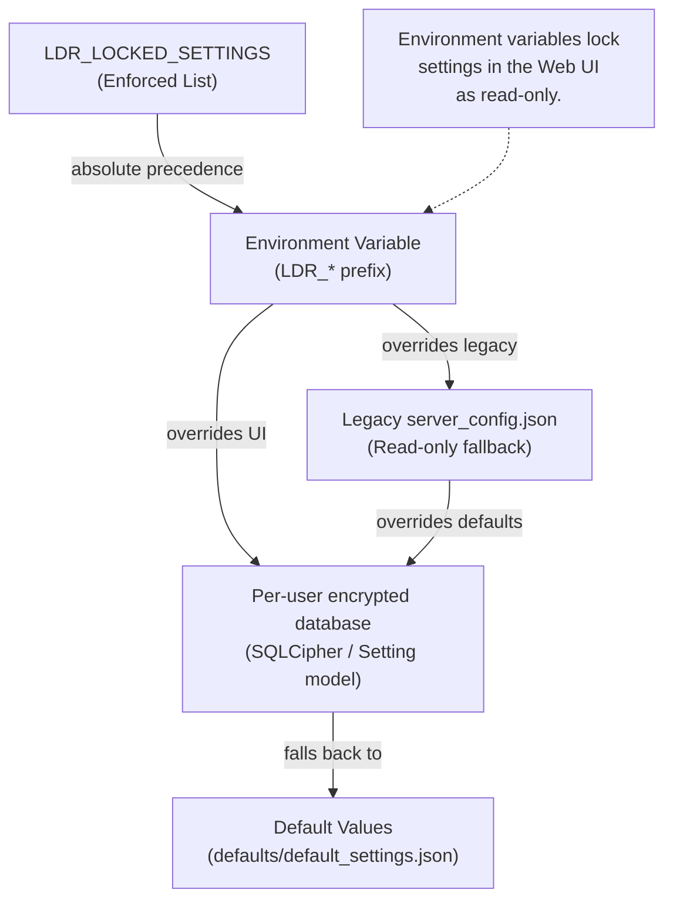
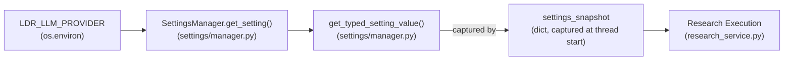
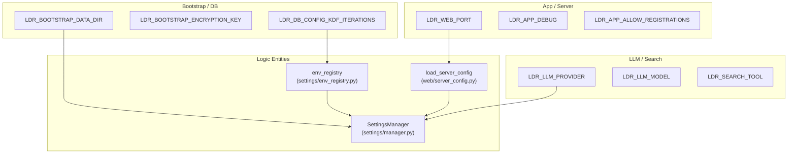

<!-- source: DeepWiki mcp.deepwiki.com · repo LearningCircuit/local-deep-research · page 2.2 Environment Configuration · fetched 2026-10-29 -->

# Environment Configuration

Relevant source files

The following files were used as context for generating this wiki page:

- [docker-compose.unraid.yml](docker-compose.unraid.yml)
- [docs/CONFIGURATION.md](docs/CONFIGURATION.md)
- [docs/CUSTOM_LLM_INTEGRATION.md](docs/CUSTOM_LLM_INTEGRATION.md)
- [docs/analytics-dashboard.md](docs/analytics-dashboard.md)
- [docs/architecture.md](docs/architecture.md)
- [docs/architecture/DATABASE_SCHEMA.md](docs/architecture/DATABASE_SCHEMA.md)
- [docs/architecture/OVERVIEW.md](docs/architecture/OVERVIEW.md)
- [docs/decisions/0004-nullpool-for-sqlcipher.md](docs/decisions/0004-nullpool-for-sqlcipher.md)
- [docs/deployment/unraid.md](docs/deployment/unraid.md)
- [docs/developing/EXTENDING.md](docs/developing/EXTENDING.md)
- [docs/env_configuration.md](docs/env_configuration.md)
- [docs/faq.md](docs/faq.md)
- [docs/features.md](docs/features.md)
- [docs/library-and-rag.md](docs/library-and-rag.md)
- [docs/mcp-server.md](docs/mcp-server.md)
- [docs/search-engines.md](docs/search-engines.md)
- [docs/troubleshooting.md](docs/troubleshooting.md)
- [package-lock.json](package-lock.json)
- [package.json](package.json)
- [src/local_deep_research/__version__.py](src/local_deep_research/__version__.py)
- [src/local_deep_research/defaults/settings_security.json](src/local_deep_research/defaults/settings_security.json)
- [src/local_deep_research/utilities/formatting.py](src/local_deep_research/utilities/formatting.py)
- [src/local_deep_research/web/database/README.md](src/local_deep_research/web/database/README.md)
- [src/local_deep_research/web/server_config.py](src/local_deep_research/web/server_config.py)
- [src/local_deep_research/web/static/js/mobile-navigation.js](src/local_deep_research/web/static/js/mobile-navigation.js)
- [src/local_deep_research/web/static/js/security/url-validator.js](src/local_deep_research/web/static/js/security/url-validator.js)
- [src/local_deep_research/web/static/js/services/formatting.js](src/local_deep_research/web/static/js/services/formatting.js)
- [src/local_deep_research/web/warning_checks/__init__.py](src/local_deep_research/web/warning_checks/__init__.py)
- [src/local_deep_research/web/warning_checks/backup.py](src/local_deep_research/web/warning_checks/backup.py)
- [src/local_deep_research/web/warning_checks/hardware.py](src/local_deep_research/web/warning_checks/hardware.py)
- [tests/database/test_post_login_settings_atomicity.py](tests/database/test_post_login_settings_atomicity.py)
- [tests/infrastructure_tests/test_urls.test.js](tests/infrastructure_tests/test_urls.test.js)
- [tests/mcp/test_mcp_strategy.py](tests/mcp/test_mcp_strategy.py)
- [tests/security/test_check_response_size.py](tests/security/test_check_response_size.py)
- [tests/web/routes/test_backup_status_api.py](tests/web/routes/test_backup_status_api.py)
- [tests/web/routes/test_history_routes_extended.py](tests/web/routes/test_history_routes_extended.py)
- [tests/web/routes/test_settings_validation_edge_cases.py](tests/web/routes/test_settings_validation_edge_cases.py)
- [tests/web/test_server_config.py](tests/web/test_server_config.py)
- [tests/web/warning_checks/test_backup.py](tests/web/warning_checks/test_backup.py)
- [tests/web/warning_checks/test_hardware.py](tests/web/warning_checks/test_hardware.py)
- [tests/web/warning_checks/test_orchestrator.py](tests/web/warning_checks/test_orchestrator.py)
- [unraid-templates/local-deep-research.xml](unraid-templates/local-deep-research.xml)
- [vite.config.js](vite.config.js)

This page covers how Local Deep Research reads its configuration from environment variables, the naming rules that govern variable names, and the full catalogue of variables by category. It focuses on the environment variable layer specifically. For the full layered settings system (including the per-user encrypted database and the web UI), see **Settings Management (4.1)**. For Docker-specific deployment configuration, see **Docker Deployment (2.1)**.

---

## Naming Convention

All application settings follow a dot-separated key format (e.g., `llm.provider`, `search.tool`). To address a setting via an environment variable, apply this transformation:

1. Prepend `LDR_`
2. Convert to uppercase
3. Replace every `.` with `_`

**Examples:**

| Setting Key | Env Var |
|---|---|
| `llm.provider` | `LDR_LLM_PROVIDER` |
| `llm.openai.api_key` | `LDR_LLM_OPENAI_API_KEY` |
| `app.max_concurrent_researches` | `LDR_MAX_CONCURRENT` (Explicit mapping) |
| `web.port` | `LDR_WEB_PORT` |

The system also supports deprecated aliases for backward compatibility (e.g., `LDR_ALLOW_UNENCRYPTED` for `LDR_BOOTSTRAP_ALLOW_UNENCRYPTED`) [docs/CONFIGURATION.md:34-54](). 

The conversion and lookup are handled by `SettingsManager` in `src/local_deep_research/settings/manager.py` [src/local_deep_research/settings/manager.py:19-26](). The `get_typed_setting_value` function specifically checks `os.environ` for these prefixed keys using `check_env` logic [src/local_deep_research/settings/manager.py:188-204]().

Sources: [docs/CONFIGURATION.md:8-12](), [src/local_deep_research/settings/manager.py:187-204](), [docs/env_configuration.md:14-25](), [src/local_deep_research/web/server_config.py:22-53]()

---

## Configuration Priority

When a setting is requested (via `SettingsManager.get_setting()`), the following priority order applies. Higher entries win. Note that environment variables act as "locks" — if a non-empty environment variable exists, it overrides the database value and makes the setting read-only in the UI [docs/env_configuration.md:27-29](). Empty environment variables (e.g., `LDR_LLM_PROVIDER=""`) are treated as not set and will not override the UI [docs/env_configuration.md:29-29]().

Title: Configuration Resolution Order

Sources: [docs/CONFIGURATION.md:11-25](), [src/local_deep_research/settings/manager.py:187-204](), [docs/env_configuration.md:27-30](), [src/local_deep_research/web/server_config.py:149-162]()

---

## Pre-Database (Bootstrap) Settings

Bootstrap settings are resolved before the database is initialized and can only be set via environment variables. These are required for the application to start and locate its data [docs/CONFIGURATION.md:27-31]().

| Env Var | Type | Default | Description |
|---|---|---|---|
| `LDR_BOOTSTRAP_DATA_DIR` | Path | `None` | Root data directory for DB, logs, and cache [docs/CONFIGURATION.md:37-37](). |
| `LDR_BOOTSTRAP_ENCRYPTION_KEY` | Secret | `None` | Master key for database encryption [docs/CONFIGURATION.md:39-39](). |
| `LDR_BOOTSTRAP_ALLOW_UNENCRYPTED` | Boolean | `False` | Allow unencrypted DB (dev only) [docs/CONFIGURATION.md:34-34](). |
| `LDR_DB_CONFIG_KDF_ITERATIONS` | Integer | `256000` | PBKDF2 iterations for SQLCipher [docs/CONFIGURATION.md:47-47](). |
| `LDR_DB_CONFIG_CIPHER_MEMORY_SECURITY` | Enum | `'OFF'` | `ON` clears memory after use (requires `mlock`/`IPC_LOCK`) [docs/CONFIGURATION.md:43-43](). |
| `LDR_BOOTSTRAP_SECRET_KEY` | Secret | `None` | Application secret key for session encryption [docs/CONFIGURATION.md:41-41](). |

Sources: [docs/CONFIGURATION.md:32-49](), [src/local_deep_research/settings/manager.py:101-104]()

---

## Application Behaviour Settings

These settings control the web server and global application limits. Server-level settings like `web.port` are managed in `server_config.py` and are loaded during early startup [src/local_deep_research/web/server_config.py:1-10]().

| Env Var | Setting Key | Default | Notes |
|---|---|---|---|
| `LDR_APP_DEBUG` | `app.debug` | `false` | Produces informative errors; may expose sensitive data [docs/CONFIGURATION.md:66-66](). |
| `LDR_WEB_PORT` | `web.port` | `5000` | Port the server listens on [src/local_deep_research/web/server_config.py:58-58](). |
| `LDR_MAX_CONCURRENT` | `app.max_concurrent_researches` | `3` | Max simultaneous research threads per user [docs/CONFIGURATION.md:114-128](). |
| `LDR_SERVER_MAX_CONCURRENT_RESEARCH` | `app.max_global_concurrent_researches` | `10` | Server-wide concurrency limit [docs/CONFIGURATION.md:57-57](). |
| `LDR_APP_ALLOW_REGISTRATIONS` | `app.allow_registrations` | `true` | Disabling this blocks new account creation [docs/CONFIGURATION.md:65-65](). |
| `LDR_APP_LOCK_SETTINGS` | `app.lock_settings` | `false` | Freezes all settings globally via UI [docs/CONFIGURATION.md:100-113](). |

Sources: [docs/CONFIGURATION.md:54-71](), [docs/env_configuration.md:120-135](), [src/local_deep_research/web/server_config.py:56-66]()

---

## LLM Provider Settings

The following variables configure which LLM provider is active. These are read at research-thread startup time via the `settings_snapshot` mechanism [src/local_deep_research/settings/manager.py:220-225]().

### Provider and Model Selection

| Env Var | Setting Key | Default | Description |
|---|---|---|---|
| `LDR_LLM_PROVIDER` | `llm.provider` | `ollama` | Active provider (e.g., `ollama`, `openai`, `anthropic`, `google`) [docs/CONFIGURATION.md:76-76](). |
| `LDR_LLM_MODEL` | `llm.model` | `gemma3:12b` | Model name string [docs/CONFIGURATION.md:75-75](). |

### Endpoint URLs and Keys

| Env Var | Setting Key | Default | Description |
|---|---|---|---|
| `LDR_LLM_OLLAMA_URL` | `llm.ollama.url` | `http://localhost:11434` | Ollama server URL [docs/CONFIGURATION.md:80-80](). |
| `LDR_LLM_OPENAI_API_KEY` | `llm.openai.api_key` | `None` | OpenAI API key [docs/CONFIGURATION.md:82-82](). |
| `LDR_LLM_ANTHROPIC_API_KEY` | `llm.anthropic.api_key` | `None` | Anthropic API key [docs/CONFIGURATION.md:78-78](). |

Sources: [docs/CONFIGURATION.md:75-85](), [docs/env_configuration.md:33-52]()

---

## System Locking (LDR_LOCKED_SETTINGS)

Administrators can strictly enforce specific settings using the `LDR_LOCKED_SETTINGS` variable.

*   **Format**: Comma-separated list of setting keys (e.g., `llm.model,app.port`) [docs/CONFIGURATION.md:18-18]().
*   **Behavior**:
    1.  Listed settings **MUST** have a corresponding `LDR_` environment variable defined [docs/CONFIGURATION.md:20-20]().
    2.  Settings become **read-only** in the Web UI [docs/CONFIGURATION.md:21-21]().
    3.  Environment variable values take absolute precedence, ignoring any value in the database [docs/CONFIGURATION.md:22-22]().

Sources: [docs/CONFIGURATION.md:14-25]()

---

## End-to-End Variable Resolution

The diagram below maps the code path from an environment variable to the value used inside a research thread.

Title: Environment to Research Execution Flow

Sources: [src/local_deep_research/settings/manager.py:188-204](), [src/local_deep_research/settings/manager.py:25-26]()

---

## Quick Reference: Complete Category Map

Title: Environment Variable Categories and Code Entities

Sources: [docs/CONFIGURATION.md:32-100](), [src/local_deep_research/settings/manager.py:188-204](), [src/local_deep_research/web/server_config.py:149-162](), [src/local_deep_research/settings/env_registry.py:26-26]()

---

