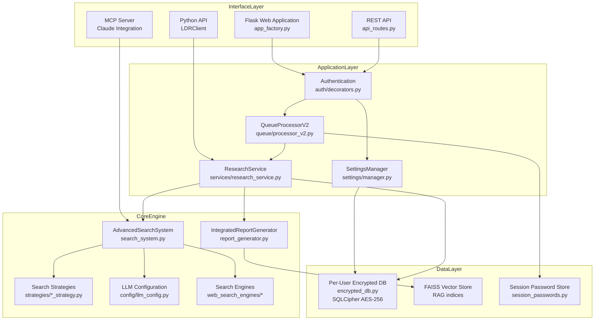
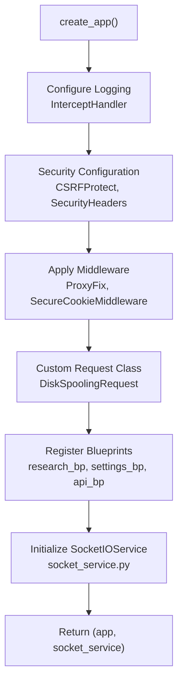
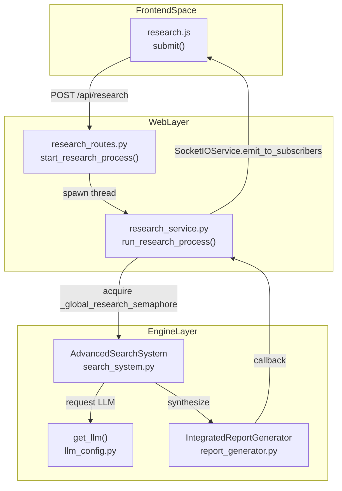
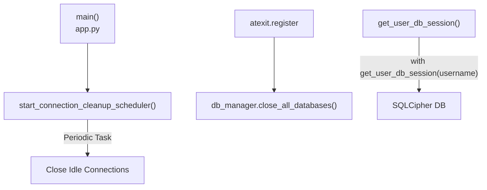

<!-- source: DeepWiki mcp.deepwiki.com · repo LearningCircuit/local-deep-research · page 3 Architecture · fetched 2026-10-29 -->

# Architecture

Relevant source files

The following files were used as context for generating this wiki page:

- [.github/CODEOWNERS](.github/CODEOWNERS)
- [README.md](README.md)
- [docker-compose.gpu.override.yml](docker-compose.gpu.override.yml)
- [docker-compose.unraid.yml](docker-compose.unraid.yml)
- [docs/CI_CD_INFRASTRUCTURE.md](docs/CI_CD_INFRASTRUCTURE.md)
- [docs/CUSTOM_LLM_INTEGRATION.md](docs/CUSTOM_LLM_INTEGRATION.md)
- [docs/SECURITY_REVIEW_PROCESS.md](docs/SECURITY_REVIEW_PROCESS.md)
- [docs/SQLCIPHER_INSTALL.md](docs/SQLCIPHER_INSTALL.md)
- [docs/analytics-dashboard.md](docs/analytics-dashboard.md)
- [docs/architecture.md](docs/architecture.md)
- [docs/architecture/DATABASE_SCHEMA.md](docs/architecture/DATABASE_SCHEMA.md)
- [docs/architecture/OVERVIEW.md](docs/architecture/OVERVIEW.md)
- [docs/decisions/0001-remove-detect-secrets.md](docs/decisions/0001-remove-detect-secrets.md)
- [docs/decisions/0004-nullpool-for-sqlcipher.md](docs/decisions/0004-nullpool-for-sqlcipher.md)
- [docs/deployment/unraid.md](docs/deployment/unraid.md)
- [docs/developing.md](docs/developing.md)
- [docs/developing/EXTENDING.md](docs/developing/EXTENDING.md)
- [docs/docker-compose-guide.md](docs/docker-compose-guide.md)
- [docs/env_configuration.md](docs/env_configuration.md)
- [docs/faq.md](docs/faq.md)
- [docs/features.md](docs/features.md)
- [docs/install-pip.md](docs/install-pip.md)
- [docs/installation.md](docs/installation.md)
- [docs/library-and-rag.md](docs/library-and-rag.md)
- [docs/mcp-server.md](docs/mcp-server.md)
- [docs/search-engines.md](docs/search-engines.md)
- [docs/troubleshooting.md](docs/troubleshooting.md)
- [src/local_deep_research/__init__.py](src/local_deep_research/__init__.py)
- [src/local_deep_research/api/__init__.py](src/local_deep_research/api/__init__.py)
- [src/local_deep_research/config/llm_config.py](src/local_deep_research/config/llm_config.py)
- [src/local_deep_research/database/sqlcipher_compat.py](src/local_deep_research/database/sqlcipher_compat.py)
- [src/local_deep_research/news/__init__.py](src/local_deep_research/news/__init__.py)
- [src/local_deep_research/utilities/log_utils.py](src/local_deep_research/utilities/log_utils.py)
- [src/local_deep_research/web/app.py](src/local_deep_research/web/app.py)
- [src/local_deep_research/web/app_factory.py](src/local_deep_research/web/app_factory.py)
- [src/local_deep_research/web/database/README.md](src/local_deep_research/web/database/README.md)
- [src/local_deep_research/web/models/database.py](src/local_deep_research/web/models/database.py)
- [src/local_deep_research/web/routes/api_routes.py](src/local_deep_research/web/routes/api_routes.py)
- [src/local_deep_research/web/routes/history_routes.py](src/local_deep_research/web/routes/history_routes.py)
- [src/local_deep_research/web/routes/research_routes.py](src/local_deep_research/web/routes/research_routes.py)
- [src/local_deep_research/web/routes/settings_routes.py](src/local_deep_research/web/routes/settings_routes.py)
- [src/local_deep_research/web/services/research_service.py](src/local_deep_research/web/services/research_service.py)
- [src/local_deep_research/web/services/socket_service.py](src/local_deep_research/web/services/socket_service.py)
- [src/local_deep_research/web/static/js/components/settings.js](src/local_deep_research/web/static/js/components/settings.js)
- [tests/config/test_llm_config_extra_coverage.py](tests/config/test_llm_config_extra_coverage.py)
- [tests/database/test_post_login_settings_atomicity.py](tests/database/test_post_login_settings_atomicity.py)
- [tests/mcp/test_mcp_strategy.py](tests/mcp/test_mcp_strategy.py)
- [tests/web/routes/test_history_routes_extended.py](tests/web/routes/test_history_routes_extended.py)
- [tests/web/services/test_socket_service_coverage.py](tests/web/services/test_socket_service_coverage.py)
- [tests/web/services/test_socket_service_extra_coverage.py](tests/web/services/test_socket_service_extra_coverage.py)
- [tests/web_services/test_socket_service.py](tests/web_services/test_socket_service.py)
- [unraid-templates/local-deep-research.xml](unraid-templates/local-deep-research.xml)

This document provides a comprehensive overview of Local Deep Research's system architecture, describing how major components interact to deliver AI-powered research capabilities. It covers the multi-layered design, component relationships, data flow patterns, and key architectural decisions that enable per-user data isolation, concurrent research execution, and extensible search strategies.

For deployment-specific details, see [Docker Deployment](#2.1) and [Production Configuration and Hardening](#9.3). For development setup and contribution guidelines, see [Development Guide](#7). For user-facing interface details, see [User Interfaces](#5).

---

## System Overview

Local Deep Research implements a four-layer architecture: **User Interface Layer** (web UI, REST API, Python API, MCP server), **Application Layer** (Flask routes, service classes, queue processor), **Core Engine Layer** (search system, LLM integration, report generation), and **Data Layer** (per-user encrypted SQLCipher databases, FAISS vector stores).

### High-Level Component Diagram

**Sources:** [src/local_deep_research/web/app_factory.py:60-124](), [src/local_deep_research/web/services/socket_service.py:14-131]()

---

## Flask Application Initialization

The Flask application is created via `create_app()` in `app_factory.py`, which configures middleware, security headers, rate limiting, CSRF protection, and registers blueprints. The application uses a custom request class (`DiskSpoolingRequest`) to prevent memory exhaustion from large file uploads.

### Application Factory Flow

Key initialization steps:

1. **Logging Setup** ([src/local_deep_research/web/app_factory.py:67-91]()): Routes stdlib loggers (`werkzeug`, `apscheduler`) through `loguru` via `InterceptHandler`.
2. **Security Configuration** ([src/local_deep_research/web/app_factory.py:126-140]()): Configures proxy support via `ProxyFix` and dynamic cookie security via `SecureCookieMiddleware`.
3. **Middleware Stack** ([src/local_deep_research/web/app_factory.py:129-140]()): Middleware layers wrap the application to handle `X-Forwarded-For` and secure session cookies.
4. **Disk Spooling** ([src/local_deep_research/web/app_factory.py:45-57]()): The `DiskSpoolingRequest` class ensures that files larger than 5MB are spooled to disk rather than held in memory.

For details, see [Flask Web Application](#3.1).

**Sources:** [src/local_deep_research/web/app_factory.py:45-140]()

---

## Research Execution Architecture

Research execution follows a multi-stage pipeline coordinated by the `AdvancedSearchSystem`. The system uses a global semaphore `_global_research_semaphore` to limit concurrent research across all users and provides real-time updates via `SocketIOService`.

### Research Execution Flow

**Key Components:**

1. **Dynamic Provider Loading** ([src/local_deep_research/config/llm_config.py:159-191]()): The system dynamically fetches available LLM providers (Ollama, OpenAI, Anthropic, Google, etc.) using `get_available_providers`.
2. **Real-time Updates** ([src/local_deep_research/web/services/socket_service.py:171-210]()): `SocketIOService` handles targeted emission of research progress to specific subscribers using unique research IDs.
3. **Concurrency Control** ([src/local_deep_research/web/services/research_service.py:36-40]()): A global semaphore `_global_research_semaphore` limits the total number of active research tasks server-wide.
4. **Throttled Emission** ([src/local_deep_research/web/services/research_service.py:42-47]()): Socket.IO emissions are throttled using `_EMIT_THROTTLE_SECONDS` to prevent UI lag during high-frequency research updates.

For details, see [Research Service and Execution Lifecycle](#3.3) and [Search System Architecture](#3.5).

**Sources:** [src/local_deep_research/config/llm_config.py:159-191](), [src/local_deep_research/web/services/socket_service.py:171-210](), [src/local_deep_research/web/services/research_service.py:36-60]()

---

## Database Architecture and Per-User Isolation

Local Deep Research uses per-user encrypted SQLCipher databases. Authentication is tied directly to the ability to decrypt the database file using a password-derived key.

### Database Connection Lifecycle

**Isolation Strategy:**
- **Per-User DBs**: Each user has a unique database file that remains encrypted at rest via SQLCipher.
- **Session Context Management** ([src/local_deep_research/database/session_context.py:19-20]()): The system uses context managers to ensure database sessions are properly opened and closed within the request lifecycle or background threads.
- **Cleanup Schedulers** ([src/local_deep_research/web/app.py:107-120]()): A periodic background task (`start_connection_cleanup_scheduler`) ensures idle database connections are closed to free file descriptors.
- **Graceful Shutdown** ([src/local_deep_research/web/app.py:132-140]()): The system registers `atexit` handlers to close all database connections via `db_manager.close_all_databases()` when the server stops.

For details, see [Database Architecture and Security](#3.8) and [Thread-Safe Settings and Context Management](#3.4).

**Sources:** [src/local_deep_research/web/app.py:107-160](), [src/local_deep_research/database/session_context.py:19-62]()

---

## Settings and Configuration System

The application uses a robust settings management system that supports environment variable overrides, per-user database persistence, and thread-safe snapshots.

- **Dual-Mode Submission** ([src/local_deep_research/web/routes/settings_routes.py:6-38]()): Settings can be saved via AJAX/JSON (primary) or traditional POST (fallback for accessibility).
- **Validation** ([src/local_deep_research/web/routes/settings_routes.py:158-202]()): Settings are validated against their defined types (checkbox, number, slider, select) and constraints (min/max).
- **Snapshots** ([src/local_deep_research/web/services/research_service.py:12-13]()): Before a research task starts, a `SnapshotSettingsContext` is created to ensure the research uses a consistent set of parameters even if the user changes settings mid-execution.
- **Namespace Validation** ([src/local_deep_research/web/routes/settings_routes.py:93-131]()): New settings are validated against `ALLOWED_SETTING_PREFIXES` and `BLOCKED_SETTING_PREFIXES` to prevent unauthorized configuration changes.

For details, see [Thread-Safe Settings and Context Management](#3.4) and [Settings Management](#4.1).

**Sources:** [src/local_deep_research/web/routes/settings_routes.py:6-202](), [src/local_deep_research/web/services/research_service.py:12-13]()

---

## Frontend Build and Design System

The frontend is built with a focus on local-first accessibility and consistent styling.

- **Vite-based architecture**: Handles asset bundling and CSS management.
- **LDR Prefix**: CSS classes use an `ldr-` prefix to provide a clean namespace.
- **Dynamic Dropdowns** ([src/local_deep_research/web/static/js/components/settings.js:59-103]()): Custom dropdowns for model and search engine selection are rendered dynamically to handle provider-specific options.
- **Theme System**: Themes (system, dark, sepia) are applied before content visibility to prevent flashes of unstyled content.

### UI Layout Structure

| Component | Route | Responsibility |
|-----------|------|----------------|
| **Research Form** | `/` | Main research interface [src/local_deep_research/web/routes/research_routes.py:88-92]() |
| **History Viewer** | `/history` | View past research sessions [src/local_deep_research/web/routes/history_routes.py:33-37]() |
| **Settings Dashboard**| `/settings` | Configuration management [src/local_deep_research/web/routes/research_routes.py:117-121]() |
| **Research Details** | `/details/<id>` | Detailed progress and logs [src/local_deep_research/web/routes/research_routes.py:95-99]() |

For details, see [Frontend Build System](#3.2).

**Sources:** [src/local_deep_research/web/routes/research_routes.py:88-121](), [src/local_deep_research/web/routes/history_routes.py:33-37](), [src/local_deep_research/web/static/js/components/settings.js:59-103]()

---

## Report Generation and Export

Reports are synthesized into Markdown and can be exported to various formats using the `IntegratedReportGenerator`.

- **Export Formats** ([src/local_deep_research/web/services/research_service.py:83-128]()): The `export_report_to_memory` function uses an `ExporterRegistry` to support formats like PDF, LaTeX, ODT, and RIS.
- **Citation Handling** ([src/local_deep_research/web/services/research_service.py:64-80]()): The `CitationFormatter` manages various citation modes (number hyperlinks, domain hyperlinks, etc.) based on user settings like `report.citation_format`.
- **Think-Tag Removal** ([src/local_deep_research/config/llm_config.py:10]()): The system automatically cleanses LLM output of internal "thought" tokens before synthesis using `remove_think_tags`.

For details, see [Report Generation and Export System](#3.9).

**Sources:** [src/local_deep_research/web/services/research_service.py:64-128](), [src/local_deep_research/config/llm_config.py:10]()

---

This architecture enables Local Deep Research to provide privacy-focused, concurrent AI research capabilities while maintaining security through per-user database isolation and robust request handling. For implementation details of specific subsystems, see the child pages (3.1-3.9).

---

