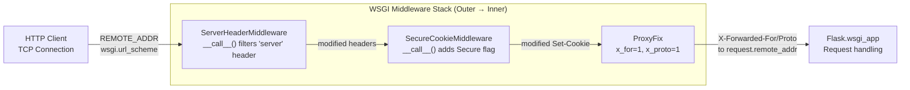
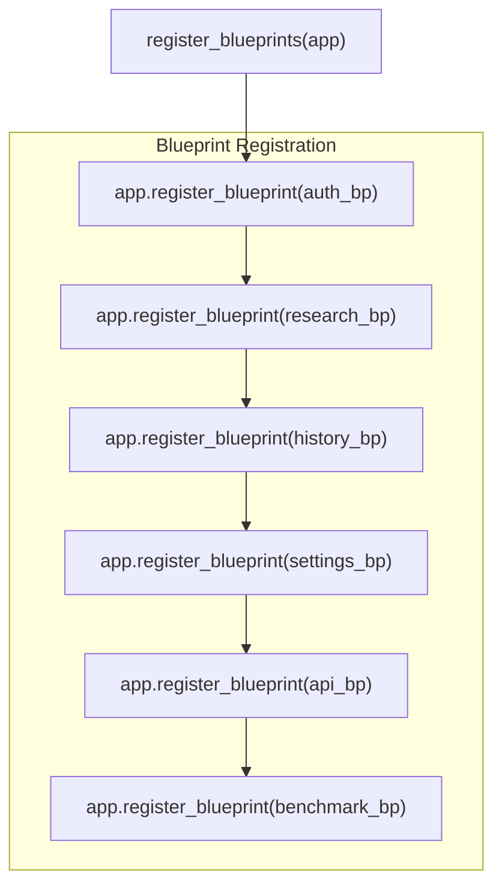
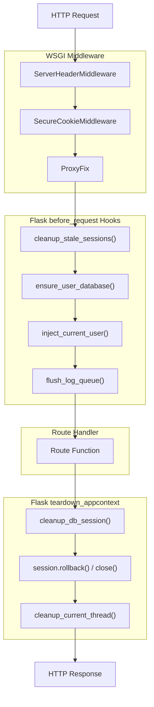

<!-- source: DeepWiki mcp.deepwiki.com · repo LearningCircuit/local-deep-research · page 3.1 Flask Web Application · fetched 2026-10-29 -->

# Flask Web Application

<details>
<summary>Relevant source files</summary>

The following files were used as context for generating this wiki page:

- [.semgrep/rules/README.md](.semgrep/rules/README.md)
- [.semgrep/rules/ldr-security.yaml](.semgrep/rules/ldr-security.yaml)
- [.zap/rules.tsv](.zap/rules.tsv)
- [src/local_deep_research/__init__.py](src/local_deep_research/__init__.py)
- [src/local_deep_research/api/__init__.py](src/local_deep_research/api/__init__.py)
- [src/local_deep_research/config/llm_config.py](src/local_deep_research/config/llm_config.py)
- [src/local_deep_research/defaults/settings_security.json](src/local_deep_research/defaults/settings_security.json)
- [src/local_deep_research/news/__init__.py](src/local_deep_research/news/__init__.py)
- [src/local_deep_research/security/__init__.py](src/local_deep_research/security/__init__.py)
- [src/local_deep_research/security/security_headers.py](src/local_deep_research/security/security_headers.py)
- [src/local_deep_research/utilities/formatting.py](src/local_deep_research/utilities/formatting.py)
- [src/local_deep_research/utilities/log_utils.py](src/local_deep_research/utilities/log_utils.py)
- [src/local_deep_research/web/app.py](src/local_deep_research/web/app.py)
- [src/local_deep_research/web/app_factory.py](src/local_deep_research/web/app_factory.py)
- [src/local_deep_research/web/models/database.py](src/local_deep_research/web/models/database.py)
- [src/local_deep_research/web/routes/api_routes.py](src/local_deep_research/web/routes/api_routes.py)
- [src/local_deep_research/web/routes/history_routes.py](src/local_deep_research/web/routes/history_routes.py)
- [src/local_deep_research/web/routes/research_routes.py](src/local_deep_research/web/routes/research_routes.py)
- [src/local_deep_research/web/routes/settings_routes.py](src/local_deep_research/web/routes/settings_routes.py)
- [src/local_deep_research/web/server_config.py](src/local_deep_research/web/server_config.py)
- [src/local_deep_research/web/services/research_service.py](src/local_deep_research/web/services/research_service.py)
- [src/local_deep_research/web/services/socket_service.py](src/local_deep_research/web/services/socket_service.py)
- [src/local_deep_research/web/static/js/components/settings.js](src/local_deep_research/web/static/js/components/settings.js)
- [src/local_deep_research/web/warning_checks/__init__.py](src/local_deep_research/web/warning_checks/__init__.py)
- [src/local_deep_research/web/warning_checks/backup.py](src/local_deep_research/web/warning_checks/backup.py)
- [src/local_deep_research/web/warning_checks/hardware.py](src/local_deep_research/web/warning_checks/hardware.py)
- [tests/config/test_llm_config_extra_coverage.py](tests/config/test_llm_config_extra_coverage.py)
- [tests/library/download_management/test_database_init.py](tests/library/download_management/test_database_init.py)
- [tests/news/subscription_manager/test_scheduler_coverage.py](tests/news/subscription_manager/test_scheduler_coverage.py)
- [tests/news/test_scheduler.py](tests/news/test_scheduler.py)
- [tests/news/test_scheduler_comprehensive.py](tests/news/test_scheduler_comprehensive.py)
- [tests/news/test_scheduler_extended.py](tests/news/test_scheduler_extended.py)
- [tests/search_engines/test_search_engine_serper.py](tests/search_engines/test_search_engine_serper.py)
- [tests/search_engines/test_search_engine_wayback.py](tests/search_engines/test_search_engine_wayback.py)
- [tests/search_engines/test_search_engine_wikinews.py](tests/search_engines/test_search_engine_wikinews.py)
- [tests/security/test_check_response_size.py](tests/security/test_check_response_size.py)
- [tests/security/test_security_headers.py](tests/security/test_security_headers.py)
- [tests/web/routes/test_backup_status_api.py](tests/web/routes/test_backup_status_api.py)
- [tests/web/routes/test_settings_validation_edge_cases.py](tests/web/routes/test_settings_validation_edge_cases.py)
- [tests/web/services/test_socket_service.py](tests/web/services/test_socket_service.py)
- [tests/web/services/test_socket_service_coverage.py](tests/web/services/test_socket_service_coverage.py)
- [tests/web/services/test_socket_service_extra_coverage.py](tests/web/services/test_socket_service_extra_coverage.py)
- [tests/web/test_app_factory.py](tests/web/test_app_factory.py)
- [tests/web/test_server_config.py](tests/web/test_server_config.py)
- [tests/web/themes/test_loader.py](tests/web/themes/test_loader.py)
- [tests/web/warning_checks/test_backup.py](tests/web/warning_checks/test_backup.py)
- [tests/web/warning_checks/test_hardware.py](tests/web/warning_checks/test_hardware.py)
- [tests/web/warning_checks/test_orchestrator.py](tests/web/warning_checks/test_orchestrator.py)
- [tests/web_search_engines/engines/test_search_engine_wayback.py](tests/web_search_engines/engines/test_search_engine_wayback.py)
- [tests/web_search_engines/engines/test_search_engine_wayback_coverage.py](tests/web_search_engines/engines/test_search_engine_wayback_coverage.py)
- [tests/web_search_engines/engines/test_search_engine_wikinews.py](tests/web_search_engines/engines/test_search_engine_wikinews.py)
- [tests/web_services/test_socket_service.py](tests/web_services/test_socket_service.py)

</details>


This page documents the Flask web application structure, including the application factory pattern, WSGI middleware layers, service initialization, blueprint registration, and request lifecycle.

## Application Factory Pattern

The Flask application is created using the factory pattern via the `create_app()` function in [src/local_deep_research/web/app_factory.py:60-60](). This function returns a tuple of `(app, socket_service)` where `app` is the configured Flask instance and `socket_service` is the initialized `SocketIOService` [src/local_deep_research/web/app_factory.py:65-66]().

```mermaid
graph TD
    create_app["create_app()"]
    
    subgraph Phase_1["Phase 1: Flask Instance Creation"]
        resolve["importlib_resources.files()<br/>Package directory resolution"]
        flask_init["Flask(__name__)<br/>static_folder=None"]
        request_class["app.request_class = DiskSpoolingRequest"]
    end
    
    subgraph Phase_2["Phase 2: WSGI Middleware Wrapping"]
        proxy["ProxyFix(app.wsgi_app)<br/>x_for=1, x_proto=1"]
        secure["SecureCookieMiddleware(wsgi_app, app)"]
        server["ServerHeaderMiddleware(wsgi_app)"]
    end
    
    subgraph Phase_3["Phase 3: Configuration"]
        secret["SECRET_KEY from .secret_key file"]
        session["SESSION_COOKIE_* settings"]
        csrf["CSRFProtect(app)"]
        limiter_init["limiter.init_app(app)"]
        headers["SecurityHeaders(app)"]
    end
    
    subgraph Phase_4["Phase 4: Service Initialization"]
        vite["vite.init_app(app)"]
        theme["theme_helper.init_app(app)"]
        themes_css["theme_registry.get_combined_css()"]
        socketio["SocketIOService(app=app)"]
        scheduler["get_news_scheduler().start()"]
    end
    
    subgraph Phase_5["Phase 5: Middleware & Blueprints"]
        apply_mid["apply_middleware(app)"]
        register_bp["register_blueprints(app)"]
        error_handlers["register_error_handlers(app)"]
    end
    
    subgraph Phase_6["Phase 6: Queue Processor"]
        queue_start["start_log_queue_processor(app)"]
        atexit["atexit.register(shutdown_databases)"]
    end
    
    create_app --> resolve
    resolve --> flask_init
    flask_init --> request_class
    request_class --> proxy
    proxy --> secure
    secure --> server
    server --> secret
    secret --> session
    session --> csrf
    csrf --> limiter_init
    limiter_init --> headers
    headers --> vite
    vite --> theme
    theme --> themes_css
    themes_css --> socketio
    socketio --> scheduler
    scheduler --> apply_mid
    apply_mid --> register_bp
    register_bp --> error_handlers
    error_handlers --> queue_start
    queue_start --> atexit
```



**Diagram: create_app() Initialization Sequence with Code Entities**

**Key Initialization Steps:**

| Step | Code Entity | Location | Purpose |
|------|-------------|----------|---------|
| 1 | `importlib_resources.files()` | [src/local_deep_research/web/app_factory.py:97-98]() | Locate package `static/` and `templates/` directories |
| 2 | `DiskSpoolingRequest` class | [src/local_deep_research/web/app_factory.py:45-58]() | Spool uploads >5MB to disk to prevent memory exhaustion |
| 3 | `ProxyFix`, `SecureCookieMiddleware` | [src/local_deep_research/web/app_factory.py:129-213]() | WSGI middleware stack for proxy support and dynamic cookie security |
| 4 | `SECRET_KEY` generation | [src/local_deep_research/web/app_factory.py:248-268]() | Generate or load secret key from `.secret_key` file with 0600 permissions |
| 5 | `CSRFProtect(app)`, `limiter.init_app(app)` | [src/local_deep_research/web/app_factory.py:306-320]() | Initialize CSRF protection and rate limiting |
| 6 | `SocketIOService(app)`, `get_news_scheduler()` | [src/local_deep_research/web/app_factory.py:425-464]() | Initialize WebSocket service and news subscription scheduler |
| 7 | `apply_middleware(app)` | [src/local_deep_research/web/app_factory.py:499-544]() | Register before_request handlers for auth, database, cleanup |
| 8 | `register_blueprints(app)` | [src/local_deep_research/web/app_factory.py:614-759]() | Register all Flask blueprints with URL prefixes |

**Sources:** [src/local_deep_research/web/app_factory.py:60-759](), [src/local_deep_research/web/app.py:74-81]()

### Directory Resolution

The application determines its static and template directories based on whether it's running from an installed package or development environment:

```
Try: importlib.resources.files() for package paths
Fallback: Path("templates").resolve() for development
```

Static folder is explicitly set to `None` to disable Flask's built-in static handling, allowing custom static route logic at [src/local_deep_research/web/app_factory.py:105-120]().

**Sources:** [src/local_deep_research/web/app_factory.py:97-120]()

### Request Class Customization

A custom `DiskSpoolingRequest` class replaces Flask's default Request class to prevent memory exhaustion from large file uploads:

```python
class DiskSpoolingRequest(Request):
    max_form_memory_size = 5 * 1024 * 1024  # 5MB threshold
```

This prevents memory exhaustion from large multipart uploads by writing files larger than the threshold to temporary files on disk instead of keeping them in memory [src/local_deep_research/web/app_factory.py:45-58]().

**Sources:** [src/local_deep_research/web/app_factory.py:45-58](), [src/local_deep_research/web/app_factory.py:124-124]()

## WSGI Middleware Stack

The application is wrapped by multiple WSGI middleware layers, applied in this specific order (outermost to innermost). Each middleware implements the WSGI `__call__(environ, start_response)` interface:



**Diagram: WSGI Middleware Wrapping with Code Entities**

### Wrapping Order

The middleware is applied in this order in `create_app()`:

1.  **ProxyFix** (Innermost): [src/local_deep_research/web/app_factory.py:129-136]()
2.  **SecureCookieMiddleware**: [src/local_deep_research/web/app_factory.py:141-213]()
3.  **ServerHeaderMiddleware** (Outermost): [src/local_deep_research/web/app_factory.py:215-241]()

**Sources:** [src/local_deep_research/web/app_factory.py:129-241]()

### ProxyFix Middleware

Werkzeug's `ProxyFix` middleware handles `X-Forwarded-For` and `X-Forwarded-Proto` headers for deployments behind reverse proxies. Configuration at [src/local_deep_research/web/app_factory.py:129-136]():

```python
ProxyFix(
    app.wsgi_app,
    x_for=1,      # Trust 1 proxy for X-Forwarded-For
    x_proto=1,    # Trust 1 proxy for X-Forwarded-Proto (http/https)
    x_host=0,     # Don't trust X-Forwarded-Host
    x_port=0,     # Don't trust X-Forwarded-Port
    x_prefix=0    # Don't trust X-Forwarded-Prefix
)
```

This ensures rate limiting and security checks use the real client IP, not the proxy IP [src/local_deep_research/web/app_factory.py:128-128]().

**Sources:** [src/local_deep_research/web/app_factory.py:129-136]()

### SecureCookieMiddleware

A custom WSGI middleware class at [src/local_deep_research/web/app_factory.py:141-213]() that dynamically adds the `Secure` flag to `Set-Cookie` headers based on request context:

```mermaid
graph TD
    call["SecureCookieMiddleware.__call__()"]
    
    should_add["_should_add_secure_flag(environ)"]
    
    test_mode{"app.config['LDR_TESTING_MODE']"}
    https{"wsgi.url_scheme == 'https'"}
    remote_addr["environ['REMOTE_ADDR']"]
    is_private{"_is_private_ip(REMOTE_ADDR)"}
    
    add_secure["Add '; Secure' to Set-Cookie"]
    no_secure["Leave Set-Cookie unchanged"]
    
    call --> should_add
    should_add --> test_mode
    test_mode -->|True| no_secure
    test_mode -->|False| https
    https -->|True| add_secure
    https -->|False| remote_addr
    remote_addr --> is_private
    is_private -->|False<br/>public IP| add_secure
    is_private -->|True<br/>localhost/LAN| no_secure
```

**Diagram: SecureCookieMiddleware Decision Logic**

**Decision Logic:**

| Condition | Result | Rationale |
|-----------|--------|-----------|
| `LDR_TESTING_MODE` is active | No Secure flag | CI/development compatibility [src/local_deep_research/web/app_factory.py:148-148]() |
| `wsgi.url_scheme` == 'https' | Add Secure flag | HTTPS connections are secure [src/local_deep_research/web/app_factory.py:146-146]() |
| `_is_private_ip(REMOTE_ADDR)` == True | No Secure flag | Localhost/LAN HTTP is safe [src/local_deep_research/web/app_factory.py:30-37]() |
| Non-localhost HTTP | Add Secure flag | Enforce HTTPS for public traffic [src/local_deep_research/web/app_factory.py:147-147]() |

**Sources:** [src/local_deep_research/web/app_factory.py:30-42](), [src/local_deep_research/web/app_factory.py:141-213]()

### ServerHeaderMiddleware

The outermost middleware layer that removes the `Server` header from all responses to prevent information disclosure about the underlying web server implementation [src/local_deep_research/web/app_factory.py:215-241]().

**Sources:** [src/local_deep_research/web/app_factory.py:215-241]()

## Configuration and Security

### SecurityHeaders Middleware

The `SecurityHeaders` class [src/local_deep_research/security/security_headers.py:13-24]() provides comprehensive HTTP security headers. It is initialized in the application factory [src/local_deep_research/web/app_factory.py:315-315]().

| Header | Purpose | Configuration Site |
|--------|---------|-------------------|
| `Content-Security-Policy` | Prevents XSS/injection | [src/local_deep_research/security/security_headers.py:103-133]() |
| `X-Frame-Options` | Clickjacking protection | [src/local_deep_research/security/security_headers.py:18-18]() |
| `Permissions-Policy` | Disables dangerous features | [src/local_deep_research/security/security_headers.py:135-156]() |
| `Cross-Origin-Embedder-Policy` | Spectre protection | [src/local_deep_research/security/security_headers.py:48-49]() |

**Sources:** [src/local_deep_research/security/security_headers.py:1-174](), [src/local_deep_research/web/app_factory.py:315-315]()

### CSRF Protection

Flask-WTF's `CSRFProtect` is initialized globally [src/local_deep_research/web/app_factory.py:306-306](). Specific blueprints or routes are exempted where necessary, such as API endpoints that use alternative authentication [src/local_deep_research/web/app_factory.py:720-729]().

**Sources:** [src/local_deep_research/web/app_factory.py:306-306](), [src/local_deep_research/web/app_factory.py:720-729]()

## Blueprint Architecture

Blueprints organize routes into logical modules with URL prefixes.



**Diagram: Blueprint Registration Flow**

**Key Registered Blueprints:**

| Blueprint | URL Prefix | Purpose |
|-----------|------------|---------|
| `auth_bp` | `/auth` | Authentication and user management [src/local_deep_research/web/app_factory.py:710]() |
| `research_bp` | `/` | Core research interface and execution [src/local_deep_research/web/routes/research_routes.py:72]() |
| `history_bp` | `/history` | Research history and results retrieval [src/local_deep_research/web/routes/history_routes.py:23]() |
| `settings_bp` | `/settings` | Application configuration management [src/local_deep_research/web/routes/settings_routes.py:84]() |
| `api_bp` | `/api` | REST API for external integrations [src/local_deep_research/web/routes/api_routes.py:30]() |

**Sources:** [src/local_deep_research/web/app_factory.py:614-764](), [src/local_deep_research/web/routes/settings_routes.py:84](), [src/local_deep_research/web/routes/api_routes.py:30]()

## Settings Handling and Validation

The settings system utilizes a dual-mode submission pattern to handle checkboxes correctly, ensuring compatibility with and without JavaScript [src/local_deep_research/web/routes/settings_routes.py:6-39]().

- **AJAX Mode**: JSON submission where JavaScript reads `checkbox.checked` directly [src/local_deep_research/web/routes/settings_routes.py:10-15]().
- **Traditional POST**: Uses a hidden fallback input pattern to ensure unchecked checkboxes are captured (submitting "false") [src/local_deep_research/web/routes/settings_routes.py:17-23]().

Settings are validated against their defined `ui_element` type (e.g., checkbox, number, slider, select) and constraints like `min_value` or `max_value` [src/local_deep_research/web/routes/settings_routes.py:158-202](). Namespace validation restricts the creation of new settings to allowed prefixes like `llm.`, `search.`, or `rag.` [src/local_deep_research/web/routes/settings_routes.py:93-131]().

**Sources:** [src/local_deep_research/web/routes/settings_routes.py:6-39](), [src/local_deep_research/web/routes/settings_routes.py:158-202](), [src/local_deep_research/web/routes/settings_routes.py:93-145]()

## Request Lifecycle and Middleware Chain

The request lifecycle consists of multiple middleware functions registered via `@app.before_request`, `@app.teardown_appcontext`, and the WSGI middleware stack.



**Diagram: Complete Request Processing Pipeline**

### Teardown Cleanup

The `cleanup_db_session(exception=None)` function [src/local_deep_research/web/app_factory.py:547-596]() ensures that database sessions are rolled back and closed after every request, and that thread-local engines are disposed of to prevent memory leaks [src/local_deep_research/web/app_factory.py:575-585](). Final cleanup is registered via `atexit` to close all databases on server shutdown [src/local_deep_research/web/app.py:132-160]().

**Sources:** [src/local_deep_research/web/app_factory.py:547-596](), [src/local_deep_research/web/app.py:132-160]()

## SocketIO Integration

The `SocketIOService` manages WebSocket connections and subscriptions [src/local_deep_research/web/services/socket_service.py:14-17](). It is implemented as a singleton and handles events like `subscribe_to_research` and `leave` [src/local_deep_research/web/services/socket_service.py:105-122]().

- **Throttling**: Progress emissions are throttled using `_EMIT_THROTTLE_SECONDS` (0.2s) per research to prevent UI flooding [src/local_deep_research/web/services/research_service.py:42-43]().
- **Concurrency**: Global research concurrency is controlled via `_global_research_semaphore`, defaulting to 10 concurrent tasks [src/local_deep_research/web/services/research_service.py:37-40]().
- **CORS Policy**: WebSocket origins are restricted via `LDR_SECURITY_WEBSOCKET_ALLOWED_ORIGINS` [src/local_deep_research/web/services/socket_service.py:54-74]().

**Sources:** [src/local_deep_research/web/services/socket_service.py:14-131](), [src/local_deep_research/web/services/research_service.py:36-47]()

---

