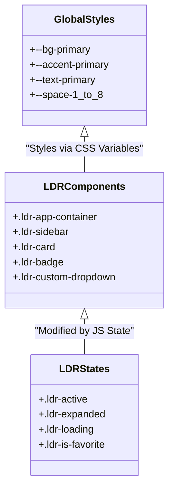
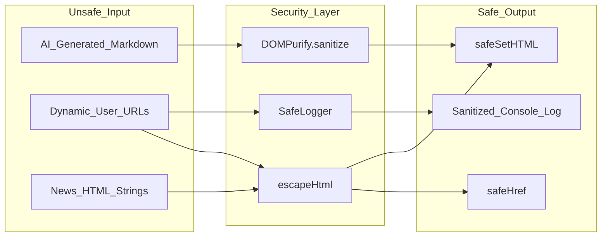

<!-- source: DeepWiki mcp.deepwiki.com · repo LearningCircuit/local-deep-research · page 3.2 Frontend Build System · fetched 2026-10-29 -->

# Frontend Build System

<details>
<summary>Relevant source files</summary>

The following files were used as context for generating this wiki page:

- [docs/CONFIGURATION.md](docs/CONFIGURATION.md)
- [eslint.config.js](eslint.config.js)
- [package-lock.json](package-lock.json)
- [package.json](package.json)
- [src/local_deep_research/__version__.py](src/local_deep_research/__version__.py)
- [src/local_deep_research/web/static/css/mobile-navigation.css](src/local_deep_research/web/static/css/mobile-navigation.css)
- [src/local_deep_research/web/static/css/mobile-responsive.css](src/local_deep_research/web/static/css/mobile-responsive.css)
- [src/local_deep_research/web/static/css/news-enhanced.css](src/local_deep_research/web/static/css/news-enhanced.css)
- [src/local_deep_research/web/static/css/news.css](src/local_deep_research/web/static/css/news.css)
- [src/local_deep_research/web/static/css/settings-mobile-fix.css](src/local_deep_research/web/static/css/settings-mobile-fix.css)
- [src/local_deep_research/web/static/css/settings.css](src/local_deep_research/web/static/css/settings.css)
- [src/local_deep_research/web/static/css/styles.css](src/local_deep_research/web/static/css/styles.css)
- [src/local_deep_research/web/static/css/subscriptions.css](src/local_deep_research/web/static/css/subscriptions.css)
- [src/local_deep_research/web/static/js/components/fallback/ui.js](src/local_deep_research/web/static/js/components/fallback/ui.js)
- [src/local_deep_research/web/static/js/components/history.js](src/local_deep_research/web/static/js/components/history.js)
- [src/local_deep_research/web/static/js/components/library_search.js](src/local_deep_research/web/static/js/components/library_search.js)
- [src/local_deep_research/web/static/js/components/logpanel.js](src/local_deep_research/web/static/js/components/logpanel.js)
- [src/local_deep_research/web/static/js/components/research.js](src/local_deep_research/web/static/js/components/research.js)
- [src/local_deep_research/web/static/js/components/settings_sync.js](src/local_deep_research/web/static/js/components/settings_sync.js)
- [src/local_deep_research/web/static/js/components/subscription-manager.js](src/local_deep_research/web/static/js/components/subscription-manager.js)
- [src/local_deep_research/web/static/js/mobile-navigation.js](src/local_deep_research/web/static/js/mobile-navigation.js)
- [src/local_deep_research/web/static/js/news-enhancements.js](src/local_deep_research/web/static/js/news-enhancements.js)
- [src/local_deep_research/web/static/js/pages/news.js](src/local_deep_research/web/static/js/pages/news.js)
- [src/local_deep_research/web/static/js/pages/subscriptions.js](src/local_deep_research/web/static/js/pages/subscriptions.js)
- [src/local_deep_research/web/static/js/research_form.js](src/local_deep_research/web/static/js/research_form.js)
- [src/local_deep_research/web/static/js/security/url-validator.js](src/local_deep_research/web/static/js/security/url-validator.js)
- [src/local_deep_research/web/static/js/security/xss-protection.js](src/local_deep_research/web/static/js/security/xss-protection.js)
- [src/local_deep_research/web/static/js/services/formatting.js](src/local_deep_research/web/static/js/services/formatting.js)
- [src/local_deep_research/web/static/js/services/socket.js](src/local_deep_research/web/static/js/services/socket.js)
- [src/local_deep_research/web/static/js/services/theme.js](src/local_deep_research/web/static/js/services/theme.js)
- [src/local_deep_research/web/static/js/services/ui.js](src/local_deep_research/web/static/js/services/ui.js)
- [src/local_deep_research/web/static/js/utils/log-helpers.js](src/local_deep_research/web/static/js/utils/log-helpers.js)
- [src/local_deep_research/web/templates/base.html](src/local_deep_research/web/templates/base.html)
- [src/local_deep_research/web/templates/pages/research.html](src/local_deep_research/web/templates/pages/research.html)
- [src/local_deep_research/web/utils/theme_helper.py](src/local_deep_research/web/utils/theme_helper.py)
- [tests/infrastructure_tests/test_urls.test.js](tests/infrastructure_tests/test_urls.test.js)
- [tests/infrastructure_tests/test_xss_protection.test.js](tests/infrastructure_tests/test_xss_protection.test.js)
- [tests/js/utils/form-validation.test.js](tests/js/utils/form-validation.test.js)
- [tests/theme_tests/test_theme_system.py](tests/theme_tests/test_theme_system.py)
- [tests/ui_tests/playwright/playwright.config.js](tests/ui_tests/playwright/playwright.config.js)
- [tests/ui_tests/playwright/tests/auth.setup.js](tests/ui_tests/playwright/tests/auth.setup.js)
- [tests/ui_tests/playwright/tests/helpers/auth.js](tests/ui_tests/playwright/tests/helpers/auth.js)
- [tests/ui_tests/playwright/tests/theme-visual-regression.spec.js](tests/ui_tests/playwright/tests/theme-visual-regression.spec.js)
- [vite.config.js](vite.config.js)

</details>


The frontend build system manages JavaScript and CSS dependencies, asset bundling, and development workflows for the Local Deep Research web interface. It utilizes **npm** for package management and **Vite** as the primary build tool to ensure all frontend assets are bundled and served locally without external CDN dependencies, maintaining the project's local-first privacy policy.

---

## Build System Architecture

The frontend build system operates in two distinct modes: development mode with Hot Module Replacement (HMR) for rapid iteration, and production mode with optimized bundles for deployment.

### Frontend Asset Flow
```mermaid
graph TB
    subgraph "Source_Assets"
        ["package.json"] --> ["NPM_Scripts"]
        ["static/js/"] --> ["JS_Modules"]
        ["static/css/"] --> ["Stylesheets"]
    end
    
    subgraph "Build_Tools"
        ["npm_install"] --> ["node_modules"]
        ["npm_run_dev"] --> ["Vite_Dev_Server"]
        ["npm_run_build"] --> ["Vite_Production_Build"]
    end
    
    subgraph "Build_Artifacts"
        ["Vite_Production_Build"] --> ["static/dist/assets/"]
        ["Vite_Production_Build"] --> ["manifest.json"]
    end
    
    subgraph "Flask_Integration"
        ["vite_asset_helper"] --> ["Jinja2_Templates"]
        ["manifest.json"] -.-> ["vite_asset_helper"]
        ["static/dist/assets/"] --> ["Flask_Static_Route"]
    end

    ["JS_Modules"] --> ["Vite_Dev_Server"]
    ["Stylesheets"] --> ["Vite_Dev_Server"]
    ["Vite_Dev_Server"] -.->|HMR| ["Browser"]
```

**Sources:** [package.json:10-13](), [src/local_deep_research/web/static/css/styles.css:1-88]()

---

## Package Management

### Dependency Configuration

All frontend dependencies are strictly managed through `package.json`. To ensure zero-knowledge privacy and offline capability, the system avoids all external CDNs. The `engines` field enforces Node.js `>=24.0.0` [package.json:7-9]().

| Dependency Category | Packages | Purpose |
|---------------------|----------|---------|
| **Real-time Updates** | `socket.io-client` | Research progress tracking via Socket.IO [package.json:35]() |
| **Security** | `dompurify` | HTML sanitization in frontend components [package.json:30]() |
| **UI Framework** | `bootstrap`, `bootstrap-icons` | Core responsive framework [package.json:24-25]() |
| **Data Viz** | `chart.js` | Performance metrics and research analytics [package.json:26]() |
| **Export System** | `jspdf`, `html2canvas` | Client-side PDF generation for research reports [package.json:32-33]() |
| **Markdown** | `marked`, `highlight.js` | Report rendering and code highlighting [package.json:31,34]() |

**Sources:** [package.json:1-45](), [package-lock.json:7-36]()

---

## Design System: The `ldr-` Prefix

The codebase utilizes a custom design system where all internal CSS classes and components are prefixed with `ldr-`. This prevents namespace collisions with third-party libraries like Bootstrap and establishes a clear boundary for custom logic.

### Design System Entity Mapping


**Key Implementation Patterns:**
- **Variables**: Defined in `:root` within `styles.css`, including a 4px base spacing scale (`--space-1` to `--space-8`) and a typography scale (`--text-xs` to `--text-3xl`) [src/local_deep_research/web/static/css/styles.css:2-73]().
- **Layout**: Uses `.ldr-sidebar` for a fixed 240px navigation drawer and `.ldr-app-container` for the primary flex layout [src/local_deep_research/web/static/css/styles.css:172-193]().
- **Accessibility**: Includes `.ldr-skip-link` for keyboard users and `.sr-only` for screen reader optimization [src/local_deep_research/web/static/css/styles.css:101-169]().
- **Component Styling**: Specific page elements like the research card use `.ldr-research-card` and `.ldr-form-group` to maintain layout consistency [src/local_deep_research/web/templates/pages/research.html:21-24]().

**Sources:** [src/local_deep_research/web/static/css/styles.css:2-200](), [src/local_deep_research/web/templates/pages/research.html:14-80]()

---

## Asset Organization and Modularity

### Component Architecture
The frontend is organized into self-contained components and services. Many components interact with the backend via specialized endpoints and handle complex UI states.

| Component | File | Role |
|-----------|------|------|
| **Theme Service** | `theme.js` | Manages theme switching and persistence across user sessions [src/local_deep_research/web/templates/base.html:13-33]() |
| **Research Component** | `research.js` | Manages research forms, mode selection, and advanced options state [src/local_deep_research/web/static/js/components/research.js:6-51]() |
| **Log Panel** | `logpanel.js` | Handles real-time display of research logs with autoscroll and filtering [src/local_deep_research/web/static/js/components/logpanel.js:6-32]() |
| **News Component** | `news.js` | Manages news feeds, subscriptions, and semantic search integration [src/local_deep_research/web/static/js/pages/news.js:141-174]() |

### Frontend-Backend Integration
The Flask application injects critical constants and asset helpers into Jinja2 templates:
- **Vite Helpers**: `vite_hmr()` and `vite_asset('js/app.js')` are used in `base.html` to inject appropriate scripts for dev vs production [src/local_deep_research/web/templates/base.html:35-41]().
- **Constants Injection**: Python enums like `ResearchStatus` are injected as `window.RESEARCH_STATUS` to provide a single source of truth for frontend state management [src/local_deep_research/web/templates/base.html:145-151]().
- **FOUC Prevention**: A blocking script in the `<head>` detects the saved theme from `localStorage` and applies the `data-theme` attribute to `document.documentElement` before rendering [src/local_deep_research/web/templates/base.html:13-33]().

**Sources:** [src/local_deep_research/web/templates/base.html:1-160](), [src/local_deep_research/web/static/js/components/research.js:1-100](), [src/local_deep_research/web/static/js/components/logpanel.js:24-32]()

---

## Security & XSS Protection

The build system and frontend architecture prioritize security through a multi-layered XSS protection strategy, enforced by ESLint and specialized utility functions.

### Sanitization Pipeline


**Implementation Details:**
- **ESLint Enforcement**: The `no-unsanitized` plugin is configured to detect unsafe assignments to `innerHTML` and `outerHTML`, allowing only recognized sanitization methods like `DOMPurify.sanitize` or `escapeHtml` [eslint.config.js:8-27, 79-81]().
- **Safe HTML Setting**: The `ui.js` utility provides `safeSetHTML`, which uses `DOMPurify` if available, ensuring that even dynamic UI elements are rendered safely [src/local_deep_research/web/static/js/services/ui.js:18-29]().
- **Safe Logging**: `SafeLogger` is loaded as a blocking script in `base.html` to ensure that all subsequent frontend logs are handled securely from the start of the application lifecycle [src/local_deep_research/web/templates/base.html:38-39]().
- **News Rendering**: The news page implements `safeRenderHTML` which prioritizes `DOMPurify` but includes a safe fallback to `textContent` if the library is not yet initialized [src/local_deep_research/web/static/js/pages/news.js:5-34]().
- **URL Sanitization**: The `safeHref` function blocks dangerous schemes like `javascript:` or `data:` for all dynamic links generated in the UI [src/local_deep_research/web/static/js/pages/news.js:37-50]().

**Sources:** [eslint.config.js:8-81](), [src/local_deep_research/web/static/js/services/ui.js:18-29](), [src/local_deep_research/web/static/js/pages/news.js:5-50](), [src/local_deep_research/web/templates/base.html:6-39]()

---

