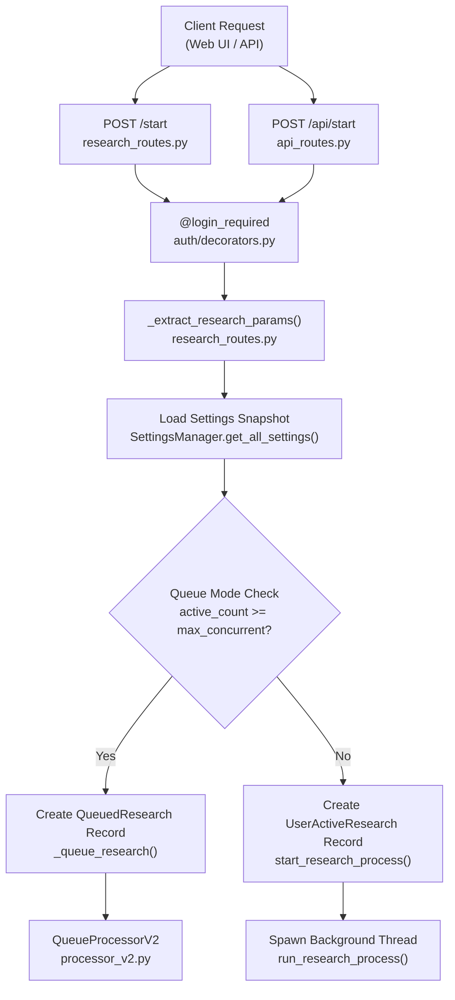
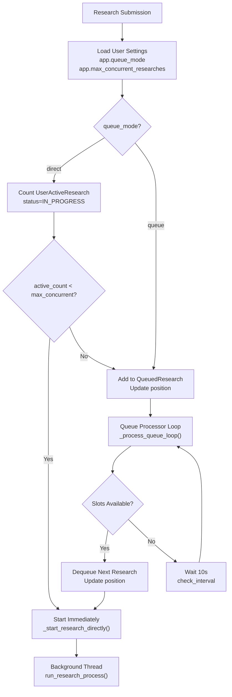
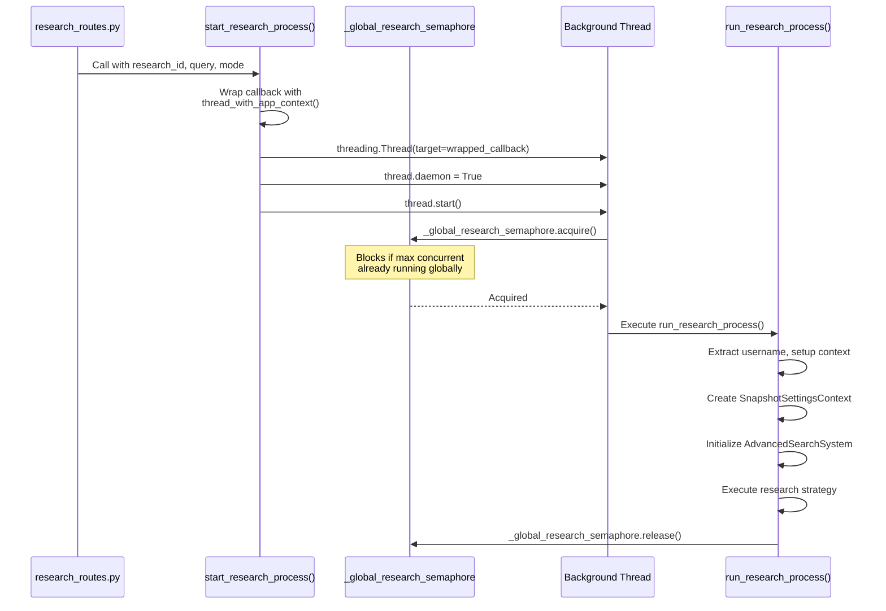

<!-- source: DeepWiki mcp.deepwiki.com · repo LearningCircuit/local-deep-research · page 3.3 Research Service and Execution Lifecycle · fetched 2026-10-29 -->

# Research Service and Execution Lifecycle

<details>
<summary>Relevant source files</summary>

The following files were used as context for generating this wiki page:

- [src/local_deep_research/__init__.py](src/local_deep_research/__init__.py)
- [src/local_deep_research/advanced_search_system/filters/cross_engine_filter.py](src/local_deep_research/advanced_search_system/filters/cross_engine_filter.py)
- [src/local_deep_research/advanced_search_system/findings/repository.py](src/local_deep_research/advanced_search_system/findings/repository.py)
- [src/local_deep_research/advanced_search_system/strategies/base_strategy.py](src/local_deep_research/advanced_search_system/strategies/base_strategy.py)
- [src/local_deep_research/advanced_search_system/strategies/direct_search_strategy.py](src/local_deep_research/advanced_search_system/strategies/direct_search_strategy.py)
- [src/local_deep_research/advanced_search_system/strategies/focused_iteration_strategy.py](src/local_deep_research/advanced_search_system/strategies/focused_iteration_strategy.py)
- [src/local_deep_research/advanced_search_system/strategies/iterdrag_strategy.py](src/local_deep_research/advanced_search_system/strategies/iterdrag_strategy.py)
- [src/local_deep_research/advanced_search_system/strategies/parallel_search_strategy.py](src/local_deep_research/advanced_search_system/strategies/parallel_search_strategy.py)
- [src/local_deep_research/advanced_search_system/strategies/rapid_search_strategy.py](src/local_deep_research/advanced_search_system/strategies/rapid_search_strategy.py)
- [src/local_deep_research/advanced_search_system/strategies/source_based_strategy.py](src/local_deep_research/advanced_search_system/strategies/source_based_strategy.py)
- [src/local_deep_research/advanced_search_system/strategies/standard_strategy.py](src/local_deep_research/advanced_search_system/strategies/standard_strategy.py)
- [src/local_deep_research/api/__init__.py](src/local_deep_research/api/__init__.py)
- [src/local_deep_research/api/research_functions.py](src/local_deep_research/api/research_functions.py)
- [src/local_deep_research/benchmarks/web_api/benchmark_routes.py](src/local_deep_research/benchmarks/web_api/benchmark_routes.py)
- [src/local_deep_research/benchmarks/web_api/benchmark_service.py](src/local_deep_research/benchmarks/web_api/benchmark_service.py)
- [src/local_deep_research/citation_handler.py](src/local_deep_research/citation_handler.py)
- [src/local_deep_research/config/llm_config.py](src/local_deep_research/config/llm_config.py)
- [src/local_deep_research/database/library_init.py](src/local_deep_research/database/library_init.py)
- [src/local_deep_research/exceptions.py](src/local_deep_research/exceptions.py)
- [src/local_deep_research/news/__init__.py](src/local_deep_research/news/__init__.py)
- [src/local_deep_research/report_generator.py](src/local_deep_research/report_generator.py)
- [src/local_deep_research/search_system.py](src/local_deep_research/search_system.py)
- [src/local_deep_research/utilities/log_utils.py](src/local_deep_research/utilities/log_utils.py)
- [src/local_deep_research/web/app.py](src/local_deep_research/web/app.py)
- [src/local_deep_research/web/app_factory.py](src/local_deep_research/web/app_factory.py)
- [src/local_deep_research/web/models/database.py](src/local_deep_research/web/models/database.py)
- [src/local_deep_research/web/queue/processor_v2.py](src/local_deep_research/web/queue/processor_v2.py)
- [src/local_deep_research/web/routes/api_routes.py](src/local_deep_research/web/routes/api_routes.py)
- [src/local_deep_research/web/routes/history_routes.py](src/local_deep_research/web/routes/history_routes.py)
- [src/local_deep_research/web/routes/research_routes.py](src/local_deep_research/web/routes/research_routes.py)
- [src/local_deep_research/web/routes/settings_routes.py](src/local_deep_research/web/routes/settings_routes.py)
- [src/local_deep_research/web/services/research_service.py](src/local_deep_research/web/services/research_service.py)
- [src/local_deep_research/web/services/socket_service.py](src/local_deep_research/web/services/socket_service.py)
- [src/local_deep_research/web/static/js/components/settings.js](src/local_deep_research/web/static/js/components/settings.js)
- [tests/config/test_llm_config_extra_coverage.py](tests/config/test_llm_config_extra_coverage.py)
- [tests/database/test_session_passwords.py](tests/database/test_session_passwords.py)
- [tests/web/queue/test_processor_v2.py](tests/web/queue/test_processor_v2.py)
- [tests/web/queue/test_processor_v2_concurrency.py](tests/web/queue/test_processor_v2_concurrency.py)
- [tests/web/queue/test_processor_v2_coverage.py](tests/web/queue/test_processor_v2_coverage.py)
- [tests/web/queue/test_processor_v2_real.py](tests/web/queue/test_processor_v2_real.py)
- [tests/web/routes/test_research_routes_start_research_coverage.py](tests/web/routes/test_research_routes_start_research_coverage.py)
- [tests/web/services/test_socket_service_coverage.py](tests/web/services/test_socket_service_coverage.py)
- [tests/web/services/test_socket_service_extra_coverage.py](tests/web/services/test_socket_service_extra_coverage.py)
- [tests/web_search_engines/engines/__init__.py](tests/web_search_engines/engines/__init__.py)
- [tests/web_search_engines/rate_limiting/__init__.py](tests/web_search_engines/rate_limiting/__init__.py)
- [tests/web_search_engines/rate_limiting/test_tracker.py](tests/web_search_engines/rate_limiting/test_tracker.py)
- [tests/web_services/test_socket_service.py](tests/web_services/test_socket_service.py)

</details>


**Purpose**: This page documents the complete lifecycle of research execution in Local Deep Research, from HTTP request submission to background thread completion. It covers the dual execution modes (queue vs direct), thread spawning mechanisms, settings snapshot isolation, progress tracking, and global concurrency controls.

**Scope**: This page focuses on the orchestration and lifecycle management of research processes. For details on settings management within threads, see [Thread-Safe Settings and Context Management (3.4)](). For search system architecture, see [Search System Architecture (3.5)](). For the Flask application structure, see [Flask Web Application (3.1)]().

---

## Research Request Flow

The research execution process begins when a user submits a query through the web interface or API. The request flows through multiple layers before spawning a background thread.

### Entry Point: HTTP Endpoint

The primary entry points for starting research are the web-based `start_research` route and the `api_start_research` endpoint.


Sources: [src/local_deep_research/web/routes/research_routes.py:124-201](), [src/local_deep_research/web/queue/processor_v2.py:145-181]()

### Parameter Resolution and Settings Snapshot

The endpoint resolves parameters using a priority hierarchy: request body → database settings → defaults. A complete settings snapshot is captured before thread spawning to ensure thread isolation.

| Parameter | Resolution Priority | Default |
|-----------|-------------------|---------|
| `model_provider` | Request → DB (`llm.provider`) | `"ollama"` |
| `model` | Request → DB (`llm.model`) | `None` (resolved via DB) |
| `search_engine` | Request → DB (`search.tool`) | `"searxng"` |
| `iterations` | Request → DB (`search.iterations`) | `5` |
| `questions_per_iteration` | Request → DB (`search.questions_per_iteration`) | `5` |
| `strategy` | Request → DB (`search.search_strategy`) | `"source-based"` |

The settings snapshot is created using `SnapshotSettingsContext`. This snapshot is critical because background threads operate in an isolated context where they cannot safely access the main Flask request or session objects.

Sources: [src/local_deep_research/web/routes/research_routes.py:124-201](), [src/local_deep_research/web/services/research_service.py:11-12]()

---

## Queue vs Direct Execution Modes

Local Deep Research supports two execution modes to manage concurrent research processes: **direct mode** and **queue mode**. The mode is determined by the `app.queue_mode` setting and per-user concurrency limits.

### Mode Selection Logic


Sources: [src/local_deep_research/web/queue/processor_v2.py:145-181](), [src/local_deep_research/web/queue/processor_v2.py:297-513]()

### Direct Mode Execution

In direct mode, research starts immediately if slots are available. The decision is made synchronously during request handling:

1. **User Critical Lock**: To prevent race conditions during concurrent submissions, a per-user lock is acquired via `_get_user_critical_lock(username)` [src/local_deep_research/web/queue/processor_v2.py:95-104]().
2. **Active Count Query**: The system counts `UserActiveResearch` records for the user.
3. **Immediate Start**: If the count is below `app.max_concurrent_researches`, `start_research_process()` is called to spawn the thread [src/local_deep_research/web/services/research_service.py:60-61]().

### Queue Mode Execution

In queue mode, research is added to a queue and processed by `QueueProcessorV2`:

1. **Queue Addition**: Creates a `QueuedResearch` record [src/local_deep_research/web/routes/research_routes.py:204-215]().
2. **Processor Loop**: The background thread runs `_process_queue_loop()` [src/local_deep_research/web/queue/processor_v2.py:297-310]().
3. **Spawn Retries**: If a thread fails to spawn, the system retries up to `SPAWN_RETRY_LIMIT` (3) before marking the research as failed [src/local_deep_research/web/queue/processor_v2.py:40-41]().

---

## Background Thread Lifecycle

Research execution occurs entirely within a background thread to avoid blocking the web server.

### Thread Creation and Initialization


Sources: [src/local_deep_research/web/services/research_service.py:200-263](), [src/local_deep_research/web/services/research_service.py:288-456]()

### Thread Spawning Details

The `start_research_process()` function handles thread creation:

1. **Flask Context Wrapping**: Uses `thread_with_app_context()` to preserve the Flask application context [src/local_deep_research/utilities/threading_utils.py:28-29]().
2. **Global Concurrency**: The thread execution is wrapped in a semaphore check using `_global_research_semaphore` [src/local_deep_research/web/services/research_service.py:40]().
3. **Thread Configuration**: Creates a daemon thread using `thread_context()` to pass required metadata [src/local_deep_research/utilities/threading_utils.py:28-29]().

---

## Progress Tracking and Callbacks

Research progress is tracked through a callback mechanism that reports updates from the search system to the web interface via SocketIO.

### Progress Callback Implementation

The progress callback performs several critical functions:

1. **Termination Check**: Periodically checks for termination flags using `is_research_active()`. If research was terminated by the user, it raises `ResearchTerminatedException` [src/local_deep_research/web/routes/globals.py:68-70]().
2. **Milestone Logging**: Records significant events using `log_for_research()` [src/local_deep_research/utilities/log_utils.py:26]().
3. **Throttled SocketIO Emission**: Ensures emissions don't exceed `_EMIT_THROTTLE_SECONDS` (200ms) to prevent UI flooding [src/local_deep_research/web/services/research_service.py:43-47]().

---

## Global Concurrency Control

To prevent resource exhaustion (CPU/Memory/LLM rate limits), Local Deep Research implements a global concurrency limit using a semaphore that spans all users.

### Semaphore Implementation

The global semaphore is initialized at the module level in `research_service.py`:

```python
# Global concurrent research limit (server-wide, across all users)
_MAX_GLOBAL_CONCURRENT = get_env_setting(
    "server.max_concurrent_research", default=10
)
_global_research_semaphore = threading.Semaphore(_MAX_GLOBAL_CONCURRENT)
```
Sources: [src/local_deep_research/web/services/research_service.py:36-40]()

---

## Research Completion and Cleanup

Research completion involves updating database records and cleaning up tracking structures.

### Database Updates on Completion

When research completes, several database records are updated in sequence:

1. **Save Strategy**: The specific strategy used (e.g., `source-based`) is saved via `save_research_strategy()` [src/local_deep_research/web/services/research_service.py:131-171]().
2. **Update ResearchHistory Record**: Sets status to `COMPLETED`, calculates final duration, and stores the report [src/local_deep_research/web/services/research_service.py:17-18]().

### Thread Cleanup with @thread_cleanup

The `@thread_cleanup` decorator ensures proper cleanup when the thread exits:

```python
@thread_cleanup
def run_research_process(research_id, query, mode, **kwargs):
    ...
```
The decorator ensures that any thread-local database sessions are closed and resources are released even if an exception occurs during execution [src/local_deep_research/database/thread_local_session.py:20-20]().

### Error Handling

If research fails, the error handling flow executes:
1. **Catch Exception**: Logs the error and identifies the failure cause [src/local_deep_research/exceptions.py:10-10]().
2. **Generate Error Report**: Creates a partial report documenting the failure using `ErrorReportGenerator` [src/local_deep_research/error_handling/report_generator.py:21-25]().
3. **Update Status**: Sets research status to `FAILED` and stores the error message [src/local_deep_research/constants.py:17-17]().

Sources: [src/local_deep_research/web/services/research_service.py:933-1049](), [src/local_deep_research/error_handling/report_generator.py:21-25]()

---

