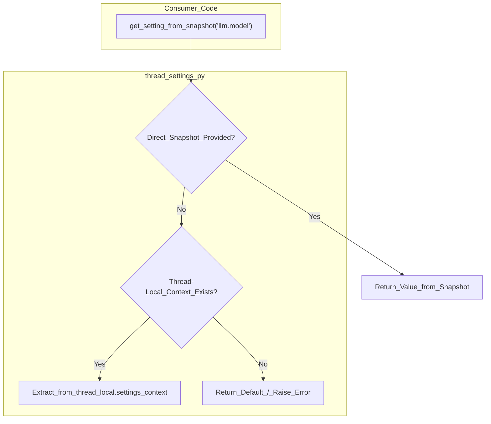
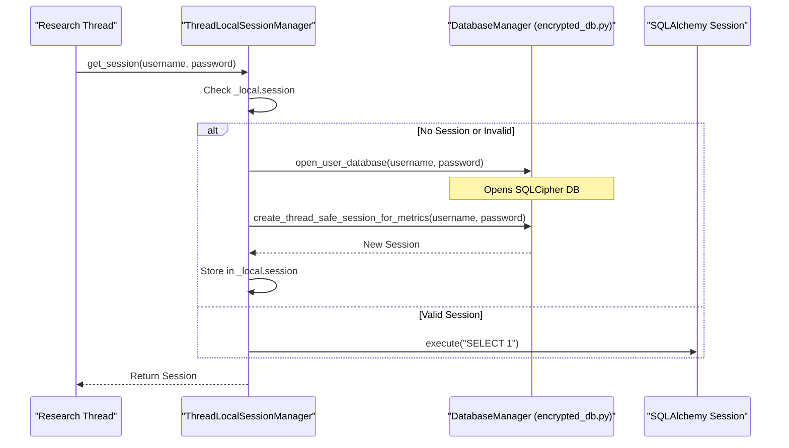
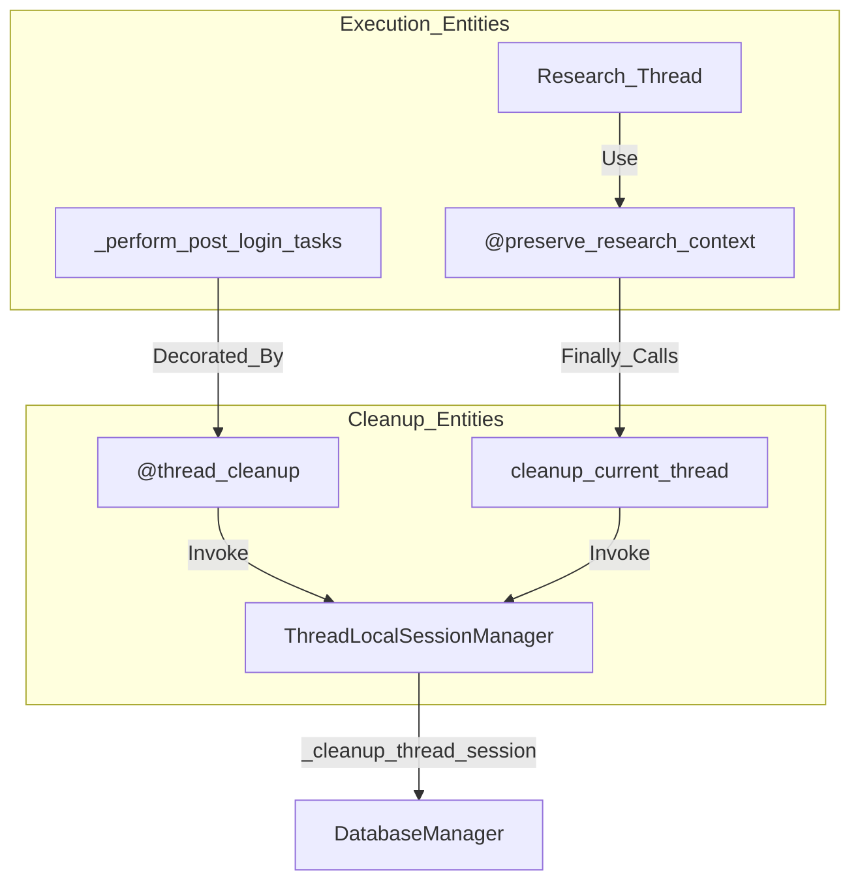

<!-- source: DeepWiki mcp.deepwiki.com · repo LearningCircuit/local-deep-research · page 3.4 Thread-Safe Settings and Context Management · fetched 2026-10-29 -->

# Thread-Safe Settings and Context Management

Relevant source files

The following files were used as context for generating this wiki page:

- [src/local_deep_research/api/settings_utils.py](src/local_deep_research/api/settings_utils.py)
- [src/local_deep_research/config/search_config.py](src/local_deep_research/config/search_config.py)
- [src/local_deep_research/config/thread_settings.py](src/local_deep_research/config/thread_settings.py)
- [src/local_deep_research/security/security_settings.py](src/local_deep_research/security/security_settings.py)
- [src/local_deep_research/settings/logger.py](src/local_deep_research/settings/logger.py)
- [src/local_deep_research/settings/manager.py](src/local_deep_research/settings/manager.py)
- [src/local_deep_research/utilities/thread_context.py](src/local_deep_research/utilities/thread_context.py)
- [src/local_deep_research/web/auth/middleware_optimizer.py](src/local_deep_research/web/auth/middleware_optimizer.py)
- [src/local_deep_research/web/auth/session_manager.py](src/local_deep_research/web/auth/session_manager.py)
- [src/local_deep_research/web_search_engines/search_engine_factory.py](src/local_deep_research/web_search_engines/search_engine_factory.py)
- [tests/database/models/test_file_integrity_models.py](tests/database/models/test_file_integrity_models.py)
- [tests/security/test_data_sanitizer_extended.py](tests/security/test_data_sanitizer_extended.py)
- [tests/security/test_module_whitelist_extended.py](tests/security/test_module_whitelist_extended.py)
- [tests/security/test_url_builder_extended.py](tests/security/test_url_builder_extended.py)
- [tests/security/test_url_validator_extended.py](tests/security/test_url_validator_extended.py)
- [tests/settings/test_boolean_parsing.py](tests/settings/test_boolean_parsing.py)
- [tests/settings/test_env_registry_extended.py](tests/settings/test_env_registry_extended.py)
- [tests/settings/test_env_settings_extended.py](tests/settings/test_env_settings_extended.py)
- [tests/settings/test_manager_behavior.py](tests/settings/test_manager_behavior.py)
- [tests/settings/test_settings_logger.py](tests/settings/test_settings_logger.py)
- [tests/settings/test_settings_manager.py](tests/settings/test_settings_manager.py)
- [tests/settings/test_settings_type_mapping.py](tests/settings/test_settings_type_mapping.py)
- [tests/utilities/test_thread_context.py](tests/utilities/test_thread_context.py)
- [tests/utilities/test_thread_context_coverage.py](tests/utilities/test_thread_context_coverage.py)
- [tests/utilities/test_thread_context_extended.py](tests/utilities/test_thread_context_extended.py)
- [tests/utilities/test_url_thread_coverage.py](tests/utilities/test_url_thread_coverage.py)
- [tests/web/auth/test_connection_cleanup.py](tests/web/auth/test_connection_cleanup.py)
- [tests/web/auth/test_middleware_optimizer.py](tests/web/auth/test_middleware_optimizer.py)
- [tests/web/auth/test_session_manager.py](tests/web/auth/test_session_manager.py)
- [tests/web/queue/test_queue_manager_coverage.py](tests/web/queue/test_queue_manager_coverage.py)
- [tests/web/services/test_settings_manager_extended.py](tests/web/services/test_settings_manager_extended.py)
- [tests/web_search_engines/engines/test_search_engine_ddg.py](tests/web_search_engines/engines/test_search_engine_ddg.py)
- [tests/web_search_engines/engines/test_search_engine_searxng.py](tests/web_search_engines/engines/test_search_engine_searxng.py)
- [tests/web_search_engines/engines/test_search_engine_wikipedia.py](tests/web_search_engines/engines/test_search_engine_wikipedia.py)

## Purpose and Scope

This document describes the thread-safe settings management system that allows background research threads to access configuration and database sessions without contention or race conditions. The system utilizes **settings snapshots**, **thread-local context**, and specialized **database session management** to ensure each research thread has an isolated, consistent environment throughout its lifecycle.

Key mechanisms covered include:
- **Settings Snapshotting**: Capturing state at the start of a process to ensure immutability during execution.
- **Thread-Local Storage**: Managing context within `threading.local()` and `contextvars.ContextVar` to prevent cross-thread leakage.
- **Database Session Management**: Handling SQLCipher sessions in threads using specialized connection pooling (`QueuePool`) and thread-local tracking.
- **Cleanup Decorators**: Ensuring resource release via `@preserve_research_context` and session cleanup handlers.

---

## The Problem: Multi-Threaded Configuration Access

Background research threads face critical challenges when interacting with shared resources:

| Challenge | Without Thread-Safety | With Thread-Safety |
|-----------|----------------------|-------------------|
| **Database Contention** | Multiple threads compete for SQLCipher locks, causing `Database is locked` errors | Each thread uses isolated snapshots or dedicated thread-local sessions [src/local_deep_research/database/thread_local_session.py:31-37]() |
| **Race Conditions** | Settings changed via Web UI during research affect behavior mid-stream | Snapshot ensures consistent configuration from start to finish [src/local_deep_research/config/thread_settings.py:70-73]() |
| **Session Scope** | Background threads lack Flask request context for authentication | Thread-local storage and session password stores provide credentials [src/local_deep_research/database/thread_local_session.py:108-115]() |
| **Resource Leaks** | Reused threads in a pool may leak context from previous tasks | `clear_settings_context` and explicit context clearing ensure isolation [src/local_deep_research/config/thread_settings.py:29-37]() |

**Sources:** [src/local_deep_research/config/thread_settings.py:1-5](), [src/local_deep_research/database/thread_local_session.py:1-4]()

---

## Settings Snapshot and Thread-Local Context

To avoid frequent database reads during research, the system captures a **settings snapshot** (a dictionary of keys and values) and places it into a thread-local context.

### Context Resolution Flow

Title: Setting Retrieval Logic in `thread_settings.py`

**Sources:** [src/local_deep_research/config/thread_settings.py:64-140]()

### Key Functions and Classes

*   **`_thread_local`**: A `threading.local()` instance that stores the `settings_context` for the current thread [src/local_deep_research/config/thread_settings.py:21-21]().
*   **`settings_context(ctx)`**: A context manager that sets the context on entry and clears it in a `finally` block to prevent leaks when threads are reused in a pool [src/local_deep_research/config/thread_settings.py:46-62]().
*   **`get_setting_from_snapshot()`**: The primary entry point for retrieving configuration in background threads. It handles both full dictionary formats (containing metadata like `ui_element`) and simplified raw values [src/local_deep_research/config/thread_settings.py:64-115](). It utilizes `get_typed_setting_value` to ensure type safety [src/local_deep_research/config/thread_settings.py:90-94]().
*   **`get_bool_setting_from_snapshot()`**: Wraps the standard getter with `to_bool` conversion logic to handle truthy string representations (e.g., "on", "1", "true") from SQLite or APIs [src/local_deep_research/config/thread_settings.py:142-170]().
*   **`InMemorySettingsManager`**: An implementation of `ISettingsManager` used by the programmatic API to provide settings without requiring a live database connection, loading defaults from JSON resources and checking environment variable overrides via `check_env_setting` [src/local_deep_research/api/settings_utils.py:19-80]().

---

## Thread-Local Database Session Management

Research threads often need to write metrics or update findings. The `ThreadLocalSessionManager` manages these connections to ensure that each thread has its own dedicated `Session`.

### Database Session Lifecycle

Title: Thread-Local Session Acquisition in `ThreadLocalSessionManager`

**Sources:** [src/local_deep_research/database/thread_local_session.py:31-116]()

### NullPool vs. QueuePool
The system uses `QueuePool` for production and `StaticPool` for tests [src/local_deep_research/database/encrypted_db.py:95-96](). `QueuePool` is configured with `pool_size=20` and `max_overflow=40` to handle concurrent web requests while limiting file descriptor (FD) usage [src/local_deep_research/database/encrypted_db.py:108-110](). `NullPool` was rejected because SQLCipher's `PRAGMA key` adds ~0.2ms overhead per connection; with 20-30 queries per page, `NullPool` adds noticeable latency compared to `QueuePool` [src/local_deep_research/database/encrypted_db.py:91-93]().

### Recovery from `PendingRollbackError`
If a previous operation failed (e.g., a database timeout), the session enters a "failed" state. The manager detects `PendingRollbackError`, attempts an automatic `rollback()`, and verifies the connection with `SELECT 1` before returning it to the caller [src/local_deep_research/database/thread_local_session.py:62-72]().

---

## Context Propagation and Cleanup

To prevent resource exhaustion and credential leakage, the system uses context variables and decorators to manage the lifecycle of research metadata and database connections.

### Research Context Propagation
The `thread_context.py` module uses `contextvars.ContextVar` (`_search_context_var`) to store research metadata like `research_id` [src/local_deep_research/utilities/thread_context.py:19-21](). This ensures context is correctly inherited by frameworks like LangGraph's `ContextThreadPoolExecutor` [src/local_deep_research/utilities/thread_context.py:4-9]().

### The `@preserve_research_context` Decorator
This decorator captures the context at decoration time and restores it when the function executes in a worker thread [src/local_deep_research/utilities/thread_context.py:81-104](). Crucially, it includes a `finally` block that calls `cleanup_current_thread()` to release any thread-local database sessions created during the task [src/local_deep_research/utilities/thread_context.py:108-117]().

### Cleanup Mechanics
1.  **Session Disposal**: `_cleanup_thread_session` rolls back uncommitted changes, closes the SQLAlchemy session, and clears thread-local storage [src/local_deep_research/database/thread_local_session.py:135-160]().
2.  **Explicit Cleanup**: The `thread_cleanup` decorator ensures that sessions are closed when a decorated function completes [src/local_deep_research/database/thread_local_session.py:202-219]().
3.  **Engine Disposal**: The `cleanup_idle_connections` task periodically disposes all `QueuePool` engines every 30 minutes to release accumulated WAL/SHM file handles [src/local_deep_research/web/auth/connection_cleanup.py:41-47](). Periodic `dispose()` resets the handle state cleanly [src/local_deep_research/web/auth/connection_cleanup.py:132-137]().

**Sources:** [src/local_deep_research/utilities/thread_context.py:81-124](), [src/local_deep_research/database/thread_local_session.py:135-219](), [src/local_deep_research/web/auth/connection_cleanup.py:41-171]()

---

## Background Thread Safety and Monitoring

The application maintains stability through strict constraints on database access and active monitoring of resources.

### Thread Safety Constraints
Background threads must not access the database directly without proper session management. The `SettingsManager` class includes a `_check_thread_safety()` method that raises a `RuntimeError` if a manager instance is used in a thread other than the one that created it [src/local_deep_research/settings/manager.py:302-322](). This prevents unsafe sharing of SQLAlchemy `Session` objects [src/local_deep_research/settings/manager.py:279-281]().

### Search Engine Thread Safety
When creating search engines within threads, a `settings_snapshot` is mandatory [src/local_deep_research/web_search_engines/search_engine_factory.py:85-87](). The `create_search_engine` function uses this snapshot to resolve configurations without reaching out to the database [src/local_deep_research/web_search_engines/search_engine_factory.py:76-83]().

Title: Context and Session Cleanup Architecture

**Sources:** [src/local_deep_research/web_search_engines/search_engine_factory.py:85-87](), [src/local_deep_research/database/thread_local_session.py:135-160](), [src/local_deep_research/utilities/thread_context.py:108-117]()

### Dead Thread Sweeping
The system includes a safety net `cleanup_dead_threads()` which uses `threading.enumerate()` to identify and purge credential entries for threads that have already terminated [src/local_deep_research/database/thread_local_session.py:186-199]().

**Sources:** [src/local_deep_research/database/thread_local_session.py:186-199]()

---

