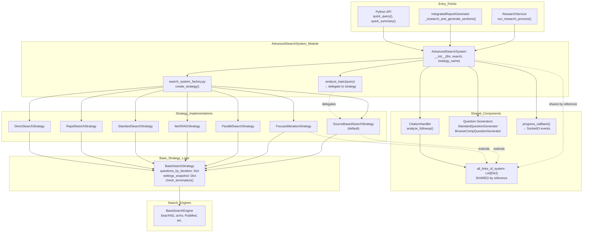
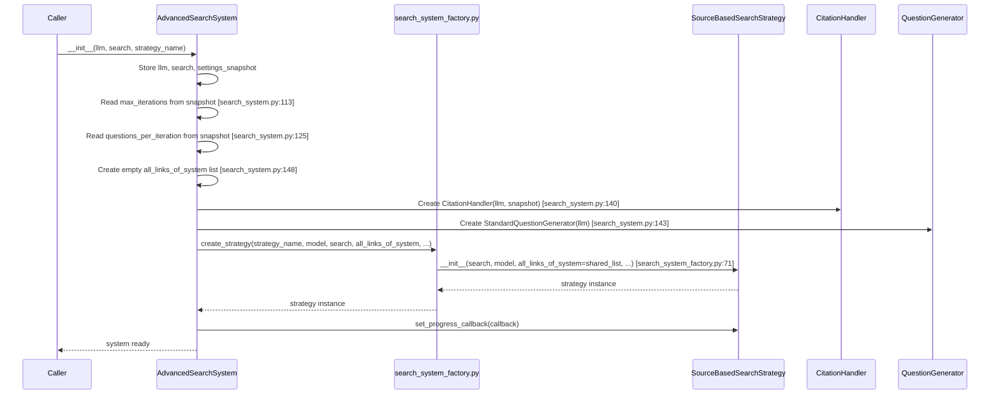
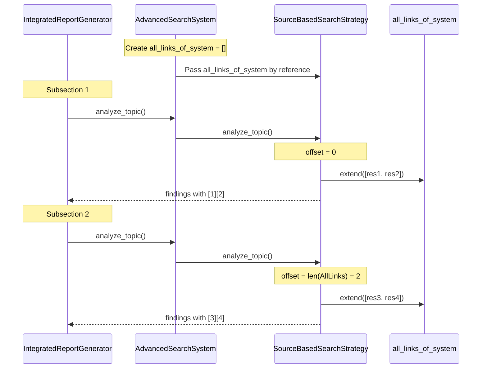

<!-- source: DeepWiki mcp.deepwiki.com · repo LearningCircuit/local-deep-research · page 3.5 Search System Architecture · fetched 2026-10-29 -->

# Search System Architecture

Relevant source files

The following files were used as context for generating this wiki page:

- [docs/BENCHMARKING.md](docs/BENCHMARKING.md)
- [src/local_deep_research/advanced_search_system/filters/cross_engine_filter.py](src/local_deep_research/advanced_search_system/filters/cross_engine_filter.py)
- [src/local_deep_research/advanced_search_system/findings/repository.py](src/local_deep_research/advanced_search_system/findings/repository.py)
- [src/local_deep_research/advanced_search_system/questions/browsecomp_question.py](src/local_deep_research/advanced_search_system/questions/browsecomp_question.py)
- [src/local_deep_research/advanced_search_system/questions/flexible_browsecomp_question.py](src/local_deep_research/advanced_search_system/questions/flexible_browsecomp_question.py)
- [src/local_deep_research/advanced_search_system/strategies/base_strategy.py](src/local_deep_research/advanced_search_system/strategies/base_strategy.py)
- [src/local_deep_research/advanced_search_system/strategies/direct_search_strategy.py](src/local_deep_research/advanced_search_system/strategies/direct_search_strategy.py)
- [src/local_deep_research/advanced_search_system/strategies/focused_iteration_strategy.py](src/local_deep_research/advanced_search_system/strategies/focused_iteration_strategy.py)
- [src/local_deep_research/advanced_search_system/strategies/iterdrag_strategy.py](src/local_deep_research/advanced_search_system/strategies/iterdrag_strategy.py)
- [src/local_deep_research/advanced_search_system/strategies/langgraph_agent_strategy.py](src/local_deep_research/advanced_search_system/strategies/langgraph_agent_strategy.py)
- [src/local_deep_research/advanced_search_system/strategies/parallel_search_strategy.py](src/local_deep_research/advanced_search_system/strategies/parallel_search_strategy.py)
- [src/local_deep_research/advanced_search_system/strategies/rapid_search_strategy.py](src/local_deep_research/advanced_search_system/strategies/rapid_search_strategy.py)
- [src/local_deep_research/advanced_search_system/strategies/source_based_strategy.py](src/local_deep_research/advanced_search_system/strategies/source_based_strategy.py)
- [src/local_deep_research/advanced_search_system/strategies/standard_strategy.py](src/local_deep_research/advanced_search_system/strategies/standard_strategy.py)
- [src/local_deep_research/advanced_search_system/strategies/topic_organization_strategy.py](src/local_deep_research/advanced_search_system/strategies/topic_organization_strategy.py)
- [src/local_deep_research/advanced_search_system/tools/fetch/__init__.py](src/local_deep_research/advanced_search_system/tools/fetch/__init__.py)
- [src/local_deep_research/advanced_search_system/tools/fetch/prompts.py](src/local_deep_research/advanced_search_system/tools/fetch/prompts.py)
- [src/local_deep_research/api/research_functions.py](src/local_deep_research/api/research_functions.py)
- [src/local_deep_research/api/settings_utils.py](src/local_deep_research/api/settings_utils.py)
- [src/local_deep_research/benchmarks/models/__init__.py](src/local_deep_research/benchmarks/models/__init__.py)
- [src/local_deep_research/citation_handler.py](src/local_deep_research/citation_handler.py)
- [src/local_deep_research/config/search_config.py](src/local_deep_research/config/search_config.py)
- [src/local_deep_research/config/thread_settings.py](src/local_deep_research/config/thread_settings.py)
- [src/local_deep_research/database/migrations/versions/0009_default_fetch_mode_summary.py](src/local_deep_research/database/migrations/versions/0009_default_fetch_mode_summary.py)
- [src/local_deep_research/defaults/default_settings.json](src/local_deep_research/defaults/default_settings.json)
- [src/local_deep_research/report_generator.py](src/local_deep_research/report_generator.py)
- [src/local_deep_research/search_system.py](src/local_deep_research/search_system.py)
- [src/local_deep_research/search_system_factory.py](src/local_deep_research/search_system_factory.py)
- [src/local_deep_research/security/security_settings.py](src/local_deep_research/security/security_settings.py)
- [src/local_deep_research/settings/manager.py](src/local_deep_research/settings/manager.py)
- [src/local_deep_research/web_search_engines/search_engine_factory.py](src/local_deep_research/web_search_engines/search_engine_factory.py)
- [tests/advanced_search_system/tools/test_fetch_modes.py](tests/advanced_search_system/tools/test_fetch_modes.py)
- [tests/database/test_migration_0009_default_fetch_mode.py](tests/database/test_migration_0009_default_fetch_mode.py)
- [tests/settings/golden_master_settings.json](tests/settings/golden_master_settings.json)
- [tests/settings/test_boolean_parsing.py](tests/settings/test_boolean_parsing.py)
- [tests/settings/test_manager_behavior.py](tests/settings/test_manager_behavior.py)
- [tests/settings/test_settings_defaults_integrity.py](tests/settings/test_settings_defaults_integrity.py)
- [tests/settings/test_settings_type_mapping.py](tests/settings/test_settings_type_mapping.py)
- [tests/strategies/test_langgraph_agent_strategy.py](tests/strategies/test_langgraph_agent_strategy.py)
- [tests/web/services/test_settings_manager_extended.py](tests/web/services/test_settings_manager_extended.py)
- [tests/web_search_engines/engines/test_search_engine_ddg.py](tests/web_search_engines/engines/test_search_engine_ddg.py)
- [tests/web_search_engines/engines/test_search_engine_searxng.py](tests/web_search_engines/engines/test_search_engine_searxng.py)
- [tests/web_search_engines/engines/test_search_engine_wikipedia.py](tests/web_search_engines/engines/test_search_engine_wikipedia.py)

## Purpose and Scope

This document describes the **AdvancedSearchSystem** and its strategy-based architecture for conducting iterative research across multiple search engines. It covers the strategy pattern implementation, shared state management via `all_links_of_system`, citation handling, question generation, and the 30+ available research strategies.

For search engine provider implementations (SearXNG, arXiv, PubMed), see [Search Engine Integration Layer](#3.6). For the report generation system that calls `AdvancedSearchSystem`, see [Report Generation and Export System](#3.9).

---

## System Overview

The search system uses a **strategy pattern** to support multiple research approaches while maintaining a consistent interface. A single `AdvancedSearchSystem` instance coordinates the strategy, manages shared state (`all_links_of_system`), and provides progress callbacks.

### High-Level Architecture

Sources: [src/local_deep_research/search_system.py:20-150](), [src/local_deep_research/report_generator.py:33-134](), [src/local_deep_research/api/research_functions.py:34-163](), [src/local_deep_research/search_system_factory.py:32-177]()

---

## AdvancedSearchSystem Core

The `AdvancedSearchSystem` class is the main entry point for all research operations. It coordinates strategy selection, manages shared state, and provides a consistent interface regardless of the underlying strategy.

### Constructor Parameters

| Parameter | Type | Default | Description |
|-----------|------|---------|-------------|
| `llm` | `BaseChatModel` | Required | LangChain LLM instance for question generation and synthesis [src/local_deep_research/search_system.py:27]() |
| `search` | `BaseSearchEngine` | Required | Search engine implementation (SearXNG, arXiv, etc.) [src/local_deep_research/search_system.py:28]() |
| `strategy_name` | `str` | `"source-based"` | Strategy to use (see Strategy Implementations below) [src/local_deep_research/search_system.py:29]() |
| `include_text_content` | `bool` | `True` | Whether to fetch full page content or just snippets [src/local_deep_research/search_system.py:30]() |
| `use_cross_engine_filter` | `bool` | `True` | Enable LLM-based relevance filtering [src/local_deep_research/search_system.py:31]() |
| `max_iterations` | `int` | `None` | Override iterations setting (from snapshot if `None`) [src/local_deep_research/search_system.py:32]() |
| `questions_per_iteration` | `int` | `None` | Override questions setting (from snapshot if `None`) [src/local_deep_research/search_system.py:33]() |
| `username` | `str` | `None` | For database access (required for non-programmatic mode) [src/local_deep_research/search_system.py:35]() |
| `settings_snapshot` | `dict` | `None` | Frozen settings dict for thread-safe access [src/local_deep_research/search_system.py:36]() |
| `research_id` | `str` | `None` | Research ID for metrics tracking [src/local_deep_research/search_system.py:37]() |
| `research_context` | `dict` | `None` | Context from parent research (for follow-ups) [src/local_deep_research/search_system.py:38]() |
| `programmatic_mode` | `bool` | `False` | Disable database operations for standalone usage [src/local_deep_research/search_system.py:39]() |
| `search_original_query` | `bool` | `True` | Include original query verbatim in first iteration [src/local_deep_research/search_system.py:40]() |

Sources: [src/local_deep_research/search_system.py:25-101]()

### Initialization Flow

Sources: [src/local_deep_research/search_system.py:109-223](), [src/local_deep_research/search_system_factory.py:32-177]()

---

## Strategy Pattern Architecture

The strategy pattern allows different research approaches to be used interchangeably. All strategies inherit from `BaseSearchStrategy` and implement the `analyze_topic(query) -> Dict` interface.

### BaseSearchStrategy
The abstract base class defines the common interface and shared functionality for all strategies. It handles progress reporting via `_update_progress`, setting retrieval via `get_setting`, and termination checks. [src/local_deep_research/advanced_search_system/strategies/base_strategy.py:12-136]()

### Strategy Factory
The `create_strategy()` function in `search_system_factory.py` acts as the single source of truth for strategy instantiation, reading configuration from the `settings_snapshot` to customize strategy behavior. [src/local_deep_research/search_system_factory.py:32-177]()

**Key Strategies:**

| Strategy Name | Class | Description |
|---------------|-------|-------------|
| `source-based` | `SourceBasedSearchStrategy` | Default. Iterative generation → parallel search → synthesis. [src/local_deep_research/advanced_search_system/strategies/source_based_strategy.py:22]() |
| `focused-iteration`| `FocusedIterationStrategy` | Optimized for SimpleQA (96.51% accuracy). Uses entity extraction and `ProgressiveExplorer`. [src/local_deep_research/advanced_search_system/strategies/focused_iteration_strategy.py:40]() |
| `parallel` | `ParallelSearchStrategy` | Simultaneous execution of all queries for maximum speed. [src/local_deep_research/advanced_search_system/strategies/parallel_search_strategy.py:21]() |
| `iterdrag` | `IterDRAGStrategy` | Iterative Dense Retrieval Augmented Generation via query decomposition. [src/local_deep_research/advanced_search_system/strategies/iterdrag_strategy.py:22]() |
| `rapid` | `RapidSearchStrategy` | Quick single-pass search for fast responses. [src/local_deep_research/advanced_search_system/strategies/rapid_search_strategy.py:20]() |

---

## Shared State: all_links_of_system

The `all_links_of_system` list is the **single source of truth** for all citations in the final report. This list is created in `AdvancedSearchSystem` and **passed by reference** to the strategy.

### Why Shared Reference Matters
In detailed report mode, `IntegratedReportGenerator` calls `analyze_topic()` multiple times (once per subsection). Each call:
1. **Extends** `self.all_links_of_system` with new results. [src/local_deep_research/advanced_search_system/strategies/source_based_strategy.py:46-56]()
2. Uses the length of the list to ensure citation indices are unique across the entire report. [src/local_deep_research/advanced_search_system/strategies/source_based_strategy.py:40-44]()

Sources: [src/local_deep_research/advanced_search_system/strategies/source_based_strategy.py:46-62](), [src/local_deep_research/report_generator.py:33-134]()

---

## Question Generation

Strategies use question generators to create targeted search queries. The generation process is context-aware, using accumulated results from previous iterations to inform follow-up questions.

### Question Generator Types

| Class | Purpose | Strategy |
|-------|---------|----------|
| `StandardQuestionGenerator` | General iterative follow-ups. [src/local_deep_research/advanced_search_system/questions/standard_question.py:8]() | `SourceBased`, `Parallel` |
| `BrowseCompQuestionGenerator`| Entity extraction and progressive exploration. [src/local_deep_research/advanced_search_system/strategies/focused_iteration_strategy.py:106]() | `FocusedIteration` |
| `FlexibleBrowseCompQuestionGenerator`| Truncation-aware question generation for long contexts. [src/local_deep_research/search_system_factory.py:171]() | `FocusedIteration` (configurable) |
| `DecompositionQuestionGenerator`| Breaking queries into sub-queries. [src/local_deep_research/advanced_search_system/strategies/iterdrag_strategy.py:63]() | `IterDRAG` |

Sources: [src/local_deep_research/advanced_search_system/strategies/source_based_strategy.py:135-139](), [src/local_deep_research/advanced_search_system/strategies/focused_iteration_strategy.py:104-118](), [src/local_deep_research/search_system_factory.py:165-175]()

---

## Citation and Findings Handling

The `CitationHandler` manages citation formatting and numbering in synthesized content.

### Flow of Synthesis
1. **Accumulate Results:** Strategies gather search results across iterations.
2. **Cross-Engine Filter:** Results are filtered and reordered for relevance via `CrossEngineFilter`. [src/local_deep_research/advanced_search_system/strategies/source_based_strategy.py:117-123]()
3. **Extend Global State:** Results are added to `all_links_of_system`.
4. **Synthesize:** `CitationHandler.analyze_followup()` generates text using the global list for indexing. [src/local_deep_research/advanced_search_system/strategies/source_based_strategy.py:40-44]()

Sources: [src/local_deep_research/search_system.py:140-144](), [src/local_deep_research/advanced_search_system/strategies/source_based_strategy.py:376-394]()

---

## Available Research Strategies (30+)

The system provides a vast array of strategies through the factory pattern, categorized by their performance and complexity.

| Category | Strategies |
|----------|------------|
| **Core** | `source-based`, `standard`, `rapid`, `direct` |
| **High Performance** | `focused-iteration` (SimpleQA), `browsecomp` |
| **Constraint-Based** | `constrained`, `parallel-constrained`, `early-stop-constrained` |
| **Confidence-Based** | `dual-confidence`, `dual-confidence-with-rejection`, `concurrent-dual-confidence` |
| **Iterative Reasoning** | `iterdrag`, `iterative`, `adaptive`, `smart`, `iterative-refinement` |
| **Specialized** | `browsecomp-entity`, `modular`, `evidence`, `mcp` |

Sources: [src/local_deep_research/search_system.py:47-67](), [src/local_deep_research/search_system_factory.py:62-177]()

---

## Complete Code Entity Map

| Concept | Code Entity | File Path |
|---------|-------------|-----------|
| Main coordinator | `AdvancedSearchSystem` | [src/local_deep_research/search_system.py:20]() |
| Strategy interface | `BaseSearchStrategy` | [src/local_deep_research/advanced_search_system/strategies/base_strategy.py:12]() |
| Strategy factory | `create_strategy` | [src/local_deep_research/search_system_factory.py:32]() |
| Shared citation list | `all_links_of_system` | [src/local_deep_research/search_system.py:148]() |
| Citation formatting | `CitationHandler` | [src/local_deep_research/search_system.py:140]() |
| Result filtering | `CrossEngineFilter` | [src/local_deep_research/advanced_search_system/strategies/source_based_strategy.py:117]() |
| Findings storage | `FindingsRepository` | [src/local_deep_research/search_system.py:144]() |
| Report integration | `IntegratedReportGenerator`| [src/local_deep_research/report_generator.py:33]() |
| API initialization | `_init_search_system` | [src/local_deep_research/api/research_functions.py:34]() |

Sources: [src/local_deep_research/search_system.py:20-150](), [src/local_deep_research/search_system_factory.py:32-177](), [src/local_deep_research/report_generator.py:33-134]()

---

