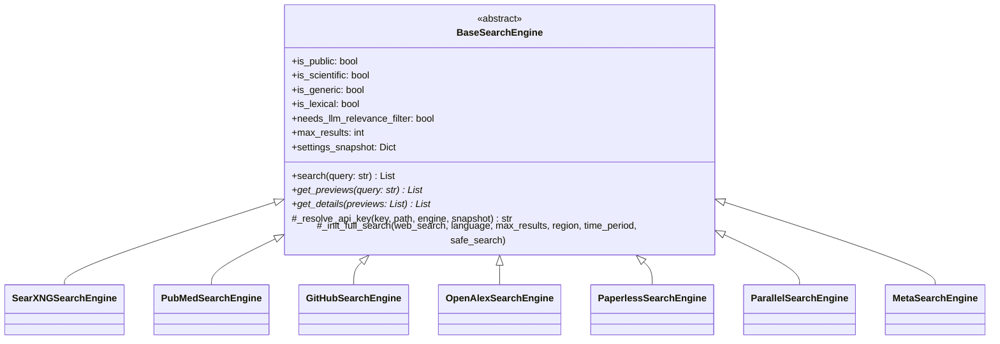
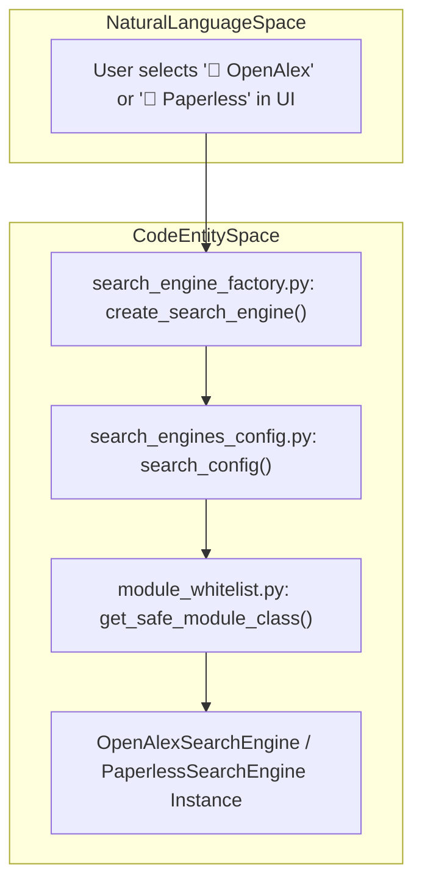
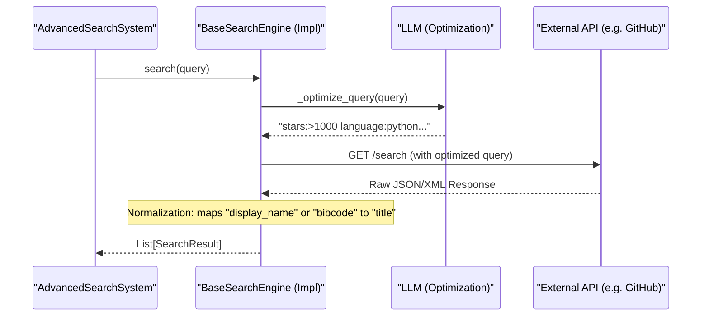

<!-- source: DeepWiki mcp.deepwiki.com · repo LearningCircuit/local-deep-research · page 3.6 Search Engine Integration Layer · fetched 2026-10-29 -->

# Search Engine Integration Layer

Relevant source files

The following files were used as context for generating this wiki page:

- [docs/elasticsearch_search_engine.md](docs/elasticsearch_search_engine.md)
- [docs/elasticsearch_search_engine.zh.md](docs/elasticsearch_search_engine.zh.md)
- [src/local_deep_research/defaults/settings/search_engines/elasticsearch.json](src/local_deep_research/defaults/settings/search_engines/elasticsearch.json)
- [src/local_deep_research/defaults/settings/search_engines/paperless.json](src/local_deep_research/defaults/settings/search_engines/paperless.json)
- [src/local_deep_research/defaults/settings/search_engines/parallel.json](src/local_deep_research/defaults/settings/search_engines/parallel.json)
- [src/local_deep_research/defaults/settings/search_engines/scaleserp.json](src/local_deep_research/defaults/settings/search_engines/scaleserp.json)
- [src/local_deep_research/defaults/settings/search_engines/serper.json](src/local_deep_research/defaults/settings/search_engines/serper.json)
- [src/local_deep_research/defaults/settings_nasa_ads.json](src/local_deep_research/defaults/settings_nasa_ads.json)
- [src/local_deep_research/defaults/settings_openalex.json](src/local_deep_research/defaults/settings_openalex.json)
- [src/local_deep_research/defaults/settings_semantic_scholar.json](src/local_deep_research/defaults/settings_semantic_scholar.json)
- [src/local_deep_research/security/module_whitelist.py](src/local_deep_research/security/module_whitelist.py)
- [src/local_deep_research/web_search_engines/default_search_engines.py](src/local_deep_research/web_search_engines/default_search_engines.py)
- [src/local_deep_research/web_search_engines/engines/meta_search_engine.py](src/local_deep_research/web_search_engines/engines/meta_search_engine.py)
- [src/local_deep_research/web_search_engines/engines/parallel_search_engine.py](src/local_deep_research/web_search_engines/engines/parallel_search_engine.py)
- [src/local_deep_research/web_search_engines/engines/search_engine_arxiv.py](src/local_deep_research/web_search_engines/engines/search_engine_arxiv.py)
- [src/local_deep_research/web_search_engines/engines/search_engine_brave.py](src/local_deep_research/web_search_engines/engines/search_engine_brave.py)
- [src/local_deep_research/web_search_engines/engines/search_engine_ddg.py](src/local_deep_research/web_search_engines/engines/search_engine_ddg.py)
- [src/local_deep_research/web_search_engines/engines/search_engine_exa.py](src/local_deep_research/web_search_engines/engines/search_engine_exa.py)
- [src/local_deep_research/web_search_engines/engines/search_engine_github.py](src/local_deep_research/web_search_engines/engines/search_engine_github.py)
- [src/local_deep_research/web_search_engines/engines/search_engine_google_pse.py](src/local_deep_research/web_search_engines/engines/search_engine_google_pse.py)
- [src/local_deep_research/web_search_engines/engines/search_engine_guardian.py](src/local_deep_research/web_search_engines/engines/search_engine_guardian.py)
- [src/local_deep_research/web_search_engines/engines/search_engine_nasa_ads.py](src/local_deep_research/web_search_engines/engines/search_engine_nasa_ads.py)
- [src/local_deep_research/web_search_engines/engines/search_engine_openalex.py](src/local_deep_research/web_search_engines/engines/search_engine_openalex.py)
- [src/local_deep_research/web_search_engines/engines/search_engine_paperless.py](src/local_deep_research/web_search_engines/engines/search_engine_paperless.py)
- [src/local_deep_research/web_search_engines/engines/search_engine_pubmed.py](src/local_deep_research/web_search_engines/engines/search_engine_pubmed.py)
- [src/local_deep_research/web_search_engines/engines/search_engine_searxng.py](src/local_deep_research/web_search_engines/engines/search_engine_searxng.py)
- [src/local_deep_research/web_search_engines/engines/search_engine_semantic_scholar.py](src/local_deep_research/web_search_engines/engines/search_engine_semantic_scholar.py)
- [src/local_deep_research/web_search_engines/engines/search_engine_serpapi.py](src/local_deep_research/web_search_engines/engines/search_engine_serpapi.py)
- [src/local_deep_research/web_search_engines/engines/search_engine_tavily.py](src/local_deep_research/web_search_engines/engines/search_engine_tavily.py)
- [src/local_deep_research/web_search_engines/engines/search_engine_wayback.py](src/local_deep_research/web_search_engines/engines/search_engine_wayback.py)
- [src/local_deep_research/web_search_engines/engines/search_engine_wikipedia.py](src/local_deep_research/web_search_engines/engines/search_engine_wikipedia.py)
- [src/local_deep_research/web_search_engines/search_engine_base.py](src/local_deep_research/web_search_engines/search_engine_base.py)
- [src/local_deep_research/web_search_engines/search_engines_config.py](src/local_deep_research/web_search_engines/search_engines_config.py)
- [tests/security/test_module_whitelist.py](tests/security/test_module_whitelist.py)
- [tests/web_search_engines/engines/test_meta_search_coverage.py](tests/web_search_engines/engines/test_meta_search_coverage.py)
- [tests/web_search_engines/engines/test_search_engine_exa.py](tests/web_search_engines/engines/test_search_engine_exa.py)
- [tests/web_search_engines/test_search_engine_factory_coverage.py](tests/web_search_engines/test_search_engine_factory_coverage.py)
- [tests/web_search_engines/test_search_engines_config.py](tests/web_search_engines/test_search_engines_config.py)

This document describes the search engine integration layer, which provides a unified interface for multiple search sources including academic databases (ArXiv, PubMed, OpenAlex, NASA ADS), web search APIs (SearXNG, Brave, Google PSE, ScaleSerp), code repositories (GitHub), and custom document management systems (Paperless-ngx). This layer abstracts provider-specific logic behind a standardized interface while enforcing strict security via a module whitelist.

## Purpose and Scope

The Search Engine Integration Layer handles:
- **Search Engine Abstraction**: Providing a common `BaseSearchEngine` interface for all providers.
- **Dynamic Factory Pattern**: Instantiating engines based on hierarchical configuration settings.
- **Result Standardization**: Normalizing diverse API responses (JSON, XML, HTML) into a consistent format for research strategies.
- **Module Whitelist Security**: Preventing arbitrary code execution by restricting dynamic imports to a pre-approved list.
- **Rate Limiting & Retries**: Managing API quotas through adaptive wait strategies, `RateLimitError` handling, and exponential backoff.

---

## Core Abstractions

### BaseSearchEngine

The `BaseSearchEngine` is an abstract base class (ABC) that defines the lifecycle and capabilities of a search provider. It includes classification attributes (e.g., `is_scientific`, `is_public`, `is_generic`) and implements a standardized retrieval approach.

Title: BaseSearchEngine Hierarchy and Attributes

**Key Functionality:**
- **Two-Phase Retrieval**: Separates initial result listing (`get_previews`) from detailed content extraction (`get_details`) [src/local_deep_research/web_search_engines/search_engine_base.py:35-40]().
- **Adaptive Rate Limiting**: Uses the `RateTracker` and `AdaptiveWait` to apply rate limits specific to the `engine_type` before making requests [src/local_deep_research/web_search_engines/search_engine_base.py:25-35]().
- **Full Content Support**: Optional initialization of `FullSearchResults` to scrape or retrieve the full text of discovered links [src/local_deep_research/web_search_engines/engines/search_engine_searxng.py:126-129]().
- **Result Normalization**: Includes helper methods like `_ensure_list` to handle JSON-encoded strings or comma-separated values from the UI [src/local_deep_research/web_search_engines/search_engine_base.py:135-162]().
- **LLM Relevance Filtering**: Behavioral flags like `needs_llm_relevance_filter` allow the factory to auto-enable post-search filtering using LLM batches [src/local_deep_research/web_search_engines/search_engine_base.py:96-101]().
- **Journal Reputation Filtering**: Scientific engines (PubMed, OpenAlex, Semantic Scholar) integrate `JournalReputationFilter` to score results against bundled quality data (Q1-Q4 tiers) before LLM processing [src/local_deep_research/web_search_engines/engines/search_engine_pubmed.py:76-83]().

**Sources:**
- [src/local_deep_research/web_search_engines/search_engine_base.py:25-162]()
- [src/local_deep_research/web_search_engines/engines/search_engine_searxng.py:26-129]()
- [src/local_deep_research/web_search_engines/engines/search_engine_pubmed.py:76-83]()

---

## Engine Factory and Configuration

### Dynamic Instantiation Flow

Search engines are created via `create_search_engine`, which resolves engine names to specific Python classes and validates them against the `module_whitelist`.

Title: Search Engine Creation Pipeline

**Implementation Details:**
- **Search Configuration**: `search_config()` merges settings from the database/snapshot with the hardcoded `ENGINE_REGISTRY` to determine module paths [src/local_deep_research/web_search_engines/search_engines_config.py:128-144]().
- **API Key Resolution**: `create_search_engine` extracts API keys from the `settings_snapshot` based on specific paths (e.g., `search.engine.web.{engine_name}.api_key`) [src/local_deep_research/web_search_engines/search_engine_factory.py:171-186]().
- **Instance Validation**: Providers like `SearXNGSearchEngine` perform a `safe_get` connection test during `__init__` to ensure the instance URL is accessible [src/local_deep_research/web_search_engines/engines/search_engine_searxng.py:136-155]().
- **Retriever Integration**: LangChain retrievers registered in `retriever_registry` are automatically wrapped in a `RetrieverSearchEngine` [src/local_deep_research/web_search_engines/search_engines_config.py:146-163]().

**Sources:**
- [src/local_deep_research/web_search_engines/search_engine_factory.py:13-186]()
- [src/local_deep_research/web_search_engines/search_engines_config.py:93-172]()
- [src/local_deep_research/web_search_engines/engines/search_engine_searxng.py:131-155]()

### Module Whitelist Security

To prevent Remote Code Execution (RCE), the system uses a strict whitelist for dynamic imports.

- **ALLOWED_MODULE_PATHS**: Only relative imports within the `web_search_engines` package are permitted (e.g., `.engines.search_engine_arxiv`) [src/local_deep_research/security/module_whitelist.py:26-66]().
- **ALLOWED_CLASS_NAMES**: Only specific class identifiers (e.g., `ArXivSearchEngine`, `PaperlessSearchEngine`) are allowed [src/local_deep_research/security/module_whitelist.py:74-112]().
- **Validation Logic**: `get_safe_module_class` ensures both the module path and class name are approved before importing [src/local_deep_research/security/module_whitelist.py:145-173]().

**Sources:**
- [src/local_deep_research/security/module_whitelist.py:1-173]()

---

## Specialized Provider Implementations

### Meta and Parallel Engines

| Engine | Implementation | Description |
| :--- | :--- | :--- |
| **Meta Search** | `MetaSearchEngine` | LLM-powered engine that intelligently selects and uses appropriate sub-engines based on query analysis (e.g., prioritizing `pubmed` for medical queries) [src/local_deep_research/web_search_engines/engines/meta_search_engine.py:13-105](). |
| **Parallel Search** | `ParallelSearchEngine` | Executes multiple search engines simultaneously using a global `_global_executor` (ThreadPoolExecutor) to prevent thread proliferation [src/local_deep_research/web_search_engines/engines/parallel_search_engine.py:96-150](). |

### Academic and Scientific Engines

| Engine | Implementation | Special Features |
| :--- | :--- | :--- |
| **PubMed** | `PubMedSearchEngine` | Two-phase approach (`esearch` + `efetch`); extracts MeSH terms and PubMed Central (PMC) full text [src/local_deep_research/web_search_engines/engines/search_engine_pubmed.py:19-128](). |
| **OpenAlex** | `OpenAlexSearchEngine` | Uses the "polite pool" via email header; supports natural language query filtering by citation count and date [src/local_deep_research/web_search_engines/engines/search_engine_openalex.py:101-152](). |
| **NASA ADS** | `NasaAdsSearchEngine` | Targeted at physics and astronomy; includes ArXiv cross-referencing and bibcode metadata [src/local_deep_research/web_search_engines/engines/search_engine_nasa_ads.py:17-115](). |
| **Semantic Scholar** | `SemanticScholarSearchEngine` | Retrieves TLDR summaries and SPECTER embeddings; uses `SafeSession` with exponential backoff [src/local_deep_research/web_search_engines/engines/search_engine_semantic_scholar.py:16-160](). |

### Technical and Archive Engines

- **GitHub**: `GitHubSearchEngine` uses an LLM to transform natural language into optimized GitHub Search API queries (e.g., adding `stars:>1000` or `in:readme`) [src/local_deep_research/web_search_engines/engines/search_engine_github.py:114-167]().
- **Wayback Machine**: `WaybackSearchEngine` discovers historical URLs via DuckDuckGo and retrieves archived snapshots using the CDX API [src/local_deep_research/web_search_engines/engines/search_engine_wayback.py:59-108]().
- **Paperless-ngx**: `PaperlessSearchEngine` integrates with private document management systems, using LLMs to expand queries for TF-IDF keyword matching [src/local_deep_research/web_search_engines/engines/search_engine_paperless.py:169-183]().

### Web Search Providers

- **SearXNG**: Standardized aggregator. It filters out internal instance URLs (like `/stats` or `/preferences`) to ensure result quality [src/local_deep_research/web_search_engines/engines/search_engine_searxng.py:66-86]().
- **Google PSE**: Implementation for Programmable Search Engines; includes a `_validate_connection` test for API keys and Engine IDs [src/local_deep_research/web_search_engines/engines/search_engine_google_pse.py:150-163]().

---

## Result Standardization Flow

The integration layer ensures that regardless of the source (XML from PubMed, JSON from GitHub, or HTML from a Wayback snapshot), the data is normalized for the `AdvancedSearchSystem`.

Title: Standardized Search Retrieval Sequence

**Key Standardization Points:**
- **Snippet Generation**: Scientific engines use `SNIPPET_LENGTH_LONG` for abstracts [src/local_deep_research/web_search_engines/engines/search_engine_pubmed.py:10]().
- **URL Validation**: `SearXNGSearchEngine` ensures all results are absolute URLs starting with `http` [src/local_deep_research/web_search_engines/engines/search_engine_searxng.py:78-79]().
- **Quality Tags**: `_format_quality_tag` converts numeric scores (1-10) into compact Markdown tags (e.g., `[Q1 ★★★★]`) for the UI [src/local_deep_research/utilities/search_utilities.py:50-119]().
- **Link Extraction**: `extract_links_from_search_results` preserves citation-relevant fields (DOI, authors, journal_ref) during the transition from engine to database [src/local_deep_research/utilities/search_utilities.py:142-188]().

**Sources:**
- [src/local_deep_research/web_search_engines/search_engine_base.py:35-143]()
- [src/local_deep_research/web_search_engines/engines/search_engine_searxng.py:39-87]()
- [src/local_deep_research/web_search_engines/engines/search_engine_github.py:114-167]()
- [src/local_deep_research/web_search_engines/engines/search_engine_pubmed.py:10-25]()
- [src/local_deep_research/utilities/search_utilities.py:50-188]()

---

