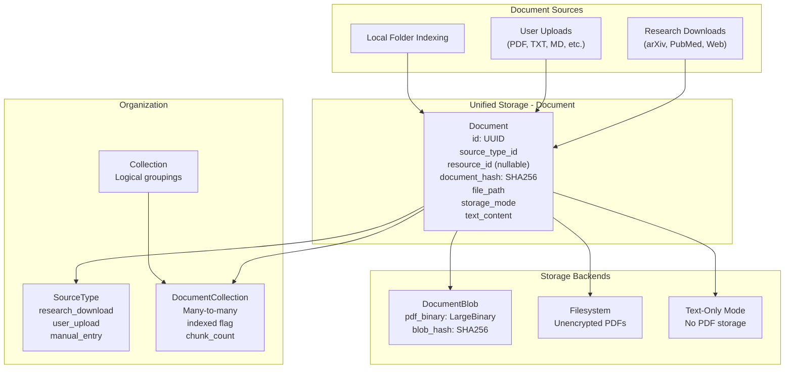
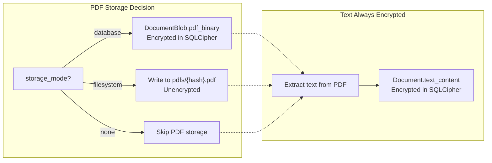
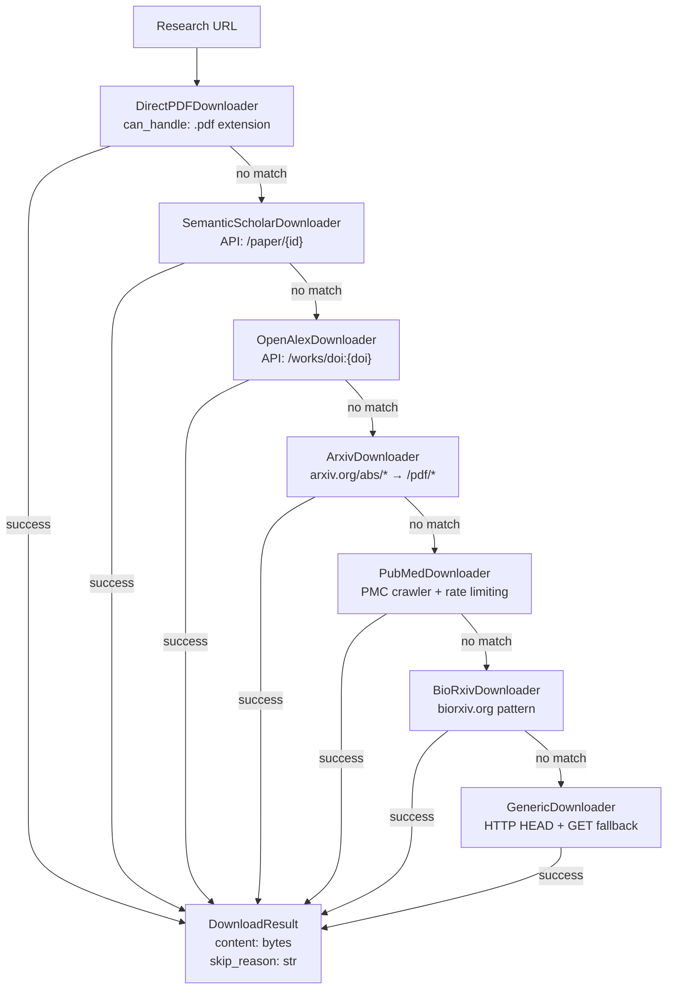
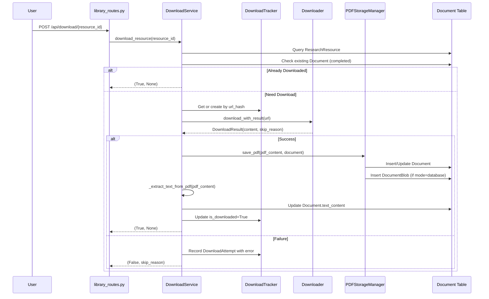
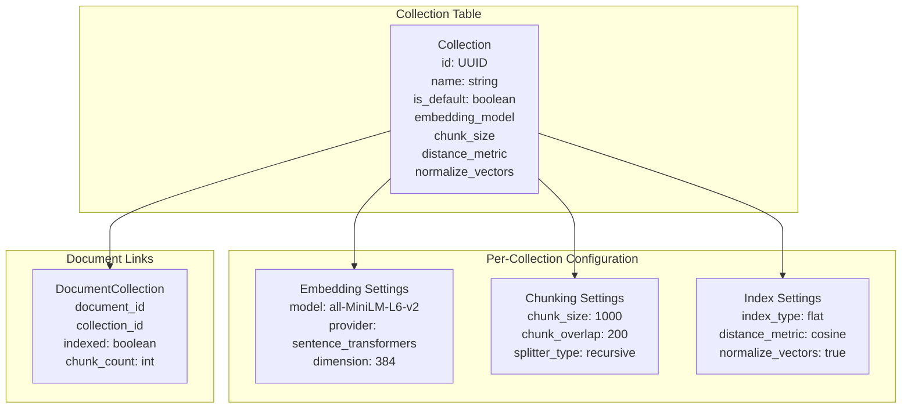
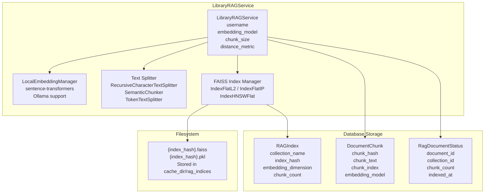
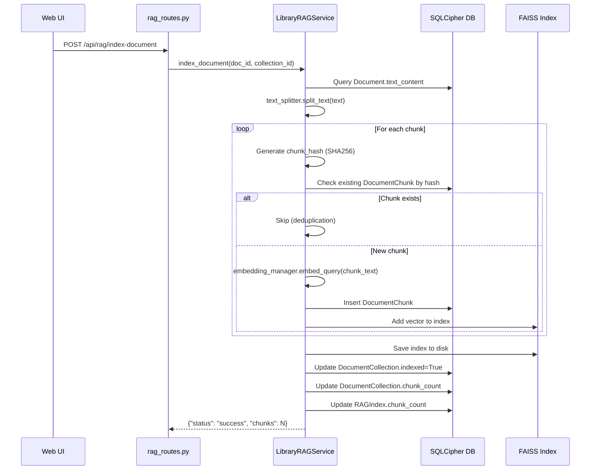
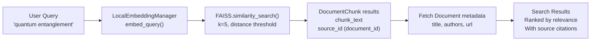

<!-- source: DeepWiki mcp.deepwiki.com · repo LearningCircuit/local-deep-research · page 3.7 Research Library and RAG System · fetched 2026-10-29 -->

# Research Library and RAG System

<details>
<summary>Relevant source files</summary>

The following files were used as context for generating this wiki page:

- [src/local_deep_research/constants.py](src/local_deep_research/constants.py)
- [src/local_deep_research/database/models/library.py](src/local_deep_research/database/models/library.py)
- [src/local_deep_research/defaults/research_library/library_settings.json](src/local_deep_research/defaults/research_library/library_settings.json)
- [src/local_deep_research/research_library/downloaders/__init__.py](src/local_deep_research/research_library/downloaders/__init__.py)
- [src/local_deep_research/research_library/downloaders/arxiv.py](src/local_deep_research/research_library/downloaders/arxiv.py)
- [src/local_deep_research/research_library/downloaders/base.py](src/local_deep_research/research_library/downloaders/base.py)
- [src/local_deep_research/research_library/downloaders/biorxiv.py](src/local_deep_research/research_library/downloaders/biorxiv.py)
- [src/local_deep_research/research_library/downloaders/direct_pdf.py](src/local_deep_research/research_library/downloaders/direct_pdf.py)
- [src/local_deep_research/research_library/downloaders/generic.py](src/local_deep_research/research_library/downloaders/generic.py)
- [src/local_deep_research/research_library/downloaders/openalex.py](src/local_deep_research/research_library/downloaders/openalex.py)
- [src/local_deep_research/research_library/downloaders/pubmed.py](src/local_deep_research/research_library/downloaders/pubmed.py)
- [src/local_deep_research/research_library/downloaders/semantic_scholar.py](src/local_deep_research/research_library/downloaders/semantic_scholar.py)
- [src/local_deep_research/research_library/routes/library_routes.py](src/local_deep_research/research_library/routes/library_routes.py)
- [src/local_deep_research/research_library/routes/rag_routes.py](src/local_deep_research/research_library/routes/rag_routes.py)
- [src/local_deep_research/research_library/search/routes/search_routes.py](src/local_deep_research/research_library/search/routes/search_routes.py)
- [src/local_deep_research/research_library/search/services/research_history_indexer.py](src/local_deep_research/research_library/search/services/research_history_indexer.py)
- [src/local_deep_research/research_library/services/download_service.py](src/local_deep_research/research_library/services/download_service.py)
- [src/local_deep_research/research_library/services/library_rag_service.py](src/local_deep_research/research_library/services/library_rag_service.py)
- [src/local_deep_research/research_library/services/library_service.py](src/local_deep_research/research_library/services/library_service.py)
- [src/local_deep_research/research_library/services/pdf_storage_manager.py](src/local_deep_research/research_library/services/pdf_storage_manager.py)
- [src/local_deep_research/research_library/utils/__init__.py](src/local_deep_research/research_library/utils/__init__.py)
- [src/local_deep_research/web/static/css/components/semantic-search.css](src/local_deep_research/web/static/css/components/semantic-search.css)
- [src/local_deep_research/web/static/js/components/library_search_ui.js](src/local_deep_research/web/static/js/components/library_search_ui.js)
- [src/local_deep_research/web/static/js/components/save_to_collection.js](src/local_deep_research/web/static/js/components/save_to_collection.js)
- [src/local_deep_research/web/static/js/components/semantic_search.js](src/local_deep_research/web/static/js/components/semantic_search.js)
- [src/local_deep_research/web/templates/components/storage_mode_modal.html](src/local_deep_research/web/templates/components/storage_mode_modal.html)
- [src/local_deep_research/web/templates/pages/collection_create.html](src/local_deep_research/web/templates/pages/collection_create.html)
- [src/local_deep_research/web/templates/pages/collection_upload.html](src/local_deep_research/web/templates/pages/collection_upload.html)
- [src/local_deep_research/web/templates/pages/download_manager.html](src/local_deep_research/web/templates/pages/download_manager.html)
- [src/local_deep_research/web/templates/pages/library.html](src/local_deep_research/web/templates/pages/library.html)
- [src/local_deep_research/web_search_engines/engines/search_engine_collection.py](src/local_deep_research/web_search_engines/engines/search_engine_collection.py)
- [src/local_deep_research/web_search_engines/engines/search_engine_library.py](src/local_deep_research/web_search_engines/engines/search_engine_library.py)
- [tests/research_library/search/routes/test_search_routes.py](tests/research_library/search/routes/test_search_routes.py)
- [tests/research_library/services/test_download_service_coverage.py](tests/research_library/services/test_download_service_coverage.py)
- [tests/research_library/services/test_download_service_deep_coverage.py](tests/research_library/services/test_download_service_deep_coverage.py)
- [tests/research_library/services/test_library_rag_service.py](tests/research_library/services/test_library_rag_service.py)
- [tests/research_library/services/test_library_rag_service_coverage.py](tests/research_library/services/test_library_rag_service_coverage.py)
- [tests/research_library/services/test_library_rag_service_deep_coverage.py](tests/research_library/services/test_library_rag_service_deep_coverage.py)
- [tests/research_library/services/test_library_rag_service_index_coverage.py](tests/research_library/services/test_library_rag_service_index_coverage.py)
- [tests/research_library/utils/test_utils.py](tests/research_library/utils/test_utils.py)
- [tests/test_search_system_factory_high_value.py](tests/test_search_system_factory_high_value.py)

</details>


## Purpose and Scope

The Research Library and RAG System provides unified document storage, organization, and semantic search capabilities for Local Deep Research. This system manages three distinct workflows:

1.  **Research Downloads**: Automatic download and indexing of PDFs/papers from research sessions [src/local_deep_research/research_library/services/download_service.py:68-150]().
2.  **User Uploads**: Direct file uploads for personal document collections [src/local_deep_research/database/models/library.py:136-161]().
3.  **RAG Indexing**: Vector-based semantic search across document collections [src/local_deep_research/research_library/services/library_rag_service.py:43-154]().

The system implements a flexible storage architecture with three modes (database/filesystem/text-only), per-collection RAG configuration, and FAISS-based vector search. All text content is stored encrypted in SQLCipher databases for security [src/local_deep_research/database/models/library.py:223-225]().

**Sources**: [src/local_deep_research/research_library/services/download_service.py:1-67](), [src/local_deep_research/research_library/services/library_rag_service.py:1-41](), [src/local_deep_research/database/models/library.py:1-111]()

---

## Document Storage Architecture

### Unified Document Model

All documents—regardless of source—are stored in a single `Document` table [src/local_deep_research/database/models/library.py:163-170](). This design eliminates redundancy and enables consistent metadata handling across research downloads and user uploads.

Unified Storage Model


**Sources**: [src/local_deep_research/database/models/library.py:113-250](), [src/local_deep_research/database/models/library.py:352-475]()

### Storage Modes

The system supports three PDF storage modes configured via `research_library.pdf_storage_mode` [src/local_deep_research/database/models/library.py:105-111]():

| Mode | Description | Security | Use Case |
| :--- | :--- | :--- | :--- |
| **database** | PDFs encrypted in `DocumentBlob` table | AES-256 via SQLCipher | Default. Portable, isolated per-user |
| **filesystem** | Unencrypted files in `library/pdfs/` | None (file permissions only) | Large files, external tool access |
| **none** | Text extraction only, no PDF storage | N/A | Minimal storage footprint |

Text content is **always** stored in `Document.text_content` regardless of PDF storage mode [src/local_deep_research/database/models/library.py:223-225](). This column is encrypted within the user's SQLCipher database.

Storage Mode Logic


**Sources**: [src/local_deep_research/database/models/library.py:105-111](), [src/local_deep_research/defaults/research_library/library_settings.json:32-59]()

The `PDFStorageManager` class handles storage abstraction, including file validation and encrypted blob management [src/local_deep_research/research_library/services/pdf_storage_manager.py:1-100]().

### Document Identification and Deduplication

Documents are deduplicated using SHA256 hashes:

*   **document_hash**: SHA256 of PDF binary content (for PDFs) or file content (for other types) [src/local_deep_research/database/models/library.py:205-207]().
*   **chunk_hash**: SHA256 of chunk text for RAG deduplication [src/local_deep_research/database/models/library.py:598-600]().
*   **url_hash**: SHA256 of normalized URL for download tracking [src/local_deep_research/research_library/services/download_service.py:204-208]().

The `DownloadTracker` table prevents re-downloading the same URL multiple times across different research sessions [src/local_deep_research/database/models/download_tracker.py:28-31]().

**Sources**: [src/local_deep_research/database/models/library.py:205-207](), [src/local_deep_research/research_library/services/download_service.py:189-208]()

---

## Download Pipeline

### Source-Specific Downloaders

The download system uses a chain-of-responsibility pattern with specialized downloaders for academic sources [src/local_deep_research/research_library/services/download_service.py:123-138]():

Downloader Chain


**Sources**: [src/local_deep_research/research_library/services/download_service.py:123-138]()

Each downloader implements `can_handle` to check URL compatibility and `download_with_result` to execute the fetch [src/local_deep_research/research_library/services/download_service.py:123-138](). The `ArxivDownloader` converts abstract URLs to PDF URLs. The `PubMedDownloader` implements rate limiting (1 req/sec) to comply with NCBI guidelines [src/local_deep_research/research_library/services/download_service.py:135]().

### Download Service Flow

The `DownloadService` manages the lifecycle of a resource download, from checking existing records to extracting text and updating status [src/local_deep_research/research_library/services/download_service.py:378-519]().

Download Sequence


**Sources**: [src/local_deep_research/research_library/services/download_service.py:378-519](), [src/local_deep_research/research_library/routes/library_routes.py:512-533]()

### Text Extraction Pipeline

Text extraction uses a fallback chain to maximize quality:
1.  **pdfplumber** (primary): Better for complex layouts and tables [src/local_deep_research/research_library/services/download_service.py:24]().
2.  **PyPDF** (fallback): Simpler extraction if pdfplumber fails [src/local_deep_research/research_library/services/download_service.py:25]().

The service tracks `extraction_method` and `extraction_source` to audit data quality [src/local_deep_research/database/models/library.py:53-70]().

---

## Collection Management

### Collection Model

Collections organize documents into logical groups. Each user has a default "Library" collection created automatically [src/local_deep_research/database/models/library.py:352-423]().

Collection Architecture


**Sources**: [src/local_deep_research/database/models/library.py:352-423]()

Collections store their RAG configuration at first indexing time, allowing different collections to use different embedding models [src/local_deep_research/research_library/routes/rag_routes.py:94-127]().

### DocumentCollection Junction Table

The many-to-many relationship allows documents to belong to multiple collections with independent indexing status [src/local_deep_research/database/models/library.py:425-475]().

| Column | Type | Purpose |
| :--- | :--- | :--- |
| `document_id` | UUID | Foreign key to Document |
| `collection_id` | UUID | Foreign key to Collection |
| `indexed` | boolean | Whether indexed in this collection |
| `chunk_count` | int | Number of chunks for this document in this collection |

---

## RAG Indexing System

### RAG Service Architecture

The `LibraryRAGService` orchestrates embeddings, text splitting, and FAISS index management [src/local_deep_research/research_library/services/library_rag_service.py:43-154]().

RAG Service Architecture


**Sources**: [src/local_deep_research/research_library/services/library_rag_service.py:43-154](), [src/local_deep_research/database/models/library.py:477-565]()

### Text Splitting Configuration

The system supports four splitter types via `SplitterType` enum [src/local_deep_research/database/models/library.py:96-103]():

| Splitter | Best For | Configurable Parameters |
| :--- | :--- | :--- |
| `recursive` | General text | `text_separators` (default: `["\n\n", "\n", ". ", " ", ""]`) |
| `semantic` | Maintaining meaning boundaries | `embedding_model` |
| `token` | Token-count-based chunking | `chunk_size`, `chunk_overlap` |
| `sentence` | Sentence-aligned chunks | `chunk_size`, `chunk_overlap` |

**Sources**: [src/local_deep_research/research_library/services/library_rag_service.py:87-96](), [src/local_deep_research/research_library/services/library_rag_service.py:145-153]()

### Indexing Pipeline

The indexing pipeline transforms document text into searchable vector embeddings. This is managed by `LibraryRAGService.index_document()` [src/local_deep_research/research_library/services/library_rag_service.py:650-803]().

Indexing Sequence


**Sources**: [src/local_deep_research/research_library/services/library_rag_service.py:650-803]()

### FAISS Index Management

FAISS indices are identified by `index_hash` derived from collection name and embedding configuration [src/local_deep_research/research_library/services/library_rag_service.py:396-439](). The system uses `IndexFlatIP` for cosine similarity and `IndexFlatL2` for Euclidean distance [src/local_deep_research/research_library/services/library_rag_service.py:38-39]().

Index files are stored in the cache directory under `rag_indices/` [src/local_deep_research/config/paths.py:19]().

---

## Semantic Search

### Search Flow

The `LibraryRAGSearchEngine` and `CollectionSearchEngine` provide semantic search capabilities within the research workflow [src/local_deep_research/web_search_engines/engines/search_engine_library.py:23-26](), [src/local_deep_research/web_search_engines/engines/search_engine_collection.py:21-26]().

Search Flow


**Sources**: [src/local_deep_research/web_search_engines/engines/search_engine_library.py:86-107](), [src/local_deep_research/web_search_engines/engines/search_engine_collection.py:112-133]()

### Distance Metrics

The system supports three distance metrics via `DistanceMetric` enum [src/local_deep_research/database/models/library.py:80-86]():
*   `cosine`: Scale-invariant similarity (default).
*   `l2`: Euclidean distance.
*   `dot_product`: Magnitude-dependent similarity.

---

## API Routes and Web Interface

### RAG Management Routes

**Blueprint**: `rag_bp` (prefix: `/library`) [src/local_deep_research/research_library/routes/rag_routes.py:60]().

| Endpoint | Method | Purpose |
| :--- | :--- | :--- |
| `/api/rag/settings` | GET | Get current RAG configuration [src/local_deep_research/research_library/routes/rag_routes.py:465-492](). |
| `/api/rag/models` | GET | List available embedding models [src/local_deep_research/research_library/routes/rag_routes.py:435-462](). |
| `/api/rag/index-document` | POST | Index a single document [src/local_deep_research/research_library/routes/rag_routes.py:650-705](). |
| `/api/rag/index-all` | GET | Bulk index with SSE progress [src/local_deep_research/research_library/routes/rag_routes.py:825-885](). |

### Library Management Routes

**Blueprint**: `library_bp` (prefix: `/library`) [src/local_deep_research/research_library/routes/library_routes.py:51]().

| Endpoint | Method | Purpose |
| :--- | :--- | :--- |
| `/api/documents` | GET | List documents with filters [src/local_deep_research/research_library/routes/library_routes.py:330-385](). |
| `/api/download/{resource_id}` | POST | Download single resource [src/local_deep_research/research_library/routes/library_routes.py:512-533](). |
| `/api/download-bulk` | POST | Bulk download with SSE progress [src/local_deep_research/research_library/routes/library_routes.py:610-660](). |

### Auto-Indexing Trigger

After successful document downloads, the system can automatically trigger indexing via a background thread pool executor [src/local_deep_research/research_library/routes/rag_routes.py:67-89]().

**Sources**: [src/local_deep_research/research_library/routes/rag_routes.py:67-91]()

---

## Database Schema Summary

Database Relationships
```mermaid
erDiagram
    Document ||--o{ DocumentCollection : "belongs to"
    Collection ||--o{ DocumentCollection : "contains"
    Document ||--o| DocumentBlob : "has (optional)"
    Document ||--o{ DocumentChunk : "chunks into"
    Collection ||--o{ RAGIndex : "has indices"
    RAGIndex ||--o{ RagDocumentStatus : "tracks status"
    SourceType ||--o{ Document : "categorizes"
    UploadBatch ||--o{ Document : "groups"
    
    Document {
        string id PK
        string source_type_id FK
        int resource_id FK
        string document_hash UK
        text file_path
        string storage_mode
        text text_content
        string title
        json authors
    }
    
    DocumentBlob {
        string document_id PK_FK
        binary pdf_binary
        string blob_hash
    }
    
    Collection {
        string id PK
        string name
        boolean is_default
        string embedding_model
        int chunk_size
        string distance_metric
    }
    
    DocumentCollection {
        int id PK
        string document_id FK
        string collection_id FK
        boolean indexed
        int chunk_count
    }
    
    DocumentChunk {
        int id PK
        string chunk_hash
        string source_id FK
        string collection_name
        text chunk_text
        int chunk_index
    }
    
    RAGIndex {
        int id PK
        string collection_name
        string index_hash UK
        string embedding_model
        int embedding_dimension
        string index_path
    }
```

**Sources**: [src/local_deep_research/database/models/library.py:1-698]()

---

