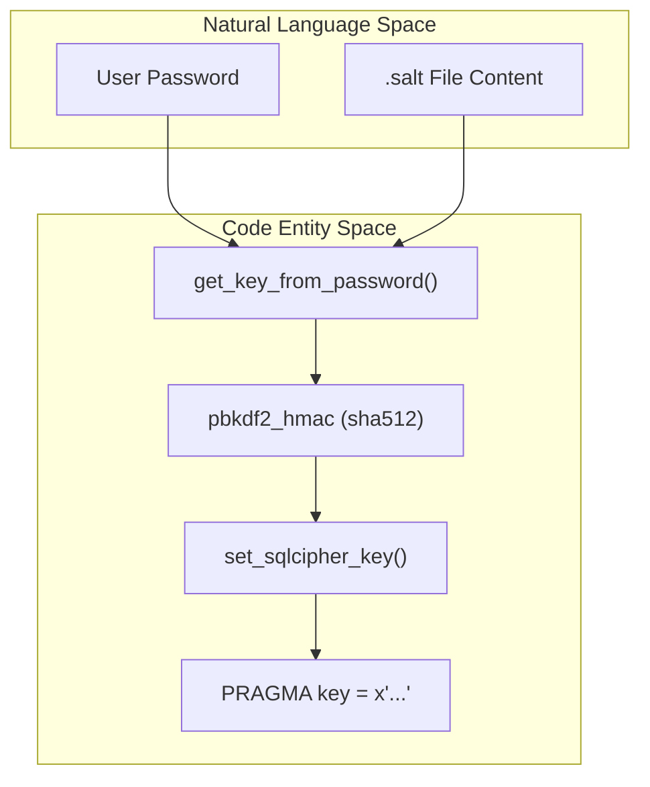
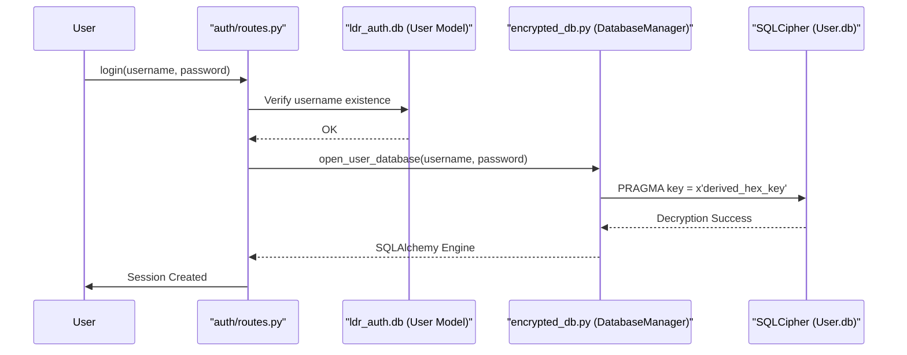
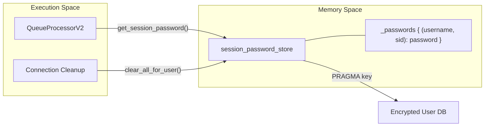

<!-- source: DeepWiki mcp.deepwiki.com · repo LearningCircuit/local-deep-research · page 3.8 Database Architecture and Security · fetched 2026-10-29 -->

# Database Architecture and Security

<details>
<summary>Relevant source files</summary>

The following files were used as context for generating this wiki page:

- [docs/release_notes/1.6.8.md](docs/release_notes/1.6.8.md)
- [scripts/pre_commit/check_datetime_timezone.py](scripts/pre_commit/check_datetime_timezone.py)
- [src/local_deep_research/database/alembic_runner.py](src/local_deep_research/database/alembic_runner.py)
- [src/local_deep_research/database/auth_db.py](src/local_deep_research/database/auth_db.py)
- [src/local_deep_research/database/encrypted_db.py](src/local_deep_research/database/encrypted_db.py)
- [src/local_deep_research/database/migrations/versions/0006_journal_quality_system.py](src/local_deep_research/database/migrations/versions/0006_journal_quality_system.py)
- [src/local_deep_research/database/migrations/versions/0007_backfill_missing_indexes.py](src/local_deep_research/database/migrations/versions/0007_backfill_missing_indexes.py)
- [src/local_deep_research/database/migrations/versions/0008_fix_research_strategy_fk.py](src/local_deep_research/database/migrations/versions/0008_fix_research_strategy_fk.py)
- [src/local_deep_research/database/models/__init__.py](src/local_deep_research/database/models/__init__.py)
- [src/local_deep_research/database/models/active_research.py](src/local_deep_research/database/models/active_research.py)
- [src/local_deep_research/database/models/benchmark.py](src/local_deep_research/database/models/benchmark.py)
- [src/local_deep_research/database/models/download_tracker.py](src/local_deep_research/database/models/download_tracker.py)
- [src/local_deep_research/database/models/journal.py](src/local_deep_research/database/models/journal.py)
- [src/local_deep_research/database/models/logs.py](src/local_deep_research/database/models/logs.py)
- [src/local_deep_research/database/models/metrics.py](src/local_deep_research/database/models/metrics.py)
- [src/local_deep_research/database/models/news.py](src/local_deep_research/database/models/news.py)
- [src/local_deep_research/database/models/providers.py](src/local_deep_research/database/models/providers.py)
- [src/local_deep_research/database/models/queue.py](src/local_deep_research/database/models/queue.py)
- [src/local_deep_research/database/models/queued_research.py](src/local_deep_research/database/models/queued_research.py)
- [src/local_deep_research/database/models/rate_limiting.py](src/local_deep_research/database/models/rate_limiting.py)
- [src/local_deep_research/database/models/reports.py](src/local_deep_research/database/models/reports.py)
- [src/local_deep_research/database/models/research.py](src/local_deep_research/database/models/research.py)
- [src/local_deep_research/database/models/settings.py](src/local_deep_research/database/models/settings.py)
- [src/local_deep_research/database/pool_config.py](src/local_deep_research/database/pool_config.py)
- [src/local_deep_research/database/sqlcipher_utils.py](src/local_deep_research/database/sqlcipher_utils.py)
- [src/local_deep_research/database/thread_local_session.py](src/local_deep_research/database/thread_local_session.py)
- [src/local_deep_research/news/folder_manager.py](src/local_deep_research/news/folder_manager.py)
- [src/local_deep_research/settings/env_definitions/bootstrap.py](src/local_deep_research/settings/env_definitions/bootstrap.py)
- [src/local_deep_research/settings/env_definitions/db_config.py](src/local_deep_research/settings/env_definitions/db_config.py)
- [src/local_deep_research/settings/env_settings.py](src/local_deep_research/settings/env_settings.py)
- [src/local_deep_research/web/auth/connection_cleanup.py](src/local_deep_research/web/auth/connection_cleanup.py)
- [tests/database/models/test_download_tracker_models.py](tests/database/models/test_download_tracker_models.py)
- [tests/database/test_alembic_migrations.py](tests/database/test_alembic_migrations.py)
- [tests/database/test_database_manager_extended.py](tests/database/test_database_manager_extended.py)
- [tests/database/test_encrypted_db_coverage.py](tests/database/test_encrypted_db_coverage.py)
- [tests/database/test_encrypted_db_manager.py](tests/database/test_encrypted_db_manager.py)
- [tests/database/test_fk_targets_resolve.py](tests/database/test_fk_targets_resolve.py)
- [tests/database/test_migration_0003_indexes.py](tests/database/test_migration_0003_indexes.py)
- [tests/database/test_migration_0004_app_settings.py](tests/database/test_migration_0004_app_settings.py)
- [tests/database/test_migration_0005_resource_document_id.py](tests/database/test_migration_0005_resource_document_id.py)
- [tests/database/test_migration_0006.py](tests/database/test_migration_0006.py)
- [tests/database/test_pool_config.py](tests/database/test_pool_config.py)
- [tests/database/test_research_models.py](tests/database/test_research_models.py)
- [tests/database/test_research_strategy_fk_regression.py](tests/database/test_research_strategy_fk_regression.py)
- [tests/database/test_schema_index_completeness.py](tests/database/test_schema_index_completeness.py)
- [tests/database/test_sqlcipher_connection_factory.py](tests/database/test_sqlcipher_connection_factory.py)
- [tests/database/test_sqlcipher_integration.py](tests/database/test_sqlcipher_integration.py)
- [tests/database/test_sqlcipher_utils.py](tests/database/test_sqlcipher_utils.py)
- [tests/database/test_thread_local_session.py](tests/database/test_thread_local_session.py)
- [tests/database/test_thread_local_session_coverage.py](tests/database/test_thread_local_session_coverage.py)
- [tests/database/test_thread_local_session_deep_coverage.py](tests/database/test_thread_local_session_deep_coverage.py)
- [tests/hooks/test_check_datetime_timezone.py](tests/hooks/test_check_datetime_timezone.py)

</details>


## Purpose and Scope

This page documents the database architecture and security mechanisms in Local Deep Research, including per-user database isolation, SQLCipher encryption, password-derived keys, and thread-safe database access. It details the separation between the authentication database (`ldr_auth.db`) and individual user research databases (`research.db`). For web application structure and request handling, see [3.1](). For settings management and configuration priority, see [4.1]().

## Per-User Database Isolation

Local Deep Research implements a **zero-knowledge architecture** where each user has a separate encrypted database. User isolation is enforced at the file level; there is no shared "master" research database for user content. [src/local_deep_research/database/encrypted_db.py:48-55]()

### Database Separation: auth.db vs research.db

The system maintains two distinct types of databases with different security profiles:

1.  **Authentication Database (`ldr_auth.db`)**: A shared, unencrypted SQLite database used only for storing user metadata (usernames) and verifying existence. [src/local_deep_research/database/auth_db.py:1-4](). It uses a global cached engine `_auth_engine` to prevent file descriptor leaks by reusing a single engine instance across the application lifecycle. [src/local_deep_research/database/auth_db.py:23-45]()
2.  **User Research Databases (`ldr_user_<hash>.db`)**: Individual SQLCipher-encrypted databases containing all research history, settings, and library data. These are only accessible after providing the correct password to derive the encryption key. [src/local_deep_research/database/encrypted_db.py:182-200]()

### Database Storage Structure

```text
{LDR_DATA_DIR}/
├── ldr_auth.db           # Shared metadata (usernames)
└── encrypted_databases/
    ├── ldr_user_abc.db   # Encrypted with user's password
    ├── ldr_user_abc.db.salt # Unique 32-byte salt for key derivation
    ├── ldr_user_xyz.db   # Encrypted with another user's password
    └── ldr_user_xyz.db.salt # Unique salt for user xyz
```

**Sources:** [src/local_deep_research/database/auth_db.py:31-33](), [src/local_deep_research/database/encrypted_db.py:54-55](), [src/local_deep_research/database/sqlcipher_utils.py:23-38]()

## SQLCipher Encryption

### Encryption Parameters

The system uses SQLCipher (AES-256-CBC) with hardened parameters. Encryption is verified at startup via `_check_encryption_available`; if the SQLCipher module is missing or non-functional, the system defaults to a security error unless unencrypted databases are explicitly allowed. [src/local_deep_research/database/encrypted_db.py:141-180]()

| Parameter | Value | Implementation |
| :--- | :--- | :--- |
| **Algorithm** | AES-256-CBC | SQLCipher Default |
| **KDF** | PBKDF2-HMAC-SHA512 | `_get_key_from_password` [src/local_deep_research/database/sqlcipher_utils.py:132-169]() |
| **Iterations** | 256,000 (Default) | `get_sqlcipher_settings` [src/local_deep_research/database/sqlcipher_utils.py:300-315]() |
| **Salt** | 32-byte random | `create_database_salt` [src/local_deep_research/database/sqlcipher_utils.py:103]() |
| **Cipher Defaults** | Applied before key | `apply_cipher_defaults_before_key` [src/local_deep_research/database/sqlcipher_utils.py:236-251]() |

### Key Derivation Flow

The system derives a raw hex key from the user's password using PBKDF2-HMAC-SHA512. This hex key is then passed to SQLCipher via `PRAGMA key`. This approach avoids SQL injection and escaping issues with special characters in passwords. [src/local_deep_research/database/sqlcipher_utils.py:195-212]()



**Sources:** [src/local_deep_research/database/sqlcipher_utils.py:132-212](), [src/local_deep_research/database/encrypted_db.py:151-154]()

## Database Manager Architecture

The `DatabaseManager` class acts as a singleton registry for active database engines and handles the lifecycle of encrypted connections. [src/local_deep_research/database/encrypted_db.py:48-52]()

### Connection Management

The manager maintains a thread-safe registry of engines to ensure isolation and performance:
1.  **`self.connections`**: Global engines shared across application threads, indexed by username. [src/local_deep_research/database/encrypted_db.py:52]()
2.  **`self._pool_class`**: Selection between `QueuePool` (production) and `StaticPool` (tests). [src/local_deep_research/database/encrypted_db.py:95-96]()

### Entity Relationship: Auth to Research DB



**Sources:** [src/local_deep_research/database/encrypted_db.py:182-230](), [src/local_deep_research/database/auth_db.py:130-141](), [src/local_deep_research/database/sqlcipher_utils.py:211-212]()

## Thread Safety and Session Management

### File Descriptor Management

To prevent "Database is locked" errors and file descriptor exhaustion (particularly in WAL mode where SQLite holds multiple handles), the system uses specific pool configurations. [src/local_deep_research/database/encrypted_db.py:60-94]()

-   **`QueuePool`**: Default for the main application with `pool_size=20` and `max_overflow=40` (60 total). Fewer pooled connections reduce opportunities for out-of-order closes during `pool_recycle` which can leak file handles in SQLCipher + WAL mode. [src/local_deep_research/database/encrypted_db.py:65-72](), [src/local_deep_research/database/encrypted_db.py:107-113]()
-   **`StaticPool`**: Used during testing to ensure all threads share a single connection. [src/local_deep_research/database/encrypted_db.py:95-96]()

### Thread-Local Sessions

The `ThreadLocalSessionManager` provides persistent sessions for the lifetime of a thread. This avoids expensive SQLCipher decryption on every database access by reusing the session within the same thread. [src/local_deep_research/database/thread_local_session.py:18-37]()

### Connection Cleanup and Resource Monitoring

A background scheduler periodically runs `cleanup_idle_connections` to close database handles for users without active sessions or research. [src/local_deep_research/web/auth/connection_cleanup.py:71-121](). 

Key maintenance tasks include:
- **Pool Disposal**: Every 30 minutes, all `QueuePool` engines are disposed to release WAL/SHM file handles that accumulate due to out-of-order connection closes (ADR-0004). [src/local_deep_research/web/auth/connection_cleanup.py:41-47](), [src/local_deep_research/web/auth/connection_cleanup.py:154-171]()
- **FD Monitoring**: The system monitors open file descriptors for the process to detect leaks. [src/local_deep_research/web/auth/connection_cleanup.py:50-68]()

### Session Password Store

For background tasks (like the `QueueProcessorV2`) that need to open an encrypted database without active user interaction, the `session_password_store` temporarily caches the password in memory for the duration of the user's session. [src/local_deep_research/web/auth/connection_cleanup.py:115]().



**Sources:** [src/local_deep_research/web/auth/connection_cleanup.py:114-115](), [src/local_deep_research/database/thread_local_session.py:124-126]()

## Security Implementation Details

### Database Integrity and Verification

The system includes a `verify_sqlcipher_connection` utility that performs a `SELECT count(*) FROM sqlite_master` check immediately after applying the key. If this fails, it indicates an incorrect password or a corrupted database. [src/local_deep_research/database/sqlcipher_utils.py:290-315]()

### Per-Database Salts

Every database is created with a unique 256-bit random salt stored in a `.salt` file. [src/local_deep_research/database/sqlcipher_utils.py:23-38](). This ensures that identical passwords across different users result in different encryption keys. [src/local_deep_research/database/sqlcipher_utils.py:76-117]()

### Alembic Migrations

Each per-user database is individually versioned using a programmatic Alembic runner. [src/local_deep_research/database/alembic_runner.py:1-7](). Migration files are validated for secure permissions (non-world-writable) to prevent arbitrary code execution during the upgrade process. [src/local_deep_research/database/alembic_runner.py:52-92]()

**Sources:** [src/local_deep_research/database/sqlcipher_utils.py:7-130](), [src/local_deep_research/database/sqlcipher_utils.py:290-315](), [src/local_deep_research/database/encrypted_db.py:22-34](), [src/local_deep_research/database/alembic_runner.py:52-92]()

---

