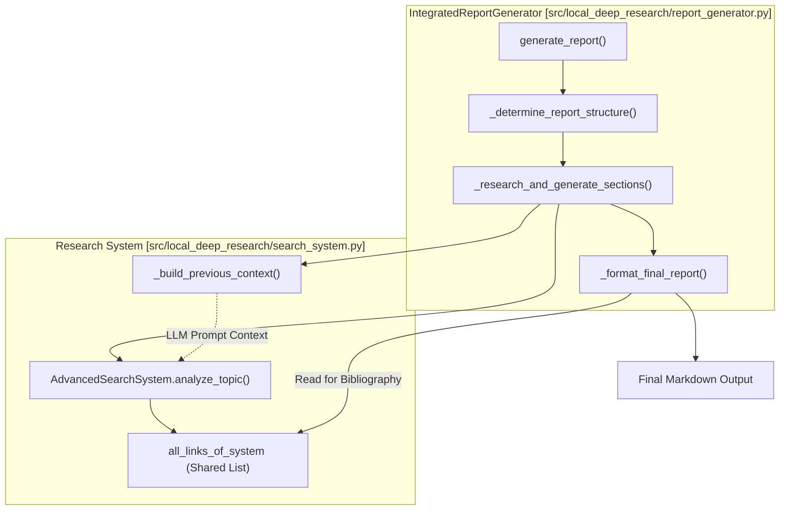
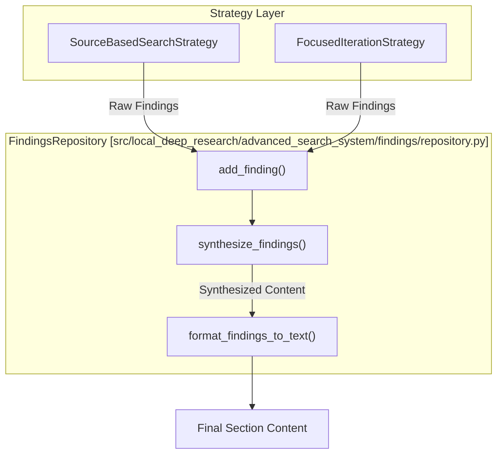

<!-- source: DeepWiki mcp.deepwiki.com · repo LearningCircuit/local-deep-research · page 3.9 Report Generation and Export System · fetched 2026-10-29 -->

# Report Generation and Export System

Relevant source files

The following files were used as context for generating this wiki page:

- [docs/cli-tools.md](docs/cli-tools.md)
- [src/local_deep_research/advanced_search_system/filters/cross_engine_filter.py](src/local_deep_research/advanced_search_system/filters/cross_engine_filter.py)
- [src/local_deep_research/advanced_search_system/findings/repository.py](src/local_deep_research/advanced_search_system/findings/repository.py)
- [src/local_deep_research/advanced_search_system/strategies/base_strategy.py](src/local_deep_research/advanced_search_system/strategies/base_strategy.py)
- [src/local_deep_research/advanced_search_system/strategies/direct_search_strategy.py](src/local_deep_research/advanced_search_system/strategies/direct_search_strategy.py)
- [src/local_deep_research/advanced_search_system/strategies/focused_iteration_strategy.py](src/local_deep_research/advanced_search_system/strategies/focused_iteration_strategy.py)
- [src/local_deep_research/advanced_search_system/strategies/iterdrag_strategy.py](src/local_deep_research/advanced_search_system/strategies/iterdrag_strategy.py)
- [src/local_deep_research/advanced_search_system/strategies/parallel_search_strategy.py](src/local_deep_research/advanced_search_system/strategies/parallel_search_strategy.py)
- [src/local_deep_research/advanced_search_system/strategies/rapid_search_strategy.py](src/local_deep_research/advanced_search_system/strategies/rapid_search_strategy.py)
- [src/local_deep_research/advanced_search_system/strategies/source_based_strategy.py](src/local_deep_research/advanced_search_system/strategies/source_based_strategy.py)
- [src/local_deep_research/advanced_search_system/strategies/standard_strategy.py](src/local_deep_research/advanced_search_system/strategies/standard_strategy.py)
- [src/local_deep_research/api/research_functions.py](src/local_deep_research/api/research_functions.py)
- [src/local_deep_research/benchmarks/efficiency/resource_monitor.py](src/local_deep_research/benchmarks/efficiency/resource_monitor.py)
- [src/local_deep_research/benchmarks/metrics/README.md](src/local_deep_research/benchmarks/metrics/README.md)
- [src/local_deep_research/benchmarks/metrics/visualization.py](src/local_deep_research/benchmarks/metrics/visualization.py)
- [src/local_deep_research/citation_handler.py](src/local_deep_research/citation_handler.py)
- [src/local_deep_research/report_generator.py](src/local_deep_research/report_generator.py)
- [src/local_deep_research/search_system.py](src/local_deep_research/search_system.py)
- [src/local_deep_research/text_optimization/citation_formatter.py](src/local_deep_research/text_optimization/citation_formatter.py)
- [tests/advanced_search_system/evidence/test_evaluator_integration.py](tests/advanced_search_system/evidence/test_evaluator_integration.py)
- [tests/advanced_search_system/filters/test_cross_engine_filter_integration.py](tests/advanced_search_system/filters/test_cross_engine_filter_integration.py)
- [tests/benchmarks/efficiency/test_resource_monitor_coverage.py](tests/benchmarks/efficiency/test_resource_monitor_coverage.py)
- [tests/benchmarks/efficiency/test_resource_monitor_high_value.py](tests/benchmarks/efficiency/test_resource_monitor_high_value.py)
- [tests/benchmarks/test_resource_monitor.py](tests/benchmarks/test_resource_monitor.py)
- [tests/benchmarks/test_visualization_high_value.py](tests/benchmarks/test_visualization_high_value.py)
- [tests/core/test_report_generator.py](tests/core/test_report_generator.py)
- [tests/report/test_report_generator_progress.py](tests/report/test_report_generator_progress.py)
- [tests/report/test_report_generator_report_extended.py](tests/report/test_report_generator_report_extended.py)
- [tests/report/test_report_section_generation.py](tests/report/test_report_section_generation.py)
- [tests/test_report_generator.py](tests/test_report_generator.py)
- [tests/test_report_generator_coverage.py](tests/test_report_generator_coverage.py)
- [tests/text_optimization/test_citation_formatter_behavior.py](tests/text_optimization/test_citation_formatter_behavior.py)

This page documents the `IntegratedReportGenerator`, section-based synthesis, context accumulation, citation formatting, export formats, and the text optimization pipeline. The system is responsible for transforming raw research findings into structured, professional documents with accurate citations and multiple export options.

---

## Overview

Report generation is the final stage of the research lifecycle. After an `AdvancedSearchSystem` has completed its iterative discovery phase, the findings are passed to the `IntegratedReportGenerator`. This component performs deep, section-specific research to build a comprehensive narrative. The resulting markdown is then processed by the `CitationFormatter` to apply specific hyperlink styles and finally passed to the export registry for conversion into formats like PDF, LaTeX, or Markdown.

### Key Components

| Component | Class / Function | Responsibility |
|:---|:---|:---|
| **Report Orchestrator** | `IntegratedReportGenerator` | Manages structure determination, section research, and final assembly. [src/local_deep_research/report_generator.py:33-40]() |
| **Citation Logic** | `CitationFormatter` | Post-processes markdown to inject hyperlinks into `[N]` markers. [src/local_deep_research/text_optimization/citation_formatter.py:46-50]() |
| **Strategy Execution** | `AdvancedSearchSystem` | Provides the underlying research engine for section-specific deep dives. [src/local_deep_research/search_system.py:20-41]() |
| **API Entry Point** | `quick_summary` | High-level function that triggers research and report generation in one call. [src/local_deep_research/api/research_functions.py:167-181]() |

Sources: [src/local_deep_research/report_generator.py:33-80](), [src/local_deep_research/text_optimization/citation_formatter.py:46-64](), [src/local_deep_research/api/research_functions.py:167-181]()

---

## IntegratedReportGenerator

The `IntegratedReportGenerator` (defined in `report_generator.py`) performs "Deep Research" by treating each section of a report as a standalone research task. It maintains a reference to an `AdvancedSearchSystem` to execute these tasks [src/local_deep_research/report_generator.py:53-58]().

### Report Generation Lifecycle

1.  **Structure Determination**: `_determine_report_structure` [src/local_deep_research/report_generator.py:136-164]() uses the LLM to analyze initial findings and generate a table of contents. It looks for a specific `STRUCTURE ... END_STRUCTURE` block in the LLM response [src/local_deep_research/report_generator.py:153-159]().
2.  **Section-Based Research**: `_research_and_generate_sections` [src/local_deep_research/report_generator.py:113-118]() (impl at [src/local_deep_research/report_generator.py:256-470]()) iterates through the determined structure. For each subsection, it calls `self.search_system.analyze_topic(subsection_query)` [src/local_deep_research/report_generator.py:408-410]().
3.  **Context Accumulation**: To ensure narrative flow and avoid repetition, the generator uses `_build_previous_context` [src/local_deep_research/report_generator.py:219-254](). It includes up to `max_context_sections` (default 3) or `max_context_chars` (default 4000) of previously generated text in the prompt for the next section [src/local_deep_research/report_generator.py:16-21]().
4.  **Final Assembly**: `_format_final_report` [src/local_deep_research/report_generator.py:472-506]() stitches the sections together and appends a "Sources" section generated from the `search_system.all_links_of_system` list [src/local_deep_research/report_generator.py:494-500]().

**Integrated Report Generation Flow:**

Sources: [src/local_deep_research/report_generator.py:88-134](), [src/local_deep_research/report_generator.py:219-254](), [src/local_deep_research/report_generator.py:256-470](), [src/local_deep_research/search_system.py:20-83]()

---

## Research Strategies and Topic Analysis

The report generator relies on specific strategies within the `AdvancedSearchSystem` to gather content. Each strategy implements the `analyze_topic` method defined in the `BaseSearchStrategy` abstract class [src/local_deep_research/advanced_search_system/strategies/base_strategy.py:122-138]().

*   **Source-Based Strategy**: Focuses on parallel search and iterative question generation [src/local_deep_research/advanced_search_system/strategies/source_based_strategy.py:22-57](). It uses a `CrossEngineFilter` to refine results before synthesis [src/local_deep_research/advanced_search_system/strategies/source_based_strategy.py:112-118]().
*   **Focused Iteration Strategy**: Optimized for accuracy (SimpleQA record of 96.51%) using progressive entity-focused exploration [src/local_deep_research/advanced_search_system/strategies/focused_iteration_strategy.py:2-20](). It supports specialized `BrowseCompQuestionGenerator` and `ProgressiveExplorer` components [src/local_deep_research/advanced_search_system/strategies/focused_iteration_strategy.py:106-111]().
*   **IterDRAG Strategy**: Breaks complex queries into sub-queries for decomposition-based research [src/local_deep_research/advanced_search_system/strategies/iterdrag_strategy.py:22-23](). It utilizes `DecompositionQuestionGenerator` [src/local_deep_research/advanced_search_system/strategies/iterdrag_strategy.py:63]().
*   **Parallel Strategy**: Maximizes speed by running all search queries simultaneously [src/local_deep_research/advanced_search_system/strategies/parallel_search_strategy.py:21-25]().
*   **Standard Strategy**: Basic iterative search strategy that generates follow-up questions using `StandardQuestionGenerator` [src/local_deep_research/advanced_search_system/strategies/standard_strategy.py:18-21]().

Sources: [src/local_deep_research/advanced_search_system/strategies/source_based_strategy.py:22-62](), [src/local_deep_research/advanced_search_system/strategies/focused_iteration_strategy.py:40-51](), [src/local_deep_research/advanced_search_system/strategies/iterdrag_strategy.py:97-107](), [src/local_deep_research/advanced_search_system/strategies/parallel_search_strategy.py:89-100](), [src/local_deep_research/advanced_search_system/strategies/standard_strategy.py:18-74]()

---

## Citation and Text Optimization

The `CitationFormatter` handles the transition from plain-text citations (e.g., `[1]`) to interactive, hyperlinked references.

### Citation Modes
The system supports several `CitationMode` [src/local_deep_research/text_optimization/citation_formatter.py:32-43]() types:
*   `NUMBER_HYPERLINKS`: Standard `[[1]](url)` format.
*   `DOMAIN_HYPERLINKS`: Replaces numbers with source domains, e.g., `[[arxiv.org]](url)`.
*   `DOMAIN_ID_HYPERLINKS`: Uses smart IDs like `[[arxiv.org-1]]` if multiple sources share a domain.
*   `DOMAIN_ID_ALWAYS_HYPERLINKS`: Always appends IDs to domains.
*   `NO_HYPERLINKS`: Leaves citations as plain text.

### Implementation Details
The formatter uses `find_sources_section` [src/local_deep_research/text_optimization/citation_formatter.py:20-29]() to identify where the bibliography begins. It then parses the sources using `_parse_sources` [src/local_deep_research/text_optimization/citation_formatter.py:173-201]() to map citation numbers to URLs. It specifically handles Unicode lenticular brackets `【】` often generated by LLMs [src/local_deep_research/text_optimization/citation_formatter.py:52-55]().

**Citation Formatting Pipeline:**

Sources: [src/local_deep_research/text_optimization/citation_formatter.py:46-64](), [src/local_deep_research/text_optimization/citation_formatter.py:122-167](), [src/local_deep_research/text_optimization/citation_formatter.py:173-201]()

---

## Export Formats and Code Mapping

The system supports multiple export formats. While specialized exporters handle specific file types, the internal representation relies on structured findings managed by the `FindingsRepository` [src/local_deep_research/advanced_search_system/findings/repository.py:30-33]().

### Code Entity Association

| Natural Language Concept | Code Entity |
|:---|:---|
| Report Assembly | `IntegratedReportGenerator._format_final_report` [src/local_deep_research/report_generator.py:472]() |
| Citation Injection | `CitationFormatter.format_document` [src/local_deep_research/text_optimization/citation_formatter.py:122]() |
| Search Orchestration | `AdvancedSearchSystem` [src/local_deep_research/search_system.py:20]() |
| Source Filtering | `CrossEngineFilter` [src/local_deep_research/advanced_search_system/filters/cross_engine_filter.py:13]() |
| Topic Analysis API | `quick_summary` [src/local_deep_research/api/research_functions.py:167]() |
| Strategy Interface | `BaseSearchStrategy.analyze_topic` [src/local_deep_research/advanced_search_system/strategies/base_strategy.py:122]() |
| Findings Storage | `FindingsRepository` [src/local_deep_research/advanced_search_system/findings/repository.py:30]() |

**Data Flow for Findings Synthesis:**

Sources: [src/local_deep_research/report_generator.py:472-506](), [src/local_deep_research/text_optimization/citation_formatter.py:122-131](), [src/local_deep_research/api/research_functions.py:167-181](), [src/local_deep_research/advanced_search_system/strategies/base_strategy.py:122-138](), [src/local_deep_research/advanced_search_system/findings/repository.py:30-165]()

---

