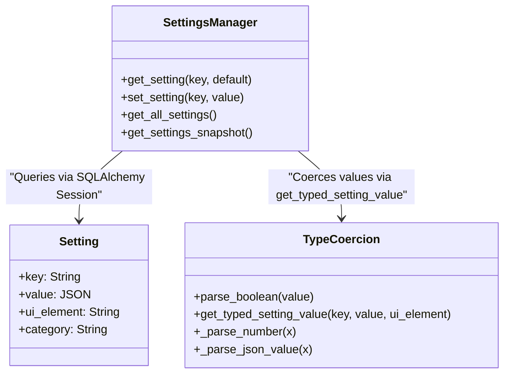

<!-- source: DeepWiki mcp.deepwiki.com · repo LearningCircuit/local-deep-research · page 4 Configuration System · fetched 2026-10-29 -->

# Configuration System

<details>
<summary>Relevant source files</summary>

The following files were used as context for generating this wiki page:

- [docs/BENCHMARKING.md](docs/BENCHMARKING.md)
- [docs/CONFIGURATION.md](docs/CONFIGURATION.md)
- [package-lock.json](package-lock.json)
- [package.json](package.json)
- [src/local_deep_research/__init__.py](src/local_deep_research/__init__.py)
- [src/local_deep_research/__version__.py](src/local_deep_research/__version__.py)
- [src/local_deep_research/advanced_search_system/questions/browsecomp_question.py](src/local_deep_research/advanced_search_system/questions/browsecomp_question.py)
- [src/local_deep_research/advanced_search_system/questions/flexible_browsecomp_question.py](src/local_deep_research/advanced_search_system/questions/flexible_browsecomp_question.py)
- [src/local_deep_research/advanced_search_system/strategies/langgraph_agent_strategy.py](src/local_deep_research/advanced_search_system/strategies/langgraph_agent_strategy.py)
- [src/local_deep_research/advanced_search_system/strategies/topic_organization_strategy.py](src/local_deep_research/advanced_search_system/strategies/topic_organization_strategy.py)
- [src/local_deep_research/advanced_search_system/tools/fetch/__init__.py](src/local_deep_research/advanced_search_system/tools/fetch/__init__.py)
- [src/local_deep_research/advanced_search_system/tools/fetch/prompts.py](src/local_deep_research/advanced_search_system/tools/fetch/prompts.py)
- [src/local_deep_research/api/__init__.py](src/local_deep_research/api/__init__.py)
- [src/local_deep_research/benchmarks/models/__init__.py](src/local_deep_research/benchmarks/models/__init__.py)
- [src/local_deep_research/config/llm_config.py](src/local_deep_research/config/llm_config.py)
- [src/local_deep_research/database/migrations/versions/0009_default_fetch_mode_summary.py](src/local_deep_research/database/migrations/versions/0009_default_fetch_mode_summary.py)
- [src/local_deep_research/defaults/default_settings.json](src/local_deep_research/defaults/default_settings.json)
- [src/local_deep_research/news/__init__.py](src/local_deep_research/news/__init__.py)
- [src/local_deep_research/search_system_factory.py](src/local_deep_research/search_system_factory.py)
- [src/local_deep_research/utilities/log_utils.py](src/local_deep_research/utilities/log_utils.py)
- [src/local_deep_research/web/app.py](src/local_deep_research/web/app.py)
- [src/local_deep_research/web/app_factory.py](src/local_deep_research/web/app_factory.py)
- [src/local_deep_research/web/models/database.py](src/local_deep_research/web/models/database.py)
- [src/local_deep_research/web/routes/api_routes.py](src/local_deep_research/web/routes/api_routes.py)
- [src/local_deep_research/web/routes/history_routes.py](src/local_deep_research/web/routes/history_routes.py)
- [src/local_deep_research/web/routes/research_routes.py](src/local_deep_research/web/routes/research_routes.py)
- [src/local_deep_research/web/routes/settings_routes.py](src/local_deep_research/web/routes/settings_routes.py)
- [src/local_deep_research/web/services/research_service.py](src/local_deep_research/web/services/research_service.py)
- [src/local_deep_research/web/services/socket_service.py](src/local_deep_research/web/services/socket_service.py)
- [src/local_deep_research/web/static/js/components/settings.js](src/local_deep_research/web/static/js/components/settings.js)
- [src/local_deep_research/web/static/js/mobile-navigation.js](src/local_deep_research/web/static/js/mobile-navigation.js)
- [src/local_deep_research/web/static/js/security/url-validator.js](src/local_deep_research/web/static/js/security/url-validator.js)
- [src/local_deep_research/web/static/js/services/formatting.js](src/local_deep_research/web/static/js/services/formatting.js)
- [tests/advanced_search_system/tools/test_fetch_modes.py](tests/advanced_search_system/tools/test_fetch_modes.py)
- [tests/config/test_llm_config_extra_coverage.py](tests/config/test_llm_config_extra_coverage.py)
- [tests/database/test_migration_0009_default_fetch_mode.py](tests/database/test_migration_0009_default_fetch_mode.py)
- [tests/infrastructure_tests/test_urls.test.js](tests/infrastructure_tests/test_urls.test.js)
- [tests/settings/golden_master_settings.json](tests/settings/golden_master_settings.json)
- [tests/settings/test_settings_defaults_integrity.py](tests/settings/test_settings_defaults_integrity.py)
- [tests/strategies/test_langgraph_agent_strategy.py](tests/strategies/test_langgraph_agent_strategy.py)
- [tests/web/services/test_socket_service_coverage.py](tests/web/services/test_socket_service_coverage.py)
- [tests/web/services/test_socket_service_extra_coverage.py](tests/web/services/test_socket_service_extra_coverage.py)
- [tests/web_services/test_socket_service.py](tests/web_services/test_socket_service.py)
- [vite.config.js](vite.config.js)

</details>


The Configuration System provides hierarchical, user-scoped configuration management for Local Deep Research. It implements a five-tier precedence system (Locked > Bootstrap > Environment > Database > Defaults) with type coercion, validation, and administrative locking capabilities. Settings are stored in per-user encrypted SQLCipher databases with thread-safe snapshot access for background research threads.

For details on the underlying management architecture, see [Settings Management](#4.1). For LLM provider-specific configuration, see [LLM Provider Configuration](#4.2). For search engine configuration, see [Search Engine Configuration](#4.3). For library and RAG parameters, see [Library and Collection Settings](#4.4).

---

## Configuration Hierarchy and Precedence

Local Deep Research uses a five-tier configuration system where settings can be defined in multiple locations with explicit precedence rules. The `SettingsManager` resolves these tiers in descending order of priority.

**Diagram: Settings Priority Resolution Flow**
```mermaid
graph TD
    ["SettingsManager.get_setting(key, default)"] --> ["Check LDR_LOCKED_SETTINGS"]
    ["Check LDR_LOCKED_SETTINGS"] -->| "key in locked list" | ["Read from LDR_* env var (fails if not set)"]
    ["Check LDR_LOCKED_SETTINGS"] -->| "not locked" | ["Check bootstrap settings (pre-database)"]
    
    ["Check bootstrap settings (pre-database)"] -->| "is bootstrap setting" | ["Read from LDR_BOOTSTRAP_* env var"]
    ["Check bootstrap settings (pre-database)"] -->| "not bootstrap" | ["Check LDR_* environment variable"]
    
    ["Check LDR_* environment variable"] -->| "env var exists" | ["get_typed_setting_value()"]
    ["Check LDR_* environment variable"] -->| "no env var" | ["Query Setting table in user DB"]
    
    ["Query Setting table in user DB"] -->| "found in DB" | ["get_typed_setting_value()"]
    ["Query Setting table in user DB"] -->| "not in DB" | ["Load from default_settings.json"]
    
    ["Load from default_settings.json"] -->| "found" | ["get_typed_setting_value()"]
    ["Load from default_settings.json"] -->| "not found" | ["Return default parameter"]
    
    ["get_typed_setting_value()"] --> ["Return typed value"]
```
**Sources:** [src/local_deep_research/settings/manager.py:188-214](), [docs/CONFIGURATION.md:1-25](), [src/local_deep_research/defaults/default_settings.json:1-15]()

### Five-Tier Precedence Rules

The precedence order (highest to lowest) ensures that administrative locks and environmental requirements always supersede user preferences:

1.  **Locked Settings**: Keys defined in the `LDR_LOCKED_SETTINGS` environment variable. These are read-only in the UI and **must** have a corresponding `LDR_*` environment variable value [docs/CONFIGURATION.md:14-25]().
2.  **Bootstrap Settings**: Environment-only settings required before the database is initialized, such as `LDR_BOOTSTRAP_DATABASE_URL` or `LDR_BOOTSTRAP_ENCRYPTION_KEY` [docs/CONFIGURATION.md:27-58]().
3.  **Environment Variables**: Overrides using the `LDR_<SETTING_KEY>` format (e.g., `LDR_APP_DEBUG` for `app.debug`). The system converts keys to uppercase and replaces dots with underscores [docs/CONFIGURATION.md:6-12]().
4.  **Database Settings**: Per-user preferences stored in the encrypted `Setting` table of the user's database [src/local_deep_research/database/models/__init__.py:11-16](), [src/local_deep_research/web/routes/settings_routes.py:148-155]().
5.  **Default JSON**: The baseline configuration defined in `default_settings.json` [src/local_deep_research/defaults/default_settings.json:1-199]().

---

## SettingsManager and Type Coercion

The `SettingsManager` class provides the primary interface for configuration access. It handles type coercion from strings (from env/DB) to Python objects based on the `ui_element` metadata defined in the schema.

**Diagram: Configuration Entity Mapping**

**Sources:** [src/local_deep_research/settings/manager.py:188-214](), [src/local_deep_research/web/routes/settings_routes.py:171-180]()

### Key Coercion Logic

The system uses `get_typed_setting_value` to ensure data integrity across the stack:
*   **Checkboxes**: Coerced to `bool` using `parse_boolean`, which follows HTML checkbox semantics (presence = True, explicit "false"/"off" = False) [src/local_deep_research/settings/manager.py:29-92]().
*   **Numbers/Sliders**: Coerced to `int` or `float` using `_parse_number` [src/local_deep_research/settings/manager.py:95-100]().
*   **JSON/Multiselect**: Parsed from string representations into Python dictionaries or lists using `_parse_json_value` or `_parse_multiselect` [src/local_deep_research/settings/manager.py:103-143]().

---

## Configuration Categories

The system categorizes settings to manage the array of research parameters. These categories are defined in the `default_settings.json` metadata.

| Category | Purpose | Example Key |
| :--- | :--- | :--- |
| **App Interface** | Web server, UI themes, and concurrency limits | `app.port`, `app.max_concurrent_researches` |
| **LLM Parameters** | Model selection, provider config, and API keys | `llm.provider`, `llm.model` |
| **Search Parameters** | Search engine API keys and query lengths | `search.tool`, `app.max_user_query_length` |
| **Research Strategy** | Strategy selection and iteration parameters | `search.search_strategy` |
| **Report Generation** | Output formatting and citation styles | `report.citation_format` |

**Sources:** [src/local_deep_research/defaults/default_settings.json:2-150](), [tests/settings/golden_master_settings.json:1-155]()

---

## Thread Safety and Snapshots

Research processes do not query the database for settings at runtime to avoid database contention and ensure consistency. Instead, they receive a **Settings Snapshot** created at the start of the research task.

### Snapshot Mechanism
The `SnapshotSettingsContext` is used during research execution to provide a consistent view of settings for the duration of a thread [src/local_deep_research/web/services/research_service.py:12-13](). This is critical for maintaining integrity when settings are changed in the UI while a research task is already running.

### Thread-Local Context
The system uses `get_setting_from_snapshot` to retrieve values from the current thread's context [src/local_deep_research/config/llm_config.py:25-28](). If a snapshot is not present, it typically raises a `NoSettingsContextError`.

For details on thread-safe management, see [Settings Management](#4.1).

---

## Related Pages
- [Settings Management](#4.1) — Detailed class structures, validation logic, and the `env_registry`.
- [LLM Provider Configuration](#4.2) — Specifics on provider availability checks and context window rules.
- [Search Engine Configuration](#4.3) — Adaptive rate limiting and engine-specific configuration.
- [Library and Collection Settings](#4.4) — Vector store parameters and library storage modes.

**Sources:** [src/local_deep_research/settings/manager.py:1-214](), [docs/CONFIGURATION.md:1-116](), [src/local_deep_research/config/llm_config.py:194-220]()

---

