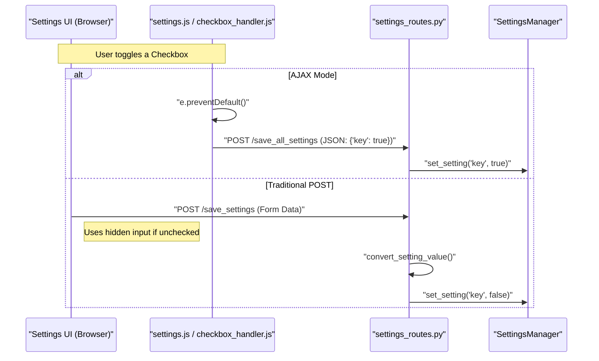

<!-- source: DeepWiki mcp.deepwiki.com · repo LearningCircuit/local-deep-research · page 4.1 Settings Management · fetched 2026-10-29 -->

# Settings Management

<details>
<summary>Relevant source files</summary>

The following files were used as context for generating this wiki page:

- [docs/BENCHMARKING.md](docs/BENCHMARKING.md)
- [src/local_deep_research/__init__.py](src/local_deep_research/__init__.py)
- [src/local_deep_research/advanced_search_system/questions/browsecomp_question.py](src/local_deep_research/advanced_search_system/questions/browsecomp_question.py)
- [src/local_deep_research/advanced_search_system/questions/flexible_browsecomp_question.py](src/local_deep_research/advanced_search_system/questions/flexible_browsecomp_question.py)
- [src/local_deep_research/advanced_search_system/strategies/langgraph_agent_strategy.py](src/local_deep_research/advanced_search_system/strategies/langgraph_agent_strategy.py)
- [src/local_deep_research/advanced_search_system/strategies/topic_organization_strategy.py](src/local_deep_research/advanced_search_system/strategies/topic_organization_strategy.py)
- [src/local_deep_research/advanced_search_system/tools/fetch/__init__.py](src/local_deep_research/advanced_search_system/tools/fetch/__init__.py)
- [src/local_deep_research/advanced_search_system/tools/fetch/prompts.py](src/local_deep_research/advanced_search_system/tools/fetch/prompts.py)
- [src/local_deep_research/api/__init__.py](src/local_deep_research/api/__init__.py)
- [src/local_deep_research/api/settings_utils.py](src/local_deep_research/api/settings_utils.py)
- [src/local_deep_research/benchmarks/models/__init__.py](src/local_deep_research/benchmarks/models/__init__.py)
- [src/local_deep_research/config/llm_config.py](src/local_deep_research/config/llm_config.py)
- [src/local_deep_research/config/search_config.py](src/local_deep_research/config/search_config.py)
- [src/local_deep_research/config/thread_settings.py](src/local_deep_research/config/thread_settings.py)
- [src/local_deep_research/database/migrations/versions/0009_default_fetch_mode_summary.py](src/local_deep_research/database/migrations/versions/0009_default_fetch_mode_summary.py)
- [src/local_deep_research/defaults/default_settings.json](src/local_deep_research/defaults/default_settings.json)
- [src/local_deep_research/news/__init__.py](src/local_deep_research/news/__init__.py)
- [src/local_deep_research/search_system_factory.py](src/local_deep_research/search_system_factory.py)
- [src/local_deep_research/security/security_settings.py](src/local_deep_research/security/security_settings.py)
- [src/local_deep_research/settings/manager.py](src/local_deep_research/settings/manager.py)
- [src/local_deep_research/utilities/log_utils.py](src/local_deep_research/utilities/log_utils.py)
- [src/local_deep_research/web/app.py](src/local_deep_research/web/app.py)
- [src/local_deep_research/web/app_factory.py](src/local_deep_research/web/app_factory.py)
- [src/local_deep_research/web/models/database.py](src/local_deep_research/web/models/database.py)
- [src/local_deep_research/web/routes/api_routes.py](src/local_deep_research/web/routes/api_routes.py)
- [src/local_deep_research/web/routes/history_routes.py](src/local_deep_research/web/routes/history_routes.py)
- [src/local_deep_research/web/routes/research_routes.py](src/local_deep_research/web/routes/research_routes.py)
- [src/local_deep_research/web/routes/settings_routes.py](src/local_deep_research/web/routes/settings_routes.py)
- [src/local_deep_research/web/services/research_service.py](src/local_deep_research/web/services/research_service.py)
- [src/local_deep_research/web/services/socket_service.py](src/local_deep_research/web/services/socket_service.py)
- [src/local_deep_research/web/static/js/components/settings.js](src/local_deep_research/web/static/js/components/settings.js)
- [src/local_deep_research/web_search_engines/search_engine_factory.py](src/local_deep_research/web_search_engines/search_engine_factory.py)
- [tests/advanced_search_system/tools/test_fetch_modes.py](tests/advanced_search_system/tools/test_fetch_modes.py)
- [tests/config/test_llm_config_extra_coverage.py](tests/config/test_llm_config_extra_coverage.py)
- [tests/database/test_migration_0009_default_fetch_mode.py](tests/database/test_migration_0009_default_fetch_mode.py)
- [tests/settings/golden_master_settings.json](tests/settings/golden_master_settings.json)
- [tests/settings/test_boolean_parsing.py](tests/settings/test_boolean_parsing.py)
- [tests/settings/test_manager_behavior.py](tests/settings/test_manager_behavior.py)
- [tests/settings/test_settings_defaults_integrity.py](tests/settings/test_settings_defaults_integrity.py)
- [tests/settings/test_settings_type_mapping.py](tests/settings/test_settings_type_mapping.py)
- [tests/strategies/test_langgraph_agent_strategy.py](tests/strategies/test_langgraph_agent_strategy.py)
- [tests/web/services/test_settings_manager_extended.py](tests/web/services/test_settings_manager_extended.py)
- [tests/web/services/test_socket_service_coverage.py](tests/web/services/test_socket_service_coverage.py)
- [tests/web/services/test_socket_service_extra_coverage.py](tests/web/services/test_socket_service_extra_coverage.py)
- [tests/web_search_engines/engines/test_search_engine_ddg.py](tests/web_search_engines/engines/test_search_engine_ddg.py)
- [tests/web_search_engines/engines/test_search_engine_searxng.py](tests/web_search_engines/engines/test_search_engine_searxng.py)
- [tests/web_search_engines/engines/test_search_engine_wikipedia.py](tests/web_search_engines/engines/test_search_engine_wikipedia.py)
- [tests/web_services/test_socket_service.py](tests/web_services/test_socket_service.py)

</details>


## Purpose and Scope

The Settings Management system in Local Deep Research provides a hierarchical configuration architecture that balances persistence, environment-based overrides, and thread-safe execution. The core of this system is the `SettingsManager` class, which interacts with an encrypted SQLCipher database to store user-specific preferences while respecting global server-wide constraints [src/local_deep_research/settings/manager.py:150-185]().

This page details the implementation of the `SettingsManager`, the dual-mode submission system for web forms, validation logic, and the integrity checks used to maintain configuration consistency.

---

## Settings Architecture and Precedence

Settings resolution follows a strict hierarchy to ensure that administrative overrides (environment variables) take precedence over user modifications in the database.

### Precedence Hierarchy

The following diagram illustrates how the system resolves a setting value when multiple sources exist.

Title: Settings Resolution Priority
```mermaid
graph TD
    "LDR_LOCKED_SETTINGS"["LDR_LOCKED_SETTINGS (Forced Read-Only)"]
    "EnvVar"["Environment Variables (LDR_* / env_registry.py)"]
    "UserDB"["User DB (research.db: Setting Table)"]
    "Defaults"["default_settings.json (Fallback)"]

    "LDR_LOCKED_SETTINGS" -->|"Overrides"| "EnvVar"
    "EnvVar" -->|"Overrides"| "UserDB"
    "UserDB" -->|"Overrides"| "Defaults"

    "FinalValue"["Final Coerced Value"]
    "SettingsManager"["SettingsManager.get_setting()"]

    "Defaults" --> "SettingsManager"
    "UserDB" --> "SettingsManager"
    "EnvVar" --> "SettingsManager"
    "LDR_LOCKED_SETTINGS" --> "SettingsManager"
    "SettingsManager" --> "FinalValue"
```
**Sources:** [src/local_deep_research/settings/manager.py:187-204](), [src/local_deep_research/settings/env_registry.py:25-30](), [src/local_deep_research/database/models/__init__.py:15-16](), [src/local_deep_research/defaults/default_settings.json:1-15]()

### Key Code Entities

| Entity | Role | File |
| :--- | :--- | :--- |
| `SettingsManager` | Primary interface for setting retrieval and persistence via SQLAlchemy sessions. | [src/local_deep_research/settings/manager.py:150-185]() |
| `Setting` | SQLAlchemy model representing a configuration entry in the encrypted DB. | [src/local_deep_research/database/models/__init__.py:15-16]() |
| `env_registry` | Registry mapping environment variables to internal setting keys. | [src/local_deep_research/settings/env_registry.py:25-30]() |
| `get_typed_setting_value` | Logic for coercing raw strings/JSON into Python types based on `ui_element`. | [src/local_deep_research/settings/manager.py:187-204]() |
| `SnapshotSettingsContext` | Context manager for thread-safe settings snapshots during research. | [src/local_deep_research/settings/manager.py:12-13]() |
| `DYNAMIC_SETTINGS` | Settings like `llm.provider` and `search.tool` that skip static option validation. | [src/local_deep_research/web/routes/settings_routes.py:90-91]() |

---

## Dual-Mode Submission (AJAX/POST)

The settings interface supports two distinct submission modes to ensure accessibility (No-JS environments) while providing a modern user experience [src/local_deep_research/web/routes/settings_routes.py:6-39](). This is particularly critical for handling HTML checkboxes, which do not submit a value when unchecked.

### Mode 1: AJAX/JSON Submission (Primary)
Used when JavaScript is enabled. The `settings.js` component intercepts the form submission and reads values directly from the DOM.
- **Endpoint**: `/settings/save_all_settings` [src/local_deep_research/web/routes/settings_routes.py:10]().
- **Checkbox Handling**: Values are read via `checkbox.checked` and sent as JSON booleans [src/local_deep_research/web/routes/settings_routes.py:12-13]().

### Mode 2: Traditional POST (Fallback)
Used in No-JS environments or for progressive enhancement [src/local_deep_research/web/routes/settings_routes.py:17-23]().
- **Endpoint**: `/settings/save_settings` [src/local_deep_research/web/routes/settings_routes.py:17]().
- **Hidden Fallback Pattern**: Each checkbox has a corresponding hidden input (managed by `checkbox_handler.js`). If the checkbox is unchecked, the hidden input provides the value `"false"` to ensure the key is captured [src/local_deep_research/web/routes/settings_routes.py:20-23]().

Title: Settings Submission Data Flow

**Sources:** [src/local_deep_research/web/routes/settings_routes.py:6-39](), [src/local_deep_research/web/routes/settings_routes.py:171-178]()

---

## Type Validation and Coercion

The system uses the `ui_element` metadata to determine how to validate and coerce incoming data. This ensures that a "number" input is never stored as a string in the database [src/local_deep_research/web/routes/settings_routes.py:180-199]().

### Validation Logic
The `validate_setting` function in `settings_routes.py` performs the following checks:
1. **Type Coercion**: Converts the input using `get_typed_setting_value` (which handles JSON parsing and numeric casting) [src/local_deep_research/web/routes/settings_routes.py:172-178]().
2. **Numeric Constraints**: Checks `min_value` and `max_value` for `number`, `slider`, and `range` types [src/local_deep_research/web/routes/settings_routes.py:186-194]().
3. **Option Constraints**: For `select` elements, ensures the value exists in the `options` list, excluding `DYNAMIC_SETTINGS` like `llm.provider`, `llm.model`, or `search.tool` [src/local_deep_research/web/routes/settings_routes.py:197-201]().

### Namespace Validation
New settings created via the web API are subject to prefix validation. Allowed prefixes include `app.`, `llm.`, `search.`, and `rag.` [src/local_deep_research/web/routes/settings_routes.py:98-121](). Blocked prefixes include `auth.`, `security.`, and `server.` [src/local_deep_research/web/routes/settings_routes.py:122-131]().

### Boolean Parsing Semantics
The `parse_boolean` function implements specific HTML checkbox semantics where the presence of a value (even strings like "on" or "enabled") evaluates to `True`, while explicit "false", "off", "0", or empty strings evaluate to `False` [src/local_deep_research/settings/manager.py:28-69]().

**Sources:** [src/local_deep_research/web/routes/settings_routes.py:158-202](), [src/local_deep_research/settings/manager.py:28-92](), [src/local_deep_research/web/routes/settings_routes.py:93-145]()

---

## Research Parameter Resolution

When a research process starts, the system resolves parameters by merging request data with database-stored settings [src/local_deep_research/web/routes/research_routes.py:124-201]().

### Parameter Priority in `_extract_research_params`
The function `_extract_research_params` follows a fallback pattern:
1. Use value from `data` (request JSON) if present [src/local_deep_research/web/routes/research_routes.py:131-132]().
2. Fallback to `settings_manager.get_setting()` for the user's defaults [src/local_deep_research/web/routes/research_routes.py:133-134]().
3. Fallback to a hardcoded default constant if neither exists (e.g., `DEFAULT_OLLAMA_URL`) [src/local_deep_research/web/routes/research_routes.py:160-162]().

Title: Research Parameter Extraction
```mermaid
graph LR
    subgraph "Request Layer"
        "ReqData"["research_routes.py: _extract_research_params(data, ...)"]
    end
    subgraph "Persistence Layer"
        "DB"["SettingsManager.get_setting()"]
    end
    subgraph "Resolution"
        "Extract"["_extract_research_params() logic"]
    end
    
    "ReqData" --> "Extract"
    "DB" --> "Extract"
    "Extract" --> "FinalParams"["Resolved Research Parameters"]
```
**Sources:** [src/local_deep_research/web/routes/research_routes.py:124-201](), [src/local_deep_research/web/services/research_service.py:11-12]()

---

## Integrity Checks and Golden Master

To prevent configuration drift and ensure the system remains stable across updates, Local Deep Research employs "Golden Master" integrity checks.

### Golden Master Integrity Checks
The codebase includes a `golden_master_settings.json` file which serves as the authoritative source for default configuration schemas [tests/settings/golden_master_settings.json:1-15]().
- **Purpose**: Validates that no essential settings are deleted or modified in a way that breaks backward compatibility.
- **Enforcement**: Tests compare the active `default_settings.json` against the golden master to detect unauthorized schema changes.

### Thread-Safe Snapshots
During research, the system uses `SnapshotSettingsContext` to freeze settings [src/local_deep_research/settings/manager.py:12-13](). This ensures that even if a user changes their LLM provider in the UI while a research thread is running, the active thread continues to use the parameters it was started with, preventing state corruption [src/local_deep_research/web/services/research_service.py:11-12]().

### Global Concurrency Control
The server-wide research limit is enforced using a global semaphore `_global_research_semaphore` initialized from the `env_registry` or environment settings [src/local_deep_research/web/services/research_service.py:36-40]().

| Variable | Internal Key | Default |
| :--- | :--- | :--- |
| `LDR_SERVER_MAX_CONCURRENT_RESEARCH` | `server.max_concurrent_research` | 10 |

**Sources:** [tests/settings/golden_master_settings.json:1-15](), [src/local_deep_research/web/services/research_service.py:36-40](), [src/local_deep_research/settings/env_registry.py:30-31](), [src/local_deep_research/settings/manager.py:150-185](), [src/local_deep_research/web/routes/settings_routes.py:89-91]()

---

