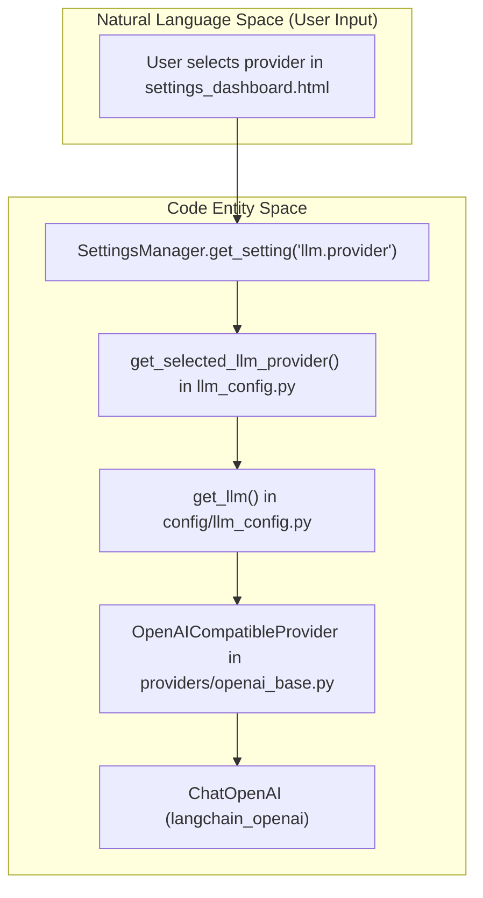
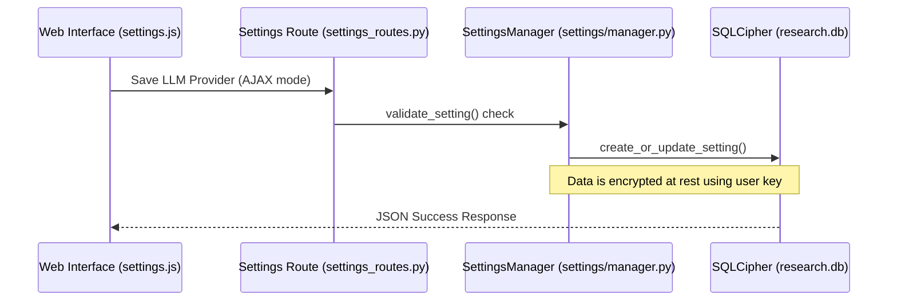

<!-- source: DeepWiki mcp.deepwiki.com · repo LearningCircuit/local-deep-research · page 4.2 LLM Provider Configuration · fetched 2026-10-29 -->

# LLM Provider Configuration

Relevant source files

The following files were used as context for generating this wiki page:

- [src/local_deep_research/__init__.py](src/local_deep_research/__init__.py)
- [src/local_deep_research/api/__init__.py](src/local_deep_research/api/__init__.py)
- [src/local_deep_research/config/llm_config.py](src/local_deep_research/config/llm_config.py)
- [src/local_deep_research/defaults/llm_providers/xai_settings.json](src/local_deep_research/defaults/llm_providers/xai_settings.json)
- [src/local_deep_research/llm/providers/__init__.py](src/local_deep_research/llm/providers/__init__.py)
- [src/local_deep_research/llm/providers/auto_discovery.py](src/local_deep_research/llm/providers/auto_discovery.py)
- [src/local_deep_research/llm/providers/base.py](src/local_deep_research/llm/providers/base.py)
- [src/local_deep_research/llm/providers/implementations/anthropic.py](src/local_deep_research/llm/providers/implementations/anthropic.py)
- [src/local_deep_research/llm/providers/implementations/custom_openai_endpoint.py](src/local_deep_research/llm/providers/implementations/custom_openai_endpoint.py)
- [src/local_deep_research/llm/providers/implementations/google.py](src/local_deep_research/llm/providers/implementations/google.py)
- [src/local_deep_research/llm/providers/implementations/ionos.py](src/local_deep_research/llm/providers/implementations/ionos.py)
- [src/local_deep_research/llm/providers/implementations/lmstudio.py](src/local_deep_research/llm/providers/implementations/lmstudio.py)
- [src/local_deep_research/llm/providers/implementations/ollama.py](src/local_deep_research/llm/providers/implementations/ollama.py)
- [src/local_deep_research/llm/providers/implementations/openai.py](src/local_deep_research/llm/providers/implementations/openai.py)
- [src/local_deep_research/llm/providers/implementations/openrouter.py](src/local_deep_research/llm/providers/implementations/openrouter.py)
- [src/local_deep_research/llm/providers/implementations/xai.py](src/local_deep_research/llm/providers/implementations/xai.py)
- [src/local_deep_research/llm/providers/openai_base.py](src/local_deep_research/llm/providers/openai_base.py)
- [src/local_deep_research/news/__init__.py](src/local_deep_research/news/__init__.py)
- [src/local_deep_research/utilities/log_utils.py](src/local_deep_research/utilities/log_utils.py)
- [src/local_deep_research/web/app.py](src/local_deep_research/web/app.py)
- [src/local_deep_research/web/app_factory.py](src/local_deep_research/web/app_factory.py)
- [src/local_deep_research/web/models/database.py](src/local_deep_research/web/models/database.py)
- [src/local_deep_research/web/routes/api_routes.py](src/local_deep_research/web/routes/api_routes.py)
- [src/local_deep_research/web/routes/history_routes.py](src/local_deep_research/web/routes/history_routes.py)
- [src/local_deep_research/web/routes/research_routes.py](src/local_deep_research/web/routes/research_routes.py)
- [src/local_deep_research/web/routes/settings_routes.py](src/local_deep_research/web/routes/settings_routes.py)
- [src/local_deep_research/web/services/research_service.py](src/local_deep_research/web/services/research_service.py)
- [src/local_deep_research/web/services/socket_service.py](src/local_deep_research/web/services/socket_service.py)
- [src/local_deep_research/web/static/js/components/settings.js](src/local_deep_research/web/static/js/components/settings.js)
- [tests/config/test_llm_config_coverage.py](tests/config/test_llm_config_coverage.py)
- [tests/config/test_llm_config_extended.py](tests/config/test_llm_config_extended.py)
- [tests/config/test_llm_config_extra_coverage.py](tests/config/test_llm_config_extra_coverage.py)
- [tests/config/test_llm_config_missing_coverage.py](tests/config/test_llm_config_missing_coverage.py)
- [tests/config/test_llm_config_providers.py](tests/config/test_llm_config_providers.py)
- [tests/llm_providers/test_auto_discovery.py](tests/llm_providers/test_auto_discovery.py)
- [tests/llm_providers/test_custom_openai_endpoint.py](tests/llm_providers/test_custom_openai_endpoint.py)
- [tests/llm_providers/test_ollama_deep_coverage.py](tests/llm_providers/test_ollama_deep_coverage.py)
- [tests/llm_providers/test_ollama_provider.py](tests/llm_providers/test_ollama_provider.py)
- [tests/llm_providers/test_openai_base.py](tests/llm_providers/test_openai_base.py)
- [tests/web/services/test_socket_service_coverage.py](tests/web/services/test_socket_service_coverage.py)
- [tests/web/services/test_socket_service_extra_coverage.py](tests/web/services/test_socket_service_extra_coverage.py)
- [tests/web_services/test_socket_service.py](tests/web_services/test_socket_service.py)

This page documents the LLM provider configuration system, which manages multiple language model backends (Ollama, OpenAI, Anthropic, etc.) and provides a unified factory interface for instantiating LLM clients.

## Overview

The LLM configuration system ([src/local_deep_research/config/llm_config.py:1-20]()) serves as the bridge between user settings and LangChain LLM instances. It handles:

- **Dynamic Provider Discovery**: Auto-discovery of available backends on module import via `discover_providers` [src/local_deep_research/config/llm_config.py:18-24]().
- **Context Window Management**: Implementation of the **80% context rule** to prevent prompt overflow and manage local memory [src/local_deep_research/config/llm_config.py:202-240]().
- **Availability Checks**: Real-time validation of API keys and local endpoint connectivity for providers like Ollama, OpenAI, and LM Studio [src/local_deep_research/config/llm_config.py:44-157]().
- **Model Post-processing**: Automated think-tag removal for reasoning models via `remove_think_tags` [src/local_deep_research/config/llm_config.py:9-11]().

All configuration respects the `settings_snapshot` pattern for thread safety in background research execution, ensuring that settings do not change mid-research [src/local_deep_research/config/llm_config.py:25-28]().

**Sources:** [src/local_deep_research/config/llm_config.py:1-40](), [src/local_deep_research/web/services/research_service.py:11-12]()

## Supported Providers

The system supports a wide range of local and cloud providers. Availability is checked dynamically before selection in the UI via `get_available_providers` [src/local_deep_research/config/llm_config.py:159-191]().

| Provider ID | Type | Base Implementation | Availability Check Logic |
|-------------|------|----------------------|-------------------|
| `ollama` | Local | `OllamaProvider` | HTTP ping to `llm.ollama.url` [src/local_deep_research/config/llm_config.py:87-97]() |
| `openai` | Cloud | `OpenAIProvider` | Delegated to `OpenAIProvider.is_available` [src/local_deep_research/config/llm_config.py:44-54]() |
| `anthropic` | Cloud | `AnthropicProvider` | Delegated to `AnthropicProvider.is_available` [src/local_deep_research/config/llm_config.py:57-67]() |
| `google` | Cloud | `GoogleProvider` | Delegated to `GoogleProvider.is_available` [src/local_deep_research/config/llm_config.py:130-141]() |
| `openrouter` | Cloud | `OpenRouterProvider` | Delegated to `OpenRouterProvider.is_available` [src/local_deep_research/config/llm_config.py:143-155]() |
| `openai_endpoint`| Custom | `OpenAICompatibleProvider` | Valid URL or API key [src/local_deep_research/config/llm_config.py:70-84]() |
| `lmstudio` | Local | `LMStudioProvider` | HTTP ping to `/models` endpoint [src/local_deep_research/config/llm_config.py:100-111]() |
| `llamacpp` | Local | `LlamaCppProvider` | Connectivity to `llama-server` [src/local_deep_research/config/llm_config.py:113-128]() |

**Sources:** [src/local_deep_research/config/llm_config.py:31-41](), [src/local_deep_research/config/llm_config.py:159-191](), [src/local_deep_research/llm/providers/openai_base.py:14-29]()

## Provider Discovery and Initialization

The system uses a centralized registry to instantiate models based on the current user's settings snapshot.

### Provider Discovery Flow

**Sources:** [src/local_deep_research/config/llm_config.py:194-200](), [src/local_deep_research/llm/providers/openai_base.py:31-44](), [src/local_deep_research/web/routes/settings_routes.py:148-156]()

### ProcessingLLMWrapper and Post-processing

All instantiated models are managed via the LLM configuration pipeline to ensure consistent behavior. A key component is the `ProcessingLLMWrapper` which handles response normalization.

One critical post-processing step is **Think-Tag Removal**. Specialized reasoning models (e.g., DeepSeek-R1) often output internal "thought" blocks inside `<think>` tags. The `remove_think_tags` utility [src/local_deep_research/config/llm_config.py:10-12]() uses regex to strip these blocks before text synthesis, ensuring final reports contain only the intended answer.

**Sources:** [src/local_deep_research/config/llm_config.py:9-11](), [src/local_deep_research/utilities/search_utilities.py:1-20]()

## Context Window and the 80% Rule

The system enforces a strict **80% context rule** to prevent prompt overflow and ensure sufficient space for model reasoning and output tokens.

### Context Logic
1.  **Local Providers** (`ollama`, `llamacpp`, `lmstudio`): Use a configurable local default (via `llm.local_context_window_size`) to prevent host memory issues [src/local_deep_research/config/llm_config.py:211-218]().
2.  **Cloud Providers**: Cap at the user-defined `llm.context_window_size` or default to provider-specific limits [src/local_deep_research/config/llm_config.py:221-240]().
3.  **The 80% Calculation**: The `max_tokens` parameter for the LLM is often derived as 80% of the calculated context window size to leave headroom for completions [src/local_deep_research/config/llm_config.py:202-240]().

**Sources:** [src/local_deep_research/config/llm_config.py:202-240](), [src/local_deep_research/llm/providers/openai_base.py:89-97]()

## API Key and Setting Management

Settings are managed via the `SettingsManager` and stored in the user's encrypted database. The web interface supports both AJAX and traditional POST modes for updates [src/local_deep_research/web/routes/settings_routes.py:10-39]().

### Settings Update Flow

**Sources:** [src/local_deep_research/web/routes/settings_routes.py:10-15](), [src/local_deep_research/web/routes/settings_routes.py:158-202](), [src/local_deep_research/web/static/js/components/settings.js:34-38]()

### Key LLM Settings Reference

| Key | Default | Description |
|-----|---------|-------------|
| `llm.provider` | `ollama` | The primary provider used for research steps [src/local_deep_research/config/llm_config.py:194-200](). |
| `llm.model` | `None` | The specific model identifier for the selected provider [src/local_deep_research/web/routes/research_routes.py:143-147](). |
| `llm.ollama.url` | `http://localhost:11434` | The base URL for local Ollama instances [src/local_deep_research/web/routes/research_routes.py:160-162](). |
| `llm.openai_endpoint.url` | `https://api.openai.com/v1` | Custom OpenAI-compatible API URL [src/local_deep_research/llm/providers/openai_base.py:25](). |
| `llm.local_context_window_size` | `8192` | Context window size for local models to manage memory [src/local_deep_research/config/llm_config.py:213-217](). |
| `llm.max_tokens` | `None` | Optional hard limit on response length [src/local_deep_research/llm/providers/openai_base.py:89-95](). |

**Sources:** [src/local_deep_research/config/llm_config.py:194-218](), [src/local_deep_research/llm/providers/openai_base.py:14-29](), [src/local_deep_research/web/routes/research_routes.py:124-166]()

---

