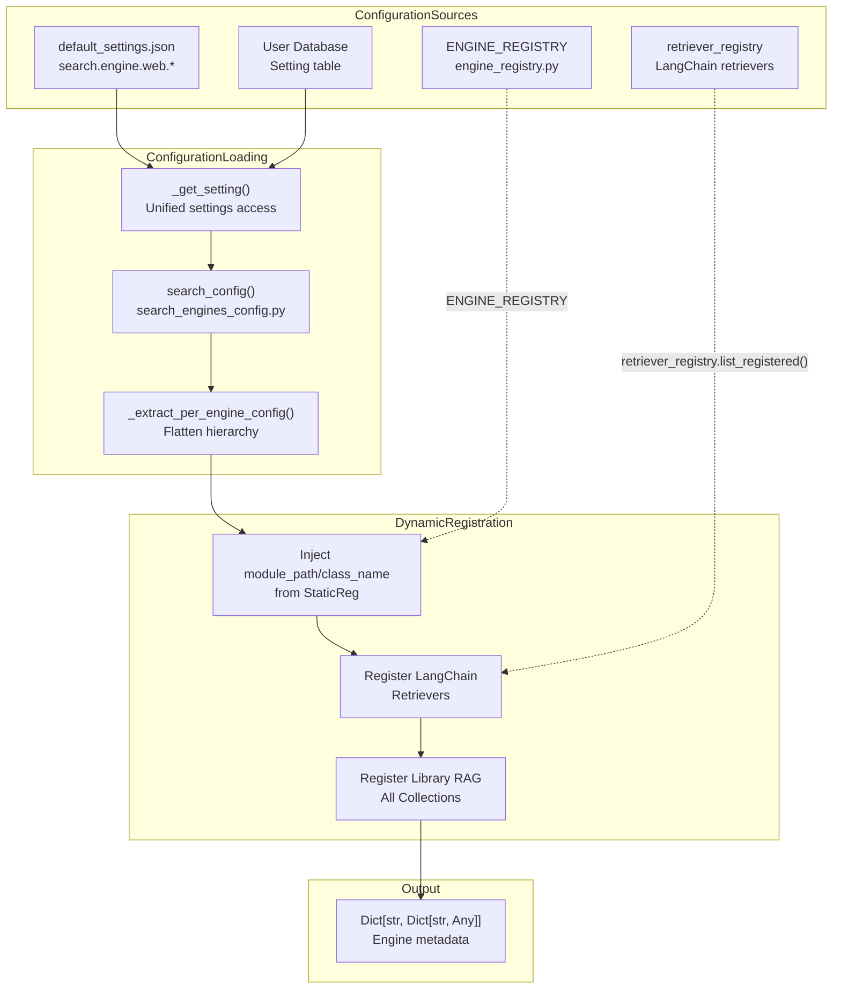
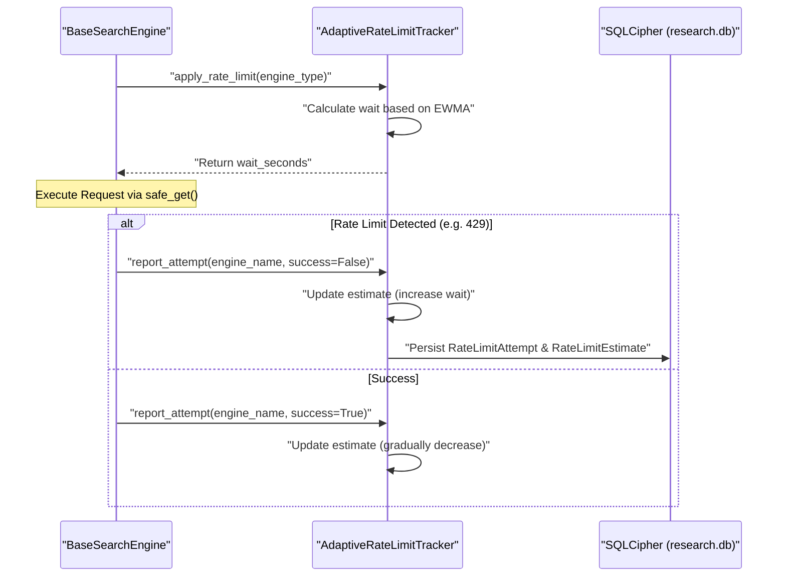
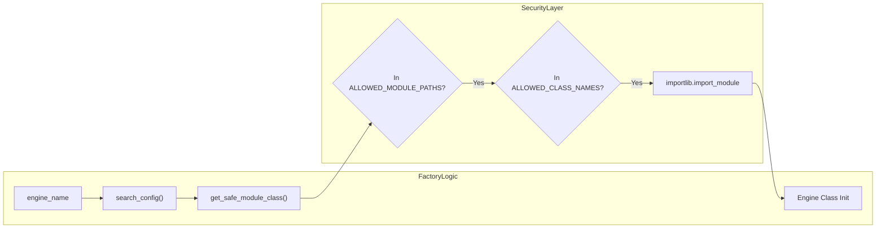

<!-- source: DeepWiki mcp.deepwiki.com · repo LearningCircuit/local-deep-research · page 4.3 Search Engine Configuration · fetched 2026-10-29 -->

# Search Engine Configuration

<details>
<summary>Relevant source files</summary>

The following files were used as context for generating this wiki page:

- [changelog.d/+context-overflow-page-rework.feature.md](changelog.d/+context-overflow-page-rework.feature.md)
- [docs/elasticsearch_search_engine.md](docs/elasticsearch_search_engine.md)
- [docs/elasticsearch_search_engine.zh.md](docs/elasticsearch_search_engine.zh.md)
- [src/local_deep_research/advanced_search_system/filters/journal_reputation_filter.py](src/local_deep_research/advanced_search_system/filters/journal_reputation_filter.py)
- [src/local_deep_research/api/settings_utils.py](src/local_deep_research/api/settings_utils.py)
- [src/local_deep_research/config/search_config.py](src/local_deep_research/config/search_config.py)
- [src/local_deep_research/config/thread_settings.py](src/local_deep_research/config/thread_settings.py)
- [src/local_deep_research/metrics/token_counter.py](src/local_deep_research/metrics/token_counter.py)
- [src/local_deep_research/security/module_whitelist.py](src/local_deep_research/security/module_whitelist.py)
- [src/local_deep_research/security/security_settings.py](src/local_deep_research/security/security_settings.py)
- [src/local_deep_research/settings/manager.py](src/local_deep_research/settings/manager.py)
- [src/local_deep_research/utilities/db_utils.py](src/local_deep_research/utilities/db_utils.py)
- [src/local_deep_research/web/routes/context_overflow_api.py](src/local_deep_research/web/routes/context_overflow_api.py)
- [src/local_deep_research/web/routes/metrics_routes.py](src/local_deep_research/web/routes/metrics_routes.py)
- [src/local_deep_research/web/static/js/components/context-overflow-shared.js](src/local_deep_research/web/static/js/components/context-overflow-shared.js)
- [src/local_deep_research/web/static/js/components/details.js](src/local_deep_research/web/static/js/components/details.js)
- [src/local_deep_research/web/templates/pages/context_overflow.html](src/local_deep_research/web/templates/pages/context_overflow.html)
- [src/local_deep_research/web/templates/pages/cost_analytics.html](src/local_deep_research/web/templates/pages/cost_analytics.html)
- [src/local_deep_research/web/templates/pages/details.html](src/local_deep_research/web/templates/pages/details.html)
- [src/local_deep_research/web/templates/pages/link_analytics.html](src/local_deep_research/web/templates/pages/link_analytics.html)
- [src/local_deep_research/web/templates/pages/metrics.html](src/local_deep_research/web/templates/pages/metrics.html)
- [src/local_deep_research/web/templates/pages/star_reviews.html](src/local_deep_research/web/templates/pages/star_reviews.html)
- [src/local_deep_research/web_search_engines/default_search_engines.py](src/local_deep_research/web_search_engines/default_search_engines.py)
- [src/local_deep_research/web_search_engines/engines/meta_search_engine.py](src/local_deep_research/web_search_engines/engines/meta_search_engine.py)
- [src/local_deep_research/web_search_engines/engines/search_engine_exa.py](src/local_deep_research/web_search_engines/engines/search_engine_exa.py)
- [src/local_deep_research/web_search_engines/rate_limiting/tracker.py](src/local_deep_research/web_search_engines/rate_limiting/tracker.py)
- [src/local_deep_research/web_search_engines/search_engine_factory.py](src/local_deep_research/web_search_engines/search_engine_factory.py)
- [src/local_deep_research/web_search_engines/search_engines_config.py](src/local_deep_research/web_search_engines/search_engines_config.py)
- [tests/security/test_module_whitelist.py](tests/security/test_module_whitelist.py)
- [tests/settings/test_boolean_parsing.py](tests/settings/test_boolean_parsing.py)
- [tests/settings/test_manager_behavior.py](tests/settings/test_manager_behavior.py)
- [tests/settings/test_settings_type_mapping.py](tests/settings/test_settings_type_mapping.py)
- [tests/test_context_overflow_detection.py](tests/test_context_overflow_detection.py)
- [tests/web/routes/test_context_overflow_api.py](tests/web/routes/test_context_overflow_api.py)
- [tests/web/services/test_settings_manager_extended.py](tests/web/services/test_settings_manager_extended.py)
- [tests/web_search_engines/engines/test_search_engine_ddg.py](tests/web_search_engines/engines/test_search_engine_ddg.py)
- [tests/web_search_engines/engines/test_search_engine_exa.py](tests/web_search_engines/engines/test_search_engine_exa.py)
- [tests/web_search_engines/engines/test_search_engine_searxng.py](tests/web_search_engines/engines/test_search_engine_searxng.py)
- [tests/web_search_engines/engines/test_search_engine_wikipedia.py](tests/web_search_engines/engines/test_search_engine_wikipedia.py)
- [tests/web_search_engines/test_search_engines_config.py](tests/web_search_engines/test_search_engines_config.py)

</details>


This document provides a technical deep dive into the search engine configuration system. It covers the hierarchical settings architecture, the adaptive rate limiting mechanism, the security-hardened dynamic loading process, and the `search_engines.toml` configuration structure.

## Configuration Architecture Overview

The configuration system follows a metadata-driven approach where each engine is defined by properties stored in the hierarchical settings database or provided via thread-safe snapshots. The system loads these definitions at runtime and dynamically registers additional engines from retrievers and document collections.

### Data Flow and Registry

The `search_config` function in `search_engines_config.py` acts as the central orchestrator, merging static definitions from the `ENGINE_REGISTRY` with user-specific settings from the database or a `settings_snapshot` [src/local_deep_research/web_search_engines/search_engines_config.py:93-132]().

**Title: Configuration Loading and Registration Flow**

Sources: [src/local_deep_research/web_search_engines/search_engines_config.py:93-169](), [src/local_deep_research/web_search_engines/search_engines_config.py:131-144](), [src/local_deep_research/web_search_engines/search_engines_config.py:146-163]()

---

## Adaptive Rate Limiting

Local Deep Research implements an `AdaptiveRateLimitTracker` that learns optimal retry wait times for each search engine based on historical performance. This prevents aggressive polling while minimizing research latency.

### Implementation Details
The tracker uses an exponentially weighted moving average (EWMA) to update estimates for wait times.

*   **Learning Rate:** Default `0.3`. This controls how quickly new rate limit events influence the wait time estimate [src/local_deep_research/web_search_engines/rate_limiting/tracker.py:79-81]().
*   **Exploration Rate:** Default `0.1`. A small probability that the tracker will attempt a shorter wait time than estimated to "probe" if limits have been lifted [src/local_deep_research/web_search_engines/rate_limiting/tracker.py:76-78]().
*   **Decay:** Estimates decay by `0.95` per day (`decay_per_day`) to ensure that temporary blocks don't permanently throttle an engine [src/local_deep_research/web_search_engines/rate_limiting/tracker.py:82-84]().

### Persistence Flow
Rate limit attempts and estimates are persisted to the user's encrypted `research.db` using the `RateLimitAttempt` and `RateLimitEstimate` models [src/local_deep_research/web_search_engines/rate_limiting/tracker.py:171-180](). In `programmatic_mode`, database persistence is disabled, and the tracker operates in memory-only mode [src/local_deep_research/web_search_engines/rate_limiting/tracker.py:146-153]().

**Title: Adaptive Rate Limiting Persistence Flow**

Sources: [src/local_deep_research/web_search_engines/rate_limiting/tracker.py:48-117](), [src/local_deep_research/web_search_engines/search_engine_base.py:25-35](), [src/local_deep_research/web_search_engines/rate_limiting/tracker.py:162-192]()

---

## Dynamic Engine Loading & Security

Search engines are instantiated via `create_search_engine` in `search_engine_factory.py` [src/local_deep_research/web_search_engines/search_engine_factory.py:13-20](). To prevent arbitrary code execution, the system uses a strict whitelist for module paths and class names.

### Module Whitelist Security
The `get_safe_module_class` function in `module_whitelist.py` ensures that only trusted internal modules can be loaded.

*   **Relative Imports Only:** Module paths must start with a `.` (e.g., `.engines.search_engine_brave`) [src/local_deep_research/security/module_whitelist.py:154-162]().
*   **Strict Whitelists:** Both the `module_path` and the `class_name` must exist in the security registry (`ALLOWED_MODULE_PATHS` and `ALLOWED_CLASS_NAMES`) [src/local_deep_research/security/module_whitelist.py:26-112]().

### Factory Instantiation Flow

**Title: Secure Engine Instantiation**

Sources: [src/local_deep_research/web_search_engines/search_engine_factory.py:13-154](), [src/local_deep_research/security/module_whitelist.py:176-200]()

---

## Configuration Settings

While the system primarily uses a database-backed hierarchical setting model, the conceptual configuration for an engine follows this structure (mapped from `default_settings.json` and the database).

### Engine Configuration Schema

| Setting Key | Description | Default Value |
| :--- | :--- | :--- |
| `search.tool` | The default search engine to use. | `searxng` |
| `search.max_results` | Global limit for initial search results per engine. | `20` |
| `search.max_filtered_results` | Results kept after LLM relevance filtering. | `5` |
| `search.snippets_only` | Whether to retrieve only snippets or full content. | `true` |
| `rate_limiting.learning_rate` | Speed of wait-time adjustment. | `0.3` |
| `rate_limiting.profile` | Preset profile: `conservative`, `balanced`, `aggressive`. | `balanced` |

Sources: [src/local_deep_research/config/search_config.py:38-114](), [src/local_deep_research/web_search_engines/rate_limiting/tracker.py:79-81](), [src/local_deep_research/web_search_engines/rate_limiting/tracker.py:93-101]()

### Specialized Engine Variants
*   **Parallel Search:** Executes multiple engines simultaneously. It can be created via `create_search_engine` using `parallel` or `parallel_scientific` aliases [src/local_deep_research/web_search_engines/search_engine_factory.py:39-60]().
*   **Meta Search:** Uses an LLM to analyze the query via `analyze_query` and select the most appropriate engines (e.g., `arxiv` for scientific queries) [src/local_deep_research/web_search_engines/engines/meta_search_engine.py:94-158]().
*   **Library RAG:** Integrated as a search engine that queries local vector collections using `LibraryRAGSearchEngine` [src/local_deep_research/web_search_engines/search_engines_config.py:183-201]().
*   **LangChain Retrievers:** Custom retrievers can be registered via `retriever_registry` and are automatically wrapped in a `RetrieverSearchEngine` [src/local_deep_research/web_search_engines/search_engine_factory.py:63-73]().

---

## Unified Settings Access

The system uses `_get_setting` in `search_engines_config.py` to abstract away the source of configuration. This allows the search system to function identically in a request context (reading from `db_session`) and in a background research thread (reading from `settings_snapshot`) [src/local_deep_research/web_search_engines/search_engines_config.py:15-56]().

```python
def _get_setting(
    key: str,
    default_value: Any = None,
    db_session: Optional[Session] = None,
    settings_snapshot: Optional[Dict[str, Any]] = None,
    username: Optional[str] = None,
) -> Any:
    # Priority 1: Thread Snapshot
    if settings_snapshot:
        return get_setting_from_snapshot(key, default_value, settings_snapshot)
    
    # Priority 2: Live Database Session
    if db_session:
        settings_manager = get_settings_manager(db_session, username)
        return settings_manager.get_setting(key, default_value)
    
    return default_value
```
Sources: [src/local_deep_research/web_search_engines/search_engines_config.py:15-56](), [src/local_deep_research/config/search_config.py:34-58](), [src/local_deep_research/config/thread_settings.py:64-111]()

---

