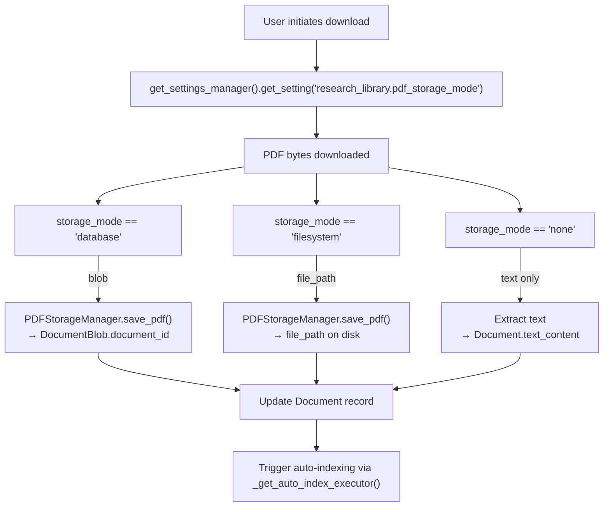
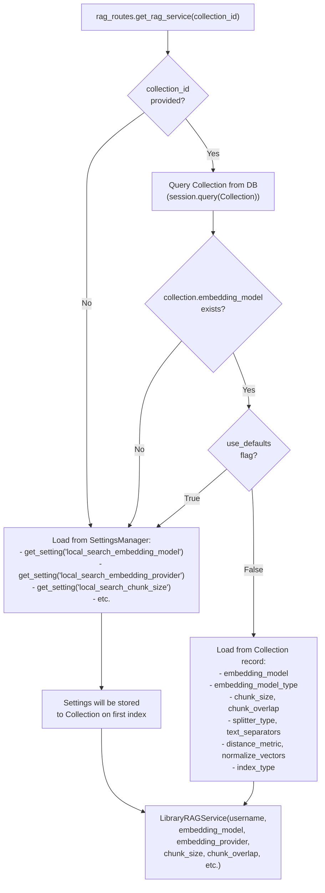
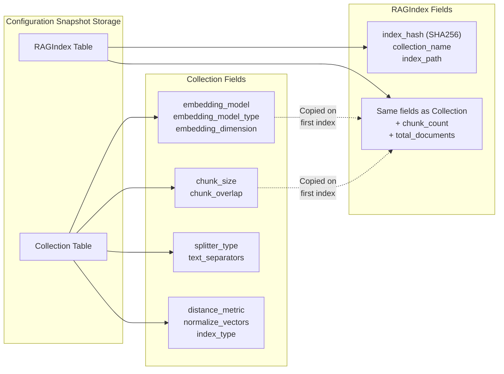

<!-- source: DeepWiki mcp.deepwiki.com · repo LearningCircuit/local-deep-research · page 4.4 Library and Collection Settings · fetched 2026-10-29 -->

# Library and Collection Settings

<details>
<summary>Relevant source files</summary>

The following files were used as context for generating this wiki page:

- [src/local_deep_research/database/models/library.py](src/local_deep_research/database/models/library.py)
- [src/local_deep_research/defaults/research_library/library_settings.json](src/local_deep_research/defaults/research_library/library_settings.json)
- [src/local_deep_research/research_library/deletion/services/collection_deletion.py](src/local_deep_research/research_library/deletion/services/collection_deletion.py)
- [src/local_deep_research/research_library/deletion/services/document_deletion.py](src/local_deep_research/research_library/deletion/services/document_deletion.py)
- [src/local_deep_research/research_library/deletion/utils/cascade_helper.py](src/local_deep_research/research_library/deletion/utils/cascade_helper.py)
- [src/local_deep_research/research_library/routes/library_routes.py](src/local_deep_research/research_library/routes/library_routes.py)
- [src/local_deep_research/research_library/routes/rag_routes.py](src/local_deep_research/research_library/routes/rag_routes.py)
- [src/local_deep_research/research_library/services/download_service.py](src/local_deep_research/research_library/services/download_service.py)
- [src/local_deep_research/research_library/services/library_rag_service.py](src/local_deep_research/research_library/services/library_rag_service.py)
- [src/local_deep_research/research_library/services/library_service.py](src/local_deep_research/research_library/services/library_service.py)
- [src/local_deep_research/research_library/services/pdf_storage_manager.py](src/local_deep_research/research_library/services/pdf_storage_manager.py)
- [src/local_deep_research/research_library/utils/__init__.py](src/local_deep_research/research_library/utils/__init__.py)
- [src/local_deep_research/web/static/css/components/history-icons.css](src/local_deep_research/web/static/css/components/history-icons.css)
- [src/local_deep_research/web/static/js/collection_create.js](src/local_deep_research/web/static/js/collection_create.js)
- [src/local_deep_research/web/static/js/collection_details.js](src/local_deep_research/web/static/js/collection_details.js)
- [src/local_deep_research/web/static/js/collection_upload.js](src/local_deep_research/web/static/js/collection_upload.js)
- [src/local_deep_research/web/static/js/collections_manager.js](src/local_deep_research/web/static/js/collections_manager.js)
- [src/local_deep_research/web/static/js/components/library_search_ui.js](src/local_deep_research/web/static/js/components/library_search_ui.js)
- [src/local_deep_research/web/static/js/components/save_to_collection.js](src/local_deep_research/web/static/js/components/save_to_collection.js)
- [src/local_deep_research/web/static/js/deletion/confirmation_modal.js](src/local_deep_research/web/static/js/deletion/confirmation_modal.js)
- [src/local_deep_research/web/static/js/deletion/delete_manager.js](src/local_deep_research/web/static/js/deletion/delete_manager.js)
- [src/local_deep_research/web/static/js/embedding_settings.js](src/local_deep_research/web/static/js/embedding_settings.js)
- [src/local_deep_research/web/templates/components/storage_mode_modal.html](src/local_deep_research/web/templates/components/storage_mode_modal.html)
- [src/local_deep_research/web/templates/pages/collection_create.html](src/local_deep_research/web/templates/pages/collection_create.html)
- [src/local_deep_research/web/templates/pages/collection_details.html](src/local_deep_research/web/templates/pages/collection_details.html)
- [src/local_deep_research/web/templates/pages/collection_upload.html](src/local_deep_research/web/templates/pages/collection_upload.html)
- [src/local_deep_research/web/templates/pages/collections.html](src/local_deep_research/web/templates/pages/collections.html)
- [src/local_deep_research/web/templates/pages/document_chunks.html](src/local_deep_research/web/templates/pages/document_chunks.html)
- [src/local_deep_research/web/templates/pages/document_details.html](src/local_deep_research/web/templates/pages/document_details.html)
- [src/local_deep_research/web/templates/pages/document_text.html](src/local_deep_research/web/templates/pages/document_text.html)
- [src/local_deep_research/web/templates/pages/download_manager.html](src/local_deep_research/web/templates/pages/download_manager.html)
- [src/local_deep_research/web/templates/pages/embedding_settings.html](src/local_deep_research/web/templates/pages/embedding_settings.html)
- [src/local_deep_research/web/templates/pages/library.html](src/local_deep_research/web/templates/pages/library.html)
- [src/local_deep_research/web_search_engines/engines/search_engine_collection.py](src/local_deep_research/web_search_engines/engines/search_engine_collection.py)
- [src/local_deep_research/web_search_engines/engines/search_engine_library.py](src/local_deep_research/web_search_engines/engines/search_engine_library.py)
- [tests/deletion/test_cascade_integration.py](tests/deletion/test_cascade_integration.py)
- [tests/deletion/test_collection_deletion.py](tests/deletion/test_collection_deletion.py)
- [tests/deletion/test_document_deletion.py](tests/deletion/test_document_deletion.py)
- [tests/research_library/deletion/utils/test_cascade_helper.py](tests/research_library/deletion/utils/test_cascade_helper.py)
- [tests/research_library/deletion/utils/test_cascade_helper_edge_cases.py](tests/research_library/deletion/utils/test_cascade_helper_edge_cases.py)
- [tests/research_library/services/test_pdf_storage_manager.py](tests/research_library/services/test_pdf_storage_manager.py)
- [tests/research_library/services/test_pdf_storage_manager_edge_cases.py](tests/research_library/services/test_pdf_storage_manager_edge_cases.py)
- [tests/research_library/test_utils.py](tests/research_library/test_utils.py)
- [tests/security/test_pdf_path_traversal.py](tests/security/test_pdf_path_traversal.py)

</details>


This page details the configuration system for the Research Library and Collections, including PDF storage modes, RAG indexing parameters, and collection-specific settings. For general configuration management, see [Configuration System](). For RAG system architecture, see [Research Library and RAG System]().

---

## Overview

The library system provides two layers of configuration:

1.  **Global library settings**: Control PDF storage behavior, batch sizes, and default indexing parameters.
2.  **Collection-specific settings**: Override RAG parameters per collection, frozen at index creation time to ensure vector compatibility.

All settings are stored in per-user encrypted SQLCipher databases via the `SettingsManager` and can be overridden via environment variables for deployment control.

**Sources:** [src/local_deep_research/defaults/research_library/library_settings.json:1-127](), [src/local_deep_research/research_library/routes/rag_routes.py:133-154]()

---

## PDF Storage Modes

The library supports three PDF storage strategies, controlled by the `research_library.pdf_storage_mode` setting. This determines how the `PDFStorageManager` handles incoming files during the download pipeline.

| Mode | Description | Storage Location | Encryption | Use Case |
| :--- | :--- | :--- | :--- | :--- |
| `database` | PDFs stored in SQLCipher DB | `DocumentBlob` table | AES-256-CBC | **Recommended**: Secure, portable, per-user isolated. |
| `filesystem` | PDFs saved to disk | `library_root/pdfs/` | None | Large files, external tool access. |
| `none` | Text extraction only | `Document.text_content` | AES-256-CBC | Minimal storage, re-download as needed. |

**Setting Location:** `research_library.pdf_storage_mode` in per-user settings database [src/local_deep_research/research_library/routes/library_routes.py:133-135]().
**Default Value:** `"database"` [src/local_deep_research/database/models/library.py:229-230]().
**Environment Override:** `LDR_RESEARCH_LIBRARY_PDF_STORAGE_MODE`.

### PDF Storage Mode Selection Flow

The `DownloadService` and `PDFStorageManager` coordinate to route bytes based on the active setting.

**Title: PDF Storage Routing Logic**


**Sources:** [src/local_deep_research/research_library/services/download_service.py:89-110](), [src/local_deep_research/database/models/library.py:105-111](), [src/local_deep_research/research_library/services/library_service.py:47-54](), [src/local_deep_research/research_library/routes/rag_routes.py:71-80]()

---

## RAG Indexing Configuration

RAG indexing behavior is controlled by settings that determine embedding generation, text chunking, and FAISS index construction.

### Default RAG Settings

Default settings are stored under the `local_search_*` prefix. The `get_rag_service` function in `rag_routes.py` is responsible for resolving these values.

| Setting | Description | Default | Type |
| :--- | :--- | :--- | :--- |
| `local_search_embedding_provider` | Provider type (`sentence_transformers` or `ollama`) | `"sentence_transformers"` | select |
| `local_search_embedding_model` | Model name (e.g., `all-MiniLM-L6-v2`) | `"all-MiniLM-L6-v2"` | text |
| `local_search_chunk_size` | Characters per chunk | `1000` | number |
| `local_search_chunk_overlap` | Overlap between chunks | `200` | number |
| `local_search_splitter_type` | Chunking strategy (`recursive`, `semantic`, `token`, `sentence`) | `"recursive"` | select |
| `local_search_text_separators` | Split delimiters (JSON array) | `["\n\n", "\n", ". ", " ", ""]` | JSON |
| `local_search_distance_metric` | Similarity metric (`cosine`, `l2`, `dot_product`) | `"cosine"` | select |
| `local_search_normalize_vectors` | L2 normalization for cosine similarity | `true` | boolean |
| `local_search_index_type` | FAISS index type (`flat`, `hnsw`, `ivf`) | `"flat"` | select |

**Sources:** [src/local_deep_research/research_library/services/library_rag_service.py:45-76](), [src/local_deep_research/web/static/js/embedding_settings.js:136-150](), [src/local_deep_research/web_search_engines/engines/search_engine_library.py:66-81]()

### Settings Resolution Flow

The `get_rag_service` helper implements priority logic where collection-specific settings override global defaults unless a force-reindex is requested.

**Title: RAG Service Configuration Resolution**


**Sources:** [src/local_deep_research/research_library/routes/rag_routes.py:94-127](), [src/local_deep_research/web_search_engines/engines/search_engine_collection.py:67-101]()

---

## Collection-Level Settings Storage

Collections store their RAG configuration directly in the `Collection` table. This allows the system to reconstruct the exact vector space (embedding model and dimensions) required to query the associated FAISS index.

### Collection Model RAG Fields

The `Collection` table includes these configuration columns, which are populated when the first document is indexed into the collection.

```python
# From src/local_deep_research/database/models/library.py
class Collection(Base):
    # ... identity fields ...
    
    # RAG Configuration (stored on first index)
    embedding_model = Column(String(100), nullable=True)
    embedding_model_type = Column(Enum(EmbeddingProvider), nullable=True)
    embedding_dimension = Column(Integer, nullable=True)
    
    # Chunking Strategy
    chunk_size = Column(Integer, nullable=True)
    chunk_overlap = Column(Integer, nullable=True)
    splitter_type = Column(String(20), nullable=True)
    text_separators = Column(JSON, nullable=True)
    
    # FAISS Configuration
    distance_metric = Column(String(20), nullable=True)
    normalize_vectors = Column(Boolean, nullable=True)
    index_type = Column(String(20), nullable=True)
```

**Sources:** [src/local_deep_research/database/models/library.py:382-415]()

### Configuration Snapshot Storage

When `LibraryRAGService` creates a new index, it captures the current settings into a `RAGIndex` record and updates the `Collection` record.

**Title: Configuration Persistence Schema**


**Sources:** [src/local_deep_research/database/models/library.py:440-490](), [src/local_deep_research/research_library/services/library_rag_service.py:105-130]()

---

## Upload-Specific Settings

User uploads have a specialized storage setting to enforce security and minimize footprint. The `PDFUploadHandler` in the frontend interacts with these limits.

| Setting | Value | Reason |
| :--- | :--- | :--- |
| `research_library.upload_pdf_storage` | `"database"` or `"none"` | Filesystem storage is disabled for uploads to prevent SSRF/Path Traversal. |
| Default | `"none"` | Optimized for text-only search to keep the encrypted DB size manageable. |
| `max_file_size` | `50MB` (default) | Enforced by `PDFUploadHandler.fetchUploadLimits()`. |

**Sources:** [src/local_deep_research/defaults/research_library/library_settings.json:88-111](), [src/local_deep_research/research_library/routes/rag_routes.py:133-154]()

---

## Performance Considerations

### Auto-Indexing Concurrency
The system uses a global `ThreadPoolExecutor` for auto-indexing tasks to prevent thread proliferation.
*   **Worker Limit:** 4 workers [src/local_deep_research/research_library/routes/rag_routes.py:76-80]().
*   **Naming Prefix:** `auto_index_` [src/local_deep_research/research_library/routes/rag_routes.py:78-78]().

### Index Type Performance
*   **`flat`**: Exact search using `IndexFlatL2` or `IndexFlatIP`. Best for collections < 5,000 documents [src/local_deep_research/research_library/services/library_rag_service.py:37-38]().
*   **`hnsw`**: Approximate search using `IndexHNSWFlat`. Recommended for large libraries [src/local_deep_research/research_library/services/library_rag_service.py:37-38]().

**Sources:** [src/local_deep_research/research_library/routes/rag_routes.py:66-80](), [src/local_deep_research/research_library/services/library_rag_service.py:37-40]()

---

## Environment Variable Reference

Complete list of library-related environment overrides:

| Environment Variable | Setting Key | Default |
| :--- | :--- | :--- |
| `LDR_RESEARCH_LIBRARY_STORAGE_PATH` | `research_library.storage_path` | `~/Documents/LocalDeepResearch/Library` |
| `LDR_RESEARCH_LIBRARY_SHARED_LIBRARY` | `research_library.shared_library` | `false` |
| `LDR_RESEARCH_LIBRARY_PDF_STORAGE_MODE` | `research_library.pdf_storage_mode` | `"database"` |
| `LDR_RESEARCH_LIBRARY_UPLOAD_PDF_STORAGE` | `research_library.upload_pdf_storage` | `"none"` |
| `LDR_RESEARCH_LIBRARY_MAX_PDF_SIZE_MB` | `research_library.max_pdf_size_mb` | `100` |

**Sources:** [src/local_deep_research/defaults/research_library/library_settings.json:1-127]()

---

