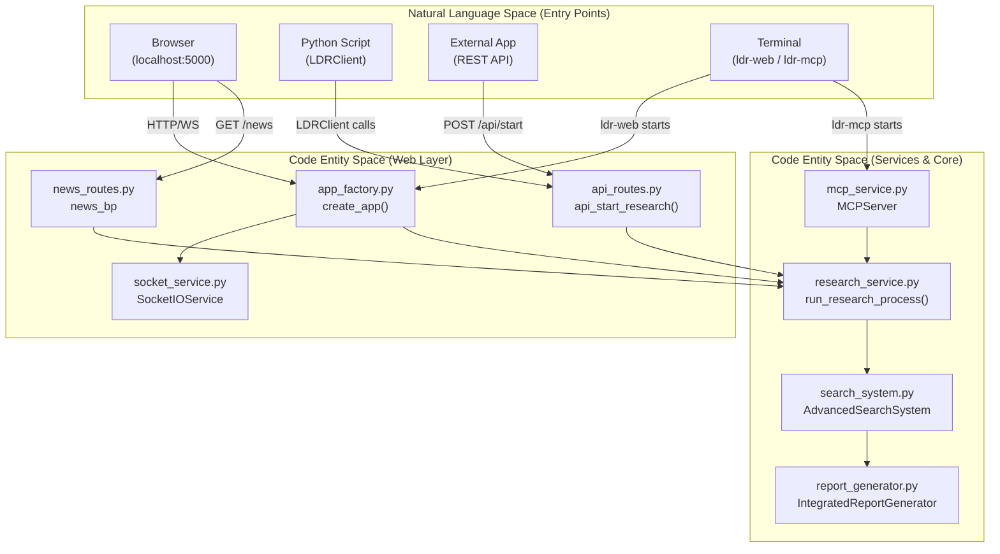
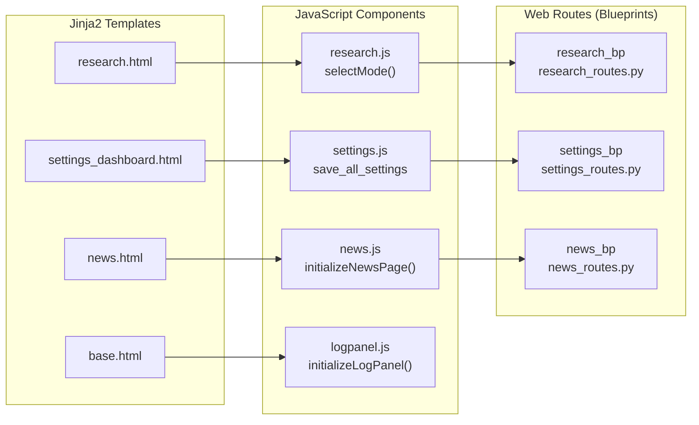

<!-- source: DeepWiki mcp.deepwiki.com · repo LearningCircuit/local-deep-research · page 5 User Interfaces · fetched 2026-10-29 -->

# User Interfaces

Relevant source files

The following files were used as context for generating this wiki page:

- [.github/CODEOWNERS](.github/CODEOWNERS)
- [README.md](README.md)
- [docker-compose.gpu.override.yml](docker-compose.gpu.override.yml)
- [docs/CI_CD_INFRASTRUCTURE.md](docs/CI_CD_INFRASTRUCTURE.md)
- [docs/SECURITY_REVIEW_PROCESS.md](docs/SECURITY_REVIEW_PROCESS.md)
- [docs/SQLCIPHER_INSTALL.md](docs/SQLCIPHER_INSTALL.md)
- [docs/decisions/0001-remove-detect-secrets.md](docs/decisions/0001-remove-detect-secrets.md)
- [docs/developing.md](docs/developing.md)
- [docs/docker-compose-guide.md](docs/docker-compose-guide.md)
- [docs/install-pip.md](docs/install-pip.md)
- [docs/installation.md](docs/installation.md)
- [eslint.config.js](eslint.config.js)
- [src/local_deep_research/__init__.py](src/local_deep_research/__init__.py)
- [src/local_deep_research/api/__init__.py](src/local_deep_research/api/__init__.py)
- [src/local_deep_research/config/llm_config.py](src/local_deep_research/config/llm_config.py)
- [src/local_deep_research/database/sqlcipher_compat.py](src/local_deep_research/database/sqlcipher_compat.py)
- [src/local_deep_research/news/__init__.py](src/local_deep_research/news/__init__.py)
- [src/local_deep_research/utilities/log_utils.py](src/local_deep_research/utilities/log_utils.py)
- [src/local_deep_research/web/app.py](src/local_deep_research/web/app.py)
- [src/local_deep_research/web/app_factory.py](src/local_deep_research/web/app_factory.py)
- [src/local_deep_research/web/models/database.py](src/local_deep_research/web/models/database.py)
- [src/local_deep_research/web/routes/api_routes.py](src/local_deep_research/web/routes/api_routes.py)
- [src/local_deep_research/web/routes/history_routes.py](src/local_deep_research/web/routes/history_routes.py)
- [src/local_deep_research/web/routes/research_routes.py](src/local_deep_research/web/routes/research_routes.py)
- [src/local_deep_research/web/routes/settings_routes.py](src/local_deep_research/web/routes/settings_routes.py)
- [src/local_deep_research/web/services/research_service.py](src/local_deep_research/web/services/research_service.py)
- [src/local_deep_research/web/services/socket_service.py](src/local_deep_research/web/services/socket_service.py)
- [src/local_deep_research/web/static/js/components/fallback/ui.js](src/local_deep_research/web/static/js/components/fallback/ui.js)
- [src/local_deep_research/web/static/js/components/history.js](src/local_deep_research/web/static/js/components/history.js)
- [src/local_deep_research/web/static/js/components/library_search.js](src/local_deep_research/web/static/js/components/library_search.js)
- [src/local_deep_research/web/static/js/components/logpanel.js](src/local_deep_research/web/static/js/components/logpanel.js)
- [src/local_deep_research/web/static/js/components/research.js](src/local_deep_research/web/static/js/components/research.js)
- [src/local_deep_research/web/static/js/components/settings.js](src/local_deep_research/web/static/js/components/settings.js)
- [src/local_deep_research/web/static/js/components/subscription-manager.js](src/local_deep_research/web/static/js/components/subscription-manager.js)
- [src/local_deep_research/web/static/js/pages/news.js](src/local_deep_research/web/static/js/pages/news.js)
- [src/local_deep_research/web/static/js/pages/subscriptions.js](src/local_deep_research/web/static/js/pages/subscriptions.js)
- [src/local_deep_research/web/static/js/research_form.js](src/local_deep_research/web/static/js/research_form.js)
- [src/local_deep_research/web/static/js/security/xss-protection.js](src/local_deep_research/web/static/js/security/xss-protection.js)
- [src/local_deep_research/web/static/js/services/socket.js](src/local_deep_research/web/static/js/services/socket.js)
- [src/local_deep_research/web/static/js/services/ui.js](src/local_deep_research/web/static/js/services/ui.js)
- [src/local_deep_research/web/static/js/utils/log-helpers.js](src/local_deep_research/web/static/js/utils/log-helpers.js)
- [src/local_deep_research/web/templates/pages/research.html](src/local_deep_research/web/templates/pages/research.html)
- [tests/config/test_llm_config_extra_coverage.py](tests/config/test_llm_config_extra_coverage.py)
- [tests/infrastructure_tests/test_xss_protection.test.js](tests/infrastructure_tests/test_xss_protection.test.js)
- [tests/js/utils/form-validation.test.js](tests/js/utils/form-validation.test.js)
- [tests/ui_tests/playwright/tests/theme-visual-regression.spec.js](tests/ui_tests/playwright/tests/theme-visual-regression.spec.js)
- [tests/web/services/test_socket_service_coverage.py](tests/web/services/test_socket_service_coverage.py)
- [tests/web/services/test_socket_service_extra_coverage.py](tests/web/services/test_socket_service_extra_coverage.py)
- [tests/web_services/test_socket_service.py](tests/web_services/test_socket_service.py)

This page provides a high-level overview of the multiple access patterns available in Local Deep Research: the **web UI**, the **HTTP REST API**, the **Python programmatic API**, **CLI tools**, and the **MCP server**. It serves as a map of entry points and their relationships to the application core.

For the underlying request lifecycle once a query is submitted, see [Research Service and Execution Lifecycle](#3.3). For settings that control what the UI exposes, see [Settings Management](#4.1). Detailed documentation for each access pattern is in the child pages: [Web Interface](#5.1), [REST API](#5.2), [Python API](#5.3), and [CLI Tools and MCP Server](#5.4).

---

## Access Patterns Summary

| Pattern | Entry Point | Typical User |
|---|---|---|
| **Web UI** | `http://localhost:5000` | Interactive research, configuration, history browsing, library management, and news monitoring. |
| **HTTP REST API** | `POST /api/start` | Automated scripts, external web integrations, monitoring tools. |
| **Python API** | `local_deep_research.api` | Enterprise Python applications, LangChain/LlamaIndex pipelines. |
| **CLI** | `ldr`, `ldr-web`, `ldr-mcp` | Server administration, local terminal research, AI IDE integration. |
| **MCP Server** | `ldr-mcp` | Claude Desktop/Code users via Model Context Protocol. |

All patterns ultimately converge on the same `AdvancedSearchSystem` [src/local_deep_research/web/services/research_service.py:24]() and `IntegratedReportGenerator` [src/local_deep_research/web/services/research_service.py:23]() in the research core. Entry points are defined as console scripts in the project configuration. Authentication is required for the web UI and REST API to unlock per-user encrypted SQLCipher databases [src/local_deep_research/web/app_factory.py:141-152]().

---

## Architecture: Access Patterns to Code Entities

The following diagram bridges the gap between natural language interaction and the specific code entities that handle them.

**Diagram: Access Patterns and Their Code-Level Entry Points**

Sources: [src/local_deep_research/web/app_factory.py:60-105](), [src/local_deep_research/web/routes/api_routes.py:75-87](), [src/local_deep_research/web/services/research_service.py:58-60](), [src/local_deep_research/web/routes/research_routes.py:72-113]()

---

## Web Interface

The web interface is a Flask-rendered application [src/local_deep_research/web/app_factory.py:105]() utilizing a Vite-built frontend. It is designed for privacy-first interaction with comprehensive research controls and a modern dark-themed UI.

**Diagram: Frontend Components and Logic**

Sources: [src/local_deep_research/web/routes/research_routes.py:72-113](), [src/local_deep_research/web/routes/settings_routes.py:83](), [src/local_deep_research/web/static/js/components/research.js:80-96](), [src/local_deep_research/web/static/js/pages/news.js:141-145](), [src/local_deep_research/web/static/js/components/logpanel.js:38-70]()

### Key UI Features
*   **Research Form:** Supports "Quick Summary" and "Detailed Report" modes [src/local_deep_research/web/templates/pages/research.html:52-69](). It features a dynamic model provider selector that updates available models from providers like Ollama, OpenAI, and Anthropic [src/local_deep_research/web/static/js/components/research.js:98-117]().
*   **Settings Dashboard:** Manages complex configuration state across categories. It supports dual-mode submission: `AJAX/JSON` for modern browsers and traditional `POST` for accessibility [src/local_deep_research/web/routes/settings_routes.py:8-38]().
*   **News Feed:** A specialized page for monitoring breaking news stories with semantic search capabilities [src/local_deep_research/web/static/js/pages/news.js:82-88](). It uses an optimized table query template to synthesize news from real, verifiable sources [src/local_deep_research/web/static/js/pages/news.js:91-138]().
*   **Log Panel:** A persistent component for monitoring research progress in real-time [src/local_deep_research/web/static/js/components/logpanel.js:24-32](). It handles log entry display, filtering, and auto-scrolling for active research tasks [src/local_deep_research/web/static/js/components/logpanel.js:113-115]().

For details, see [Web Interface](#5.1).

---

## REST API

The REST API provides programmatic access to the research engine via standard HTTP methods. It is secured by the same `ProxyFix` and `SecureCookieMiddleware` as the web interface [src/local_deep_research/web/app_factory.py:129-152]().

*   **Endpoint Control:** The API supports starting research [src/local_deep_research/web/routes/api_routes.py:75-87](), checking status [src/local_deep_research/web/routes/api_routes.py:90-134](), and terminating active processes [src/local_deep_research/web/routes/api_routes.py:137-168]().
*   **Concurrency Control:** API requests respect the `_global_research_semaphore` (defaulting to 10 concurrent tasks) to prevent system overload [src/local_deep_research/web/services/research_service.py:37-40]().
*   **Rate Limiting:** Protects endpoints using `flask-limiter`, with specific limits for settings updates [src/local_deep_research/web/routes/settings_routes.py:69]() and file uploads [src/local_deep_research/web/routes/research_routes.py:31-34]().

For details, see [REST API](#5.2).

---

## Python API

The Python API allows developers to integrate Local Deep Research directly into their Python applications. It is defined in the `local_deep_research.api` module.

*   **LDRClient:** The primary interface for programmatic interaction.
*   **Research Functions:** Provides convenience functions like `quick_query` and `quick_summary` for rapid integration.
*   **Thread Safety:** Ensures that background research tasks do not conflict with the main application thread through the `@thread_cleanup` decorator [src/local_deep_research/web/services/research_service.py:20]() and `SnapshotSettingsContext` [src/local_deep_research/web/services/research_service.py:12]().

For details, see [Python API](#5.3).

---

## CLI Tools and MCP Server

The project provides several command-line entry points for different operational modes.

*   **CLI Commands:** 
    *   `ldr`: Direct command-line research execution.
    *   `ldr-web`: Launches the Flask application factory using the custom `DiskSpoolingRequest` for memory-efficient file handling [src/local_deep_research/web/app_factory.py:45-58]().
*   **MCP Server:** The `ldr-mcp` command starts a Model Context Protocol server. This allows AI agents (like Claude Desktop) to use Local Deep Research as a tool. It leverages the `MCPServer` to expose tools like `quick_research` and `generate_report` to external LLM agents.

For details, see [CLI Tools and MCP Server](#5.4).

Sources: [src/local_deep_research/web/app_factory.py:122-136](), [src/local_deep_research/web/services/research_service.py:37-40](), [src/local_deep_research/web/routes/api_routes.py:137-147](), [src/local_deep_research/web/routes/settings_routes.py:8-38]()

---

