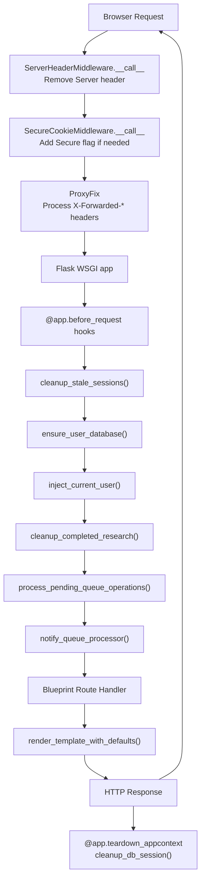
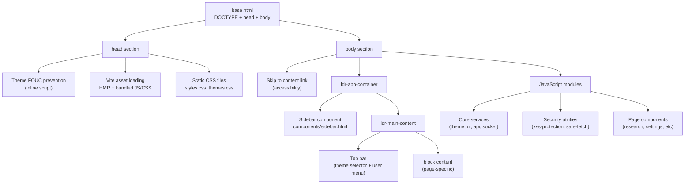
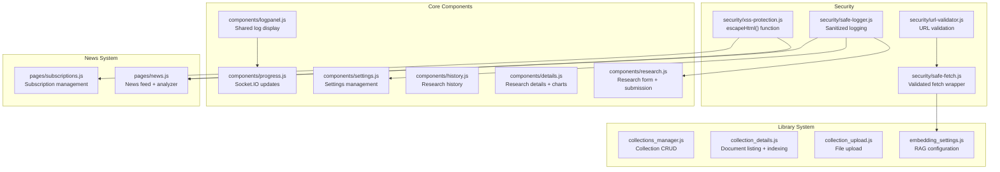

<!-- source: DeepWiki mcp.deepwiki.com · repo LearningCircuit/local-deep-research · page 5.1 Web Interface · fetched 2026-10-29 -->

# Web Interface

<details>
<summary>Relevant source files</summary>

The following files were used as context for generating this wiki page:

- [eslint.config.js](eslint.config.js)
- [src/local_deep_research/web/static/css/mobile-navigation.css](src/local_deep_research/web/static/css/mobile-navigation.css)
- [src/local_deep_research/web/static/css/mobile-responsive.css](src/local_deep_research/web/static/css/mobile-responsive.css)
- [src/local_deep_research/web/static/css/news-enhanced.css](src/local_deep_research/web/static/css/news-enhanced.css)
- [src/local_deep_research/web/static/css/news.css](src/local_deep_research/web/static/css/news.css)
- [src/local_deep_research/web/static/css/settings-mobile-fix.css](src/local_deep_research/web/static/css/settings-mobile-fix.css)
- [src/local_deep_research/web/static/css/settings.css](src/local_deep_research/web/static/css/settings.css)
- [src/local_deep_research/web/static/css/styles.css](src/local_deep_research/web/static/css/styles.css)
- [src/local_deep_research/web/static/css/subscriptions.css](src/local_deep_research/web/static/css/subscriptions.css)
- [src/local_deep_research/web/static/js/components/fallback/ui.js](src/local_deep_research/web/static/js/components/fallback/ui.js)
- [src/local_deep_research/web/static/js/components/history.js](src/local_deep_research/web/static/js/components/history.js)
- [src/local_deep_research/web/static/js/components/library_search.js](src/local_deep_research/web/static/js/components/library_search.js)
- [src/local_deep_research/web/static/js/components/logpanel.js](src/local_deep_research/web/static/js/components/logpanel.js)
- [src/local_deep_research/web/static/js/components/progress.js](src/local_deep_research/web/static/js/components/progress.js)
- [src/local_deep_research/web/static/js/components/research.js](src/local_deep_research/web/static/js/components/research.js)
- [src/local_deep_research/web/static/js/components/results.js](src/local_deep_research/web/static/js/components/results.js)
- [src/local_deep_research/web/static/js/components/settings_sync.js](src/local_deep_research/web/static/js/components/settings_sync.js)
- [src/local_deep_research/web/static/js/components/subscription-manager.js](src/local_deep_research/web/static/js/components/subscription-manager.js)
- [src/local_deep_research/web/static/js/news-enhancements.js](src/local_deep_research/web/static/js/news-enhancements.js)
- [src/local_deep_research/web/static/js/pages/news.js](src/local_deep_research/web/static/js/pages/news.js)
- [src/local_deep_research/web/static/js/pages/subscriptions.js](src/local_deep_research/web/static/js/pages/subscriptions.js)
- [src/local_deep_research/web/static/js/research_form.js](src/local_deep_research/web/static/js/research_form.js)
- [src/local_deep_research/web/static/js/security/xss-protection.js](src/local_deep_research/web/static/js/security/xss-protection.js)
- [src/local_deep_research/web/static/js/services/socket.js](src/local_deep_research/web/static/js/services/socket.js)
- [src/local_deep_research/web/static/js/services/theme.js](src/local_deep_research/web/static/js/services/theme.js)
- [src/local_deep_research/web/static/js/services/ui.js](src/local_deep_research/web/static/js/services/ui.js)
- [src/local_deep_research/web/static/js/utils/log-helpers.js](src/local_deep_research/web/static/js/utils/log-helpers.js)
- [src/local_deep_research/web/templates/base.html](src/local_deep_research/web/templates/base.html)
- [src/local_deep_research/web/templates/components/custom_dropdown.html](src/local_deep_research/web/templates/components/custom_dropdown.html)
- [src/local_deep_research/web/templates/components/log_panel.html](src/local_deep_research/web/templates/components/log_panel.html)
- [src/local_deep_research/web/templates/components/settings_form.html](src/local_deep_research/web/templates/components/settings_form.html)
- [src/local_deep_research/web/templates/pages/benchmark.html](src/local_deep_research/web/templates/pages/benchmark.html)
- [src/local_deep_research/web/templates/pages/history.html](src/local_deep_research/web/templates/pages/history.html)
- [src/local_deep_research/web/templates/pages/news-subscription-form.html](src/local_deep_research/web/templates/pages/news-subscription-form.html)
- [src/local_deep_research/web/templates/pages/news.html](src/local_deep_research/web/templates/pages/news.html)
- [src/local_deep_research/web/templates/pages/news_cleaned.html](src/local_deep_research/web/templates/pages/news_cleaned.html)
- [src/local_deep_research/web/templates/pages/progress.html](src/local_deep_research/web/templates/pages/progress.html)
- [src/local_deep_research/web/templates/pages/research.html](src/local_deep_research/web/templates/pages/research.html)
- [src/local_deep_research/web/templates/pages/results.html](src/local_deep_research/web/templates/pages/results.html)
- [src/local_deep_research/web/templates/pages/subscriptions.html](src/local_deep_research/web/templates/pages/subscriptions.html)
- [src/local_deep_research/web/templates/settings_dashboard.html](src/local_deep_research/web/templates/settings_dashboard.html)
- [src/local_deep_research/web/utils/theme_helper.py](src/local_deep_research/web/utils/theme_helper.py)
- [tests/infrastructure_tests/test_xss_protection.test.js](tests/infrastructure_tests/test_xss_protection.test.js)
- [tests/js/utils/form-validation.test.js](tests/js/utils/form-validation.test.js)
- [tests/theme_tests/test_theme_system.py](tests/theme_tests/test_theme_system.py)
- [tests/ui_tests/playwright/playwright.config.js](tests/ui_tests/playwright/playwright.config.js)
- [tests/ui_tests/playwright/tests/auth.setup.js](tests/ui_tests/playwright/tests/auth.setup.js)
- [tests/ui_tests/playwright/tests/helpers/auth.js](tests/ui_tests/playwright/tests/helpers/auth.js)
- [tests/ui_tests/playwright/tests/theme-visual-regression.spec.js](tests/ui_tests/playwright/tests/theme-visual-regression.spec.js)

</details>


The Web Interface provides the primary user-facing frontend for Local Deep Research, implemented as a Flask web application with server-side Jinja2 templating and JavaScript-enhanced interactivity. It supports research orchestration, settings management, document library operations, real-time metrics, and news monitoring.

For information about REST API endpoints used by the web interface, see [REST API](). For backend research orchestration, see [Research Service and Lifecycle](). For authentication and user management, see [Database and Security]().

---

## Architecture Overview

The web interface follows a traditional server-rendered architecture with progressive enhancement via JavaScript. The Flask application serves HTML templates that include JavaScript modules for interactivity, real-time updates via Socket.IO, and AJAX-based form submissions.

### Request Processing Flow



**Sources:** [src/local_deep_research/web/app_factory.py:121-194](), [src/local_deep_research/web/app_factory.py:199-221](), [src/local_deep_research/web/app_factory.py:483-555]()

The middleware stack processes requests in layers. WSGI middleware (`ServerHeaderMiddleware`, `SecureCookieMiddleware`) wraps the Flask app before `ProxyFix`. Flask's `before_request` hooks run sequentially: session cleanup, database initialization, user injection, research cleanup, queue processing, and queue notification. The `teardown_appcontext` ensures database sessions are closed after each request.

---

## Template System

### Base Template Structure

The `base.html` template provides the foundation for all pages, implementing a consistent layout with theme support, navigation, and JavaScript module loading.



**Sources:** [src/local_deep_research/web/templates/base.html:1-160]()

#### Theme Prevention of Flash of Unstyled Content (FOUC)

The base template includes an inline script that executes before page rendering to apply the user's saved theme immediately:

```javascript
// Lines 14-32 of base.html
var validThemes = {{ get_themes_json()|safe }};
var userId = {{ session.username|default("anonymous", true)|tojson }};
var storageKey = 'ldr-theme-' + userId;
var theme = localStorage.getItem(storageKey) || 'system';
```

This prevents the default theme from briefly displaying before the user's preference loads. It validates the theme against `validThemes` and falls back to `hashed` if invalid [src/local_deep_research/web/templates/base.html:14-33]().

---

## JavaScript Architecture

The frontend JavaScript follows a modular architecture with service layers, component modules, and security utilities.

### Module Organization



**Sources:** [src/local_deep_research/web/static/js/pages/news.js:1-50](), [src/local_deep_research/web/static/js/components/logpanel.js:16-24](), [src/local_deep_research/web/static/js/pdf_upload_handler.js:6-18]()

### Security Utilities

#### XSS Protection and Safe Rendering
The system implements multiple layers of protection. Components like the news feed use `DOMPurify` for safe HTML rendering via `safeRenderHTML` [src/local_deep_research/web/static/js/pages/news.js:5-34](). It also includes `safeHref` to block `javascript:` or `data:` schemes in attributes [src/local_deep_research/web/static/js/pages/news.js:37-50](). In `logpanel.js`, a local `escapeHtmlFallback` is used to ensure sanitization even if external scripts fail to load [src/local_deep_research/web/static/js/components/logpanel.js:9-10]().

#### Safe Logger (`security/safe-logger.js`)
All frontend modules utilize `SafeLogger` for telemetry and debugging to ensure logs are sanitized before reaching the console [src/local_deep_research/web/static/js/pages/news.js:142-143]().

---

## Research Interface

The research form allows users to trigger summaries or detailed reports with local or cloud models.

### Form Features
- **Research Modes**: Supports "Quick Summary" and "Detailed Report" modes [src/local_deep_research/web/templates/pages/research.html:52-69]().
- **Dynamic Providers**: Model providers (Ollama, LM Studio, OpenAI, etc.) are populated dynamically from the API [src/local_deep_research/web/static/js/components/research.js:98-117]().
- **Log Panel**: A shared `LogPanel` component displays real-time execution logs. It maintains a maximum of 500 entries (`MAX_LOG_ENTRIES`) to prevent memory leaks [src/local_deep_research/web/static/js/components/logpanel.js:21-22](). It tracks state globally via `window._logPanelState` [src/local_deep_research/web/static/js/components/logpanel.js:24-32]().
- **Progress Tracking**: The `ProgressJS` component manages real-time status updates via Socket.IO, updating the `progress-bar` and `status-text` elements [src/local_deep_research/web/static/js/components/progress.js:50-52]().

**Sources:** [src/local_deep_research/web/templates/pages/research.html:51-110](), [src/local_deep_research/web/static/js/components/logpanel.js:1-100](), [src/local_deep_research/web/static/js/components/progress.js:1-105]()

---

## News Feed and Subscriptions

The News system provides a real-time monitoring interface for breaking news, categorized by impact and topic.

### News Feed (`pages/news.js`)
- **Semantic Search**: Supports `hybrid`, `text`, and `semantic` search modes defined in `NEWS_SM` [src/local_deep_research/web/static/js/pages/news.js:83-84]().
- **Impact Scoring**: News items are filtered by an impact slider (0-10) [src/local_deep_research/web/static/js/pages/news.js:77-78]().
- **LLM Prompting**: Uses a specialized prompt template (`getNewsTableQuery`) to force the LLM to output news in a specific markdown table format including columns for Analysis and Impact [src/local_deep_research/web/static/js/pages/news.js:91-138]().

### Subscription Management
Users can create subscriptions that trigger periodic news scans. The UI allows managing these via `subscriptions.js` and provides folder-based organization [src/local_deep_research/web/static/js/pages/subscriptions.js:5-12](). Subscriptions support various frequencies (minute, hourly, daily, weekly) calculated in `createSubscriptionCard` [src/local_deep_research/web/static/js/pages/subscriptions.js:179-197]().

**Sources:** [src/local_deep_research/web/static/js/pages/news.js:1-138](), [src/local_deep_research/web/static/js/pages/subscriptions.js:1-200]()

---

## Settings Dashboard

The settings dashboard provides a unified interface for configuring the system.

- **Component Implementation**: Handled by `settings.js`, which manages form state and original settings for reset capability [src/local_deep_research/web/static/js/components/settings.js:17-26]().
- **Custom Dropdowns**: Uses `renderCustomDropdownHTML` to generate accessible comboboxes for model and search engine selection [src/local_deep_research/web/static/js/components/settings.js:59-103]().
- **Live Validation**: Integrates `URLValidator` for endpoint fields and provides a "Test Notification" feature [src/local_deep_research/web/static/js/components/settings.js:111-152]().

**Sources:** [src/local_deep_research/web/static/js/components/settings.js:1-160](), [src/local_deep_research/web/templates/settings_dashboard.html:1-125]()

---

## Benchmark UI

The Benchmark interface allows testing search configurations against datasets like SimpleQA, BrowseComp, and xbench-DeepSearch.

- **Dataset Selection**: Users can enable/disable specific datasets and set the count of examples to run [src/local_deep_research/web/templates/pages/benchmark.html:63-125]().
- **Search Engine Guidance**: Provides color-coded recommendations (e.g., Tavily as recommended, SearXNG as shared resource) [src/local_deep_research/web/templates/pages/benchmark.html:33-40]().

**Sources:** [src/local_deep_research/web/templates/pages/benchmark.html:1-125]()

---

## Responsive Design and Mobile Navigation

The interface utilizes a custom design system with the `ldr-` prefix for all components.

- **Layout Grid**: Uses a fixed-width sidebar (`240px`) on desktop and a flexible app container [src/local_deep_research/web/static/css/styles.css:173-188]().
- **Mobile Navigation**: Hides the desktop sidebar on small screens using high-priority inline CSS and shifts to a mobile-optimized layout [src/local_deep_research/web/templates/base.html:53-86]().
- **Design Tokens**: Defined in `:root` for consistent spacing, typography, and color palettes [src/local_deep_research/web/static/css/styles.css:2-73]().

**Sources:** [src/local_deep_research/web/static/css/styles.css:1-165](), [src/local_deep_research/web/templates/base.html:53-86]()

---

