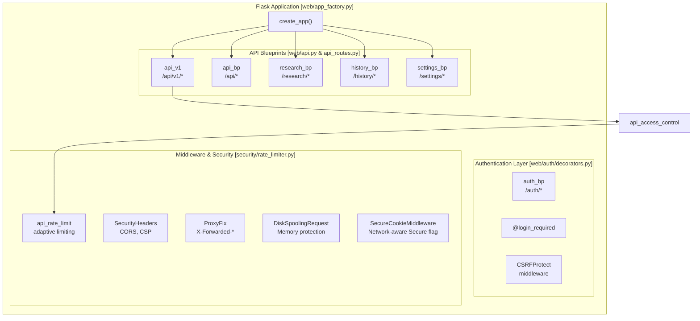
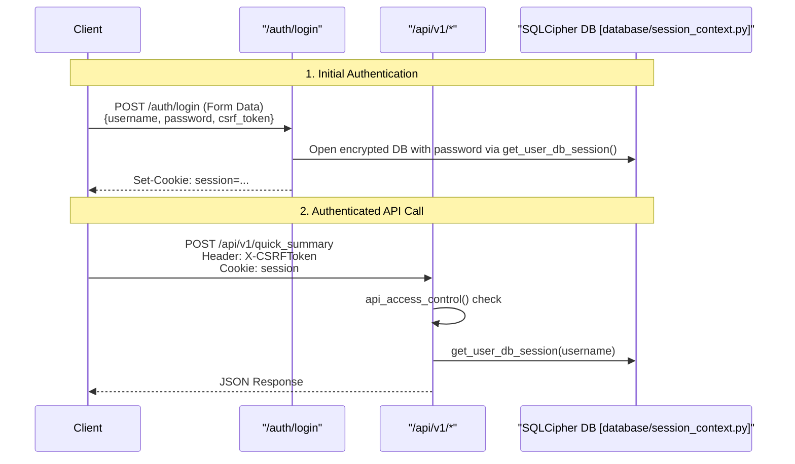
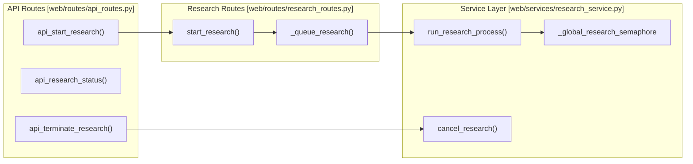

<!-- source: DeepWiki mcp.deepwiki.com · repo LearningCircuit/local-deep-research · page 5.2 REST API · fetched 2026-10-29 -->

# REST API

Relevant source files

The following files were used as context for generating this wiki page:

- [.file-whitelist.txt](.file-whitelist.txt)
- [.github/scripts/file-whitelist-check.sh](.github/scripts/file-whitelist-check.sh)
- [.gitignore](.gitignore)
- [.gitleaks.toml](.gitleaks.toml)
- [.gitleaksignore](.gitleaksignore)
- [.pre-commit-config.yaml](.pre-commit-config.yaml)
- [.pre-commit-hooks/check-absolute-module-paths.py](.pre-commit-hooks/check-absolute-module-paths.py)
- [.pre-commit-hooks/file-whitelist-check.sh](.pre-commit-hooks/file-whitelist-check.sh)
- [.pre-commit-hooks/recommend-release-notes.py](.pre-commit-hooks/recommend-release-notes.py)
- [CONTRIBUTING.md](CONTRIBUTING.md)
- [changelog.d/3670.breaking.1.md](changelog.d/3670.breaking.1.md)
- [changelog.d/3670.breaking.md](changelog.d/3670.breaking.md)
- [changelog.d/3670.feature.md](changelog.d/3670.feature.md)
- [changelog.d/3773.feature.md](changelog.d/3773.feature.md)
- [changelog.d/README.md](changelog.d/README.md)
- [docs/RELEASE_GUIDE.md](docs/RELEASE_GUIDE.md)
- [pdm.lock](pdm.lock)
- [pyproject.toml](pyproject.toml)
- [src/local_deep_research/defaults/settings_search_config.json](src/local_deep_research/defaults/settings_search_config.json)
- [src/local_deep_research/web/api.py](src/local_deep_research/web/api.py)
- [src/local_deep_research/web/static/js/services/api.js](src/local_deep_research/web/static/js/services/api.js)
- [tests/api_tests/test_all_endpoints.py](tests/api_tests/test_all_endpoints.py)
- [tests/api_tests/test_api_basic.py](tests/api_tests/test_api_basic.py)
- [tests/api_tests/test_comprehensive_apis.py](tests/api_tests/test_comprehensive_apis.py)
- [tests/api_tests/test_research_creation.py](tests/api_tests/test_research_creation.py)
- [tests/api_tests/test_rest_api.py](tests/api_tests/test_rest_api.py)
- [tests/api_tests/test_rest_api_simple.py](tests/api_tests/test_rest_api_simple.py)
- [tests/auth_tests/conftest.py](tests/auth_tests/conftest.py)
- [tests/feature_tests/test_custom_context.py](tests/feature_tests/test_custom_context.py)
- [tests/infrastructure_tests/test_csrf_api.test.js](tests/infrastructure_tests/test_csrf_api.test.js)
- [tests/mock_modules.py](tests/mock_modules.py)
- [tests/rate_limiting/test_rate_limiting.py](tests/rate_limiting/test_rate_limiting.py)
- [tests/security/test_absolute_module_paths_hook.py](tests/security/test_absolute_module_paths_hook.py)
- [tests/security/test_api_v1_auth.py](tests/security/test_api_v1_auth.py)
- [tests/security/test_csrf_hardening.py](tests/security/test_csrf_hardening.py)
- [tests/test_llm_rate_limiting.py](tests/test_llm_rate_limiting.py)
- [tests/test_search_engines_enhanced.py](tests/test_search_engines_enhanced.py)
- [tests/web/routes/test_search_favorites.py](tests/web/routes/test_search_favorites.py)
- [tests/web/routes/test_settings_routes_corrupted_coverage.py](tests/web/routes/test_settings_routes_corrupted_coverage.py)
- [tests/web/routes/test_settings_routes_coverage.py](tests/web/routes/test_settings_routes_coverage.py)
- [tests/web/routes/test_settings_routes_deep_coverage.py](tests/web/routes/test_settings_routes_deep_coverage.py)
- [tests/web/routes/test_settings_routes_deep_coverage2.py](tests/web/routes/test_settings_routes_deep_coverage2.py)
- [tests/web/routes/test_settings_routes_save_validation_coverage.py](tests/web/routes/test_settings_routes_save_validation_coverage.py)
- [tests/web/routes/test_settings_routes_security.py](tests/web/routes/test_settings_routes_security.py)

## Purpose and Scope

This document describes the HTTP REST API for Local Deep Research, which provides authenticated access to core functionality. The API supports research execution, settings management, history retrieval, and administrative operations. All endpoints require authentication and CSRF protection, as data is isolated within per-user encrypted databases.

For programmatic Python access without HTTP, see [Python API](5.3). For command-line tools, see [CLI Tools and MCP Server](5.4).

---

## Architecture Overview

### Blueprint Organization

The REST API is organized into several Flask blueprints. The `api_v1` blueprint provides a standardized programmatic interface, while domain-specific blueprints handle web-integrated API requests.

Title: API Blueprint Structure and Security Stack

Sources: [src/local_deep_research/web/api.py:24-62](), [src/local_deep_research/web/routes/api_routes.py:30-30](), [src/local_deep_research/web/app_factory.py:129-152](), [src/local_deep_research/web/app_factory.py:45-57]()

---

## Authentication and Security

### Authentication Flow

The system uses session cookies and enforces CSRF protection. Since v2.0, all API access requires authentication because data is stored in per-user encrypted databases managed via `get_user_db_session`.

Title: Request Authentication and DB Context Flow

Sources: [src/local_deep_research/web/api.py:27-62](), [src/local_deep_research/database/session_context.py:14-14](), [src/local_deep_research/web/app_factory.py:16-17]()

### CSRF Protection and Headers
Flask-WTF `CSRFProtect` is initialized in the app factory [src/local_deep_research/web/app_factory.py:16-16](). All state-changing HTTP requests (POST, PUT, DELETE, PATCH) must include a valid CSRF token. The frontend `api.js` service handles this by retrieving the token from the `csrf-token` meta tag and including it in the `X-CSRFToken` header [src/local_deep_research/web/static/js/services/api.js:17-20](), [src/local_deep_research/web/static/js/services/api.js:44-53]().

---

## Programmatic REST API (v1)

The `/api/v1/` blueprint provides high-level research functions that wrap complex execution into single HTTP calls.

### Endpoints

| Endpoint | Method | Description | Parameters |
|----------|--------|-------------|------------|
| `/api/v1/` | GET | API Documentation | None |
| `/api/v1/health` | GET | Health check | None |
| `/api/v1/quick_summary` | POST | Generate a research summary | `query`, `search_tool`, `iterations`, `temperature` |
| `/api/v1/generate_report`| POST | Generate a full report | `query`, `model_name`, `searches_per_section`, `output_file` |
| `/api/v1/analyze_documents`| POST | RAG-based local analysis | `query`, `collection_name`, `max_results`, `force_reindex` |
| `/api/v1/quick_summary_test`| POST | Fast Wikipedia-based test | `query` |

Sources: [src/local_deep_research/web/api.py:65-114](), [src/local_deep_research/web/api.py:117-122](), [src/local_deep_research/web/api.py:125-161](), [src/local_deep_research/web/api.py:187-202]()

---

## Research Execution and Management API

The internal API blueprint (`api_bp`) and research blueprint (`research_bp`) provide granular control over the background execution lifecycle.

Title: Research Lifecycle Code Entities

Sources: [src/local_deep_research/web/routes/api_routes.py:75-87](), [src/local_deep_research/web/routes/api_routes.py:137-168](), [src/local_deep_research/web/routes/research_routes.py:204-223](), [src/local_deep_research/web/services/research_service.py:36-40]()

### Key Management Operations
The frontend `api.js` service abstracts these endpoints for the UI:
- **`startResearch(query, mode)`**: Calls `URLS.API.START_RESEARCH` [src/local_deep_research/web/static/js/services/api.js:93-95]().
- **`getResearchStatus(researchId)`**: Polls for progress and state [src/local_deep_research/web/static/js/services/api.js:102-104]().
- **`terminateResearch(researchId)`**: Safely stops a background thread [src/local_deep_research/web/static/js/services/api.js:146-148]().

---

## Settings and Configuration API

Settings are managed via the `settings_bp` blueprint, supporting a dual-mode submission pattern.

### Submission Modes
1. **AJAX/JSON Mode (`/settings/save_all_settings`)**: Frontend calls like `saveMainConfig` or `saveLlmConfig` send JSON data [src/local_deep_research/web/static/js/services/api.js:192-230](). Values are converted using `get_typed_setting_value` to enforce types [src/local_deep_research/web/routes/settings_routes.py:158-178]().
2. **Traditional POST Mode (`/settings/save_settings`)**: Fallback for non-JS environments [src/local_deep_research/web/routes/settings_routes.py:98-131]().

### Namespace Validation
The API enforces strict prefix validation. Settings must belong to namespaces like `llm.`, `search.`, or `rag.`. Critical namespaces like `auth.` or `db_config.` are protected from general API modification.
Sources: [src/local_deep_research/web/routes/settings_routes.py:6-38]()

---

## Error Handling and Rate Limiting

### Adaptive Rate Limiting
The API uses an adaptive rate limiter to protect LLM and Search providers from being overwhelmed.
- **Pre-caching**: The `api_access_control` decorator reads `app.api_rate_limit` once and stores it in `g._api_rate_limit` to prevent redundant database hits [src/local_deep_research/web/api.py:52-55]().
- **Learning Mechanism**: The `AdaptiveRateLimitTracker` records outcomes and adjusts wait times based on successes or `RateLimitError` responses [tests/rate_limiting/test_rate_limiting.py:100-123]().

### Response Serialization
The API ensures consistent JSON responses. For RAG results, `_serialize_results` converts complex `Document` objects into serializable dictionaries containing `metadata` and `content` [src/local_deep_research/web/api.py:164-184]().

---

## v2.0 Authentication Migration Guide

The transition to v2.0 introduced strict security requirements:

1. **Mandatory Authentication**: `api_access_control` returns a `401` if no user session is found [src/local_deep_research/web/api.py:41-42]().
2. **Settings Isolation**: API calls now utilize `SettingsManager` within a `get_user_db_session` context, ensuring that `api_enabled` checks are specific to the authenticated user's encrypted database [src/local_deep_research/web/api.py:46-51]().
3. **CSRF Enforcement**: All state-changing requests must include the CSRF token, typically via the `X-CSRFToken` header [src/local_deep_research/web/static/js/services/api.js:50-50]().
4. **Proxy Support**: `ProxyFix` middleware is used to correctly handle `X-Forwarded-For` headers, critical for IP-based rate limiting in production [src/local_deep_research/web/app_factory.py:129-136]().

Sources: [src/local_deep_research/web/api.py:27-62](), [src/local_deep_research/web/app_factory.py:129-136]()

---

