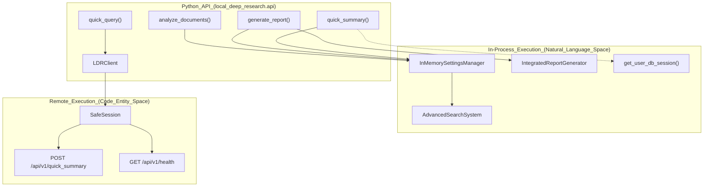
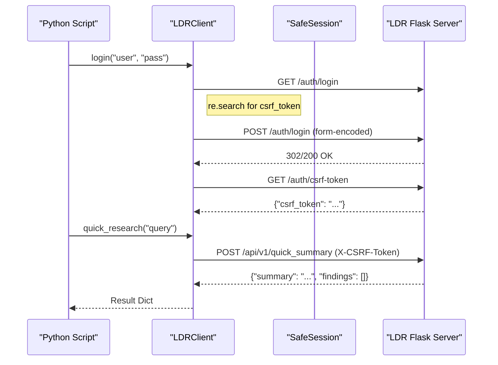

<!-- source: DeepWiki mcp.deepwiki.com · repo LearningCircuit/local-deep-research · page 5.3 Python API · fetched 2026-10-29 -->

# Python API

Relevant source files

The following files were used as context for generating this wiki page:

- [.github/CODEOWNERS](.github/CODEOWNERS)
- [README.md](README.md)
- [docker-compose.gpu.override.yml](docker-compose.gpu.override.yml)
- [docs/CI_CD_INFRASTRUCTURE.md](docs/CI_CD_INFRASTRUCTURE.md)
- [docs/SECURITY_REVIEW_PROCESS.md](docs/SECURITY_REVIEW_PROCESS.md)
- [docs/SQLCIPHER_INSTALL.md](docs/SQLCIPHER_INSTALL.md)
- [docs/decisions/0001-remove-detect-secrets.md](docs/decisions/0001-remove-detect-secrets.md)
- [docs/developing.md](docs/developing.md)
- [docs/docker-compose-guide.md](docs/docker-compose-guide.md)
- [docs/install-pip.md](docs/install-pip.md)
- [docs/installation.md](docs/installation.md)
- [src/local_deep_research/api/benchmark_functions.py](src/local_deep_research/api/benchmark_functions.py)
- [src/local_deep_research/api/client.py](src/local_deep_research/api/client.py)
- [src/local_deep_research/benchmarks/comparison/__init__.py](src/local_deep_research/benchmarks/comparison/__init__.py)
- [src/local_deep_research/benchmarks/comparison/results.py](src/local_deep_research/benchmarks/comparison/results.py)
- [src/local_deep_research/benchmarks/metrics/reporting.py](src/local_deep_research/benchmarks/metrics/reporting.py)
- [src/local_deep_research/database/sqlcipher_compat.py](src/local_deep_research/database/sqlcipher_compat.py)
- [src/local_deep_research/web/api.py](src/local_deep_research/web/api.py)
- [tests/advanced_search_system/candidate_exploration/test_diversity_explorer.py](tests/advanced_search_system/candidate_exploration/test_diversity_explorer.py)
- [tests/advanced_search_system/strategies/test_evidence_based_v2_extended.py](tests/advanced_search_system/strategies/test_evidence_based_v2_extended.py)
- [tests/advanced_search_system/strategies/test_iterative_reasoning_strategy.py](tests/advanced_search_system/strategies/test_iterative_reasoning_strategy.py)
- [tests/advanced_search_system/strategies/test_llm_driven_modular_strategy.py](tests/advanced_search_system/strategies/test_llm_driven_modular_strategy.py)
- [tests/api/test_client_extended.py](tests/api/test_client_extended.py)
- [tests/api_tests/test_api_basic.py](tests/api_tests/test_api_basic.py)
- [tests/api_tests/test_rest_api.py](tests/api_tests/test_rest_api.py)
- [tests/api_tests/test_rest_api_simple.py](tests/api_tests/test_rest_api_simple.py)
- [tests/auth_tests/conftest.py](tests/auth_tests/conftest.py)
- [tests/core/test_integrated_report_generator.py](tests/core/test_integrated_report_generator.py)
- [tests/database/test_schema_migrations.py](tests/database/test_schema_migrations.py)
- [tests/domain_classifier/test_domain_classifier.py](tests/domain_classifier/test_domain_classifier.py)
- [tests/feature_tests/test_custom_context.py](tests/feature_tests/test_custom_context.py)
- [tests/library/download_management/test_failure_classifier_extended.py](tests/library/download_management/test_failure_classifier_extended.py)
- [tests/mock_modules.py](tests/mock_modules.py)
- [tests/rate_limiting/test_rate_limiting.py](tests/rate_limiting/test_rate_limiting.py)
- [tests/security/test_api_v1_auth.py](tests/security/test_api_v1_auth.py)
- [tests/security/test_csrf_hardening.py](tests/security/test_csrf_hardening.py)
- [tests/test_llm_rate_limiting.py](tests/test_llm_rate_limiting.py)
- [tests/test_search_engines_enhanced.py](tests/test_search_engines_enhanced.py)

This page documents the programmatic Python interface to Local Deep Research. It covers two primary access patterns:

1.  **Direct Research Functions** (`quick_summary`, `generate_report`, `analyze_documents`): Run research in-process without a running server. These are suitable for enterprise integration, data pipelines, and standalone scripting.
2.  **`LDRClient` HTTP Wrapper**: Connect to a running LDR Flask server over HTTP. This handles the complexities of authentication, session management, and CSRF token handling.

Since version 2.0, all API access requires authentication due to the per-user encrypted database architecture [src/local_deep_research/api/client.py:9-13]().

---

## Access Pattern Overview

The Python API provides both a high-level client for remote interaction and low-level functions for local execution.

**Python API Architecture**

Sources: [src/local_deep_research/api/client.py:67-179](), [src/local_deep_research/web/api.py:13-24](), [src/local_deep_research/database/session_context.py:14-14]()

---

## Direct Research Functions

Direct functions run the full research pipeline in-process. These functions typically require a `settings_snapshot` to provide configuration context and may require a user database session.

### The `settings_snapshot` Pattern
Programmatic access relies on a snapshot mechanism to ensure thread safety and avoid global state.
1.  **Snapshot Creation**: A `settings_snapshot` is a dictionary of key-value pairs representing the application state (e.g., `rate_limiting.enabled`) [tests/rate_limiting/test_rate_limiting.py:34-36]().
2.  **Thread Safety**: This snapshot is passed into core systems like `AdaptiveRateLimitTracker` to ensure consistent behavior without re-querying the database in high-concurrency environments [tests/rate_limiting/test_rate_limiting.py:39-41]().
3.  **Override Support**: The `get_setting_from_snapshot` function is used throughout the codebase to prioritize snapshot values over defaults, particularly during testing and background tasks [tests/feature_tests/test_custom_context.py:32-49]().

### Research Execution
The API functions utilize the research core to perform tasks:
- **`quick_summary()`**: Performs a focused research cycle and returns findings and sources [src/local_deep_research/web/api.py:139-149]().
- **`analyze_documents()`**: Searches and analyzes documents in a local collection, often used for RAG (Retrieval-Augmented Generation) workflows [src/local_deep_research/web/api.py:100-111]().
- **`generate_report()`**: Synthesizes comprehensive reports based on queries and multi-step search iterations [src/local_deep_research/web/api.py:88-98]().

Sources: [src/local_deep_research/web/api.py:13-24](), [src/local_deep_research/web/api.py:65-114](), [tests/rate_limiting/test_rate_limiting.py:33-41](), [tests/feature_tests/test_custom_context.py:20-64]()

---

## `LDRClient` — HTTP Wrapper

`LDRClient` connects to a **running LDR Flask server**. It is designed for remote automation where the research engine is hosted elsewhere.

**Client-Server Interaction Flow**

Sources: [src/local_deep_research/api/client.py:67-179](), [src/local_deep_research/web/api.py:187-210]()

### Authentication and Security
`LDRClient` manages a `SafeSession` which provides SSRF protection and allows connections to `localhost` [src/local_deep_research/api/client.py:87]().
- **CSRF Extraction**: It uses regex to extract the `csrf_token` from the HTML login form [src/local_deep_research/api/client.py:115-126]().
- **API CSRF**: After login, it fetches a dedicated API CSRF token from the `/auth/csrf-token` endpoint [src/local_deep_research/api/client.py:148-154]().
- **Headers**: Subsequent requests include the `X-CSRF-Token` header for validation [src/local_deep_research/api/client.py:165-169]().

### Convenience Helpers
- **`quick_query()`**: A static helper that instantiates a client, logs in, performs research, and returns the summary in a single call [src/local_deep_research/api/client.py:47-48]().
- **`update_setting()`**: Allows programmatic modification of user preferences (e.g., changing the LLM model) via the client [src/local_deep_research/api/client.py:51-55]().

Sources: [src/local_deep_research/api/client.py:25-56](), [src/local_deep_research/web/api.py:27-62]()

---

## Benchmarking API

The API includes specialized functions for running evaluations programmatically. Results are managed by the `Benchmark_results` class, which handles persistent storage and performance ranking [src/local_deep_research/benchmarks/comparison/results.py:4-10]().

| Function / Method | Target | Description |
| :--- | :--- | :--- |
| `add_result` | Persistence | Saves model performance, hardware context, and accuracy metrics to `benchmark_results.json` [src/local_deep_research/benchmarks/comparison/results.py:10-39]() |
| `get_best` | Analytics | Retrieves models sorted by accuracy or execution time [src/local_deep_research/benchmarks/comparison/results.py:45-57]() |
| `quick_summary_test` | Fast Testing | A specialized API endpoint using Wikipedia for rapid infrastructure verification [src/local_deep_research/web/api.py:125-151]() |

Sources: [src/local_deep_research/benchmarks/comparison/results.py:4-78](), [src/local_deep_research/web/api.py:125-151]()

---

## Programmatic Access Examples

The codebase includes comprehensive examples for interacting with the API. Key patterns include:

- **Minimal Testing**: Using `quick_summary_test` for fast verification with Wikipedia as the search tool [src/local_deep_research/web/api.py:144-149]().
- **Health Monitoring**: Programmatic health checks via `/api/v1/health` to verify service availability [src/local_deep_research/web/api.py:117-122]().
- **Rate Limit Tracking**: Utilizing the `AdaptiveRateLimitTracker` programmatically to manage search engine quotas based on successful or failed outcomes [tests/rate_limiting/test_rate_limiting.py:100-115]().
- **LLM Customization**: Testing custom context window sizes and token limits via patched settings snapshots to ensure models like `gemma` or `llama` are configured correctly for specific providers [tests/feature_tests/test_custom_context.py:109-151]().

Sources: [src/local_deep_research/web/api.py:117-151](), [tests/rate_limiting/test_rate_limiting.py:17-41](), [tests/feature_tests/test_custom_context.py:109-151]()

---

