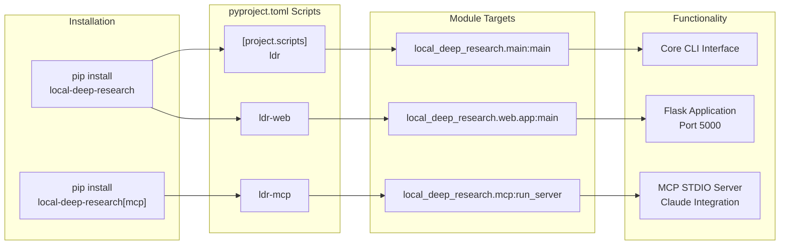
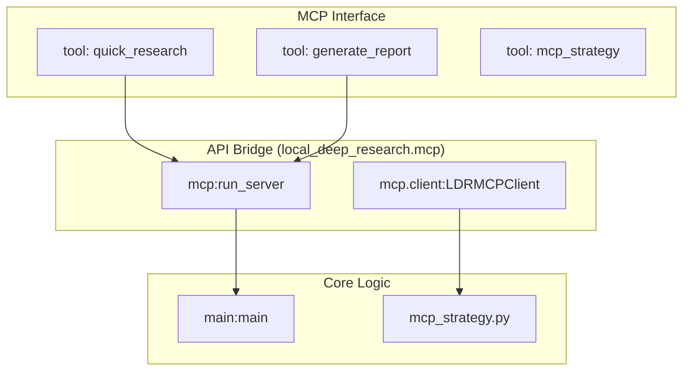
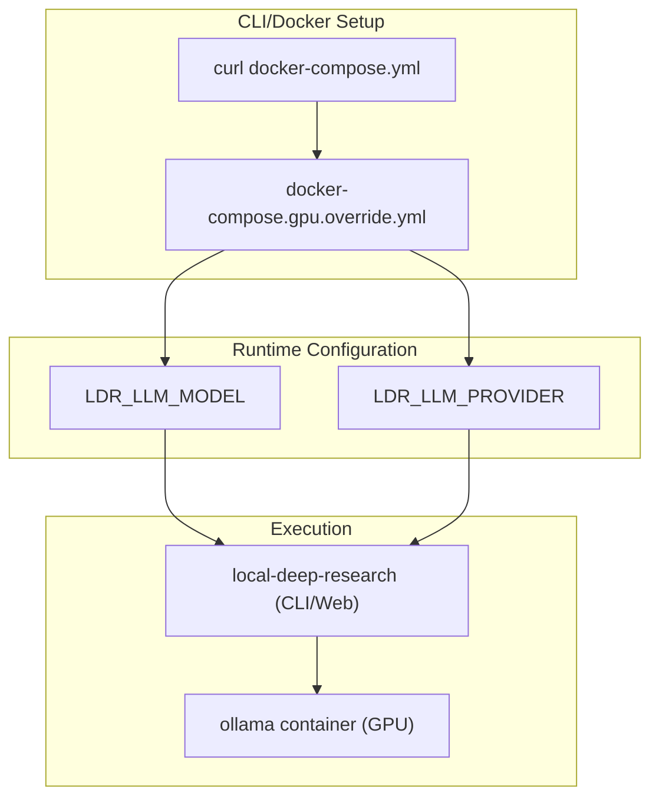

<!-- source: DeepWiki mcp.deepwiki.com · repo LearningCircuit/local-deep-research · page 5.4 CLI Tools and MCP Server · fetched 2026-10-29 -->

# CLI Tools and MCP Server

<details>
<summary>Relevant source files</summary>

The following files were used as context for generating this wiki page:

- [.file-whitelist.txt](.file-whitelist.txt)
- [.github/CODEOWNERS](.github/CODEOWNERS)
- [.github/scripts/file-whitelist-check.sh](.github/scripts/file-whitelist-check.sh)
- [.gitignore](.gitignore)
- [.gitleaks.toml](.gitleaks.toml)
- [.gitleaksignore](.gitleaksignore)
- [.pre-commit-config.yaml](.pre-commit-config.yaml)
- [.pre-commit-hooks/check-absolute-module-paths.py](.pre-commit-hooks/check-absolute-module-paths.py)
- [.pre-commit-hooks/file-whitelist-check.sh](.pre-commit-hooks/file-whitelist-check.sh)
- [.pre-commit-hooks/recommend-release-notes.py](.pre-commit-hooks/recommend-release-notes.py)
- [CONTRIBUTING.md](CONTRIBUTING.md)
- [README.md](README.md)
- [changelog.d/3670.breaking.1.md](changelog.d/3670.breaking.1.md)
- [changelog.d/3670.breaking.md](changelog.d/3670.breaking.md)
- [changelog.d/3670.feature.md](changelog.d/3670.feature.md)
- [changelog.d/3773.feature.md](changelog.d/3773.feature.md)
- [changelog.d/README.md](changelog.d/README.md)
- [docker-compose.gpu.override.yml](docker-compose.gpu.override.yml)
- [docs/CI_CD_INFRASTRUCTURE.md](docs/CI_CD_INFRASTRUCTURE.md)
- [docs/RELEASE_GUIDE.md](docs/RELEASE_GUIDE.md)
- [docs/SECURITY_REVIEW_PROCESS.md](docs/SECURITY_REVIEW_PROCESS.md)
- [docs/SQLCIPHER_INSTALL.md](docs/SQLCIPHER_INSTALL.md)
- [docs/decisions/0001-remove-detect-secrets.md](docs/decisions/0001-remove-detect-secrets.md)
- [docs/developing.md](docs/developing.md)
- [docs/docker-compose-guide.md](docs/docker-compose-guide.md)
- [docs/install-pip.md](docs/install-pip.md)
- [docs/installation.md](docs/installation.md)
- [pdm.lock](pdm.lock)
- [pyproject.toml](pyproject.toml)
- [src/local_deep_research/advanced_search_system/constraint_checking/strict_checker.py](src/local_deep_research/advanced_search_system/constraint_checking/strict_checker.py)
- [src/local_deep_research/advanced_search_system/strategies/mcp_strategy.py](src/local_deep_research/advanced_search_system/strategies/mcp_strategy.py)
- [src/local_deep_research/content_fetcher/fetcher.py](src/local_deep_research/content_fetcher/fetcher.py)
- [src/local_deep_research/database/sqlcipher_compat.py](src/local_deep_research/database/sqlcipher_compat.py)
- [src/local_deep_research/mcp/client.py](src/local_deep_research/mcp/client.py)
- [src/local_deep_research/research_library/downloaders/extraction/pipeline.py](src/local_deep_research/research_library/downloaders/extraction/pipeline.py)
- [src/local_deep_research/web/static/js/services/api.js](src/local_deep_research/web/static/js/services/api.js)
- [src/local_deep_research/web_search_engines/engines/full_search.py](src/local_deep_research/web_search_engines/engines/full_search.py)
- [tests/content_fetcher/test_fetcher_coverage.py](tests/content_fetcher/test_fetcher_coverage.py)
- [tests/infrastructure_tests/test_csrf_api.test.js](tests/infrastructure_tests/test_csrf_api.test.js)
- [tests/security/test_absolute_module_paths_hook.py](tests/security/test_absolute_module_paths_hook.py)
- [tests/security/test_file_integrity_manager_coverage.py](tests/security/test_file_integrity_manager_coverage.py)
- [tests/security/test_ssrf_debug_hardening.py](tests/security/test_ssrf_debug_hardening.py)
- [tests/web_search_engines/engines/test_full_search.py](tests/web_search_engines/engines/test_full_search.py)
- [tests/web_search_engines/engines/test_search_engine_collection.py](tests/web_search_engines/engines/test_search_engine_collection.py)
- [tests/web_search_engines/engines/test_search_engine_library.py](tests/web_search_engines/engines/test_search_engine_library.py)
- [tests/web_search_engines/engines/test_search_engine_retriever.py](tests/web_search_engines/engines/test_search_engine_retriever.py)

</details>


This page documents the command-line interfaces for Local Deep Research, including the three main entry points (`ldr`, `ldr-web`, `ldr-mcp`) and the Model Context Protocol (MCP) server that enables AI assistant integration with Claude Desktop and Claude Code.

## Entry Points

Local Deep Research provides three command-line entry points defined in the project configuration [pyproject.toml:109-113]():

| Entry Point | Module Target | Purpose |
|-------------|---------------|---------|
| `ldr` | `local_deep_research.main:main` | Primary CLI interface for core research logic [pyproject.toml:110]() |
| `ldr-web` | `local_deep_research.web.app:main` | Starts the Flask web application and UI [pyproject.toml:111]() |
| `ldr-mcp` | `local_deep_research.mcp:run_server` | Starts the MCP server for AI assistant integration [pyproject.toml:112]() |

### Entry Point Architecture

"Entry Point Architecture"


**Sources:** [pyproject.toml:100-113]()

### ldr-web: Web Application Server

The `ldr-web` command starts the Flask application [pyproject.toml:111](). It serves the frontend assets and provides the backend API for the research system [src/local_deep_research/web/static/js/services/api.js:9-11](). The server utilizes `SQLCipher` for per-user encrypted databases, with platform-specific binaries for `x86_64` and `aarch64` to ensure data privacy [pyproject.toml:85-87]().

In Docker environments, `ldr-web` is typically configured to bind to `0.0.0.0` and port `5000` [docs/docker-compose-guide.md:61-62]().

```bash
# Start the web server
ldr-web

# Equivalent module invocation
python -m local_deep_research.web.app
```

**Sources:** [pyproject.toml:111](), [pyproject.toml:85-87](), [docs/docker-compose-guide.md:61-62]()

## Model Context Protocol (MCP) Server

The MCP server provides a standardized interface for AI agents (like Claude Desktop) to use LDR as a toolset. It is implemented as a separate entry point that requires the `mcp` optional dependency [pyproject.toml:100-103]().

### MCP Tool Mapping

The server exposes research capabilities through tools that bridge natural language requests to internal research functions.

"MCP Tool Mapping"


**Sources:** [pyproject.toml:112](), [src/local_deep_research/advanced_search_system/strategies/mcp_strategy.py:1-20](), [src/local_deep_research/mcp/client.py:1-10]()

### Available Tools

The MCP integration supports agentic research modes where the LLM can decide which specialized engines to use [README.md:104](). Key tools include:

| Tool Name | Purpose |
|-----------|---------|
| `quick_research` | Performs a fast research query and returns a summary [README.md:117]() |
| `generate_report` | Synthesizes research findings into a full markdown report with citations [README.md:100]() |
| `mcp_strategy` | Allows agents to use the autonomous `langgraph-agent` strategy [README.md:104]() |

### Security and Transport

The MCP server is designed for local integration via `STDIO` transport. It inherits the security posture of the main application, including the requirement for `SQLCipher` encrypted databases [README.md:15](). For security, the application includes a `file-whitelist-check` to prevent unauthorized binary or large files from bloating the repository or leaking data [.github/scripts/file-whitelist-check.sh:106-117]().

**Sources:** [README.md:15](), [README.md:104](), [pyproject.toml:101-103](), [.github/scripts/file-whitelist-check.sh:106-117]()

## CLI Configuration and Docker

### Environment Variables

CLI tools and the web server respect `LDR_` prefixed environment variables. These variables override UI settings and lock them to prevent accidental changes [docs/docker-compose-guide.md:53-57]().

*   `LDR_DATA_DIR`: Sets the path for the research library and databases [docs/docker-compose-guide.md:63]().
*   `LDR_LLM_PROVIDER`: Selects the LLM backend (e.g., `ollama`, `openai`) [docs/docker-compose-guide.md:65]().
*   `LDR_LLM_MODEL`: Specifies the model to pull and use (e.g., `gemma3:12b`) [docs/docker-compose-guide.md:66]().

### Hardware Integration

The system supports hardware-accelerated inference via NVIDIA GPUs on Linux [docs/docker-compose-guide.md:15-23]().

"Hardware Integration Flow"


**Sources:** [docs/docker-compose-guide.md:15-37](), [pyproject.toml:110-112]()

## Research Execution Flow

When a research task is triggered via the CLI (`ldr`) or an MCP tool, it utilizes the core research engine to perform web searches and synthesize reports.

### CLI Execution Sequence

The `ldr` entry point invokes the main execution logic which handles query processing and strategy selection [pyproject.toml:110]().

1.  **Initialization**: The CLI loads settings from environment variables or the encrypted database.
2.  **Strategy Selection**: Based on the query, it selects from 20+ strategies (e.g., `langgraph-agent`, `quick`) [README.md:102-104]().
3.  **Search & Synthesis**: The engine performs searches across web and academic sources, downloading relevant PDFs into the library [README.md:117]().
4.  **Reporting**: Findings are synthesized into a markdown report with proper citations [README.md:100]().

**Sources:** [README.md:97-105](), [pyproject.toml:110](), [src/local_deep_research/web/static/js/services/api.js:93-95]()

---

