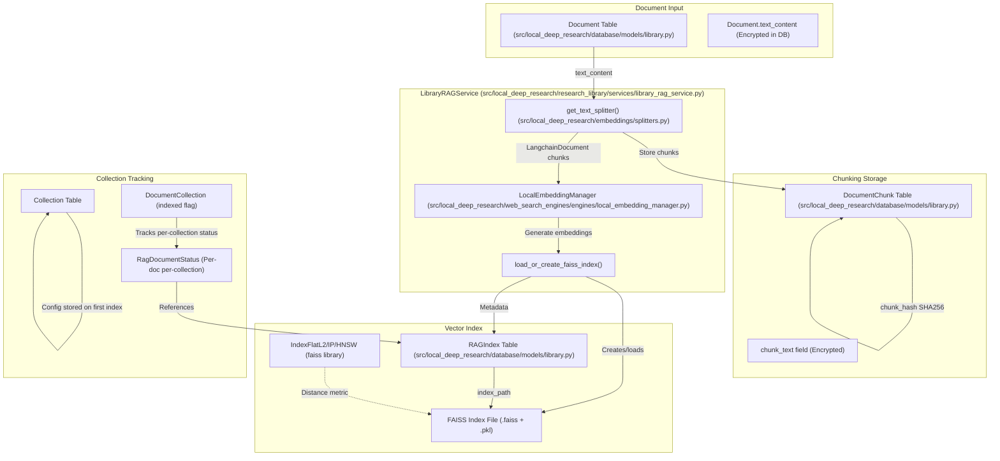
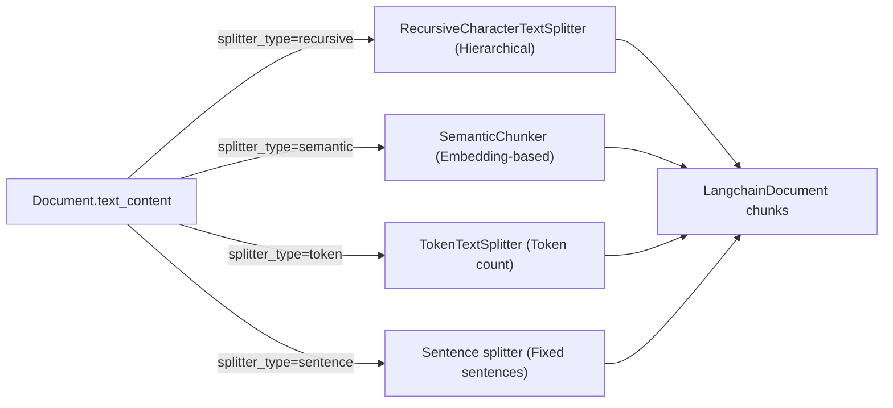
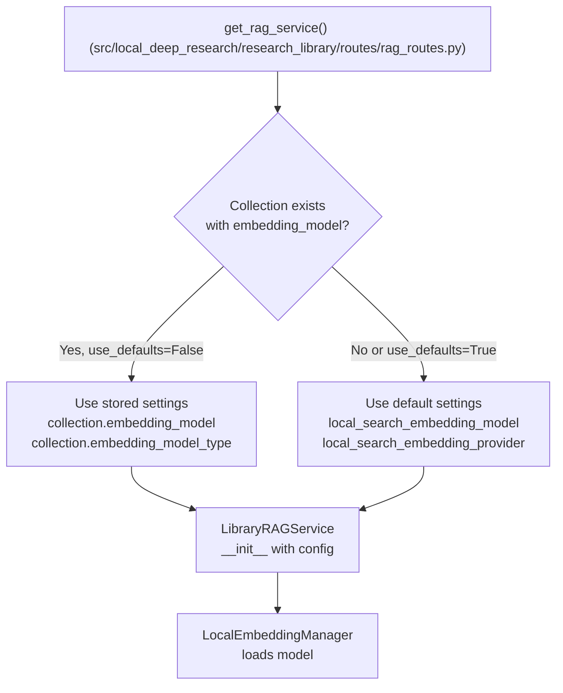

<!-- source: DeepWiki mcp.deepwiki.com · repo LearningCircuit/local-deep-research · page 6.1 RAG and Document Indexing · fetched 2026-10-29 -->

# RAG and Document Indexing

Relevant source files

The following files were used as context for generating this wiki page:

- [docs/NOTIFICATION_FLOW.md](docs/NOTIFICATION_FLOW.md)
- [src/local_deep_research/database/models/file_integrity.py](src/local_deep_research/database/models/file_integrity.py)
- [src/local_deep_research/database/models/library.py](src/local_deep_research/database/models/library.py)
- [src/local_deep_research/database/models/user_base.py](src/local_deep_research/database/models/user_base.py)
- [src/local_deep_research/defaults/research_library/library_settings.json](src/local_deep_research/defaults/research_library/library_settings.json)
- [src/local_deep_research/library/download_management/database_init.py](src/local_deep_research/library/download_management/database_init.py)
- [src/local_deep_research/library/download_management/failure_classifier.py](src/local_deep_research/library/download_management/failure_classifier.py)
- [src/local_deep_research/library/download_management/filters/resource_filter.py](src/local_deep_research/library/download_management/filters/resource_filter.py)
- [src/local_deep_research/library/download_management/models/__init__.py](src/local_deep_research/library/download_management/models/__init__.py)
- [src/local_deep_research/library/download_management/retry_manager.py](src/local_deep_research/library/download_management/retry_manager.py)
- [src/local_deep_research/library/download_management/status_tracker.py](src/local_deep_research/library/download_management/status_tracker.py)
- [src/local_deep_research/research_library/routes/library_routes.py](src/local_deep_research/research_library/routes/library_routes.py)
- [src/local_deep_research/research_library/routes/rag_routes.py](src/local_deep_research/research_library/routes/rag_routes.py)
- [src/local_deep_research/research_library/search/routes/search_routes.py](src/local_deep_research/research_library/search/routes/search_routes.py)
- [src/local_deep_research/research_library/search/services/research_history_indexer.py](src/local_deep_research/research_library/search/services/research_history_indexer.py)
- [src/local_deep_research/research_library/services/download_service.py](src/local_deep_research/research_library/services/download_service.py)
- [src/local_deep_research/research_library/services/library_rag_service.py](src/local_deep_research/research_library/services/library_rag_service.py)
- [src/local_deep_research/research_library/services/library_service.py](src/local_deep_research/research_library/services/library_service.py)
- [src/local_deep_research/research_library/services/pdf_storage_manager.py](src/local_deep_research/research_library/services/pdf_storage_manager.py)
- [src/local_deep_research/research_library/utils/__init__.py](src/local_deep_research/research_library/utils/__init__.py)
- [src/local_deep_research/security/file_integrity/__init__.py](src/local_deep_research/security/file_integrity/__init__.py)
- [src/local_deep_research/security/file_integrity/base_verifier.py](src/local_deep_research/security/file_integrity/base_verifier.py)
- [src/local_deep_research/security/file_integrity/integrity_manager.py](src/local_deep_research/security/file_integrity/integrity_manager.py)
- [src/local_deep_research/security/file_integrity/verifiers/faiss_verifier.py](src/local_deep_research/security/file_integrity/verifiers/faiss_verifier.py)
- [src/local_deep_research/utilities/search_cache.py](src/local_deep_research/utilities/search_cache.py)
- [src/local_deep_research/web/queue/manager.py](src/local_deep_research/web/queue/manager.py)
- [src/local_deep_research/web/static/css/components/semantic-search.css](src/local_deep_research/web/static/css/components/semantic-search.css)
- [src/local_deep_research/web/static/js/components/library_search_ui.js](src/local_deep_research/web/static/js/components/library_search_ui.js)
- [src/local_deep_research/web/static/js/components/save_to_collection.js](src/local_deep_research/web/static/js/components/save_to_collection.js)
- [src/local_deep_research/web/static/js/components/semantic_search.js](src/local_deep_research/web/static/js/components/semantic_search.js)
- [src/local_deep_research/web/templates/components/storage_mode_modal.html](src/local_deep_research/web/templates/components/storage_mode_modal.html)
- [src/local_deep_research/web/templates/pages/collection_create.html](src/local_deep_research/web/templates/pages/collection_create.html)
- [src/local_deep_research/web/templates/pages/collection_upload.html](src/local_deep_research/web/templates/pages/collection_upload.html)
- [src/local_deep_research/web/templates/pages/download_manager.html](src/local_deep_research/web/templates/pages/download_manager.html)
- [src/local_deep_research/web/templates/pages/library.html](src/local_deep_research/web/templates/pages/library.html)
- [src/local_deep_research/web_search_engines/engines/search_engine_collection.py](src/local_deep_research/web_search_engines/engines/search_engine_collection.py)
- [src/local_deep_research/web_search_engines/engines/search_engine_library.py](src/local_deep_research/web_search_engines/engines/search_engine_library.py)
- [tests/research_library/search/routes/test_search_routes.py](tests/research_library/search/routes/test_search_routes.py)
- [tests/research_library/services/test_download_service_coverage.py](tests/research_library/services/test_download_service_coverage.py)
- [tests/research_library/services/test_download_service_deep_coverage.py](tests/research_library/services/test_download_service_deep_coverage.py)
- [tests/research_library/services/test_library_rag_service.py](tests/research_library/services/test_library_rag_service.py)
- [tests/research_library/services/test_library_rag_service_coverage.py](tests/research_library/services/test_library_rag_service_coverage.py)
- [tests/research_library/services/test_library_rag_service_deep_coverage.py](tests/research_library/services/test_library_rag_service_deep_coverage.py)
- [tests/research_library/services/test_library_rag_service_index_coverage.py](tests/research_library/services/test_library_rag_service_index_coverage.py)
- [tests/research_library/utils/test_utils.py](tests/research_library/utils/test_utils.py)
- [tests/utilities/test_search_cache_high_value.py](tests/utilities/test_search_cache_high_value.py)

This page documents the RAG (Retrieval-Augmented Generation) implementation for semantic search over library documents. It covers the indexing pipeline, text chunking strategies, embedding generation, FAISS vector store management, and search functionality. For document storage and download management, see [6.4. Document Download and Management](). For using RAG indices as search engines during research, see [3.6. Search Engine Integration Layer]().

---

## System Architecture

The RAG system is built around `LibraryRAGService`, which manages the complete lifecycle of document indexing: text extraction, chunking, embedding generation, FAISS index construction, and semantic search.

### RAG Data Flow and Code Entities

**Key Components:**

- **`LibraryRAGService`**: Main orchestrator defined at [src/local_deep_research/research_library/services/library_rag_service.py:43-60]().
- **`Document.text_content`**: Source text stored encrypted in the database at [src/local_deep_research/database/models/library.py:223-225]().
- **`DocumentChunk`**: Chunk storage with SHA256 deduplication at [src/local_deep_research/database/models/library.py:477-542]().
- **`RAGIndex`**: Index metadata and settings at [src/local_deep_research/database/models/library.py:544-632]().
- **FAISS**: Vector similarity search using `langchain_community.vectorstores.FAISS` at [src/local_deep_research/research_library/services/library_rag_service.py:38-39]().

Sources: [src/local_deep_research/research_library/services/library_rag_service.py:43-166](), [src/local_deep_research/database/models/library.py:163-632]()

---

## Document Storage Model

Documents use a unified storage architecture where all sources (research downloads, user uploads) converge into a single `Document` table [src/local_deep_research/database/models/library.py:163-168](). Text content is always stored encrypted in the database.

| Field | Type | Purpose |
|-------|------|---------|
| `id` | String(36) UUID | Primary key [src/local_deep_research/database/models/library.py:170-170]() |
| `document_hash` | String(64) SHA256 | Deduplication by content [src/local_deep_research/database/models/library.py:205-207]() |
| `text_content` | Text | Extracted text (encrypted) [src/local_deep_research/database/models/library.py:223-225]() |
| `storage_mode` | String(20) | PDF storage: `database`, `filesystem`, `none` [src/local_deep_research/database/models/library.py:228-230]() |
| `source_type_id` | String(36) FK | Classification: `research_download`, `user_upload` [src/local_deep_research/database/models/library.py:173-178]() |
| `resource_id` | Integer FK | Link to ResearchResource (nullable) [src/local_deep_research/database/models/library.py:181-186]() |

Documents belong to collections via `DocumentCollection` (many-to-many) [src/local_deep_research/database/models/library.py:425-430](). Each document can be indexed independently per collection with different chunking parameters.

Sources: [src/local_deep_research/database/models/library.py:163-311](), [src/local_deep_research/database/models/library.py:425-475]()

---

## Text Splitting and Chunking

### Splitter Types

Text splitting is handled by `get_text_splitter()` which supports four strategies defined in `SplitterType` [src/local_deep_research/database/models/library.py:96-102]():

**Configuration Parameters:**

| Parameter | Default | Description |
|-----------|---------|-------------|
| `chunk_size` | 1000 | Target characters per chunk [src/local_deep_research/research_library/services/library_rag_service.py:51-51]() |
| `chunk_overlap` | 200 | Overlap between consecutive chunks [src/local_deep_research/research_library/services/library_rag_service.py:52-52]() |
| `text_separators` | `["\n\n", "\n", ". ", " ", ""]` | Hierarchical split points [src/local_deep_research/research_library/services/library_rag_service.py:89-93]() |
| `splitter_type` | `"recursive"` | Splitting strategy [src/local_deep_research/research_library/services/library_rag_service.py:53-53]() |

The recursive splitter tries separators in order, falling back to character splits if needed. Semantic chunking uses embedding similarity via the `embedding_manager` to find natural boundaries [src/local_deep_research/research_library/services/library_rag_service.py:145-153]().

**Chunk Storage and Deduplication:**

Chunks are stored in the `DocumentChunk` table [src/local_deep_research/database/models/library.py:477-542](). They include metadata such as `chunk_index`, `word_count`, and `embedding_model` [src/local_deep_research/database/models/library.py:497-525]().

Sources: [src/local_deep_research/research_library/services/library_rag_service.py:43-153](), [src/local_deep_research/database/models/library.py:477-542]()

---

## Embedding Generation

### Embedding Providers

Embeddings are managed by `LocalEmbeddingManager`, supporting two provider types [src/local_deep_research/database/models/library.py:46-51]():

| Provider | Models | Configuration |
|----------|--------|---------------|
| `sentence_transformers` | `all-MiniLM-L6-v2` (default) | Local models, no API key |
| `ollama` | `nomic-embed-text`, etc. | Requires Ollama server |

**Provider Selection Logic:**

Sources: [src/local_deep_research/research_library/routes/rag_routes.py:94-127](), [src/local_deep_research/research_library/services/library_rag_service.py:46-141]()

---

## FAISS Index Management

### Index Types and Distance Metrics

FAISS indices are configured per collection with three index types and three distance metrics:

**Index Types [src/local_deep_research/database/models/library.py:88-94]():**

| Type | Class | Use Case |
|------|-------|----------|
| `flat` | `IndexFlatL2` or `IndexFlatIP` | Exact search, small-medium collections |
| `hnsw` | `IndexHNSWFlat` | Fast approximate search, large collections |
| `ivf` | Inverted File Index | Optimized for very large datasets |

**Distance Metrics [src/local_deep_research/database/models/library.py:80-86]():**

| Metric | Index | Normalization | Use Case |
|--------|-------|---------------|----------|
| `cosine` | `IndexFlatIP` | Required (`normalize_vectors=True`) | Semantic similarity |
| `dot_product` | `IndexFlatIP` | Optional | Raw inner product |
| `l2` | `IndexFlatL2` | Not needed | Euclidean distance |

### Index Persistence and Integrity

**Storage Location:**

Indices are stored in the centralized cache directory, with paths resolved via `get_cache_directory()` [src/local_deep_research/config/paths.py:19-20]().

**Integrity Verification:**

Before loading, indices are verified using `FileIntegrityManager` with `FAISSIndexVerifier` at [src/local_deep_research/research_library/services/library_rag_service.py:160-163](). Corrupted indices are identified for deletion or rebuild.

**RAGIndex Metadata Table [src/local_deep_research/database/models/library.py:544-632]():**

| Field | Purpose |
|-------|---------|
| `index_hash` | Unique identifier for index configuration |
| `collection_name` | Format: `collection_{uuid}` |
| `embedding_model` | Model name (e.g., `all-MiniLM-L6-v2`) |
| `embedding_model_type` | Provider enum (`SENTENCE_TRANSFORMERS`, `OLLAMA`) |
| `status` | `active`, `rebuilding`, `deprecated` |

Sources: [src/local_deep_research/research_library/services/library_rag_service.py:155-163](), [src/local_deep_research/database/models/library.py:544-632]()

---

## Indexing Pipeline

### Batch Indexing

The indexing process processes documents in batches. The batch size is configurable via `rag.indexing_batch_size` in the library settings [src/local_deep_research/defaults/research_library/library_settings.json:71-71]().

**Optimization Strategy:**
1. Process documents in batches (default 15).
2. Parallel text splitting into chunks.
3. Deduplicate chunks within the batch using SHA256 hashes.
4. Batch embedding generation for efficiency.
5. Bulk insert to the FAISS index.

### Bulk Indexing with Progress Tracking

The RAG routes provide endpoints for bulk indexing with progress tracking [src/local_deep_research/research_library/routes/rag_routes.py:4-9](). A global `ThreadPoolExecutor` handles background indexing tasks to prevent thread proliferation [src/local_deep_research/research_library/routes/rag_routes.py:67-80]().

Sources: [src/local_deep_research/research_library/routes/rag_routes.py:67-91](), [src/local_deep_research/defaults/research_library/library_settings.json:71-71]()

---

## Semantic Search

### Search API

Semantic search is performed by the `LibraryRAGSearchEngine` [src/local_deep_research/web_search_engines/engines/search_engine_library.py:23-26]().

**Search Process:**
1. Initialize `LibraryRAGService` with the user's configuration [src/local_deep_research/web_search_engines/engines/search_engine_library.py:156-162]().
2. Load the FAISS index for the target collection [src/local_deep_research/web_search_engines/engines/search_engine_library.py:172-174]().
3. Perform `similarity_search_with_score` using the vector store [src/local_deep_research/web_search_engines/engines/search_engine_library.py:177-181]().
4. Return results enriched with document metadata and citation snippets.

### Collection-Specific Search

The `CollectionSearchEngine` inherits from the library engine but restricts the search to a specific collection's index [src/local_deep_research/web_search_engines/engines/search_engine_collection.py:21-26](). It automatically loads the embedding settings used during that collection's indexing [src/local_deep_research/web_search_engines/engines/search_engine_collection.py:67-75]().

Sources: [src/local_deep_research/web_search_engines/engines/search_engine_library.py:86-185](), [src/local_deep_research/web_search_engines/engines/search_engine_collection.py:112-185]()

---

## Configuration and Settings

### Global RAG Settings

Default settings are defined in `library_settings.json`:

| Setting Key | Default | Description |
|-------------|---------|----------|
| `rag.indexing_batch_size` | 15 | Docs processed in parallel [src/local_deep_research/defaults/research_library/library_settings.json:71-71]() |
| `research_library.pdf_storage_mode` | `database` | How PDFs are stored [src/local_deep_research/defaults/research_library/library_settings.json:56-56]() |

### Collection-Specific Configuration

When a collection is first indexed, its embedding configuration (model, provider, chunk size) is stored in the `RAGIndex` record [src/local_deep_research/database/models/library.py:544-632](). Subsequent indexing operations for that collection use the stored settings to ensure vector compatibility [src/local_deep_research/web_search_engines/engines/search_engine_collection.py:67-75]().

Sources: [src/local_deep_research/web_search_engines/engines/search_engine_collection.py:67-106](), [src/local_deep_research/defaults/research_library/library_settings.json:1-126]()

---

## Collection Management

### Default Library Collection

On first access, a default "Library" collection is used for research downloads. Users can filter by this or custom collections in the UI [src/local_deep_research/web/templates/pages/library.html:111-124]().

### Custom Collections

Users can create custom collections to group documents. The `LibraryService` provides methods to retrieve all collections for a user [src/local_deep_research/research_library/services/library_service.py:185-186]().

Sources: [src/local_deep_research/web/templates/pages/library.html:111-124](), [src/local_deep_research/research_library/services/library_service.py:185-207]()

---

