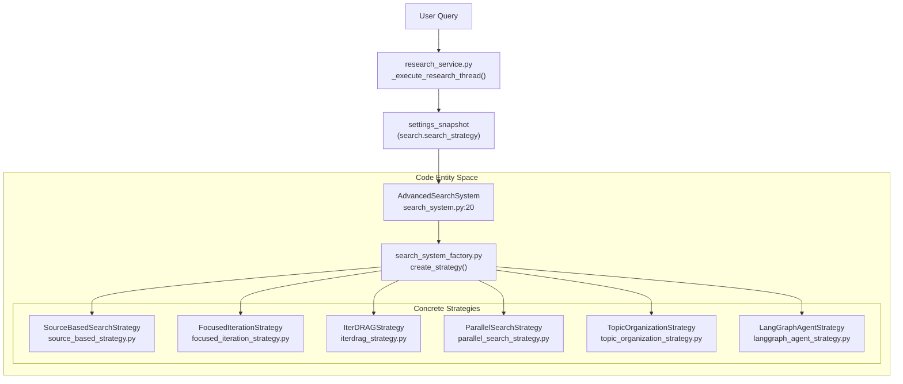
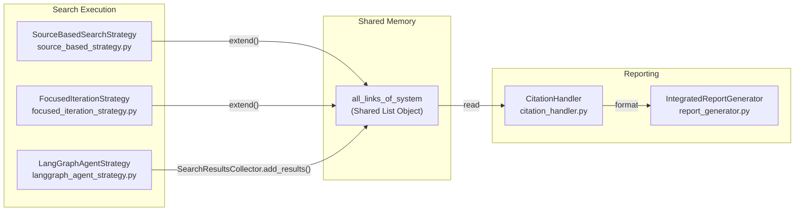

<!-- source: DeepWiki mcp.deepwiki.com · repo LearningCircuit/local-deep-research · page 6.2 Multi-Strategy Research · fetched 2026-10-29 -->

# Multi-Strategy Research

Relevant source files

The following files were used as context for generating this wiki page:

- [.pre-commit-hooks/check-sensitive-logging.py](.pre-commit-hooks/check-sensitive-logging.py)
- [.pre-commit-hooks/fix-exception-logging.py](.pre-commit-hooks/fix-exception-logging.py)
- [docs/BENCHMARKING.md](docs/BENCHMARKING.md)
- [docs/decisions/0003-reject-raise-without-from-hook.md](docs/decisions/0003-reject-raise-without-from-hook.md)
- [src/local_deep_research/advanced_search_system/filters/cross_engine_filter.py](src/local_deep_research/advanced_search_system/filters/cross_engine_filter.py)
- [src/local_deep_research/advanced_search_system/findings/repository.py](src/local_deep_research/advanced_search_system/findings/repository.py)
- [src/local_deep_research/advanced_search_system/questions/browsecomp_question.py](src/local_deep_research/advanced_search_system/questions/browsecomp_question.py)
- [src/local_deep_research/advanced_search_system/questions/flexible_browsecomp_question.py](src/local_deep_research/advanced_search_system/questions/flexible_browsecomp_question.py)
- [src/local_deep_research/advanced_search_system/strategies/base_strategy.py](src/local_deep_research/advanced_search_system/strategies/base_strategy.py)
- [src/local_deep_research/advanced_search_system/strategies/browsecomp_entity_strategy.py](src/local_deep_research/advanced_search_system/strategies/browsecomp_entity_strategy.py)
- [src/local_deep_research/advanced_search_system/strategies/direct_search_strategy.py](src/local_deep_research/advanced_search_system/strategies/direct_search_strategy.py)
- [src/local_deep_research/advanced_search_system/strategies/focused_iteration_strategy.py](src/local_deep_research/advanced_search_system/strategies/focused_iteration_strategy.py)
- [src/local_deep_research/advanced_search_system/strategies/iterdrag_strategy.py](src/local_deep_research/advanced_search_system/strategies/iterdrag_strategy.py)
- [src/local_deep_research/advanced_search_system/strategies/langgraph_agent_strategy.py](src/local_deep_research/advanced_search_system/strategies/langgraph_agent_strategy.py)
- [src/local_deep_research/advanced_search_system/strategies/llm_driven_modular_strategy.py](src/local_deep_research/advanced_search_system/strategies/llm_driven_modular_strategy.py)
- [src/local_deep_research/advanced_search_system/strategies/modular_strategy.py](src/local_deep_research/advanced_search_system/strategies/modular_strategy.py)
- [src/local_deep_research/advanced_search_system/strategies/news_strategy.py](src/local_deep_research/advanced_search_system/strategies/news_strategy.py)
- [src/local_deep_research/advanced_search_system/strategies/parallel_search_strategy.py](src/local_deep_research/advanced_search_system/strategies/parallel_search_strategy.py)
- [src/local_deep_research/advanced_search_system/strategies/rapid_search_strategy.py](src/local_deep_research/advanced_search_system/strategies/rapid_search_strategy.py)
- [src/local_deep_research/advanced_search_system/strategies/source_based_strategy.py](src/local_deep_research/advanced_search_system/strategies/source_based_strategy.py)
- [src/local_deep_research/advanced_search_system/strategies/standard_strategy.py](src/local_deep_research/advanced_search_system/strategies/standard_strategy.py)
- [src/local_deep_research/advanced_search_system/strategies/topic_organization_strategy.py](src/local_deep_research/advanced_search_system/strategies/topic_organization_strategy.py)
- [src/local_deep_research/advanced_search_system/tools/fetch/__init__.py](src/local_deep_research/advanced_search_system/tools/fetch/__init__.py)
- [src/local_deep_research/advanced_search_system/tools/fetch/prompts.py](src/local_deep_research/advanced_search_system/tools/fetch/prompts.py)
- [src/local_deep_research/api/research_functions.py](src/local_deep_research/api/research_functions.py)
- [src/local_deep_research/benchmarks/models/__init__.py](src/local_deep_research/benchmarks/models/__init__.py)
- [src/local_deep_research/citation_handler.py](src/local_deep_research/citation_handler.py)
- [src/local_deep_research/database/migrations/versions/0009_default_fetch_mode_summary.py](src/local_deep_research/database/migrations/versions/0009_default_fetch_mode_summary.py)
- [src/local_deep_research/defaults/default_settings.json](src/local_deep_research/defaults/default_settings.json)
- [src/local_deep_research/report_generator.py](src/local_deep_research/report_generator.py)
- [src/local_deep_research/search_system.py](src/local_deep_research/search_system.py)
- [src/local_deep_research/search_system_factory.py](src/local_deep_research/search_system_factory.py)
- [tests/advanced_search_system/tools/test_fetch_modes.py](tests/advanced_search_system/tools/test_fetch_modes.py)
- [tests/database/test_migration_0009_default_fetch_mode.py](tests/database/test_migration_0009_default_fetch_mode.py)
- [tests/settings/golden_master_settings.json](tests/settings/golden_master_settings.json)
- [tests/settings/test_settings_defaults_integrity.py](tests/settings/test_settings_defaults_integrity.py)
- [tests/strategies/test_langgraph_agent_strategy.py](tests/strategies/test_langgraph_agent_strategy.py)

## Overview

Local Deep Research implements over 30 research strategies, each optimized for specific scenarios such as factual Q&A, comprehensive literature review, or rapid entity lookup. The strategy pattern, managed by the `AdvancedSearchSystem`, allows the system to adapt its iteration patterns, question generation, and result filtering based on query complexity [src/local_deep_research/search_system.py:20-83]().

**Key Components:**
- **Strategy Factory**: `create_strategy` in `search_system_factory.py` provides a centralized registry and creation logic for all strategies [src/local_deep_research/search_system_factory.py:32-177]().
- **Base Strategy**: `BaseSearchStrategy` defines the common interface and shared state (e.g., `all_links_of_system`) [src/local_deep_research/advanced_search_system/strategies/base_strategy.py:12-48]().
- **Orchestration**: `AdvancedSearchSystem` coordinates LLM and Search Engine instances with the selected strategy [src/local_deep_research/search_system.py:20-83]().

### Strategy Selection Architecture

The following diagram illustrates how the system transitions from a natural language query to a specific code-level strategy implementation.

**Strategy Dispatch Flow**

Sources: [src/local_deep_research/search_system.py:25-148](), [src/local_deep_research/search_system_factory.py:32-177](), [src/local_deep_research/api/research_functions.py:34-80]()

---

## Core Research Strategies

### 1. Source-Based Strategy (Default)
**Implementation**: `SourceBasedSearchStrategy` [src/local_deep_research/advanced_search_system/strategies/source_based_strategy.py:22]()

The primary comprehensive strategy. It uses an iterative loop where each step generates follow-up questions based on accumulated search results as context [src/local_deep_research/advanced_search_system/strategies/source_based_strategy.py:28-31]().

**Key Characteristics**:
- **Parallel Search**: Questions within an iteration are searched concurrently using `ThreadPoolExecutor` [src/local_deep_research/advanced_search_system/strategies/source_based_strategy.py:32]().
- **Cross-Engine Filter**: Uses `CrossEngineFilter` to rank and reduce results (e.g., filtering 60 down to 10) based on LLM relevance [src/local_deep_research/advanced_search_system/strategies/source_based_strategy.py:35-39]().
- **Citation Invariant**: Maintains `self.all_links_of_system` as the single source of truth for report citations [src/local_deep_research/advanced_search_system/strategies/source_based_strategy.py:46-56]().

Sources: [src/local_deep_research/advanced_search_system/strategies/source_based_strategy.py:22-140]()

### 2. Focused Iteration Strategy
**Implementation**: `FocusedIterationStrategy` [src/local_deep_research/advanced_search_system/strategies/focused_iteration_strategy.py:40]()

Optimized for high-performance factual retrieval (e.g., SimpleQA benchmarks), achieving ~96.51% accuracy [src/local_deep_research/advanced_search_system/strategies/focused_iteration_strategy.py:2-7]().

**Key Characteristics**:
- **Entity Exploration**: Uses `BrowseCompQuestionGenerator` and `ProgressiveExplorer` to systematically track and search for specific entities [src/local_deep_research/advanced_search_system/strategies/focused_iteration_strategy.py:104-111]().
- **Configuration**: Default of 8 iterations with 5 questions each [src/local_deep_research/advanced_search_system/strategies/focused_iteration_strategy.py:59-60]().
- **No Early Filtering**: Trusts the LLM for final synthesis rather than pre-filtering sources, which preserves accuracy for complex "puzzle" queries [src/local_deep_research/advanced_search_system/strategies/focused_iteration_strategy.py:48-49]().

Sources: [src/local_deep_research/advanced_search_system/strategies/focused_iteration_strategy.py:1-136]()

### 3. IterDRAG (Iterative Decomposition)
**Implementation**: `IterDRAGStrategy` [src/local_deep_research/advanced_search_system/strategies/iterdrag_strategy.py:22]()

Decomposes complex queries into simpler sub-queries using `DecompositionQuestionGenerator` [src/local_deep_research/advanced_search_system/strategies/iterdrag_strategy.py:63]().

**Data Flow**:
1. Initial search for the main query [src/local_deep_research/advanced_search_system/strategies/iterdrag_strategy.py:137-143]().
2. Sub-query generation based on initial results and main query [src/local_deep_research/advanced_search_system/strategies/iterdrag_strategy.py:167-175]().
3. Sequential analysis of each sub-query to build `current_knowledge` [src/local_deep_research/advanced_search_system/strategies/iterdrag_strategy.py:190-205]().

Sources: [src/local_deep_research/advanced_search_system/strategies/iterdrag_strategy.py:22-210]()

### 4. LangGraph Agent Strategy
**Implementation**: `LangGraphAgentStrategy` [src/local_deep_research/advanced_search_system/strategies/langgraph_agent_strategy.py:28]()

Uses a tool-calling agent to autonomously decide search paths, supporting parallel subagents for complex decompositions [src/local_deep_research/advanced_search_system/strategies/langgraph_agent_strategy.py:4-7]().

**Key Characteristics**:
- **Tool-Calling**: Employs `web_search` and `fetch` tools [src/local_deep_research/advanced_search_system/strategies/langgraph_agent_strategy.py:158-187]().
- **Concurrency**: Utilizes `ThreadPoolExecutor` for subagent workers with a 30-minute timeout per subagent [src/local_deep_research/advanced_search_system/strategies/langgraph_agent_strategy.py:38-40]().
- **Thread-Safety**: Uses `SearchResultsCollector` with `threading.Lock` to ensure unique citation indices across concurrent threads [src/local_deep_research/advanced_search_system/strategies/langgraph_agent_strategy.py:50-100]().

Sources: [src/local_deep_research/advanced_search_system/strategies/langgraph_agent_strategy.py:1-128]()

### 5. Topic Organization Strategy
**Implementation**: `TopicOrganizationStrategy` [src/local_deep_research/advanced_search_system/strategies/topic_organization_strategy.py:16]()

Organizes search results into topic clusters with lead sources. It can wrap either `SourceBasedSearchStrategy` or `FocusedIterationStrategy` for the initial gathering of sources [src/local_deep_research/advanced_search_system/strategies/topic_organization_strategy.py:114-146]().

**Key Characteristics**:
- **Source Gathering**: Typically disables relevance filtering during source gathering to improve accuracy for downstream clustering [src/local_deep_research/advanced_search_system/strategies/topic_organization_strategy.py:102-108]().
- **Clustering**: Uses LLM to identify topics from sources and builds a `TopicGraph` [src/local_deep_research/advanced_search_system/strategies/topic_organization_strategy.py:149-159]().
- **Refinement**: Supports optional iterative refinement of the topic structure [src/local_deep_research/advanced_search_system/strategies/topic_organization_strategy.py:75-78]().

Sources: [src/local_deep_research/advanced_search_system/strategies/topic_organization_strategy.py:16-150]()

---

## Strategy Comparison Matrix

| Strategy | Code Class | Iterations | Question Generator | Use Case |
| :--- | :--- | :--- | :--- | :--- |
| **source-based** | `SourceBasedSearchStrategy` | 5 | `StandardQuestionGenerator` | Default comprehensive research |
| **focused-iteration** | `FocusedIterationStrategy` | 8 | `BrowseCompQuestionGenerator` | High-accuracy Q&A (SimpleQA) |
| **parallel** | `ParallelSearchStrategy` | 3 | `StandardQuestionGenerator` | Maximum speed via concurrency |
| **iterdrag** | `IterDRAGStrategy` | 3 | `DecompositionQuestionGenerator` | Complex query decomposition |
| **topic-org** | `TopicOrganizationStrategy` | Var | Inherited | Structured topic clustering |
| **langgraph** | `LangGraphAgentStrategy` | 50 | Autonomous Agent | Complex, autonomous reasoning |
| **rapid** | `RapidSearchStrategy` | 1 | `StandardQuestionGenerator` | Single-pass quick search |
| **direct** | `DirectSearchStrategy` | 1 | None | Verbatim query execution |

Sources: [src/local_deep_research/search_system_factory.py:62-177](), [src/local_deep_research/advanced_search_system/strategies/focused_iteration_strategy.py:59-60](), [src/local_deep_research/advanced_search_system/strategies/source_based_strategy.py:28-31](), [src/local_deep_research/advanced_search_system/strategies/langgraph_agent_strategy.py:34-40](), [src/local_deep_research/search_system.py:47-67]()

---

## Technical Implementation Details

### Shared State: all_links_of_system
The `all_links_of_system` list is the critical bridge between the "Natural Language Space" (research findings) and the "Code Entity Space" (report generation).

**Citation Management Diagram**

- **Persistence**: Strategies must `extend()` this list, never replace it, to ensure citation continuity across iterations and report sections [src/local_deep_research/advanced_search_system/strategies/source_based_strategy.py:46-50]().
- **Integration**: `IntegratedReportGenerator` initializes `AdvancedSearchSystem`, which in turn passes this shared list to the selected strategy [src/local_deep_research/report_generator.py:53-64](), [src/local_deep_research/search_system.py:140-148]().

Sources: [src/local_deep_research/advanced_search_system/strategies/source_based_strategy.py:41-57](), [src/local_deep_research/report_generator.py:33-80](), [src/local_deep_research/search_system.py:140-148](), [src/local_deep_research/advanced_search_system/strategies/langgraph_agent_strategy.py:81-99]()

### Strategy Logic Selection
The `search_system_factory.py` uses selection logic based on the `strategy_name` passed from user settings or API [src/local_deep_research/search_system_factory.py:32-59](). It maps string identifiers (e.g., "source-based", "focused-iteration") to their corresponding class constructors, injecting configuration from a `settings_snapshot` [src/local_deep_research/search_system_factory.py:88-145]().

### LLM and Search Engine Provisioning
Strategies do not instantiate their own LLMs or Search Engines. Instead, `AdvancedSearchSystem` initializes these components based on `settings_snapshot` and provides them to the strategy factory [src/local_deep_research/api/research_functions.py:103-148](). This ensures that thread-safe configuration and rate limits are respected across different research methodologies.

Sources: [src/local_deep_research/api/research_functions.py:34-163](), [src/local_deep_research/search_system_factory.py:32-177]()

---

